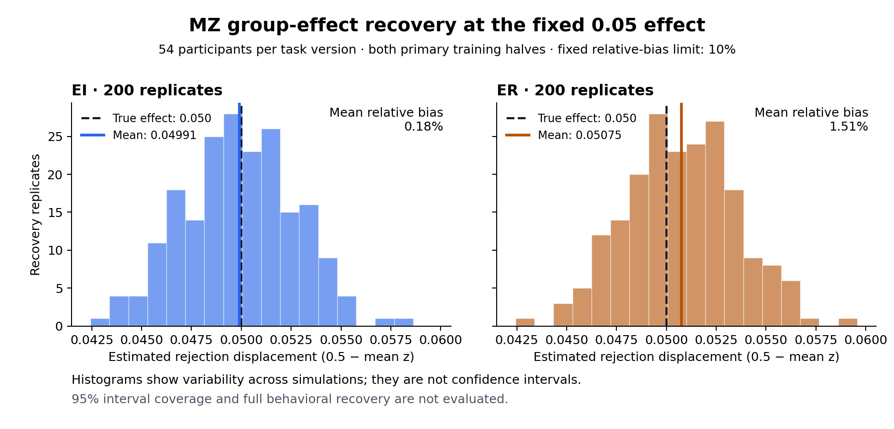

# Outputs

[Public data, code and release-version links](../DATASETS.md#public-online-resources--checked-october-6-2026)
are recorded directly in DATASETS, with their local-use limits.

The [living paper plan](paper_plan.md#completed-observed-evidence--october-6-2026)
now incorporates the completed real-behavior evidence and its limits; the
original mechanism/neural architecture remains conditional.

**Request disposition, October 6, 2026 Pacific:** earlier unanswered requests
to expand simulation/recovery/repair work are superseded by the scientist's
October 5 cancellation and real-data priority. They are historical requests,
not a pending approval queue. The selected observed-data branch and saved-score
follow-up below are complete; other unselected benchmarks/neural work remain
deferred. No new study or mechanism claim is adopted by this document revision.

**New real-data interpretation complete, October6:** all15 saved-score model
contrasts retain108 people and both original directions. MV improves over M0
for89/108 people; Z/C additions to MV give smaller mean gains, and MV versus MC
changes sign between EI andER. See the [complete comparison](runs/exploratory_observed_model_contrasts/20261006-job46735127/observed_model_contrasts.md)
and [figure](figures/observed_model_contrasts.png). Three focused checks and
ASTRA passed in shared parent46735127; no new fits/resampling/neural access.
These are post-hoc predictive descriptions, not mechanism identification.
Parent cost is accounted once in EP14.

**Completed, 2026-10-05 19:18 UTC:** all twelve fixed observed-data fit directions
converged and scored all 108 participants. The [complete predictive summary](runs/exploratory_observed_behavior/20261005-closeout-46651952/observed_behavior_summary.json)
covers M0, MV, MZ, MC, MVZ and MVC with both held-out halves per person.
Five paired mean differences from M0 range from 0.039537 to 0.121581 nat/trial.
These are exploratory within-session predictions; no psychological mechanism,
superiority gate, fresh confirmation or neural result is established.

[Actual behavior](runs/exploratory_observed_behavior/20261005-job46650095/descriptions/observed_behavior_descriptive.json)
covers 108 participants and 27,648 trials: 15,201 accepts, 12,253 rejects and
194 misses. Median responded accept/reject RT is 1.459/1.547 seconds.
The [PNG figure](figures/observed_behavior.png) and [SVG](figures/observed_behavior.svg)
show response categories and empirical RT quantiles by task version.

All parents are terminal. The observed branch used **0.6758333333 allocated
core-hours**, including failed setup, ten passing focused checks, ASTRA,
summary, plot and the two shared EP04 diagnostics. See the
[results, disclosed support contacts and accounting](experiment_log.md#2026-10-05-1918-utc--complete-observed-data-menu-and-report-allocations-closed).
The logistic benchmark remains unimplemented and mechanism claims remain deferred.

All88 remaining synthetic parents were cancelled under the scientist's
real-data priority. Completed and partial outputs are preserved; no further
simulation repair, bootstrap, urgency or recovery wave is selected. See the
[cancellation closeout](experiment_log.md#2026-10-05-1834-utc--simulations-stopped-and-terminal-allocations-accounted).

**Historical method validation follows.** These simulated-cohort results are
not discoveries about participants and do not authorize resumed computation.
The separate MVC repair pilot46642546 completed and was charged once; see
[its terminal evidence](experiment_log.md#2026-10-05-1822-utc--mvc-repair-pilot-complete-and-reviewed-first-mcmv-packs-complete).
The completed resolved fixed-menu counts are linked in the cancellation
closeout; full recovery remains unqualified.

The [200-cohort twice-effect group-bias summary](runs/behavioral_mechanism_kill_test/20261005-MZ-twice-group-bias-46634879-attempt001.json)
completed in 30.791 seconds, with all 200 sources valid and no unknowns.
EI/ER relative bias is 0.996% / 1.384%, both below the registered 10% limit.
Six focused tests and independent result review passed. This completes the
point-bias component; interval coverage and the full gate remain unevaluated.
Their parent allocation **46634879 is closed**, with 2.0455555556 allocated
core-hours charged once, including checks and EP15's shared jackknife work.
See the [execution evidence](experiment_log.md#2026-10-05-1647-utc--twice-menu-pilot-running-group-bias-result-reviewed).

**Completed, 2026-10-05 16:30 UTC:** all 16 offer-sequence omission refits
completed and passed independent review, with four converged fits and positive
EI/ER mean gains each. The [per-omission table](mz0_offer_sequence_refit_summary.md)
links every report. All three array tasks are closed; their 9.0344444444
allocated core-hours are charged once, including shared steps. The earlier
EI01 pilot remains separately accounted. These overlapping sensitivities on
one synthetic cohort do not establish template generality or a recovery gate.
See the [completion and accounting](experiment_log.md#2026-10-05-1630-utc--all-offer-sequence-refits-complete-array-accounted-once).

The [bootstrap0 parallel engineering comparison](runs/behavioral_mechanism_kill_test/20261005-MZ-bootstrap-parallel-46628484-attempt001/mz_bootstrap_parallel_comparison.json)
completed in294.322seconds on four CPUs. Both fresh original500 fits exactly
match the preserved serial results apart from elapsed time; independent
review, seven focused tests and ASTRA passed. The earlier serial process
took708.348seconds on different hardware. These observations do not establish
controlled speedup or core-hour savings. The attended step is closed;
its cost is included in task 2's completed parent charge. No new statistical draw,
confidence interval, bootstrap count or coverage result was selected.

**New result, 2026-10-05 14:53 UTC:** the adopted design-only qualification
supplies eight exact offer-sequence groups per task version. The
[saved-score influence analysis](runs/behavioral_mechanism_kill_test/20261005-MZ-offer-sequence-influence-46624388-attempt001/offer_sequence_influence.json)
completed all16 single and120 pair omissions on original MZ0 after three
focused checks and ASTRA passed. Single-omission mean gains range0.012043–0.013328
and pair-omission gains0.011349–0.013836 nat/trial; both task-version means stay
positive throughout. Predictions and measured onsets are unchanged. This
corrects the recent template-identity blocker without asserting identical
onset schedules, refitted generalization or cluster intervals. See the
[completion](experiment_log.md#2026-10-05-1453-utc--saved-offer-sequence-influence-complete).
The urgency numerical-method proposal still awaits its separate decision.

**Current, 2026-10-05 14:23 UTC:** the completed-result analyses validate
**199 MZ menus**, all with MZ alone maximal eligible (held index1 unknown),
and **all200 null menus**, all with M0 alone maximal eligible. Neither pool
has incomparable eligible models. These nested-model diagnostics do not
establish formal family-selection rates, interval coverage or the full gate.
See the [MZ199 summary](runs/behavioral_mechanism_kill_test/20261005-terminal-summaries-46607960/mz199.json),
[null200 summary](runs/behavioral_mechanism_kill_test/20261005-terminal-summaries-46607960/null200.json),
and [completion evidence](experiment_log.md#2026-10-05-1104-utc--199-mz-and200-null-menus-validated-urgency-pilot-started).
All selected old MZ/null numerical repairs are terminal and accounted once.

The [twice-effect summary](runs/behavioral_mechanism_kill_test/20261005-terminal-summaries-46607960/twice200.json)
validates all200 necessary successes, zero valid core failures and zero unknowns,
meeting this cell's necessary180-count condition.
The [half-effect summary](runs/behavioral_mechanism_kill_test/20261005-terminal-summaries-46607960/half200.json)
validates all200 continuous diagnostics and zero unknowns; the90% criterion and
21-failure curtailment do not apply below SESOI. Both arrays are terminal and
their actual allocation costs are charged once in the execution log.

Both alternate run partitions and all four leave-one-run-out fits completed.
The pooled LOO mean gain is0.0134485815 nat/trial across108 participants,
with positive EI/ER signs. The [run-sensitivity figure](figures/mz0_run_sensitivity.png)
shows saved comparisons and participant SEs; overlapping folds are sensitivities,
not independent recovery cohorts. The nonlinear pair46606082 ended with
technical500-sweep exhaustion: M0's first fit and MZ's reverse fit failed to
converge, while MZ's first153-sweep fit is preserved. Fresh M0 repair46611338
also ended with technical nonconvergence at1500 first-half sweeps; no M0
nonlinear scores were produced. Its1.7575 core-hours are charged once.
Source validation and exact primary replay passed; the original tolerance
remains fixed. Direction-specific repair46618614 completed the fresh reverse
M0 fit at348 sweeps in407.27s, with all108 scores and worker cleanup confirmed.
The first direction converged at1546 sweeps under its2000 ceiling in1868.92s.
Both four-worker fits, all twelve producer/pool checks and ASTRA passed;
source, failure contexts and exact replay validate. The parent is COMPLETED
and its4.2577777778 allocated core-hours are charged once, including both
urgency diagnostic steps. The five lower scale contacts remain visible.
See the [completion](experiment_log.md#2026-10-05-1412-utc--nonlinear-comparison-completed-and-parent-charged-once).
Reverse-only MZ repair46612046 completed: its fresh
reverse fit converged at736 sweeps in3615.13s, and the preserved153-sweep
first fit was rescored. Both fits retain seven lower-scale support contacts
and no subject-optimizer failures. Actual allocation cost1.0144444444
core-hours is charged once. The [completed nonlinear pool](runs/behavioral_mechanism_kill_test/20261005-MZ-nonlinear-M0-directions-repair-46618614/nonlinear_m0_directions_repaired_summary.json)
has no unknown components: mean MZ-minus-M0 gain0.01104355 nat/trial,
participant SE0.00110184, positive EI/ER signs and both nested criteria met.
Unequal powers make M0 a curvature-adjusted reference. This one-cohort result
does not establish full nonlinear robustness, arbitration or the recovery gate.
The [completed predictive-sensitivity figure](figures/mz0_robustness_diagnostics.png)
compares primary, common-gain and nonlinear saved means±2 participant SE,
with distinct trial supports and the exact nested numerical rule labeled.

The bounded [urgency numerical pilot](runs/behavioral_mechanism_kill_test/20261005-MZ-urgency-cost-precision-46607960/mz_urgency_cost_precision_pilot.json)
completed all48 scalar calls in1170.65s. The
[batched comparison](runs/behavioral_mechanism_kill_test/20261005-MZ-urgency-batched-benchmark-46607960/mz_urgency_batched_benchmark.json)
also completes48 calls with exactly matching trial scores after fourteen new
checks pass. Total likelihood speedups are10.41x coarse and6.26x refined.
Both validate/replay the full108-person source; the initialization panel uses
two prospectively selected synthetic participants and performs no optimization.
This does not qualify fitted-support precision or select a full urgency fit.
The eight parallel conditional optimization-cost probes in46612782 are now
terminal: probes2/6/7 returned all three starts in1998/2409/2929s; the other
five reached their3000s limits. Of17 returned starts, three report optimizer
success and fourteen line-search failure. The parent cost of6.6977777778
core-hours is charged once. The local endpoint diagnostic completed six calls:
scalar and batched scores agree exactly at all three points, but the recomputed
objective differs from the unsuccessful optimizer's reported value by-0.2040.
The endpoint remains locally descending in the tested coordinate. This does
not explain the historical line search or qualify fitted-support precision.
A trace of only original probe2/start2, using unchanged optimizer settings and
initialization, completed490 evaluations in716.85s after all six checks pass.
The original unsuccessful result reproduces exactly: returned x occurs at
evaluations270/285 with objective14.39009, while reported fun14.59409 matches
evaluation485, a different x. This explains the endpoint mismatch as distinct
recorded states, but not the cause of line-search failure. No full urgency
fit or changed optimizer is selected. The [saved-trace analysis](runs/behavioral_mechanism_kill_test/20261005-MZ-urgency-trace-analysis-46618614-attempt001/trace_analysis.json)
completed in0.168s within46618614, with no new likelihood calls. Repeated x
produces exactly identical scores. Between returned-x and reported-fun states,
one active trial changes bin13→12 and contributes+0.204109 to negative log
likelihood; other127 contribute-0.000103. Five recorded derivative stencils
also cross bin/time-grid boundaries. Simultaneous parameter/grid changes
preclude a bin-only causal claim. The subsequent [five-call crossed diagnostic](runs/behavioral_mechanism_kill_test/20261005-MZ-urgency-crossed-nondecision-46618614-attempt001/mz_urgency_crossed_nondecision_diagnostic.json)
completed in55.73s after four focused checks and ASTRA passed. Changing only
nondecision time by0.951 microseconds reproduces objective increases0.204105
and0.204103 under the two fixed backgrounds. Only the same trial changes bins;
drift grouping stays fixed within each contrast. Scalar/batched scores match
exactly at all new points. Horizon/actualdt still change, so this is a bounded
coordinate diagnosis, not a bin-only causal or optimizer-repair verdict.
No further unchanged repeat or numerical-method change is selected. The
[two-point A/C refined check](runs/behavioral_mechanism_kill_test/20261005-MZ-urgency-refined-crossed-46621405-attempt001/mz_urgency_refined_crossed_diagnostic.json)
completed in12.11s after three focused tests and ASTRA passed. The objective
contrast changes from+0.204105 coarse to-0.000024538 refined; both fine points
retain bin25 for the formerly crossing trial. This shows strong resolution
dependence, not qualified accuracy of the finer mesh. Its attended allocation
has closed and0.0433333333 core-hours are charged once. No jobs remain in the
14:21 UTC queue observation. A separate numerical-method proposal remains
unactivated; another unchanged pointwise replay is not selected. The
[concrete method proposal](urgency_numerical_method_followup.md) awaits the
scientist's decision on an isolated twelve-call evaluation, with proposed
1CPU/2GiB/20m ceiling. It does not authorize production adoption. Censored probes
are not recovery failures. See the [terminal cost evidence](experiment_log.md#2026-10-05-1248-utc--urgency-cost-pilot-closes-with-three-complete-and-five-censored-probes).
The initial fixture-check failure46612451 is retained and
charged; no scientific probe ran in that failed attempt.
The batched solver is adopted only for that bounded cost measurement.
The attended allocation has been exited and its0.6202777778 core-hours charged.

The required common-gain10–20 sensitivity46613139 ended with numerical
iteration-limit failures in both first M0 fits, after fourteen checks and ASTRA
passed. No MZ fit or contrast was produced. The four-component successor46615238
completed both M0 directions at512/674 sweeps and direction0 MZ at494. Only
direction1 MZ exhausted500; all three completed components are preserved.
Parent cost1.59 core-hours, including the endpoint diagnostic, is charged once.
Fresh direction1 MZ repair46617879 converged at565 sweeps in486.40s, with
four-worker cleanup confirmed. The [completed common-gain summary](runs/behavioral_mechanism_kill_test/20261005-MZ-common-gain-MZ-reverse-repair-46617879/common_gain_mz_reverse_repaired_summary.json)
validates all four components: mean MZ-minus-M0 gain0.01276781 nat/trial,
participant SE0.00148314, EI0.00931100, ER0.01622462. The pooled mean passes
both nested criteria, with108 equal participants and actual96 EI/176 ER trials.
All prior support contacts remain explicit. This one-cohort synthetic
diagnostic does not establish full robustness or the recovery gate.
All twelve producer/pool checks and ASTRA passed. The5CPU parent completed
both branches, and its1.1902777778 core-hour allocation cost is charged once.
See the [completion evidence](experiment_log.md#2026-10-05-1338-utc--common-gain-nested-diagnostic-completes-nonlinear-parent-starts).

Interval-method/count selection and other registered recovery obligations
remain open. Observed behavior and BOLD remain closed. Earlier component
history follows; the summaries above supersede its partial counts.

MZ recovery and original MC/MV/MVZ arrays completed. Original MVC array46572753
has197 technical failures and two completed tasks (92,105). Its MZ42 numerical
repair **46577369 also failed**: the first fit converged at666 sweeps but the
reverse fit returned nonconverged at1000. This was not a timeout. A separately
reviewed reverse-only1500 completion **46587905 completed**: the fresh reverse
fit converged at1067 sweeps in3488.11s, preserving the first666-sweep fit.
Both prior attempts and the actual baseline were validated, with exact score
replay. The process took3489.98s; cumulative costs include both earlier
attempts. See the [completion and accounting](experiment_log.md#2026-10-05-0813-utc--last-two-indexed-null-mvc-components-selected).
The remaining193 MVC repairs are now selected as described above. The original menu
pool validates3 complete menus (0,92,105), all with MZ sole maximal, and
retains197 unknown in the fixed200 denominator.

The null representative46574266 and its MC/MV/MVZ components completed.
Original null MVC46576234 failed on reverse-half500-sweep exhaustion.
Reverse-half repair **46582236 completed**, converging at sweep1000 with exact
baseline replay and the first fit preserved. Its successful full nested-menu
summary and the new indexed MVC stage are linked above. Cohorts108/176 have their distinct selected MVC array46596399 as described above.
See the [success, accounting and next selection](experiment_log.md#2026-10-05-0731-utc--null-mvc-representative-converges-first-indexed-component-selected).
These component results do not establish the overall scientific gate.

The [full200 MZ summary](runs/behavioral_mechanism_kill_test/20261005-MZ-closeout-pilot-46547708/necessary_summary.json)
has200 necessary successes, and both versions pass the
[complete point-bias gate](runs/behavioral_mechanism_kill_test/20261005-MZ-closeout-pilot-46547708/group_summary.json):
EI0.18%, ER1.51% relative bias versus the fixed10% limit. The one paired
bootstrap refit completed in708.35s. The prospective interval-method/count
choice remains pending; interval coverage is not yet qualified.

The [completed representative six-model menu](runs/behavioral_mechanism_kill_test/20261005-MZ0-full-menu-46572753.json)
has MZ as its sole maximal eligible model. This is one-cohort nested-model
diagnostic evidence, not a family-recovery verdict. MCindex1's attended job
46549073 ended with unexplained SIGKILL and no completed fit; its single
retry is held pending diagnosis. All18 focused runner/menu checks and
independent review pass; the new MVC wrapper and changed ASTRA program pass
inside task1. Nonnested arbitration, interval/other-grid recovery and full
inference remain unresolved; observed behavior/BOLD remain closed.

Earlier execution observations follow.

**Historical, 2026-10-05 01:44 UTC:**217/219 selected array tasks are
COMPLETED/exit0; only MZ indices162/190 remain running. MVZ/MVC46545300/46545303
are also running. **46547708** is queued with `afterok:46539590` to summarize
all200 MZ reports and run only the fixed paired bootstrap0 cost pilot if both
complete group-bias flags pass. The nine pilot tests, independent code review,
wrapper syntax and ASTRA validation pass. The attended allocation46535708 has
completed and been released; no compute session remains open.

The latest pooled evidence is still186 valid MZ necessary successes; the
full200 result and interval coverage are not yet available. The dependent job's
[selection and output paths](experiment_log.md#2026-10-05-0143-utc--finite-dependent-closeout-and-conditional-refit-selected)
define the next step. The prepared plot script will use only a completed200
group summary; no partial-result figure was generated.

Earlier execution observations follow.

**Historical, 2026-10-05 01:37 UTC:** MZ has
[186 valid necessary successes](runs/behavioral_mechanism_kill_test/20261005-MZ-SESOI-summary05.json),
exceeding the required180. The remaining14 fixed draws continue because the
[group-bias assessment](runs/behavioral_mechanism_kill_test/20261005-MZ-group-summary02.json)
requires all200. Its current estimates are provisional; full recovery and
observed-data eligibility remain unresolved. MVZ/MVC46545300/46545303 are
running. The paired-refit pilot is prepared, independently reviewed and passes
nine tests plus ASTRA validation, but awaits the complete point-bias result
before any execution selection. See the [current result](experiment_log.md#2026-10-05-0137-utc--mz186-valid-necessary-successes).

Earlier execution observations follow.

**Historical, 2026-10-05 01:29 UTC:** the MV necessary cell cannot pass:
[21 valid failures](runs/behavioral_mechanism_kill_test/20261005-MV-SESOI-summary04.json)
leave at most179/200 successes. No further MV draws are selected. MZ's latest
pool has [140 valid successes](runs/behavioral_mechanism_kill_test/20261005-MZ-SESOI-summary04.json);
its [group estimates](runs/behavioral_mechanism_kill_test/20261005-MZ-group-summary01.json)
remain provisional until all200 draws finish. Neither result qualifies full recovery.

MC/MV fits on the preserved MZ0 cohort completed in30m33.8s. All22 new
tests and ASTRA validation pass. After two complex-rival submissions failed
during redundant profile initialization, the wrapper was repaired and its
compute startup check passed; fresh MVZ/MVC jobs are **46545300/46545303**.
See [diagnosis and retry](experiment_log.md#2026-10-05-0128-utc--complex-rival-wrapper-startup-failure-diagnosed)
and the [scientific result](experiment_log.md#2026-10-05-0125-utc--mv-necessary-cell-fails-mz140-and-group-estimates-remain-provisional).
The scientist's nonnested classification choice remains pending. A one-draw
participant-refit bootstrap pilot is being prepared; no bootstrap fit or large
interval sweep has been selected.

Earlier execution observations follow.

**Current, 2026-10-05 00:51 UTC:** nine focused rival checks and ASTRA
validation pass. The four missing MC/MV fits on the preserved MZ0 simulation
are running in existing attended allocation46535708, capped at50minutes.
Saved M0/MZ scores replayed successfully. The219 selected array tasks continue;
latest completed pooling remains11 valid MV failures and10 valid MZ successes.
See the [dispatch record](experiment_log.md#2026-10-05-0051-utc--checked-mz0-rival-fits-dispatched)
and [live attempt](runs/behavioral_mechanism_kill_test/20261005-MZ0-fixed-rivals-attempt001/).

Earlier execution observations follow.

**Current, 2026-10-05 00:47 UTC:** nineteen array tasks completed successfully;
49 are running and151 queued at the00:46 observation. Terminal pooling now
records [11 valid MV failures](runs/behavioral_mechanism_kill_test/20261005-MV-SESOI-summary03.json)
and [10 valid MZ successes](runs/behavioral_mechanism_kill_test/20261005-MZ-SESOI-summary03.json),
including the representatives. The frozen21-failure bound has not been reached.
MC/MV rival fits on preserved MZ0 are selected for implementation/checks; no
family-selection or full-recovery verdict is available. See the
[execution record](experiment_log.md#2026-10-05-0046-utc--terminal-pooling-and-same-cohort-rivals-selected).

Earlier execution observations follow.

**Current, 2026-10-05 00:38 UTC:** MZ0 completed successfully in20m24.3s,
passing the necessary screen at0.012812nat/trial. Root submitted remaining
fixed MZ indices21–199 as **array46539590**,179 tasks, so all200 MZ draws are
now scheduled. The earlier40 tasks remain;219 array tasks are selected in
total. This is no recovery-rate or full-gate verdict. MV0's valid failure stays
recorded. See the [expanded execution record](experiment_log.md#2026-10-05-0037-utc--complete-remaining-fixed-mz-namespace-selected).

Earlier execution observations follow.

**Current, 2026-10-05 00:33 UTC:** MV representative0 completed with all four
fits converged in20m59.7s. Its gain0.006791nat/trial misses the frozen0.01
margin: [one valid failure](runs/behavioral_mechanism_kill_test/20261005-MV-SESOI-summary01.json),
which does not settle the200-draw cell. Forty array draws and MZ0 continue.
Seven pooling tests and updated ASTRA validation pass; the attended allocation
now supports analysis of terminal results. See the [result entry](experiment_log.md#2026-10-05-0033-utc--mv-process-completed-aggregation-checks-pass).

Earlier execution observations follow.

**Current, 2026-10-05 00:32 UTC:** all **42 selected recovery tasks are running**,
with every array task's model/index/CPU startup header verified. No recovery
cell verdict is available yet. See the [current log](experiment_log.md#2026-10-05-0032-utc--all-selected-recovery-tasks-running).

Earlier execution observations follow.

**Current, 2026-10-05 00:25 UTC:** the scientist requested wider parallel
execution. Root submitted **40 additional fixed recovery draws**: MV
**46538647**, indices1–20, and MZ **46538652**, indices1–20. Each array permits
20 concurrent1CPU/2GiB tasks,95minutes each, no-requeue; the two index0 jobs
remain running. Maximum new reservation63.3333 allocated core-hours, preserving
all prior costs. The same tested runner, scientific cells and stopping rule
apply. See the [selection and submission record](experiment_log.md#2026-10-05-0023-utc--scientist-requests-wider-parallel-execution).

Earlier execution observations follow.

**Current, 2026-10-05 00:10 UTC:** the declared narrower MV/MZ alternatives
have begun their necessary recovery checks. MV representative0 is dispatched
in attended job **46535708**; MZ representative0 is submitted as **46536895**.
Eight runner tests and independent review pass. Each fit is limited to90minutes,
one CPU and2GiB; no scaling array or observed-data fit is selected. See the
[adopted specification](single_process_recovery_specification.md) and
[dispatch record](experiment_log.md#2026-10-05-0009-utc--checked-representatives-selected-for-execution).

All previously launched necessary MC recovery runs
finished with [25 unique valid failures](runs/behavioral_mechanism_kill_test/20261003-array-46427975-summary04.json).
The fixed cell can reach at most 175/200, below the frozen 90% criterion.
No further cell replicates will launch. The original full-family
two-process/BOLD route cannot qualify.
Their failure does not settle the narrower alternatives. See the
[stopping decision](experiment_log.md#2026-10-03-2121-utc--necessary-recovery-criterion-unreachable).
The chronology below describes earlier preparation and attempts.

As of 2026-10-03, EP01 has qualified the behavioral source: **108 participants,
432 runs, 27,648 trials, including 194 deadline misses**. The
[source report](runs/public_asset_qualification/20261003-attempt01/asset_report.json)
records the actual input support. Twelve deadline-likelihood, urgency, parser
and exact-simulation tests passed in the coordinator's Slurm allocation. The
design-only check recovered eight exact offer sequences per task version;
participant-specific measured onsets remain intact. The first complete-design
synthetic M0 profile hit its iteration ceiling before joint convergence. After
repairing that numerical limit, both halves converged in the
[second profile](runs/behavioral_mechanism_kill_test/20261003-recovery-profile02/recovery_profile.json)
(115 and 154 sweeps; 341 seconds total). The
[deadline-aware oracle calculation](runs/behavioral_mechanism_kill_test/20261003-oracle-information01/oracle_information.json)
completed: expected MC-versus-M0 information was 0.00430–0.00448 nats per
trial at the five-point criterion SESOI, below the unchanged 0.01 selection
margin. This is a feasibility warning, not a fitted recovery probability or
an episode verdict. The representative MC/M0 component has saved three
converged model/half fits in
[attempt002](runs/behavioral_mechanism_kill_test/20261003-MC-SESOI-replicate000-attempt002/criterion_recovery.json).
After a planned runtime stop, job **46427169** was submitted around 19:29 UTC
to continue the same replicate in fresh attempt003, reusing those fits and
running only the remaining MC half. It completed with all four fits converged:
the [valid first replicate](runs/behavioral_mechanism_kill_test/20261003-MC-SESOI-replicate000-attempt003/criterion_recovery.json)
has gain 0.00230257 nat/trial, below the fixed 0.01 margin. One valid failure
does not settle the 200-replicate recovery cell. Fixed indices 1–24 are prepared
and submitted as **46427975**. Its concurrency was increased from four to eight
single-CPU tasks at 20:26 UTC while preserving all fixed indices and limits; see the
[selected execution and stopping rule](experiment_log.md#2026-10-03--completed-representative-and-selected-fixed-replicate-array).
No observed behavioral fit or scientific gate has completed under policy v6. See the
[current execution entry](experiment_log.md#2026-10-03--selected-continuation-at-complete-fit-boundaries).

The original-event entrypoint is [code/qualify_assets.py](code/qualify_assets.py).
The [fixed-bound deadline likelihood](code/deadline_ddm.py) is a computational
component, not the complete hierarchical recovery/robustness experiment.
The [hierarchical fitter](code/hierarchical_behavior.py),
[recorded implementation choices](code/behavioral_implementation.json) and
[full-design recovery profile](code/profile_recovery.py) advance that required
behavioral stage. A profile completing cannot authorize downstream BOLD.
The [criterion recovery component](code/run_criterion_recovery.py) evaluates
the necessary MC-versus-M0 comparison; other families, rivals, parameter
coverage and registered sensitivities remain required for a complete gate.
The [recovery continuation entrypoint](code/resume_criterion_recovery.py) can
reuse complete converged model/half fits from one stopped attempt with an
identical numerical specification and saved simulation. Its seven focused tests
passed in 2.150 seconds; it never resumes partial optimizer coefficients. The
[bounded continuation script](code/resume_criterion_recovery.sbatch) is the
submitted attempt003 entrypoint. Official ASTRA schema and semantic validation
[passed](astra/v0.0.14/validation_20261003_recovery_resume_attempt002.json).
The former smoothing and derivative-sufficiency designs remain retired.

The manuscript logic, prior-work boundaries and retired directions are in
[`paper_plan.md`](paper_plan.md), and the
three-layer question is shown in the image-generated
[`ep01_conceptual_question-imagegen-v3.png`](ep01_conceptual_question-imagegen-v3.png), with
[exact prompts](ep01_conceptual_question-imagegen-v3-prompt.md). Earlier figures are historical.
The experiment
dependency structure is in
[`astra/v0.0.14/astra.yaml`](astra/v0.0.14/astra.yaml), with mutable run state
kept in [`experiment_log.md`](experiment_log.md).

Planned durable scientific artifacts are:

- behavioral model/parameter-recovery and held-out prediction reports;
- the fMRI design-identifiability report;
- runwise and complementary-half `S00/S10/S01/S11/R11` comparisons;
- harmonized, coefficient-direction-aligned, and deduplicated team-map metadata;
- synthetic-coordinate projection checks;
- team shape-coordinate and method-association reports; and
- an integrated falsification and claim-tier report.

The required local projections are `experiment_log.md`, `memory.md`,
`governance.md`, `society.md`, `loop.md`, `landscape.md`, and
`verification.md`. Large model fits, simulations, and intermediate images
belong in episode-specific scratch rather than this directory.

These files are local scientific records. They do not themselves establish an
empirical result or authorize a campaign claim.
