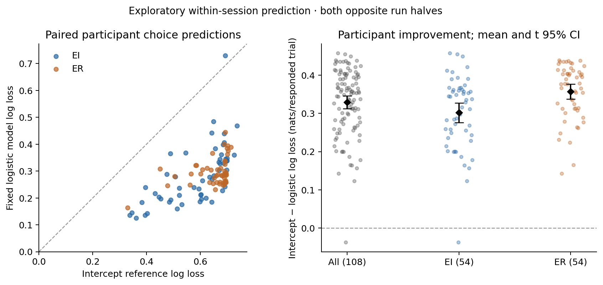

# Exploratory opposite-half choice prediction

The fixed ridge-logistic model and its regularized intercept reference were already fitted on opposite run halves. This report uses their saved scores for all **108 participants** (54 EI, 54 ER); it performs no new fit.

Loss is in **nats per responded trial**. Each participant combines both half-score sums using the actual total responded-trial denominator; group means weight participants equally. Lower loss is better.

| Stratum | Intercept mean | Logistic mean | Paired improvement, mean [t95 CI] | Participant SE of improvement | Participants improved |
|---|---:|---:|---|---:|---:|
| all | 0.617660 | 0.288500 | +0.329159 [+0.312378, +0.345941] | 0.008465 | 107/108 (99.1%) |
| EI | 0.583059 | 0.281497 | +0.301562 [+0.275807, +0.327318] | 0.012841 | 53/54 (98.1%) |
| ER | 0.652260 | 0.295504 | +0.356757 [+0.337132, +0.376381] | 0.009784 | 54/54 (100.0%) |

Scored **27,454 responded trials**; **194 misses** do not enter the binary likelihood. Intervals are descriptive and uncorrected for multiple comparisons. EI/ER differences are between-participant descriptions.

This choice-only score excludes reaction-time and deadline likelihoods and is not numerically comparable with the earlier joint behavioral scores. Predictive improvement does not identify a valuation or decision-bias mechanism and does not establish novelty or fresh confirmation.

[Full summary, including mean/SE/t95 intervals for both model losses](exploratory_choice_summary.json) · [All participant scores and half denominators](participant_choice_scores.csv)

Figure rendered subsequently from these saved values using the existing
Sherlock plotting module; [render record](figure_generation.json).

