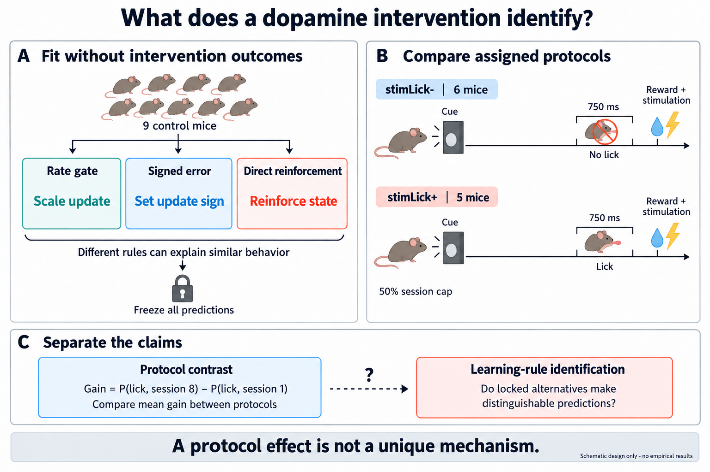

# EP02 — What does a closed-loop dopamine intervention identify?

EP02 separates a behavioral difference between assigned stimulation protocols
from identification of a unique learning rule. The source paper's rate-gate
interpretation is prior knowledge; repeating its direction is not a new
dopamine mechanism. The proposed contribution is a focused reanalysis of
locked alternative predictions and the limits of the released cohort.

*Schematic only, with no empirical results. Protocol effects do not
automatically identify a learning algorithm.*

Start with the [scientific question](GOAL.md) and
[paper plan](outputs/paper_plan.md). The complete operational specification is
[SEARCH_POLICY.json](SEARCH_POLICY.json). The conceptual figure was made with
the built-in imagegen tool; its [final prompt set](outputs/ep02_conceptual_question.prompt.md)
is retained alongside it.

The unchanged primary audit, which is not yet eligible to open, compares six
`stimLick-` with five `stimLick+` mice. Nine controls are development-only;
four high-amplitude mice form a post-primary boundary diagnostic that cannot
rescue the primary result. The raw primary endpoint is acquisition gain in
lick probability from session 1 to 8, not a measured latent learning rate.
`delta_rate_std` remains only the exact development-SD companion.

Read [`GOAL.md`](GOAL.md), [`DATASETS.md`](DATASETS.md), and
[`SEARCH_POLICY.json`](SEARCH_POLICY.json). The access contract is in
[`outputs/firewall/FIREWALL.md`](outputs/firewall/FIREWALL.md), and the
sanitized role map is [`COHORT_MAP.json`](COHORT_MAP.json).

The tracked source surface includes portable Phase-0 inventory, deterministic
role materialization, generic small-`n` stress calibration, and provisional
endpoint-shaped binomial/beta-binomial calibration. The older cryptographic
firewall verifier is retained as implementation history but is not a launch or
audit requirement. Slurm wrappers derive the episode path at runtime and write
job artifacts only beneath `$SCRATCH`.

The official Reporting Summary documents randomization within repeated
2–4-mouse cohorts and four removals after collection, but the released data do
not contain the block/exclusion roster. Consequently all 462 unblocked labels
are a sensitivity space, not the documented randomized design or an ITT
analysis. Endpoint field/time semantics and the physical firewall also remain
unresolved.

The [ASTRA worklist](outputs/astra/v0.0.14/astra.yaml) contains only already-
required stages, not new experiments or launch authority. No search or audit
has started. The present writing/design revision did not inspect protected
outcomes, bind margins, change the search grammar, or authorize execution.

A future positive terminal means rate-gate consistency under the frozen
contract, not rejection of every alternative mechanism. Formal rival-exclusion
testing or a new endpoint would need a separate pre-outcome scientific
decision. This episode is not yet an empirical paper.
