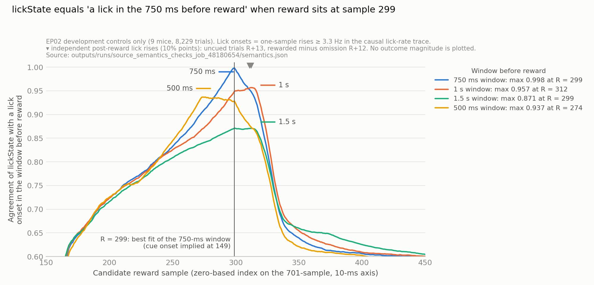

# EP02 source and implementation handoff

Prepared October 3, 2026 without empirical payload access. This is a partial
`source_semantics_design` report, not endpoint qualification or audit authority.

The release supports a planned complete-case protocol comparison, but its
field meanings and assignment record still do not identify the frozen primary
endpoint and randomization space. Re-running the structural extractor cannot
supply those meanings: its compressed MAT input contains every evidence role.

## October 16, 2026 — source-fact resolution plan, fixed before any data check

Fixed about 15:45 Pacific, before allocation 48180654 started at 17:03, under
the AGENTS.md standing authority of October 16
(missing source facts are recovered from paper, supplement, code or permitted
data, or adopted as stated assumptions; provider contact is optional). No
author or provider was contacted. Results and classifications are appended in
the next section without editing this plan.

**Documentary evidence re-read.** Sources: the article full text
([Europe PMC PMC9908546](https://www.ebi.ac.uk/europepmc/webservices/rest/PMC9908546/fullTextXML)),
Supplementary Table 1, the Reporting Summary and the 46-page Peer Review File
(Nature ESM 1–3), the [Figshare collection](https://api.figshare.com/v2/collections/6369111/articles),
the RNN_learnDA file list (HEAD equals the pinned commit) and TONIC's pinned
`TNC_ExtTrigWins.m`.

- Task: a 0.5-s, 10-kHz tone precedes reward by 1.5 s; 10% of rewards are
  uncued; after three sessions, 10% of trials are omission probes (cue, no
  reward); 100 trials per session, one session per day for 8–10 days; trial 1
  is the first reward; figures use the first 800 training trials.
- Lost blocks: "mouse 3, session 7; mouse 4, session 5; and mouse 9, session 4",
  filled offline by nearest-neighbour interpolation.
- Supplementary Table 1 numbers mice 1–20. Its control, stimLick+ and
  stimLick− columns reproduce `COHORT_MAP.json` exactly, so table numbers are
  the one-based struct indices. Controls 15 and 16 also had one extra
  cue-stimulation session after trace conditioning (Extended Data Fig. 4).
- Licks were timestamped from 100-Hz video; behaviour was digitized at 1 kHz
  and photometry downsampled to 100 Hz.
- Online contingency: stimLick+ stimulated at reward when licking was detected
  "in the 750 ms preceding reward delivery"; stimLick− when no licking was
  detected "during the delay interval"; stimLick+ was "limited to having a
  maximum of 50% of total trials stimulated in a given session". Control ran on
  unreleased Arduino Mega code. The offline lick+ class (Extended Data Fig. 8a)
  is at least one lick in the delay between cue and reward.
- The Figshare collection holds only article 21816054. RNN_learnDA's only
  analysis script is the prohibited `Figure_1_related.m`, which stays closed.
  `TNC_ExtTrigWins` returns rows indexed `-pre:post`, so 701 columns imply
  `pre + post = 700` samples with the event at a fixed integer column.
- Randomization was within repeated cohorts of two to four mice; four mice
  were removed after histology. No roster is published.

**Readings, tests and decision rules.** Data checks use development records
1, 2, 4, 6, 9, 11, 15, 16 and 19 only, and only `trialID`, `seshID`,
`lickState` and `lick` through `code/development_role_reader.py`. Sample
indices are zero-based; `R` is the reward sample.

| Item | Primary reading | Alternatives | Test and decision rule |
| --- | --- | --- | --- |
| `trialID`, denominators | Categorical trial type: cued-rewarded (majority), uncued (about 10% of every session), omission (absent in sessions 1–3, about 10% later) | Within-session trial index; extra codes (cue stimulation, aborted) | Per-session code counts. "Uncued" = 5–15% of trials in every session; "omission" = absent in sessions 1–3 and 5–15% later. Omission must show less post-reward licking (at least one lick in `[R, R+199]`) than both rewarded codes. Eligible denominator = cued-rewarded trials with finite `lickState` and lick window; at least 30 in sessions 1 and 8. |
| `seshID`, lost blocks | One-based training day 1..K (K = 8–10), rows chronological, about 100 rows per session | Non-contiguous IDs; lost blocks numbered within the control group | Contiguity and order; rows and missing rows per session. Global numbering predicts control deficits only at record 4 session 5 and record 9 session 4; control-group numbering predicts record 4 session 7, record 6 session 5 and record 19 session 4. Sessions carrying non-training codes are flagged. |
| 701-sample axis | 10-ms samples; reward at one integer index `R` for every trial type; cue onset at `R-150` | Type-specific alignment | E1: rising edge of pooled uncued-trial lick probability. E2: rise of rewarded-minus-omission lick probability, sessions 4 and later. Each is located at 10% and 50% of its maximum rise above baseline. Resolved if, for both, the 10% point lies in `[R+1, R+30]` and the 50% point in `[R+1, R+80]` for the `R` selected by the `lickState` scan. (Amended before the allocation started and before any data access: the single half-maximum bound of `R+60` was too sensitive to early-training latency spread.) |
| `lickState` | Binary: at least one lick in `[R-75, R-1]` (750 ms before reward) | `[R-100, R-1]` (1-s delay), `[R-150, R-1]` (cue to reward), inclusive end `[R-75, R]`, 500-ms control, non-binary or signed codes | Agreement with the video-lick predicate over finite trials, scanned over every `R` and window. Adopt the 750-ms window if its agreement is at least 0.98 and it wins at least 90% of trials where it disagrees with the 1-s or 1.5-s window (with at least 20 such trials). Otherwise record an assumption with the residual disagreement. |
| Online trigger, cap | Not testable on permitted data: controls are unstimulated, arm `stimState` is evaluator-only and realized counts are excluded | — | Assumption: the trigger is the same 750-ms predicate on cued-rewarded trials; stimLick− stimulates when it is false, stimLick+ when it is true until 50 stimulated trials (50% of 100) in that session; uncued and omission trials are never stimulated (the Methods make stimulation contingent on delay-period behaviour). Sensitivity: running-fraction cap, random 0.5 thinning, a 1-s window for stimLick−, and uncued rewards evaluated with the same predicate. Used only for model counterfactuals and frozen before any intervention outcome. |
| Randomization roster | Unrecoverable from public sources | — | Adopt the approved noncausal 462-label conditional exchangeability, with removals assumed independent of arm (histology-driven). Sensitivity: block-restricted enumeration over every partition of mice 1–20 into consecutive blocks of two to four, reported as an assumption-labelled range and frozen in the final lock. |

If `lick` is not an event or count stream (more than ten distinct finite
values), the predicate is re-specified from its documented format before the
agreement test runs, and that change is logged.

**Re-specifications after the structure stage, before any agreement test
(between the structure stage at 17:04:54 and the format stage at 17:09:11
Pacific, per `status.txt`).** The structure stage (job 48180654) showed that `lick` is a
continuous non-negative float trace (62,938–134,685 distinct values per mouse,
maximum 12.2–14.1), and that code 2 occurs 2–4 times pooled in each of
sessions 1–3. Hence: (1) "omission" means at most 1% of pooled trials in
sessions 1–3 and 5–15% in sessions 4–8; (2) the trace is treated as a
smoothed lick rate. A `format` stage characterizes its single-lick kernel
from normalized isolated local maxima. The primary lick predicate is "a local
maximum of at least `theta` inside the window", with `theta` set to half the
modal isolated-peak height. The secondary predicate is "any sample of at
least `theta` inside the window". Both are reported, and the decision rule
above is applied to the primary predicate.

**Second re-specification after the format stage, before any agreement test
(between the format stage at 17:09:11 and the semantics stage at 17:11:00
Pacific).** The kernel is causal, not symmetric. The isolated single-lick
shape rises over at most two samples (0.06, 0.83, 0.96, 1.00 at offsets −3 to
0), then decays roughly exponentially to half height about 10 samples later.
The modal single-lick height is 6.6, matching a rate estimate of 1/τ for
τ = 150 ms. Local maxima therefore lag lick onsets by about two samples, and
the threshold predicate extends each window backward by about ten samples. The
primary predicate becomes the rise onset, `lick[t] − lick[t−1] ≥ 3.3` (half the
modal single-lick height), inside the window. Peak and threshold predicates
are reported as alternatives.

**Emission boundary.** Outputs are limited to shapes, dtypes, value sets,
code, row and missing counts, eligible denominators, agreement fractions with
off-diagonal counts, and onset indices. No session lick probability, gain,
development centre or scale, and no lick time course, is computed for output.
This keeps the four raw thresholds presignable before development outcomes.

**Procedural roles (same account).** Steward: this session inside the logged
Slurm allocation, reading only the trusted MAT named in `DATASETS.md` and
writing only `$SCRATCH/br_autoresearch/episode02_dopamine_learning_rate_causality/source_semantics_20261016/development_full/`.
No audit or evaluator pack is created. Candidate: the same session, reading
only that pack through the reader and writing
`outputs/runs/source_semantics_checks_job_<id>/`. This development handoff is
released for these checks only; development scoring stays unauthorized.

## October 16, 2026 — results and classification (job 48180654)

Attended allocation 48180654 (`dev`, 17:03–17:20 Pacific) ran the fixture
tests, the steward step, and the structure, format and semantics stages. The
steward wrote only the nine-control pack (root `373338f6…`); no audit or
evaluator pack exists. The candidate read only `trialID`, `seshID`, `lickState`
and `lick` through the reader. No pre-reward session lick probability, gain,
centre or scale was computed for output or viewed; the pooled post-reward lick
fractions in the `trialID` row were the prespecified codebook test. No
intervention record was opened. Evidence:
[run directory](runs/source_semantics_checks_job_48180654/) (`structure.json`,
`format.json`, `semantics.json`) and the figure below.

| Item | Classification | Evidence and frozen reading |
| --- | --- | --- |
| `trialID` codes | **Resolved** | All nine controls use values 0, 1 and 2. Pooled over sessions 1–8: code 0 makes up 0.90 of sessions 1–3 and 0.79–0.80 of sessions 4–8; code 1 makes up 0.090–0.116 of every session; code 2 makes up 0.002–0.005 of sessions 1–3 and 0.089–0.109 of sessions 4–8. A lick onset in `[R, R+199]` occurs on 0.96, 0.96 and 0.70 of trials respectively. Reading: 0 = cued and rewarded, 1 = uncued reward, 2 = cued omission. No aborted-trial code exists. |
| Trial denominators | **Resolved** for development; arm support pending | Eligible trials = code 0 with finite `lickState`; finite `lickState` implies a finite `lick` row. Sessions 1 and 8, by record: 1: 36 and 76; 2: 100 and 77; 4: 90 and 80; 6: 91 and 76; 9: 91 and 78; 11: 89 and 78; 15: 89 and 80; 16: 87 and 89; 19: 85 and 81. All exceed 30. The eleven primary mice still need the steward's aggregate pass/fail gate. |
| `seshID`, lost blocks | **Resolved** | Integers 1..K, contiguous, with rows in chronological order (no reversals); K = 8–11. Lost blocks are all-NaN `lick` rows with NaN `lickState` and retained codes: record 4 session 5 (50 of 150 rows) and record 9 session 4 (39 of 96). Record 4 session 7, record 6 session 5 and record 19 session 4 have no missing rows, so the paper numbers mice by struct index; the third lost block (record 3, session 7) is evaluator-only. Sessions 1 and 8 contain no lost rows. Stated assumption: one session per training day (Methods). |
| `lickState` | **Resolved** | Coded 0/1 (1 = lick), NaN only on lost-block rows, and defined for all three codes. Agreement with a lick onset in `[R−75, R−1]` is 0.99806 at `R = 299`: 16 of 8,229 trials disagree, all with `lickState` 1. Extending the window to `[R−76, R−1]` leaves 1 disagreement in 8,229, which is within the ±1-sample onset timing of the smoothed trace. Where the 750-ms window disagrees with another window, `lickState` sides with 750 ms in 96.3% of 438 trials against 1 s, 98.5% of 1,077 against 1.5 s and 100% of 574 against 500 ms. At any `R`, the 1-s and 1.5-s windows reach at most 0.957 and 0.871. The prespecified rule is met. |
| 701-sample axis | **Resolved** to ±1 sample | Samples are 10 ms apart. Reward is at zero-based sample 299, the end of the onset-matched `lickState` window; a peak-based fit gives 301, and TONIC's round `[300 400]` window convention gives 300. Cue onset is at 149. All codes align at the same point (best `R` = 299, 299 and 298). Independent post-reward markers fall inside the prespecified bounds: the uncued lick rise reaches 10% at `R+13` and 50% at `R+18`; the rewarded-minus-omission rise reaches them at `R+12` and `R+15`. A descriptive cue-evoked lick rise appears at sample 160. `lick` is a causal lick-rate trace: each lick adds about 6.6 Hz (≈ 1/0.15 s), the rise takes at most two samples, and the trace decays to half height in about 10 samples. Frozen windows: `lickState` and the continuous replication use onset samples 223–298; NAc cue response uses samples `[149, 249)` and NAc reward response `[299, 499)`. Sensitivity: `R` = 298 and 300. |
| Online trigger, 50% cap | **Assumed**: not testable on permitted data | Assumption as fixed before the checks: the trigger is the verified 750-ms lick predicate on cued-rewarded trials. stimLick− stimulates when it is false; stimLick+ stimulates when it is true, until 50 stimulated trials in the session. Uncued and omission trials are never stimulated. Sensitivity: running-fraction cap, random 0.5 thinning, a 1-s window for stimLick−, and uncued rewards evaluated. These choices enter only model counterfactuals, frozen before any intervention outcome. |
| Randomization roster | **Unrecoverable**; assumption adopted | Absent from the article, supplement, Reporting Summary, Peer Review File, release and code. Adopted: the approved noncausal 462-label conditional exchangeability, with the four histology-driven removals assumed independent of arm. Sensitivity: enumerations restricted to consecutive blocks of 2–4 among mice 1–20, reported as an assumption-labelled range in the final lock. Claims remain complete-case and conditional. |

Further observations, recorded before any magnitude was seen:

- Records 15 (sessions 9–10) and 16 (sessions 7–8) have at most one omission
  probe per session, and record 15 session 10 has 171 trials. These are the two
  controls that Supplementary Table 1 lists for the extra cue-stimulation
  session. That session cannot be located without `stimState`, which is
  excluded. Assumption: sessions 1–8 are regular training sessions. Frozen
  development-only sensitivity: the development centre and scale are also
  reported without record 16.
- Record 1 has 11 sessions; its sessions 1–3 hold only 41, 50 and 59 trials.
- Transport assumption: intervention and boundary records share this exporter
  (codes, axis, `lickState`). The steward's aggregate structural gate can test
  codes and session support without opening outcomes.
- Continuous-lick replication metric: the mean of the released `lick` trace
  over samples 223–298. Sensitivity: lick onsets in the same samples divided by
  0.76 s.

**Next analysis step.** Freeze these definitions in `SEARCH_POLICY.json`
revision 6: codebook, eligibility, lost-block rule, axis and windows, `R`
sensitivity, continuous-replication metric, and the trigger/cap and roster
assumptions. Then run the steward's aggregate-only prelock structural gate on
the eleven primary mice: sessions 1 and 8 present, at least 30 eligible code-0
trials in each, and the same code pattern, with pass/fail output only.
Development scoring (session 1 and 8 gains, centre and scale) stays closed
until the four raw margins are presigned. Presigning is a scientist decision
for the daily question batch, and no outcome information is available to
inform it.

*Both steps were completed on October 16: revision 6 adds
`source_definitions_20261016` to `SEARCH_POLICY.json`, and the primary-mouse
gate passed in job 48187322 (6 of 6 and 5 of 5 mice; see the
[log](experiment_log.md#2026-10-16-1835-pacific--source_semantics_design--primary-structural-gate-passes-job-48187322)).*

## Documentary facts and missing decisions

*Historical October 3 table. The October 16 classification above supersedes
its "resolution needed" column; provider contact is now an optional fallback.*

| Item | Current evidence | Concrete resolution needed |
| --- | --- | --- |
| Trial eligibility | Policy requires cued reward trials and at least 30 eligible trials in each endpoint epoch. | Provider mapping of every `trialID` code, including uncued, omission and aborted trials; identify the primary eligible code and denominator rules. |
| Epochs | Policy selects training sessions1 and8. | Provider definition of `seshID`, including pretraining/restarts and lost blocks. Do not equate sorted unique values with training days. |
| Binary endpoint | Policy specifies the online 750-ms pre-reward licking condition. | Confirm whether `lickState` is that exact binary state, its sign/coding, boundary convention, and handling of missing lick acquisition. |
| Continuous replication | Streams have701 samples; existing documentation records100-Hz acquisition. | Provider vector of sample times or start/step/end, event alignment, and resampling history. Length and sample rate do not identify time zero. |
| Assignment/exclusion | Existing source review records randomized cohorts of2–4 mice and four postcollection exclusions. | Released-record-to-block roster, within-block allocations, excluded animals' arms and timing. Without it, use the explicitly approved noncausal462-label exchangeability sensitivity only. |
| Plus-arm session cap | The assigned protocol has a50% stimulation cap. | Clarify exact online cap logic and ordering; a generic “first eligible trials until cap” implementation is only a simulator scenario until that logic is verified. |

The authoritative source requests above can be sent by the scientist or data
steward. No message has been sent on their behalf. The mixed MAT and empirical
Figure-1 script have not been read or reacquired during this preparation.

## Public-source check — October 6, 2026 Pacific

**October 7, 09:52 UTC follow-up:** the browser still could not open the API,
but three bounded HTTPS requests successfully read official public JSON
metadata, without fetching scientific files. The [current article record](https://api.figshare.com/v2/articles/21816054)
is version1 and lists exactly one file: `seshMerge.mat`, file38710665,
271,014,539 bytes. The [published version list](https://api.figshare.com/v2/articles/21816054/versions)
contains only version1. The [version1 description](https://api.figshare.com/v2/articles/21816054/versions/1)
describes an analyzed session structure covering behavioral/sensor and
photometry recordings; it provides no field codebook, sample-time vector,
online-cap implementation or exporter reference, and has no custom fields.
Thus no separate documentation attachment or later published version is listed
in this inspected record. This resolves the earlier metadata-retrieval gap,
not the underlying field/time/trigger definitions, and does not establish that
documentation is absent elsewhere. The next useful source action is the
specific provider request below; repeating structural extraction cannot supply
an authenticated definition. No author was contacted, no scientific payload
was fetched, and no access/model/endpoint rule changed.

The following paragraph records the earlier failed browser-only check.

The bounded public search verified that the official
[RNN_learnDA repository](https://github.com/dudmanj/RNN_learnDA) describes the
author's simulation model and that [DudLab/TONIC](https://github.com/DudLab/TONIC)
documents a general MATLAB function library, including time-alignment helpers.
These are useful implementation references. Their inspected documentation did
not supply the release-specific `seshMerge` exporter/codebook, the 701-sample
time origin, or the online stimulation-cap implementation. Indexed searches
for those field names also found no authenticated release-specific definition;
this bounded negative search is not proof that no such source exists.

The browser tool could not retrieve either the
[Figshare v1 DOI record](https://doi.org/10.25378/janelia.21816054.v1) or its
[public article API record](https://api.figshare.com/v2/articles/21816054).
Consequently, current attachments or later corrections were **not verified**;
the retrieval failure is not evidence that a codebook is absent. The pinned
local release and code references remain unchanged.

Next useful source action: inspect the official Figshare attachment/version
metadata when reachable for an explicitly release-linked exporter, timestamp
definition or task/acquisition code. If that supplies no authentic definition,
the existing precise provider request below remains the route to resolve
`trialID`, `seshID`, `lickState`, the 750-ms window/cap logic, sample times and
assignment/exclusion mapping. No empirical Figure-1 script, MAT payload,
held-out outcome or source value was opened; no author was contacted. This
check resolves no endpoint blocker and selects no fit, new model variant,
margin, access change or additional simulation.

## Adopted model choice — October 6, 2026

The scientist's “i agree with your judgement” accepts the presented
article/task-primary recommendation. Use authenticated article/task dynamics
(25 ms; double the current dopamine factor on the verified lick-contingent
trial) as the primary empirical variant. Retain the pinned code's 30-ms,
set-multiplier-to-four variant, including its documented proxy trigger logic,
as a separately labeled report-only sensitivity with no rescue, selection or
promotion role. Never blend the variants. All primary mechanism families must
share the same authenticated task trigger and schedule.

This answers the variant choice, not the provider codebook, online 750-ms/cap
implementation or 701-sample time-axis questions. The optional low-parameter
rival operators remain unadopted; the four grid-derived margins remain null.
The next implementation work is to instantiate this selected primary after
source authentication, complete the empirical fitter and preserve role
separation. No sensitivity job, outcome opening, calibration validation or
resource extension is implied. The earlier recommendation below is retained
as decision history and is superseded only on the model-variant choice.

## Two simulator variants, neither selected by observed outcomes

### Adopted article multiplier — explicit trigger interface, October 6

`code/actr_port.py::article_stimulation_multiplier` now implements the adopted
article rule separately from the synthetic contingency helper. It requires
the current source-anchor dopamine factor and an explicit Boolean trigger:
double the factor when triggered and retain it otherwise. There is no arm,
lick-code, error-sign, trial-order or stimulation-count fallback. The caller
must supply the authenticated common task/cap decision and use the existing
`article_25ms_times2` dynamics; this arithmetic API cannot certify provenance.

The older `stimulation` helper remains a synthetic first-eligible-cap scenario
for article fixtures and the pinned error-proxy sensitivity for author-code
fixtures. It is explicitly not the primary empirical trigger implementation.
The three new focused checks exercise multiplier distinction, required Boolean
input and finite source-domain handling. All eleven component checks, including
these three, passed in job 46839671; see the
[October 7 execution evidence](experiment_log.md#2026-10-07--implementation_qualification--adopted-article-component-checks-pass).
No new simulated cohort, recovery sweep, task assumption or outcome access is
selected. The empirical fitter still needs the shared state/readout recipe,
training-only hierarchical observation model and authenticated source semantics;
the optional rival equations and four margins remain unadopted.

The pinned MIT [training source](https://github.com/dudmanj/RNN_learnDA/blob/3627746957975632cddb05bf8f6b26a4b6f901b6/dlRNN_train_learnDA.m)
uses a30-ms time constant. Its calibrated stimulation sets the dopamine
multiplier to4 under performance-error sign proxies; the minus proxy includes
a0.6 random gate, and other trials subtract0.75. This is distinct from the
article variant retained in the existing policy:25 ms and multiplying the
current dopamine factor by2 on eligible lick-contingent trials. Preserve both
as explicit variants; do not silently combine their rules.

Earlier recommendation, now adopted as recorded above: the article/task-defined
variant should be the primary empirical protocol model once online trigger
semantics are verified. Keep the pinned-code version as the synthetic author
parity/sensitivity oracle. The frozen grammar and all rival families must use
the same authenticated production trigger, schedule and seed bank. Adoption
does not claim that the two variants agree or authenticate missing task facts.

The [pinned recurrent engine](https://github.com/dudmanj/RNN_learnDA/blob/3627746957975632cddb05bf8f6b26a4b6f901b6/dlRNN_engine.m)
and [behavioral plant](https://github.com/dudmanj/RNN_learnDA/blob/3627746957975632cddb05bf8f6b26a4b6f901b6/dlRNN_Pcheck_transfer.m)
are MIT oracle sources. The missing Gaussian helper's
[pinned TONIC formula](https://github.com/DudLab/TONIC/blob/f78fdbf4bca0e5c16859f885550b4e274fc3459d/CreateFunctions/TNC_CreateGaussian.m)
uses exponent `-(t-mu)^2/(4*sigma^2)` and unit trapezoidal area over sample
indices. Thus its effective standard deviation is `sqrt(2)*sigma` away from
truncation. Reimplement this mathematical formula independently; no unlicensed
TONIC source is copied. Seeded initialization is a documented replacement for
the unavailable author initialization asset, not an exact replay of that asset.
The preserved recurrent engine receives its activation/learning callbacks from
that unavailable workspace. Component qualification explicitly instantiates
tanh and a cubic eligibility nonlinearity; authenticating those callbacks to
the original workspace is still part of full author-port qualification.

## Remaining model definitions after the pinned-critic port

### October 7 — generic grouped binomial optimizer prepared

The array-only [quadratic-MAP optimizer](code/grouped_binomial_map.py) supplies
an actual numerical fit for an explicitly supplied design, rather than only
scoring externally supplied predictions. It minimizes
`sum_s[k_s softplus(-eta_s) + (n_s-k_s) softplus(eta_s)] + (b-m)' P (b-m)/2`,
with `eta = offset + X b`, caller-fixed `X`, offsets, prior center `m` and
strictly positive-definite precision `P`. Session denominators are retained;
the parameter-independent binomial combination term is omitted only from the
optimization objective. The existing scorer includes it in log probabilities
and performs the policy's per-trial and per-mouse aggregation. Damped Newton
iterations use stable logits and caller-supplied convergence/line-search
settings; exhaustion is a failed fit, not a successful estimate.

This component does **not** adopt an observation-model structure. The exact
operative scope is `SEARCH_POLICY.json:365–370`: sessionwise binomial primary,
training-only hierarchical/partial-pooling mouse effects, and no held-mouse
outcome fit. Those fields do not specify an intercept/random-intercept model,
penalty strength or predictive integration method. `GOAL.md:103–111` fixes the
nine development records and the mouse as inferential unit. The optimizer
therefore requires all eight training IDs for one supplied development holdout
and rejects held-mouse rows; it never invents an intercept or mouse-effect
column. These identity checks cannot authenticate array provenance or enforce
the outstanding physical access boundary.

The separate prediction helper applies fitted coefficients to caller-fixed
new-mouse design/offset rows and accepts no target outcomes. Its output is
explicitly **conditional plug-in logits**, not an integrated
population-predictive distribution. An approved recipe still needs to define
the observation design, penalty/prior selection using training mice only,
new-mouse feature semantics and integration over required uncertainty before
these estimates could feed production scoring. The common state/readout,
trial-to-session probability mapping and authenticated codebook/time/trigger
facts also remain unresolved. No field meaning, scientific setting, model
family, access role, margin or budget is changed by this numerical component.

Six [analytic tests](tests/test_grouped_binomial_map.py) were prepared to check
known stationary solutions, unequal-denominator/session-splitting equivalence,
coupled designs and fixed offsets, invalid folds/counts/penalties, row-order
and fixed prediction behavior, and explicit convergence failure. All six
[checks](runs/shared_integration_46845646/tests_initial.txt) subsequently passed
in **1.893 s** in job **46845646**, and ASTRA validation exited zero. This supports
the numerical component under its supplied-input contract, not adoption of an
observation recipe or population-predictive layer. The checks used no empirical
reads or simulation/recovery sweep; see the
[completed check record](experiment_log.md#2026-10-07--implementation_qualification--grouped-binomial-optimizer-checks-pass).

October5 source inspection distinguishes the array-only
[critic port](code/pinned_critic_core.py) from a complete TD rival.
The pinned `ModelComparisonScript.m` at lines341–342 assumes external
`ValuModelSims`/`sim_summary`; its later TD figures plot existing RPE/value
summaries. Conditions21/22 at lines673–696 still call the same ACTR trainer,
and the “critic only” summaries at lines868–920 reuse that RNN's behavioral
outputs. In `dlRNN_train_learnDA.m`, lines313–323 modify error terms while
neural weights continue updating at lines330–341. Those branches cannot
silently substitute for the policy's direct-reinforcement family without
neural learning. These are permitted mechanism-source observations, not
empirical Figure-1 or outcome access.

The shared state/action representation, on-/off-policy target distinction,
value-to-behavior readout and non-neural direct-reinforcement update were not
recovered from the author code or selected by that port. The concrete optional
implementation below now makes those choices reviewable; no additional source
retrieval is needed to establish this implementation gap.

### October6 outcome-blind rival interfaces — implemented, unadopted

[`code/rival_model_core.py`](code/rival_model_core.py) supplies array-only
operators within all seven existing mechanism families. This is a concrete
**unadopted low-parameter mathematical proposal**, not a selected production
recipe or qualification of complete rivals. The author RNN/reactive-path,
pinned critic and development scorer remain unchanged. There is no source
reader, empirical adapter, task simulator, fit/search entrypoint or new family.

The proposed common representation has two explicitly named actions and one
caller-supplied, past-only K-feature state vector `x`. Each rival stores a
`2 × K` coefficient table. Feature names, feature values and endpoint-positive
action `e` are required; an intercept is never added implicitly. The shared
readout is `score[a] = W[a]·x`,
`logit(p_endpoint) = temperature × (score[e] - score[1-e])`, with explicit
positive inverse temperature. This table contains `2K` stored coefficients,
not necessarily `2K` identifiable parameters: common action offsets cancel
from a softmax policy but can affect TD values. Matching dimensions alone
does not certify equal effective complexity. The final frozen configuration
must count all fitted basis/readout/nuisance parameters and state its
identifiability convention. No parameter is fitted here.

| Existing family | Concrete optional operator |
| --- | --- |
| Constant direct policy | `W += alpha × (error-baseline) × credit`; stimulation has no effect. |
| Adaptive-rate ACTR, low-parameter representation | Same signed update multiplied by nonnegative `beta_DA`, and by the supplied stimulation multiplier only when the common resolved trigger is true. The evolution of `beta_DA` is still a required production definition. |
| Signed-PE ACTR, low-parameter representation | Add a nonnegative stimulation bias to the signed centered performance error; the multiplier is1. |
| Amplitude-threshold hybrid | Adaptive-rate update plus the signed bias only on triggered events whose supplied amplitude is at least the supplied threshold. No amplitude unit or threshold value is invented; calibrated amplitudes must remain below the chosen boundary to implement the registered physiological rule. |
| On-policy TD/RPE | Canonical SARSA(0): `target = reward + gamma Q(next_state, actual_next_action)`; `delta = target-Q(state,action)`. |
| Off-policy TD/RPE | Canonical Q-learning(0): same features, actions and target except `max_a Q(next_state,a)`. |
| Direct contingent reinforcement | Non-neural associative preferences: `h[detected_action] += alpha × (natural_reinforcement + trigger × stimulation_reinforcement) × preceding_state`. Both reinforcers are nonnegative; no critic or recurrent neural weights are updated. The reinforced action is the actual supplied preceding action, never automatically the endpoint-positive action. |

For the performance rules, the optional credit helper computes
`grad log pi(supplied_action|state)`. An externally supplied credit can instead
be passed explicitly; neither choice determines the source performance-error
sign. The baseline update uses only the unperturbed supplied performance error,
not an intervention bias. The caller must prospectively bind the error/credit
orientation. The author anchor continues using its existing eligibility and
clipped recurrent/reactive update, not this optional low-parameter rule.

Both TD targets use pre-update coefficients. A terminal transition explicitly
sets bootstrap to zero and requires absent next state/action; no boundary is
inferred from row order. SARSA requires the actual nonterminal next action,
whereas max-Q accepts no supplied next action. Their optional stimulation
effect adds a supplied nonnegative bias to the signed RPE after computing the
unperturbed target. This additive rule, zero-trace choice and terminal convention
are prospective choices; they are **not** the pinned critic's
`r + gamma(V_next-V_current)` arithmetic or its tenfold-reward source condition.

Consequential choices still needing selection before empirical development are
the two-action encoding and exact shared past-only feature recipe; error and
reward scales/orientation; baseline and adaptive-rate dynamics; temperature
and parameter-identifiability convention; TD transition/terminal and
stimulation-bias mapping; natural/direct reinforcement assignment; hybrid
amplitude units/boundary; and the mapping from trial readouts to the registered
session-binomial probability. The finite admissible configurations, common
schedule/seeds and hierarchical training-only fit must then be instantiated
under the existing tiers. In particular, averaging trial logits is not supplied
as a silent session likelihood. These model choices do not resolve the separate
provider codebook/trigger gaps, four null margin fields, physical reader
separation or current calibration requirements.

[`tests/test_rival_model_core.py`](tests/test_rival_model_core.py) contains
11 hand-computable checks of action relabeling/readout, credit, unsigned gating
versus signed bias, the nested null, hybrid boundary, SARSA/max-Q targets,
terminal handling, direct-action reinforcement and nonfinite-update refusal.
They use no empirical records, parameter fitting or recovery sweep. The
[compute transcript](runs/rival_model_checks001/tests.txt) passes all11 checks;
the existing experiment log records allocation46721202 and validation evidence.
Arithmetic success does not select this proposed production recipe.

## Four proposed values for review, all inactive

**Revised October 6, 2026 (Pacific): not recommended for adoption on the
present rationale.** These values were taken from a provisional software
calibration grid. Grid membership and the largest available floor are not
scientific justifications. Preserve the tuple below as an unadopted proposal;
all four fields in `SEARCH_POLICY.json` remain null.

| Canonical field | Proposed raw value | Rationale and limitation |
| --- | ---: | --- |
| `practical_margin_raw` |0.15| Require a15-percentage-point between-protocol difference in acquisition gain; this matches the existing engine's minimum practical-margin eligibility criterion. Its substantive value still needs scientist review. |
| `arm_margin_raw` |0.05| Require each protocol's mean gain to differ from the development reference by at least5 points in the predicted direction. Both guards together imply a10-point separation; the15-point primary margin remains stronger. These are reference guards, not randomized arm-versus-control effects. |
| `development_scale_floor_raw` |0.06| Use the largest existing grid floor to avoid division by a near-zero nine-control SD. At this floor the proposed15-point raw margin maps to2.5 development SDs. This is a numerical/reference-scale safeguard; it does not by itself establish precise SD estimation with nine mice. |
| `loo_delta_floor_raw` |0.00| Require every leave-one-mouse-out contrast to remain strictly positive. This preserves sign stability without inventing a second positive effect-size margin. |

The exact standardized values must be computed only by division by the frozen
development SD. Safety/power requirements, valid denominators, overdispersion,
selection and independent validation remain those of the current contract.
No claim is made that this proposed tuple will pass calibration or have useful
power. If it fails, report that failure and seek a scientific decision; do not
select margins using intervention outcomes.

Before requesting adoption, explain why a 15-point difference in acquisition
gain matters for this task, why the two five-point arm guards are meaningful,
and what reliability of the nine-control scale is sufficient. Separate those
scientific judgments from attainable precision using authenticated trial
denominators, missingness and control-only measurement variability. Noise can
show that the question is unresolved; it cannot justify lowering the effect
margin until a result passes. No new calibration sweep is selected.

The external review's approximately 0.37 illustration is conditional, not a
measured requirement: assuming independent arm SDs of 0.20 gives
`SE = 0.20 sqrt(1/6 + 1/5) ≈ 0.121`; an illustrative one-sided t9 multiplier
of about 1.83 would require a difference near `0.15 + 1.83 SE ≈ 0.37` to put
that lower bound above 0.15. EP02's actual uncertainty procedure is not this
illustration, the SD is not observed here, and it does not justify a threshold.

## October 6 recommendation — provider semantics first; variant choice unadopted

Historical recommendation: the later scientist agreement above adopts its
model choice. The source request and unresolved source/engineering conditions
below remain current; the original unadopted wording records the earlier stage.

The immediate missing input is release-specific documentation, not another
structural extraction or numerical component test. In particular, unresolved
701-sample timing independently leads to
`technical_input_underidentified_without_search` under the current policy:
the raw continuous-lick replication is a required terminal gate. The existing
462-label unblocked sensitivity already has a noncausal interpretation in the
contract; this is not a newly proposed claim downgrade and does not supply
the missing endpoint or access definitions.

*October 16: the October 16 classification above covers the facts this request
sought. The request is now an optional fallback, not a gate.*

**Draft request for the scientist to send; not sent:** For Janelia Figshare
21816054 v1 / `seshMerge.mat`, please provide the release-specific codebook or
exporter for every `trialID`, `seshID` and `lickState` value; the exact
701-sample timestamp vector, event zero and resampling history; the online
750-ms lick trigger, missing-acquisition handling and `stimLick+` 50% cap
logic; and the released-index-to-randomization-block roster, within-block
allocations, and excluded animals' arms and exclusion timing. Methods or
source-code excerpts are sufficient where they identify these exact fields;
no additional neural outcome is requested.

**Recommended model amendment, UNADOPTED:** after those semantics are bound,
use the article/task-defined variant as the primary empirical implementation
and retain the pinned author-code variant as a separately labeled,
report-only sensitivity with no rescue, selection or promotion role. Preserve
their different time constants and stimulation rules; never mix them into
one model. This requires an explicit production choice and does not activate
a new sensitivity job. The four thresholds, role isolation, fit pipeline and
bounded resource decision remain separate prerequisites. Provider contact,
payload reads, policy changes and execution are not authorized by this draft.

## Data-role preparation and next executable work

The sanitized `COHORT_MAP.json` already supplies the fixed9/6/5/4 mapping.
A distinct steward can later run the existing materializer in its own bounded
allocation and provide only development and aggregate structural surfaces to
candidate workers. Steward/mixed and evaluator paths must be unreadable and
non-reacquirable by the candidate runtime. A subagent, same-user chmod, or
candidate-controlled container does not establish that separation. Record the
actual responsible roles and direct denial tests in a short note; do not revive
the retired signature/receipt machinery.

Removed the unsupported `--account=russpold` directive from the four existing
Slurm wrappers, retaining their original limits. Calibration still accepts
historical receipt arguments; those are not active authority requirements.
The wrappers do not supply missing endpoint or access authorization. Do not
run materialization merely to produce another packet.

No additional simulator qualification is selected by this revision.
End-to-end author-port qualification, independent equation checking, verified empirical endpoints,
calibration, LOSO models/search and the atomic evaluator are still separate
required work. No empirical trial, final lock or audit is produced by a
synthetic component run.
