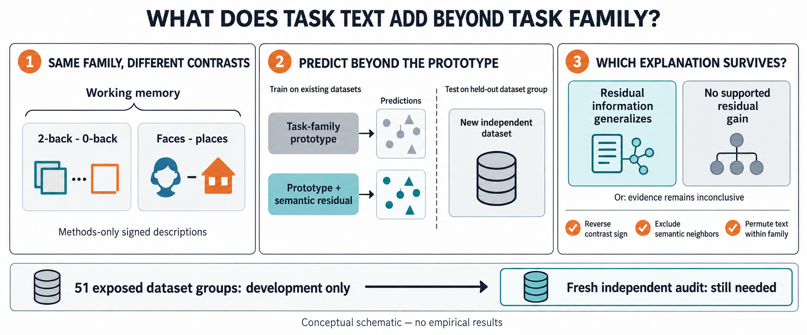

# EP03 — What does a task description add beyond its task family?

EP03 tests whether methods-only **signed condition comparisons** add
normalized group-Z-map geometry beyond a training-fold task-family prototype
in an independent dataset. It is a residual-information study, not a first
text-to-brain model or a causal-mechanism claim.

*Schematic only. Both outcome boxes are possibilities, and check icons name
planned falsifiers, not passed tests. "Faces minus places" illustrates a
category comparison within a memory task. No empirical brain maps or scores
are shown.*

- [Scientific question and operative contract](GOAL.md)
- [Paper argument and closest prior work](outputs/paper_plan.md)
- [Data roles, independence, and missing sources](DATASETS.md)
- [Unchanged search grammar and mandatory falsifiers](SEARCH_POLICY.yaml)
- [Runtime history and next action](outputs/experiment_log.md)
- [Image-generation prompt and inspection](outputs/ep03_conceptual_question.prompt.md)

Writing/design milestone: **2026-09-30**. No current-contract experiment has
run. The reported 51 NeuroEffect groups are exposed development data; the
handoff is not provisioned here, and no fresh prospective audit is available.
These are source/confirmation limitations, not evidence against the question.

The rewrite preserves the target, group-weighted score, operators, budgets,
mandatory falsifiers, and one-shot audit. A prototype-dominated outcome can be
scientifically useful only if precision and map reliability make the result
informative; an imprecise null remains inconclusive. Design completion is not
empirical completion, paper readiness, or canonical acceptance.
