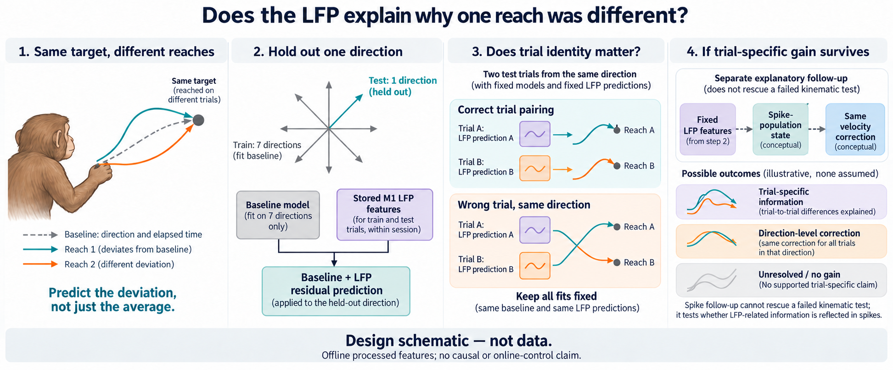

# Outputs

[Public Dryad, author-code and method links](../DATASETS.md#public-online-resources--checked-october-6-2026)
are now recorded directly in DATASETS with their relevance to EP05.

The [living paper plan](paper_plan.md#completed-evidence--october-6-2026)
and [DATASETS](../DATASETS.md) now incorporate source support, the original
search closeout and the completed calibration/component evidence.

**Request disposition, October 6, 2026 Pacific:** old pending pilot/extension
requests in the dated history are superseded by the completed original stop,
the subsequently selected calibration/decomposition work, and the scientist's
October 5 real-data priority. They are not current launch requests. Preserve
all attempts and the failed practical-margin result; no additional successor
is selected by this documentation revision.

**Complete comparative figure, October6:** the
[all-session/all-bin comparison](figures/fixed_prediction_components_attempt001/interpretation.md)
shows that calibrated HW's slightly higher total gain accompanies a smaller
trial-varying contribution than the blend in both animal averages. All16
sessions/all15 bins are retained in the [PNG](figures/fixed_prediction_components_attempt001/fixed_prediction_components.png)
and PDF/tables. No new fits or selection; original practical margins still fail.
Independent review, exact saved-score reconstruction, plotting and ASTRA passed
inside parent46735127, charged once in EP14.

October5,05:34UTC: the [HW calibration result](runs/fixed_hw_correction_calibration/attempt001/interpretation.md)
is complete. Every other-fifteen-session fold selects amplitude0.75. Primary
deltaR2 rises to0.002732680, slightly above the original half-blend0.002678854,
while identity falls to0.004210788. Both practical margins still fail; the
small gain over the blend is session-sensitive in Chewie. Simple scalar
shrinkage can reproduce the aggregate primary improvement, with a different
trial-identity tradeoff: its larger mean correction accompanies a smaller net
trial-varying benefit than the blend in both animals. This is one separate exposed-development comparison;
the original45-comparison stop is unchanged. Five tests and exact score replay
passed; no neural-source read, decoder refit or future test occurred. Shared
job46578298 closed normally; its1.5744444444 allocated core-hours are counted
once for both episodes in EP14. See the [log](experiment_log.md).

Earlier execution observations follow.

October5,05:30UTC: one separate [HW correction-calibration comparison](paper_plan.md#fixed-hw-correction-calibration)
is adopted and implemented under the scientist's continued-work request.
It selects only a scalar from0/0.25/0.5/0.75/1 using the other fifteen sessions,
with frozen HWlambda1 and the original half-blend reference. The
[runner](tools/calibrate_fixed_hw_correction.py), five focused fixtures,
living policy and minimal ASTRA entry are ready for coordinator review and
compute checks. No calibration outcome exists yet; no source-neural read,
decoder refit or future-session access is part of this comparison. The
original45-comparison stop and practical margins remain unchanged. See the
[execution record](experiment_log.md#2026-10-05-0530-utc--fixed_hw_correction_calibration-bounded-successor-adopted-and-implemented).

Earlier execution observations follow.

October5,04:50UTC: the [fixed-prediction decomposition](runs/descriptive_secondary/fixed_prediction_decomposition_attempt001/interpretation.md)
explains the small gain without another fit. About95% of the existing blend's
deltaR2 comes from its net trial-varying component. Relative to history-only
HW, reduced prediction energy outweighs weaker trial covariance, with an
additional smaller mean-correction gain. Exact original scores and algebraic
identities pass on all sixteen sessions; all bins remain available in the
[data](runs/descriptive_secondary/fixed_prediction_decomposition_attempt001/bins.csv).
The45-comparison stop and failed0.01/0.005 margins are unchanged. No new source,
fit, selection or held data were used; no biological mechanism is established.
Process elapsed11.013831s in shared job46574496; coordinator allocation
accounting remains separate. See the [execution log](experiment_log.md).

Earlier execution observations follow.

October4,22:27UTC: final shared allocation46521343 completed normally; EP05's
actual bookkeeping share is0.186389core-hours. The final inclusive documented
resource bound is19.249core-hours, with no active EP05 compute. The
[scientific report](primary_development_report.md) and22:17 ordinary patience
stop remain final:45 comparisons, no eligible candidate, development-only.

Earlier execution observations follow.

October4,22:17UTC: **primary development search complete**, stopped under the
ordinary patience rule at45 valid comparisons/patience12. No candidate meets
the registered practical requirements. The W/HW incumbent's small positive
primary0.002679 falls below0.01; identity0.004559 falls below0.005.
Read the [final scientific report](primary_development_report.md) and
[stopping/coverage review](primary_post_basis_stopping_review.md).
This is exposed development evidence; no future-session confirmation or
spike-population follow-up was activated. Current shared allocation accounting
remains pending, bounded conservatively in the report; the scientific stop
does not depend on another experiment. The penalty amendment remains unadopted.

Earlier execution observations follow.

October4,22:16UTC: **45 valid comparisons, patience12/12; no primary-eligible
candidate.** The [complete basis diagnostic](runs/adaptive_search/primary_history_pls_basis_summary_attempt001/compact_evidence_attempt001.json)
passed all16-session replays and is distinct. Paired PLS beats shuffled
projections with true heads, but restoring true heads on those projections
does not consistently beat the matched full-target controls. Neither result
changes the original practical failures or the W/HW incumbent. See the
[absolute figure](figures/primary_history_pls_basis/primary_history_pls_basis_comparison.png),
[conditional contrasts](figures/primary_history_pls_basis/primary_history_pls_basis_conditional_contrasts.png)
and [log](experiment_log.md). Final stopping/resource review precedes formal
development closeout; current46521343 remains available for bounded EP17
preparation. The separate blend-penalty amendment remains unadopted.

Earlier execution observations follow.

October4,22:10UTC: the fixed basis-only pilot completed22.868seconds with
all original HW/PLS replays and no new projection fit. The fifteen fresh
sessions plus full-panel summary are running sequentially in46521343,
preserving that pilot. Selected bounds1500s internal/1560s external fit the
current allocation; no new job is needed. New effects remain closed until
all16 complete; counts44/patience11. See the [log](experiment_log.md).

October4,22:07UTC: allocation46521343 is RUNNING on sh03-01n68, Requeue0,
1CPU/6GiB, ends22:39:59UTC; root verified placement in PTY36735. All ten
basis-only fixtures passed0.623seconds and changed ASTRA validation passed.
The fixed resource-only pilot is launched with900s outer bound; new effects
stay closed until full16-session completion. Counts remain44/patience11.
See the [log](experiment_log.md).

October4,22:00UTC: shared compute46518769/PTY34288 closed normally after the
selected work, with this episode charged0.1816666667core-hours of the one
0.545core-hour shared allocation. No active compute shell remains. See the
[allocation closeout](experiment_log.md#2026-10-04-2200-utc--shared-allocation46518769-closed-and-accounted).

October4,21:55UTC: the [complete PLS panel](runs/adaptive_search/primary_history_pls_summary_attempt001/compact_evidence_attempt001.json)
and independent interpretation are complete. Job46519201 exited0 in153seconds
(0.0425 allocated core-hours). PLS primary0.000360/id0.001406 miss both margins
and lose to HW and the W/HW blend, despite beating all eight full target-shuffle
controls in both animal summaries. Counts are44, patience11/12; no promotion
or automatic stop. The [comparison figure](figures/primary_history_pls/primary_history_pls_comparison.png),
[SVG](figures/primary_history_pls/primary_history_pls_comparison.svg) and
[24-row source table](figures/primary_history_pls/primary_history_pls_comparison.csv)
are rendered and visually checked. See the [log](experiment_log.md).
The [coverage review](primary_post_pls_coverage_review.md) led root to adopt
one basis-only PLS diagnostic for implementation and a resource-only pilot:
reuse stored shuffled projections, restore true head targets, preserve old
selectors. No new effects/counts exist yet. The independent-penalty amendment
remains unadopted.

Earlier preparation:

October4,21:41UTC: ten independent PLS fixtures and code review passed.
The [fixed resource pilot](runs/adaptive_search/primary_history_pls_pilot_attempt001/pilot_resources.json)
completed in54.55seconds with all originalHW replays. The fifteen-session
remainder is submitted as46519201 (1CPU/6GiB/35minutes), reusing that pilot.
Scientific effects stay closed until full16-session completion; counts remain
42 and patience9/12. See the [log](experiment_log.md).

Earlier preparation:

October4,21:17UTC: the independently reviewed [two-component deflated-PLS
comparison](primary_history_pls_proposal.md) is adopted for implementation,
focused compute checks and its fixed resource-only pilot. No successor source
job has launched yet. It preserves the original search contract; counts remain
42 and patience9/12. The separate blend-penalty amendment remains unadopted.
See the [execution log](experiment_log.md).

Earlier completed evidence:

October4,21:08UTC: the [complete HW105 panel](runs/adaptive_search/primary_history_rbf_summary_attempt001/compact_evidence_attempt001.json)
passed all replay checks across16 sessions. Its primary0.001473 and
identity0.003169 increments miss both original margins and lose to the
separately selected linear HW and constant blend. The correctly paired model
beats its matched mean control. Slurm46516505 completed with exit0; counts
are42 and patience9/12, with the blend incumbent unchanged. See the
[comparison figure](figures/primary_history_rbf/primary_history_rbf_comparison.png),
[30-row source table](figures/primary_history_rbf/primary_history_rbf_comparison.csv)
and [execution log](experiment_log.md). A distinct deflated-PLS proposal is
being prepared; no successor or penalty amendment is adopted.

Earlier preparation:

October 4,20:37 UTC: root adopted the [HW105 nonlinear-history comparison](primary_history_rbf_proposal.md)
under the existing search grammar. It pairs one fixed Nyström RBF predictor on
the qualified HW representation with eight shared-Gram training-pair controls.
Implementation and independent review are underway; shared attended compute
46515379 is queued for focused checks and pilots. Completed counts remain40
valid and patience7; no new score has been released. The separate independent-
penalty blend amendment is still unadopted. See the [execution log](experiment_log.md).

October 4, 10:17 UTC: the completed compute session is closed and accounted.
Root and independent review passed a [single-exception amendment](primary_independent_penalty_blend_amendment.md)
for separate component penalties, but it remains **unadopted, awaiting an
explicit human decision** because the original plan prohibited that change
after outcomes. No implementation, new score or allocation follows from
the draft. Forty comparisons are complete; patience remains 7 of 12.
See the [log](experiment_log.md).

Earlier execution observations follow.

October 4, 10:12 UTC: **40 valid comparisons complete; no primary-eligible
candidate.** The complete [actual-blend support evidence](runs/adaptive_search/primary_history_blend_intersection_summary_attempt001/compact_evidence.json)
fails both practical margins. Guide-intersection support exceeds the mean
random support, with individual-draw exceptions, but both variants lose to
the original full-support blend. Mixing gains at a matched penalty do not
translate into gains over the previously selected reduced-HW policies.
The incumbent is unchanged; patience is 7 of 12, so search remains open.
The [figure](figures/primary_history_blend_intersection_attempt001.png),
[PDF](figures/primary_history_blend_intersection_attempt001.pdf) and
[2,310-row source table](figures/primary_history_blend_intersection_attempt001.csv)
are complete and visually checked. See the [log](experiment_log.md).

Earlier execution observations follow.

October 4, 10:07 UTC: the pilot completed in 65.5 seconds with every exact
replay passing. The preserved pilot plus fifteen fresh sessions are now
running under the reviewed 1440/1470-second aggregate bound in job 46476174.
One worker, unchanged inputs and models; scientific scores remain closed
until complete release. Count 38, patience 5. See the [log](experiment_log.md).

Earlier execution observations follow.

October 4, 10:05 UTC: all ten independent blend-support checks passed in
the verified compute allocation. The fixed resource-only pilot is running
in job 46476174; its scientific scores remain closed until all sixteen
sessions complete. ASTRA validation passed. Count 38, patience 5.
See the [execution log](experiment_log.md).

Earlier execution observations follow.

October 4, 09:54 UTC: the independently reviewed
[actual-blend support stress](primary_history_blend_intersection_proposal.md)
is adopted for implementation and a bounded pilot. It tests current/history
error complementarity on the exact existing I/R supports, refitting only
reduced W and reusing reduced HW. No source job or next allocation has
launched. Count 38, patience 5. See the [log](experiment_log.md).

Earlier execution observations follow.

October 4, 09:52 UTC: the timing-model
[figure](figures/primary_timevarying_history_blend_attempt001.png),
[PDF](figures/primary_timevarying_history_blend_attempt001.pdf) and
[776-row source table](figures/primary_timevarying_history_blend_attempt001.csv)
are rendered and visually checked. The completed compute session is closed;
the next support proposal remains unadopted. Count 38, patience 5. See the
[log](experiment_log.md).

Earlier execution observations follow.

October 4, 09:49 UTC: **38 valid comparisons complete; no primary-eligible candidate**.
The complete [time-varying blend](runs/adaptive_search/primary_timevarying_history_blend_summary_attempt001/compact_evidence.json)
has primary 0.002646676360074717, slightly below the constant blend, and
fails both original margins. Nine sessions select the exact half-blend;
seven select a positive ramp, whose primary effect is adverse in Chewie.
The constant blend remains the incumbent; patience is 5. Independent review,
figure preparation and an unadopted support proposal continue. See the
[execution record](experiment_log.md).

Earlier execution observations follow.

October 4, 09:47 UTC: the timing-model pilot passed every original-score
replay in 5.65 seconds, and all ten independent checks passed. Its reviewed
fifteen-session remainder is running in job 46473740 under the selected
300/330-second bound, preserving the pilot. Scientific scores remain closed
until complete release; count 37/patience 4. See the [log](experiment_log.md).

Earlier execution observations follow.

October 4, 09:41 UTC: the complete intersection
[figure](figures/primary_intersection_attempt001.png),
[PDF](figures/primary_intersection_attempt001.pdf) and
[1,608-row source table](figures/primary_intersection_attempt001.csv)
are rendered and visually checked. They retain the individual-draw and
session-omission exceptions to the average support advantage. Count 37,
patience 4; timing-model implementation continues.

Earlier execution observations follow.

October 4, 09:39 UTC: the independently reviewed
[fixed linear-time blend](primary_timevarying_history_blend_proposal.md)
is adopted for implementation and a bounded saved-artifact pilot. It tests
the temporal allocation of the original two component predictions; no new
score or full-panel bound exists yet. Count 37, patience 4 remain unchanged.
See the [execution record](experiment_log.md).

Earlier execution observations follow.

October 4, 09:37 UTC: **37 valid comparisons complete; no primary-eligible candidate**.
The complete [intersection sensitivities](runs/adaptive_search/primary_intersection_sensitivity_summary_attempt001/compact_evidence.json)
retain positive increments but fail both practical margins and lose to full HW.
Intersection electrodes beat random sets of the same size on average, with
important draw-level exceptions; guide membership does not identify contamination.
The blend remains the comparable incumbent; patience is 4. The next optional
timing proposal is under review, with no new model launched. See the
[execution record](experiment_log.md).

The reviewed [H2W figure](figures/primary_history2_repeatability_attempt001.png),
[PDF](figures/primary_history2_repeatability_attempt001.pdf) and
[852-row source table](figures/primary_history2_repeatability_attempt001.csv)
are available. The [coverage audit](primary_post_intersection_coverage_audit.md)
separates completed checks from failed promotion gates and the open patience
requirement.

Earlier execution observations follow.

October4,09:33UTC: **35 valid comparisons complete; no primary-eligible candidate**.
The complete [two-lag result](runs/adaptive_search/primary_history2_repeatability_summary_attempt001/compact_evidence.json)
beats its capacity-matched training controls, but misses both original margins
and loses primary prediction to the existing blend in both animals.
Best comparable primary remains0.0026788544310999856; patience2.
The adopted intersection sensitivity remainder is running in job46473740,
with its pilot preserved and scientific scores closed until complete.
See the [execution record](experiment_log.md).

Earlier execution observations follow.

October4,09:22UTC: both [H2W](runs/adaptive_search/primary_history2_repeatability_attempt001/Chewie_20150313/score_banks.json)
and [intersection](runs/adaptive_search/primary_intersection_sensitivity_attempt001/Chewie_20150313/score_banks.json)
pilots completed with exact original replays. Their scientific scores remain
closed pending complete sixteen-session panels. Root selected bounded,
sequential remainders and closed the completed compute session; the next
allocation is queued. Count33,patience0; [details](experiment_log.md).

Earlier execution observations follow.

October4,09:14UTC: all sixteen original guide joins passed in the
[cached metadata retry](runs/source_support/primary_intersection_metadata_attempt002/primary_intersection_metadata.json),
without spike/LFP/XY values. Intersections contain21–51 electrodes and
require the adopted numerical sensitivity fits; implementation is underway.
The reviewed [blend figure](figures/primary_history_blend_attempt001.png) and
[capacity-control figure](figures/primary_capacity_matched_surrogate_attempt001.png)
now have companion PDFs and source CSVs. Count33,patience0,no primary-eligible
candidate; see the [execution record](experiment_log.md).

Earlier execution observations follow.

October4,09:09UTC: **33 valid comparisons complete; no primary-eligible candidate**.
The [saved-prediction blend](runs/adaptive_search/primary_history_blend_summary_attempt001/primary_history_blend.json)
improves the comparable primary score to0.0026788544310999856 and resets
prospective patience to0. It still fails both original practical margins,
with reduced identity gain versus HW and a fragile Chewie primary advantage.
Literal controls12/27, alternatives16/27. Cached guide-only metadata002 is
running; an independently reviewed fixed two-lag challenger is adopted for
implementation. See the [record](experiment_log.md).

Earlier execution observations follow.

October 4, 08:55 UTC: **32 valid comparisons complete; no primary-eligible candidate**.
The [capacity-matched control](runs/adaptive_search/primary_capacity_matched_surrogate_summary_attempt001/primary_capacity_matched_surrogate.json)
shows a true-pair advantage in both metrics in every session and every fixed
surrogate draw, with exactly shared ridge capacity. HW still misses the
original primary margin. Patience is4; literal controls12/26 and conservative
alternative checks16/26. Metadata-repair and saved-prediction blend work
continue; see the [complete evidence](experiment_log.md).

Earlier execution observations follow.

October 4, 08:52 UTC: **capacity-control pilot running after ten passing checks**.
The guide-only intersection qualification reached its 60-second workload
limit without reading spike/LFP/XY values; its failed attempt is preserved
and any engineering revision awaits review. The separately reviewed
current/history blend will use only complete saved predictions. Count31,
patience3; see the [execution record](experiment_log.md).

Earlier execution observations follow.

October 4, 08:48 UTC: the complete elapsed-only
[figure](figures/primary_elapsed_only_attempt001.png),
[PDF](figures/primary_elapsed_only_attempt001.pdf) and
[938-row source table](figures/primary_elapsed_only_attempt001.csv)
are rendered and visually checked. They separate the large direction-related
baseline effect from the small original neural increment and show why
stronger trial pairing does not rescue full-trajectory accuracy. Count31,
patience3; next control implementations continue. See the [log](experiment_log.md).

Earlier execution observations follow.

October 4, 08:46 UTC: the complete matched-budget
[figure](figures/primary_matched_budget_attempt001.png),
[PDF](figures/primary_matched_budget_attempt001.pdf) and
[804-row source table](figures/primary_matched_budget_attempt001.csv)
are rendered and visually checked. The explicit capacity-matched surrogate
and metadata-defined electrode-intersection proposals are adopted after
independent reviews; implementation is underway. Neither changes primary
eligibility or authorizes the conditional spike-population follow-up.
Count remains 31; see the [log](experiment_log.md).

Earlier execution observations follow.

October 4, 08:44 UTC: **31 valid comparisons complete; no primary-eligible candidate**.
The [elapsed-only sensitivity](runs/adaptive_search/primary_elapsed_only_summary_attempt001/primary_elapsed_only.json)
passes its directional checks, but loses full-trajectory prediction to the
original direction/time baseline and HW in every session. Large gains over
elapsed time alone mostly reflect the omitted direction information and
cannot rescue the registered endpoint. Patience is 3; required intersection
and capacity-control proposals are under review. See the [complete evidence](experiment_log.md).

Earlier execution observations follow.

October 4, 08:43 UTC: **30 valid comparisons complete; elapsed-only running**.
All three [matched-budget diagnostics](runs/adaptive_search/primary_matched_budget_summary_attempt001/primary_matched_budget.json)
retain positive gains in both animals and under every session omission, but
all fail the 0.01 primary margin. Trial reduction also fails identity 0.005.
Direct predictions lose to full HW on identical targets. Patience is 2;
HW remains the comparable incumbent. The elapsed-only remainder is running
in job 46469298. See the [scientific closeout](experiment_log.md).

Earlier execution observations follow.

October 4, 08:40 UTC: **matched-budget remainder running in job 46469298**.
The compute shell is verified at four CPUs/8 GiB; five elapsed dispatcher
checks and changed ASTRA validation passed. The matched panel reuses its
completed pilot and runs fifteen fresh sessions under the frozen bounds.
Elapsed-only follows if sufficient allocation time remains. Count stays 27
until complete evidence is released; see the [execution log](experiment_log.md).

Earlier execution observations follow.

October 4, 08:34 UTC: **matched-budget and elapsed-only pilots complete;
remaining panels queued in job 46469298**. Both pilots passed support and
saved-model replay checks; seven matched and nine elapsed scientific fixtures
passed. The prior allocation closed cleanly. The new attended request is
4 CPUs/8 GiB/30 minutes; each remaining panel uses four bounded workers,
with panels run sequentially. Pilot scientific scores remain closed until
their complete sixteen-session comparisons succeed. Count remains 27.
See the [resource decisions and execution record](experiment_log.md).

Earlier execution observations follow.

October 4, 08:17 UTC: the complete all-band
[figure](figures/primary_all_band_attempt001.png),
[PDF](figures/primary_all_band_attempt001.pdf) and
[938-row source table](figures/primary_all_band_attempt001.csv) are rendered
and visually checked. The next matched-budget proposal uses existing
metadata minima of 86 electrodes and 12 trials per direction, with separate
electrode-only, trial-only and joint sensitivities. No new fit is selected
until that proposal is reviewed. Count remains 27.

Earlier execution observations follow.

October 4, 08:15 UTC: **27 valid comparisons complete; no primary-eligible candidate**.
The [all-band result](runs/adaptive_search/primary_all_band_summary_attempt001/primary_all_band.json)
has primary gain 0.000672 and identity gain 0.001380, failing both practical
gates. All five complementarity screens fail: the added-band control contrast
is fragile, and the model loses primary accuracy to independently selected
LMP and LMP-plus-high-frequency models in both animals. HW retains the best
comparable primary score; patience has not started through comparison 27.
Controls comprise 11 of 21 post-initial comparisons. See the
[complete evidence and remaining coverage](experiment_log.md); the matched
trial/electrode sensitivity is being proposed, and search remains open.

Earlier execution observations follow.

October 4, 08:08 UTC: **all-band remainder running in job 46466271**.
The completed pilot is preserved; four single-thread workers are processing
the fifteen remaining sessions in a verified 4-CPU, 8 GiB allocation.
Nine dispatcher checks and updated ASTRA validation passed. Scientific
scores stay closed until the entire panel completes; count remains 25.
The [log](experiment_log.md) records bounds, allocation and the remaining
elapsed-only, matched-support, intersection and capacity-surrogate checks.

Earlier execution observations follow.

October4,07:45UTC: the complete full-target [figure](figures/primary_full_target_sensitivity_attempt001.png),
[PDF](figures/primary_full_target_sensitivity_attempt001.pdf) and
[402-row source table](figures/primary_full_target_sensitivity_attempt001.csv)
are rendered and visually checked. The [all-band comparison](primary_all_band_complementarity_proposal.md)
has been adopted after two reviews; implementation and independent checks
are underway. Count remains25. The shared compute session was closed after
finishing its ready work; the next bounded allocation is being requested.

Earlier execution observations follow.

October4,07:41UTC: **twenty-five valid comparisons complete; no primary-eligible candidate**.
The complete [full-target sensitivity](runs/adaptive_search/primary_full_target_sensitivity_summary_attempt001/primary_full_target_sensitivity.json)
loses to the direction/time baseline in every session (equal-animal primary
increment−0.322121), despite a positive training-pairing contrast in both
animals. This does not support baseline-independent prediction. Both residual
LMP anchor comparisons lose primary accuracy; the sensitivity cannot replace
the registered target. Controls comprise10 of19 post-initial comparisons.
See the [closeout](experiment_log.md) for all margins, omissions, seeds and
resources. All-band planning is prospective; required search remains open.

Earlier execution observations follow.

October4,07:29UTC: completed H/W/HW [figure](figures/primary_history_repeatability_weight_attempt002.png),
[PDF](figures/primary_history_repeatability_weight_attempt002.pdf) and
[402-row source table](figures/primary_history_repeatability_weight_attempt002.csv)
are rendered and visually checked. The [full-target sensitivity](primary_full_target_sensitivity_proposal.md)
has now been adopted after two scientific reviews; implementation and
independent checks are underway. Complete count remains23.

Earlier execution observations follow.

October4,07:25UTC: **twenty-three comparisons complete; no primary-eligible candidate**.
The [history-plus-weighting panel](runs/adaptive_search/primary_history_repeatability_weight_summary_attempt002/primary_history_repeatability_weight.json)
has primary gain0.002341 (fails0.01) and identity gain0.005614 (passes0.005).
Weighting improves H in both animals, but adding history to W lowers Mihili's
primary score under every omission. The weight-label and H-anchor screens
pass; both W-anchor screens fail. The full panel completed with exact replay,
reusing pilot002; failed001 is preserved. Controls comprise9 of17 post-initial
comparisons. See the [scientific closeout and resources](experiment_log.md).
The required [full-target sensitivity](primary_full_target_sensitivity_proposal.md)
is a separate unadopted proposal; search continues.

Earlier execution observations follow.

October4,07:18UTC: **corrected history-plus-weighting pilot complete; full panel queued**.
The [pilot002](runs/adaptive_search/primary_history_repeatability_weight_control_attempt002/Chewie_20150313/score_banks.json)
passed all exact replay checks in23.341seconds after a diagnosed array-layout
repair; ten focused tests passed. Failed001 is preserved and uncharged.
Pilot scientific scores remain withheld. Root selected the remaining15
sessions at960/990seconds, sequentially, preserving the pilot. Bounded
allocation46463321 (1CPU/6GiB/30minutes) is queued; no remaining source run
has launched. Complete count remains21. See the [log](experiment_log.md).

Earlier execution observations follow.

October4,07:10UTC: the fixed [history plus repeatability-weight pair](primary_history_repeatability_weight_proposal.md)
is adopted after two scientific reviews; implementation and checks are underway.
Twenty-one comparisons remain complete, with no new fit or charge yet.
The completed-W [figure](figures/primary_repeatability_weight_attempt001.png),
[PDF](figures/primary_repeatability_weight_attempt001.pdf) and
[268-row source table](figures/primary_repeatability_weight_attempt001.csv)
show all sessions, animal means and fixed-prediction omission ranges.
Root rendered and visually checked them in allocation46460577.
Both practical thresholds still fail; see the [execution log](experiment_log.md).

Earlier execution observations follow.

October4,06:59UTC: **twenty-one comparisons complete; no primary-eligible
candidate.** [Repeatability weighting](runs/adaptive_search/primary_repeatability_weight_summary_attempt001/primary_repeatability_weight.json)
improves full LMP by0.000237 primary/0.000108 identity in both animals, with
positive contrasts under every session omission. Its own primary0.002175 and
identity0.003504 still miss the required practical margins. All three weighting
directional screens pass; matched trace does not match effective capacity.
Eight of fifteen post-initial comparisons are controls. See the [log](experiment_log.md)
for complete resource, session, seed and omission evidence. Required search continues.

Earlier execution observations follow.

October4,06:44UTC: the native elastic-net recovery completed five more sessions
but stopped at the fixed10000-sweep convergence limit in Chewie_20150629/0630.
Fourteen selected banks are complete and preserved; the pair remains
technically incomplete, uncharged and without released scientific scores.
Nineteen valid comparisons remain. See the [recovery record](runs/adaptive_search/primary_elastic_net_recovery_panel_attempt002/remaining_panel.json)
and [execution log](experiment_log.md). No limit relaxation or further retry is selected.

October4,06:32UTC: the parallel panel stopped cleanly when Mihili_20140307
hit its local270second optimizer deadline. Eight session banks including the
pilot are complete and preserved; seven remain unlaunched. A reviewed native
inner-loop repair preserves the scientific solver and all existing limits.
Its fresh failed-session resource pilot awaits build and equivalence checks.
Count19 remains, with all partial scientific scores withheld. See [log](experiment_log.md).

October4,06:23UTC: all six parallel-dispatch checks and changed ASTRA validation
passed. The remaining15 elastic-net sessions are launching in job46458807,
four single-thread workers,1,260/1,290second aggregate bounds. The original
complete pilot is reused; no scientific result/count increment yet. See
[execution log](experiment_log.md) for actual allocation and evidence.

October4,06:15UTC: the elastic-net resource pilot completed all360 fits in
161.403seconds with exact original support replay and convergence certificates.
Root selected four parallel single-thread workers for the remaining15 sessions,
with1,260/1,290second bounds in a planned4CPU/12GiB/30minute allocation.
The wrapper change is under review; no remaining launch or new comparison is
claimed. Pilot scientific scores remain withheld. See [log](experiment_log.md).

October4,06:08UTC: the [fixed elastic-net pair](primary_elastic_net_proposal.md)
is adopted after two scientific reviews. Implementation and independent checks
are underway, with a270/300s resource pilot selected before any complete-cohort
bound. Nineteen comparisons are complete; see [log](experiment_log.md).

October4,06:01UTC: **nineteen comparisons complete; no primary-eligible
candidate.** [Covariance-SVD](runs/adaptive_search/primary_covariance_svd_summary_attempt001/primary_covariance_svd.json)
gives primary0.000290/identity0.000602, below both margins. It beats its
basis-label control robustly but loses to full LMP in both animals under
independent and matched penalties; all omission checks preserve those losses.
Seven of thirteen post-initial comparisons are controls. See [log](experiment_log.md)
for the repaired pilot,83.348s complete remainder, sensitivity and capacity
limits. The next elastic-net idea is prospective only; required search remains.

October4,05:59UTC: the repaired covariance-SVD pilot completed in11.355s with
exact original support replay. All remaining15 sessions launched05:58:41UTC
in46457171,600/630s bounds, after resource-only selection and ASTRA validation.
Seventeen comparisons remain complete until the full report is available;
see [log](experiment_log.md) for the preserved failed attempt and repair.

October4,05:51UTC: the covariance-SVD pilot stopped before fitting because
the new integer-ID guard rejected the source's qualified trial-name strings.
The original attempt is preserved; a representation-only repair passed ten
scientific fixtures and independent review. A fresh bounded pilot is selected
in requested allocation46457171 (pending), with scores closed until the
remaining-cohort resource decision. See [log](experiment_log.md).

October4,05:41UTC: the [covariance-SVD candidate/control](primary_covariance_svd_proposal.md)
is adopted after two scientific reviews; implementation and focused fixtures
are underway. No new source execution or comparison has occurred. See the
[log](experiment_log.md) for the bounded resource-pilot selection.
[Top16 result figure](figures/primary_relevance_attempt001.png) ·
[PDF](figures/primary_relevance_attempt001.pdf) ·
[54-row data](figures/primary_relevance_attempt001.csv).

October4,05:35UTC: **seventeen comparisons complete; no primary-eligible
candidate.** [Nested top16 relevance](runs/adaptive_search/primary_relevance_summary_attempt001/primary_relevance.json)
gives primary+0.000566 and identity+0.001844, missing both margins. It loses
to its random-retention control on Mihili primary and to full LMP on both
animal primary/identity means; omission checks preserve those losses.
All adopted relevance screens fail. The [log](experiment_log.md) records
complete session/seed/capacity evidence and131.428s remaining-panel runtime.
Six of eleven post-initial comparisons are controls; required search remains.

October4,05:30UTC: the adopted [nested top16 selector/control](primary_relevance_top16_proposal.md)
passed eight scientific checks and initial ASTRA validation. Its complete
resource pilot finished in50.381s with exact original support replay. All
remaining15 sessions are selected for a1200/1230s bounded panel; pilot scores
remain unreleased and the completed scientific count is still15. See the
[execution log](experiment_log.md) for preserved fixture roundoff failures,
their test-only correction, measured cost and the selected execution bound.

October 4,00:38UTC: **fifteen comparisons are complete; no candidate passes
the primary criteria.** The [PCA90 result](runs/adaptive_search/primary_pca_control_summary_attempt001/primary_pca.json)
gives primary+0.001378 and identity+0.002837, missing both margins. It beats
its loading-label control but loses0.000559 on both primary and identity
relative to full LMP; both animal means lose and every overall fixed-session
omission preserves the losses. K24–44 and lower control variance/effective
capacity limit the channel-identity interpretation. The [log](experiment_log.md)
records all screens, source support, costs and the five controls among nine
post-initial comparisons. Remaining prescribed development search is open.

[PCA comparison figure](figures/primary_pca_attempt001.png) ·
[PDF](figures/primary_pca_attempt001.pdf) ·
[Plotted session and animal values](figures/primary_pca_attempt001.csv).
All original sessions are shown against both practical margins; no new fits
or confidence intervals are introduced.

October 4, 00:10:37 UTC: **thirteen comparisons are complete; no candidate
passes the primary criteria.** The
[complete fixed-LMP timing control](runs/adaptive_search/primary_temporal_offset_attempt001/primary_temporal_offset.json)
passes its directional screen: aligned minus offset primary +0.003684 and
identity +0.003004, with both contrasts positive in all sixteen sessions.
The unchanged aligned LMP anchor still fails 0.01/0.005. Circular wrap and
movement-phase limitations remain; no physiological lead or causal claim
follows. The [log](experiment_log.md) records complete scores and the 0.714s
report-only execution. Four of seven post-initial comparisons are controls.
The [PCA90 denoising/loading-label pair](primary_pca_denoising_proposal.md)
was adopted00:19UTC before new fits, within the existing PCA grammar.
Nine scientific checks passed. Its complete-session resource pilot finished
in11.582s with exact original support replay; the remaining fifteen sessions
are selected for a600/630s bounded run. Updated ASTRA validation passed.
Retained-rank/energy diagnostics cannot change the fixed recipe; scientific
scores remain unreleased until all sixteen sessions finish.

[Timing-control figure](figures/primary_temporal_offset_attempt001.png) ·
[PDF](figures/primary_temporal_offset_attempt001.pdf) ·
[Plotted values](figures/primary_temporal_offset_attempt001.csv). Root rendered
and reviewed all fourteen offsets and original sessions; no new fits or CIs.

Earlier execution milestones follow.

October 4, 00:10 UTC: **twelve comparisons are complete; no candidate passes
the primary criteria.** The
[complete joint LMP/high result](runs/adaptive_search/primary_lmp_high_control_summary_attempt001/primary_lmp_high.json)
gives primary +0.002253 and identity +0.005207. Identity passes 0.005, primary
fails 0.01. Correct high-block pairing beats its control in all sixteen primary
contrasts, but adding high power loses primary performance versus LMP in Mihili
and fails both adopted complementarity screens. See the [log](experiment_log.md)
for both animals, preserved reference contrasts and complete costs. Three of
six post-initial comparisons are controls. The independently adopted
[within-trial timing control](primary_temporal_offset_proposal.md) is ready
for root's bounded report-only execution: static review, seven tests and ASTRA
passed; no source reread, model refit or lag choice is involved.

October 3, 23:48 UTC: **ten comparisons are complete; no candidate passes the
primary criteria.** The
[complete history/control result](runs/adaptive_search/primary_history_control_summary_attempt001/primary_history_control.json)
gives primary +0.002039 and identity +0.005499: identity passes its 0.005 margin,
but primary remains below 0.01. H beats its channel-label control in all
sixteen primary contrasts. Its tiny primary gain over stationary LMP loses
in Mihili and reverses when Chewie_20150629 is omitted. The
[log](experiment_log.md) records complete costs, animal results and limits.
The next [joint LMP/high-band and trial-label control](primary_lmp_high_control_proposal.md)
is adopted before any new fits, retaining the stationary anchor chosen before
the history result. Two of four post-initial comparisons are controls; the
search and required falsifiers remain incomplete.
The [exact within-trial timing control](primary_temporal_offset_proposal.md)
was adopted October 4, 00:00 UTC before computation: all fourteen nonzero
offsets of the fixed stationary LMP neural correction, with baseline and
original trial identities unchanged. Its report-only execution follows root's
review and checks; no source reread or candidate retuning is involved.

[Ten-comparison figure](figures/primary_ten_attempt001.png) ·
[PDF](figures/primary_ten_attempt001.pdf). Root rendered and reviewed these
complete exploratory results with both animals and the frozen margins.

October 3, 23:41 UTC: **eight scientific comparisons are complete; no candidate
passes the primary criteria.** The
[complete temporal/control panel](runs/adaptive_search/primary_temporal_control_summary_attempt001/primary_temporal_control.json)
gives time-varying LMP primary +0.001178 and identity +0.003951, below the
0.01/0.005 margins. Its Mihili primary mean is negative (−0.000425; only
1/6 sessions positive). Correctly paired training beats the eight-seed
training-shuffle control in all sixteen primary session contrasts and passes
the adopted directional screen, but this does not rescue the primary result.
Stationary full-channel ridge remains the aggregate primary anchor. The
[log](experiment_log.md) records both animals and complete-panel cost. The
[fixed four-bin history and channel-label control](primary_history_control_proposal.md)
is adopted and implemented, with nine fixtures and ASTRA passing; independent
review precedes its selected complete
Chewie_20150313 pilot; it preserves the evaluated 0:+14 endpoint. One of two
post-initial comparisons is a control; full search remains incomplete.

October 3, 23:20 UTC: **six primary scientific comparisons are complete;
none passes the adopted practical margins.** The
[complete capacity panel](runs/adaptive_search/primary_capacity_summary_attempt001/primary_capacity.json)
adds rank-one LMP ridge (primary +0.000988, identity +0.002052) and the fixed
105-landmark Nyström RBF (primary +0.001562, identity +0.004255). Both miss
0.01/0.005. Stationary full-channel ridge remains the strongest aggregate
primary anchor; the RBF primary mean is only +0.000079 in Mihili. The
[log](experiment_log.md) records all animals, measured cost, limitations and
the unavailable optional BR critique. The next
[fixed temporal-family and matched training-shuffle pair](primary_temporal_control_proposal.md)
is **adopted and implemented, not yet run**. Root selected its complete
Chewie_20150313 pilot before remaining-panel sizing. Sixteen sessions,
the evaluated 0:+14 bins, native XY endpoint and frozen margins stay fixed.
Minimum family coverage is complete; full search and required controls are not.

[Capacity comparison figure](figures/primary_capacity_attempt001.png) ·
[PDF](figures/primary_capacity_attempt001.pdf). These show completed exploratory
results and the unchanged primary/identity margins.

October3,22:52UTC: **four primary scientific trials are complete; none passes
the adopted practical margins.** The
[complete multichannel panel](runs/adaptive_search/primary_multichannel_summary_attempt001/primary_multichannel.json)
retains all sixteen sessions. Full-channel LMP gives primary+0.001937 R2 and
identity+0.003396, with primary gains in15/16sessions and positive identity
increments in all16. The0.5–12Hz block is negative on the primary;100–400Hz
is positive but small. Required margins remain0.01/0.005. The
[log](experiment_log.md) records both animals, unchanged controls and observed
spatial cancellation. The next reduced-rank/Nyström-RBF coverage is
[adopted and implemented](primary_capacity_proposal.md), not yet run. A fixed
two-recipe Chewie_20150313 pilot is selected before remaining-panel sizing.

October3,22:20UTC: **the complete scoped publication benchmark is accepted**.
The [sixteen-session comparison](runs/publication_reproduction/comparison_attempt001/benchmark_comparison.json)
has exact606/1600/144 support, positive association R2=0.77899(rounding to0.78),
and the broad low/high-versus-middle-frequency pattern in both animals.
Chewie's frequency shoulder, mean/median ambiguity, original-runtime/draw
uncertainty and pinned reference semantics remain disclosed in the
[interpretation and decision](experiment_log.md). The10,000 paired-bank
diagnostic is descriptive, not an equivalence or pass rule.

October3,22:31UTC: the complete sixteen-session
[first primary result](runs/adaptive_search/primary_reference_summary_attempt001/primary_reference.json)
is negative and retained as **one valid scientific trial**. The
[fixed mean-LMP recipe](primary_reference_proposal.md) gives animal-balanced
primary increment−8.76799e−7 R2 and identity increment−2.77805e−7; all five
reference margin screens fail. Every outer selector chose the fixed lambda10.
This does not reject all spatial LFP representations or complete the search.
The pilot ran in46433944.5, remaining banks/summary in46433944.6, and all three
focused tests passed in0.081s. The primary120-hour clock began22:23:02.824UTC.
The [next multichannel comparison](primary_multichannel_proposal.md) is adopted
and implemented: full-channel LMP,0.5–12Hz and100–400Hz ridge. Its exact
three-bank Chewie_20150313 pilot completed22:44:55UTC in46436630 on
`sh03-06n50.int`,46.89s total with all1,038trials/86channels. The remaining
fifteen unchanged session banks plus full summary completed22:48:58UTC in157.10s
at1CPU/4GiB; pilot scores did not select the scope. See the exact logged command.
The [log](experiment_log.md) distinguishes the paper's
common-average-reference semantics from the now-measured tiny spatial-mean
variation, without asserting an exact upstream rounding history.
The [changed-program ASTRA validation](astra/v0.0.14/validation_20261003_primary_reference.json)
passed in the same allocation for the preceding program. All four new
multichannel fixtures subsequently passed in0.235s, and
[multichannel ASTRA validation](astra/v0.0.14/validation_20261003_primary_multichannel.json)
passed schema/semantics in46433944. That allocation closed cleanly; the source
pilot completed in the new coordinator-owned allocation above.

The first reference session and fourteen other completed sessions were reused.
The last session's unchanged1038-trial recovery completed in46433944.1 at
22:18:28UTC after939.163s. Earlier guard/timeout failures and partial artifacts
remain preserved; see the [log](experiment_log.md) for their exact paths.

October 3: all sixteen M1 sources passed both the **paper/figure window**
(-4:+14 native ticks, 19 samples) and **Main-example window** (0:+15 ticks,
16 samples) checks in allocation 46425841. Seven synthetic method checks and
ASTRA schema/semantic validation also passed. The historical attempt 001
`publication_*` labels refer to the example window only; attempt 002 reports
both windows explicitly using [the HDF5 adapter](tools/source_adapter.py).
These structural checks preceded the completed first-session reference fit. See the
[execution log](experiment_log.md) for the selected source, benchmark boundary
and remaining scientific specifications, the
[two-window support report](runs/source_support/attempt002/source_support.json),
[session table](runs/source_support/attempt002/session_table.csv), and
[method check report](runs/source_support/attempt001/method_component_checks.json).
EP07's integer-spike gate is not
part of the EP05 kinematic endpoint. Chewie implants remain one animal.

- [paper_plan.md](paper_plan.md) explains the scientific story that would
  follow the first LFP-to-kinematics result.
- [ep05_question_imagegen.png](ep05_question_imagegen.png) is the current
  conceptual figure: same-target variation, held-out direction, fixed
  correct-versus-wrong-trial comparison, and a conditional population follow-up.
  Its traces are schematic, not observations. The
  [exact prompts](ep05_question_imagegen_prompt.md) include the targeted correction.
- [ep05_question.svg](ep05_question.svg) is preserved as the earlier design figure.
- The remaining files record local status and study boundaries.
- The publication benchmark is accepted; thirteen scientific comparisons are
  complete and no primary candidate passes. Full search and required controls
  remain incomplete.

The read-only Dryad source and native windows are qualified. The next
scientific step is root's reviewed PCA90/loading-label complete-session pilot.
The wider adaptive search and falsifier program
remain to be completed. Large temporary analyses belong in
`$SCRATCH/br_autoresearch/episode05_sensorimotor_lfp/`.
