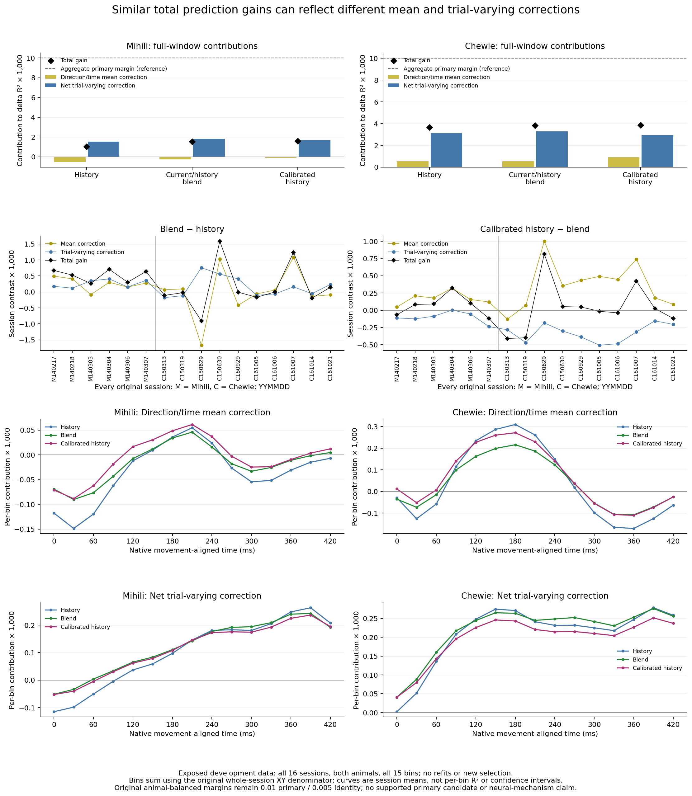

# Fixed prediction components

The same completed predictions are compared across both animals, all sixteen sessions and all fifteen native bins. No model is fitted or selected here.

| Group | Policy | Mean correction | Net trial-varying correction | Total delta R² | Identity |
| --- | --- | ---: | ---: | ---: | ---: |
| Mihili | HW | -0.000520777 | +0.001540619 | +0.001019842 | +0.004613635 |
| Chewie | HW | +0.000539409 | +0.003123258 | +0.003662667 | +0.006615133 |
| animal_balanced | HW | +0.000009316 | +0.002331938 | +0.002341254 | +0.005614384 |
| Mihili | blend | -0.000262591 | +0.001801657 | +0.001539066 | +0.003633834 |
| Chewie | blend | +0.000535037 | +0.003283605 | +0.003818642 | +0.005484955 |
| animal_balanced | blend | +0.000136223 | +0.002542631 | +0.002678854 | +0.004559395 |
| Mihili | calibrated_HW | -0.000091213 | +0.001699354 | +0.001608142 | +0.003460226 |
| Chewie | calibrated_HW | +0.000902719 | +0.002954499 | +0.003857218 | +0.004961350 |
| animal_balanced | calibrated_HW | +0.000405753 | +0.002326927 | +0.002732680 | +0.004210788 |

Mean and trial-varying terms sum to the existing primary result. The trial-varying term is covariance benefit minus prediction energy; identity is a separate whole-trial pairing contrast. Evaluation means are descriptive accounting only. Curves use the unchanged whole-session denominator and are not per-bin R² endpoints.

Every original session is shown in both pairwise contrasts; all directions contribute to each of the fifteen time bins. Sessions are averaged within animal, then animals equally. No favorable interval, seed or session is selected, and no uncertainty intervals or biological replication claims are added.

The original 45-comparison stop and separate calibration closeout remain unchanged. The 0.01 primary and 0.005 identity practical margins remain in force; these plots cannot promote a candidate. There is no neural-source access, future-session evaluation or spike-population follow-up.

[PDF](fixed_prediction_components.pdf) · [Session values](sessions.csv) · [All bins](bins.csv) · [Contrasts](session_contrasts.csv) · [Sources and execution](components.json)
