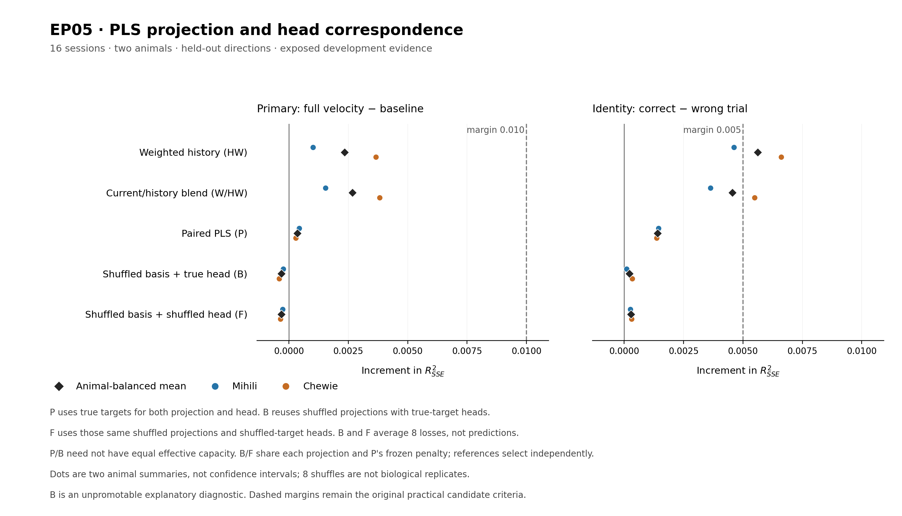
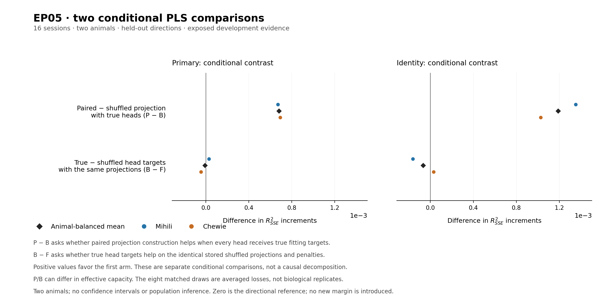

# EP05 primary development closeout

**The completed search did not establish a candidate meeting the registered
practical requirements on the exposed development corpus.** Root adopted the
ordinary patience stop on **2026-10-04 at 22:17 UTC**, after 45 valid scientific
comparisons and 12 consecutive counted comparisons without a strict improvement
in the comparable primary incumbent. This is a completed exploratory
development result, with no supported candidate and no future-session
confirmation. The final shared allocation completed normally at22:27:18UTC;
its actual EP05 bookkeeping share is included in the resource bound below.

## What was tested

The question was whether a trial's M1 LFP improves its complete native X/Y
velocity prediction beyond the expected movement for target direction and
elapsed time. The analyzed source is the previously exposed Dryad release,
with the fixed sixteen eligible M1 sessions: six Mihili and ten Chewie.
Chewie's implants remain one animal. Trials, directions, bins, channels,
folds and repeated controls are not additional biological replicates.

Within each session, fits use seven reach directions and predict the eighth.
The cyclic direction-by-time baseline, input transforms, model coefficients
and residual target are fitted without that held-out direction. Each global
recipe uses the original other-fifteen-session policy selection, preserving
whole sessions and equal animal weighting. The target is the unchanged
fifteen-bin, 0–420 ms native X/Y analysis window. Its full-trajectory primary
increment is the improvement in SSE-based R-squared over the original
direction/time baseline on identical trials.

The identity readout holds predictions fixed and contrasts correct trajectories
with wrong whole-trial pairings within the same direction. Positive identity
is informative about pairing; it does not replace the primary practical
requirement. The prospectively adopted aggregate margins are **0.01 primary**
and **0.005 identity**, alongside both-animal, session-majority, omission and
applicable control requirements. The scoped publication benchmark and source/
indexing/leakage checks were recorded before this adaptive search; their
acceptance is not broadened to every published analysis here.

## Best comparable primary result

The constant current/history reliability-weighted ridge blend, **W/HW**, remains
the comparable primary incumbent. Its original other-session selectors chose
lambda 1 and history weight 0.5 throughout. It improves the primary endpoint
slightly over the separately selected history-only HW recipe, but it fails
both practical margins and has lower identity gain than HW.

| Fixed recipe | Animal-balanced primary increment | Identity increment | Practical margins |
| --- | ---: | ---: | --- |
| Weighted four-bin history ridge, HW | +0.0023412544731769847 | +0.0056143839673429 | Primary fails; identity passes |
| Constant W/HW blend, primary incumbent | **+0.0026788544310999856** | +0.004559394718773168 | Both fail |
| Weighted-history 105-landmark RBF | +0.0014729045689071778 | +0.003169133294973225 | Both fail |
| Deflated two-component PLS | +0.00036033660315523165 | +0.001405621668816818 | Both fail |

The blend's primary means are approximately +0.001539066426 in Mihili and
+0.003818642437 in Chewie; 5/6 and 9/10 sessions are positive. Both animal
means and every within-animal omission remain positive on both endpoints.
These signs coexist with its failed practical thresholds. Its aggregate
advantage over HW is +0.000337599958 primary while identity declines by
approximately 0.001054989249. The improvement made it the search incumbent
at comparison 33; it did not make it eligible for promotion.

The figure's diamonds are animal-balanced means and dots are the two animal
summaries. They are not confidence intervals. Its
[exact plotted values](figures/primary_history_pls_basis/primary_history_pls_basis_comparison.csv)
come from the complete replayed
[basis diagnostic compact report](runs/adaptive_search/primary_history_pls_basis_summary_attempt001/compact_evidence_attempt001.json),
which also preserves original PLS, HW and blend summaries. The
[blend result figure](figures/primary_history_blend_attempt001.png) retains
the earlier detailed component comparison.

## What the final projection/head diagnostic resolved

The completed full-target PLS control changed the labels used to learn both
the supervised projection and the ridge head. The final comparison reused
each stored shuffled projection exactly and changed only its head back to
true fitting residuals. P denotes the completed paired PLS, B the new
basis-only shuffle with true heads, and F the completed full-target shuffle.
All three retain the original native support and P's already selected
lambda 10. B and F average eight losses; predictions are not averaged into
a new ensemble predictor.

| Released panel or contrast | Primary increment | Identity increment | Directional conclusion |
| --- | ---: | ---: | --- |
| B: shuffled projection with true head | -0.000320968039427831 | +0.0002158722477637581 | Primary negative in both animals |
| P minus B | +0.0006813046425830627 | +0.00118974942105306 | All five prospective directional screens pass |
| B minus F | -0.00000825425862852567 | -0.0000663796039679276 | All five directional screens fail |

P exceeds mean B on primary in all sixteen sessions, both animal summaries
and every within-animal omission; identity is positive in both animals and
all their omissions. Both animal means favor P against every one of the
eight B draws on both endpoints. The PLS advantage over the shuffled
projection therefore persists when the latter's head receives true targets.
This is evidence for predictive training correspondence in projection
construction within the fixed comparison. P/B effective capacity is not
matched, so it is not a pure capacity-controlled mechanism attribution.

Restoring true heads did **not** give the predicted consistent recovery on
the shuffled projections. B−F primary is positive in Mihili and negative in
Chewie; identity has the opposite animal signs. All eight overall identity
contrasts are negative and the overall primary contrasts have mixed signs.
Each B/F draw shares its stored projection, Gram and penalty exactly, but the
finding establishes neither equivalence nor absence of any head-target effect.
Shuffling within direction preserves task structure; these are not uniformly
random projections or signal-free recordings.

The [contrast values](figures/primary_history_pls_basis/primary_history_pls_basis_conditional_contrasts.csv)
retain the signed animal effects. Zero is the directional reference; no
post hoc practical margin is introduced. Eight controls are computational
draws, not biological replicates. None of these comparisons rescues PLS's
failed original practical gates, promotes B or changes the incumbent.

## Why the primary development search stopped

The [complete stopping review](primary_post_basis_stopping_review.md) links the
policy, original patience interpretation, coverage audits and exact counting
history. The minimum 28 comparisons has been exceeded and the maximum 64
was not reached. Patience started at comparison 29, reset on the strict
comparable-primary improvement at comparison 33, and reached twelve after
comparisons 34–45. The final valid distinct B policy adds one mean-loss
alternative comparison, zero candidate credit, zero literal-null credit and
no incumbent reset. Its seeds and the two explanatory contrasts add no depth.

Coverage includes the initial LMP, registered low/high-frequency, regularized
linear, reduced-rank and nonlinear references; later all-band, temporal,
feature-label, whole-trial pairing and target-residualization comparisons;
separate channel/trial/joint budgets; elapsed-only baseline; exact shared-Gram
HW surrogate; and guide-intersection/random-support sensitivities, including
the actual blend. W→HW, HW→blend and subsequent H2W/timing/nonlinear/PLS
challenges satisfy the adaptive-round and leader/challenger obligations.

There are six initial comparisons and 39 post-initial comparisons.
**24/39 (61.54%)** carry conservative alternative-explanation credit,
exceeding the original 40% requirement. Literal-null credit is separately
**15/39 (38.46%)**; the requirement concerns alternatives, not exclusively
literal nulls. These overlapping tallies are not added together.

Performed development coverage does not certify every control for every
possible finalist. A positive finalist would need its own required falsifiers;
stationary-LMP or HW controls cannot automatically certify a history blend.
No candidate passes the primary practical gate, so repeating every finalist
control on an ineligible recipe is not required to report this valid negative
development closeout. The guide-intersection sensitivity does not measure or
remove spike contamination. The incomplete elastic-net attempt remains an
uncharged technical limitation, not evidence of a completed family-wide
elastic-net test; completed ridge already covers regularized linear models.

The original wall clock started **2026-10-03 22:23:02.824 UTC**, giving an
unchanged 120-hour deadline of **2026-10-08 22:23:02.824 UTC**. The stop was
adopted before 24 hours elapsed. Existing operational records plus the final
shared allocation's actual EP05 share give a conservative **19.249-core-hour
ceiling**, well below 2,000. This intentionally includes some earlier
pre-search/shared work and is not an exact primary-search-only bill. Shared
totals are counted once. Allocation46521343 completed in1342seconds/oneCPU;
the EP05 share is671seconds (0.1863888889core-hours), giving an inclusive
documented bound19.248425926core-hours rounded upward above. This replaces
the former full-allocation reservation; no active EP05 compute remains.
No new work or resource extension follows from this report.

## Interpretation and boundaries

The result is a small positive best primary increment and informative
trial-correspondence controls, with **no candidate meeting the registered
practical requirements**. It does not establish that LFP contains no movement
information, that every possible decoder fails, or that the particular
incomplete elastic-net comparison would be negative.

The entire reused source is exposed exploratory development; new folds and
complete-session selectors do not make it independent confirmation. No
compatible sealed future-session dataset is available and no future test ran.
The conditional spike-population explanation remains unactivated. There is
no physiological, causal, new-animal population, online-BCI, raw-voltage or
cross-session weight-transfer conclusion. No result identifies the absence
or amount of spike contamination.

The independent-component-penalty amendment remains **unadopted and
unexecuted**. This closeout does not activate it, enlarge PLS ranks or penalty
grids, retry the stopped solver, or imply that every conceivable model must
be exhausted. Any later amended study or new-source evaluation requires its
own prospective authority and preserved evidence boundary. The
[execution log](experiment_log.md) remains authoritative for attempts, failures,
the root stopping decision and final resource accounting.
