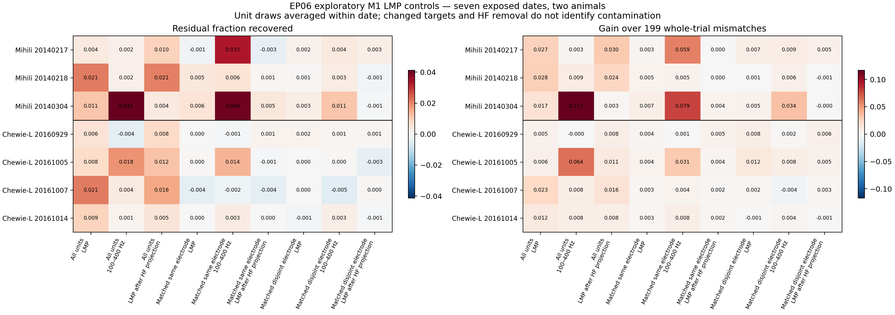
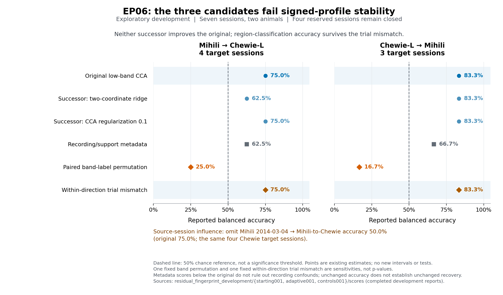

# Outputs

**October13 — exploratory LMP support panel complete, all seven dates retained.**
All-unit M1 LMP recovers a small residual fraction: equal-animal score
**0.01168**, staying **0.01081** after training-only HF projection. Actual
pairing beats the199 mismatch mean on every all-unit LMP date. Matching both
electrode pools to only four units reduces LMP scores to **0.00111/0.00098**;
their HF-projected means are near zero. Training-half mappings vary markedly,
including a negative prediction correlation on one date. These controls show
support sensitivity; they cannot identify contamination or a pure regional effect.

Read the [complete interpretation, nine-method table and accounting](experiment_log.md#2026-10-13--lmp_support_followup--complete-small-prediction-survives-hf-projection-support-and-stability-remain-limiting)
or [full report](runs/lmp_support_followup/attempt001/report.json).
The original30-comparison negative result and four closed reserved dates remain.
Four checks, scientific/plot execution and corrected ASTRA validation passed.
Parent47686488 completed45seconds,
charged **0.0125CPUh once to EP06**, including the separate EP17 companion.
No further analysis is selected. Earlier submission notes below are historical.

[Download PDF](figures/lmp_support_followup/attempt001/lmp_support.pdf).

**October13 — new real-data LMP follow-up submitted as47686488.**
The fixed seven-date support/pairing/HF-control analysis is selected, with
reserved dates closed. See the [execution log](experiment_log.md).
No scientific result is claimed from submission.

**October13,13:44 Pacific — separate M1 LMP support analysis adopted; ready for compute.**
The scientist approved the exploratory follow-up after the original negative
search. The [fixed analysis](paper_plan.md#october-13-exploratory-lmp-support-analysis)
tests count-matched same/disjoint-electrode unit populations, high-frequency
proxies, conditional training-half mapping stability and199 whole-trial
mismatches across all seven exposed dates. Original all-unit predictions are
reused; calibration and four reserved dates stay closed. No result is available
yet. [Implementation, resource bound and command](experiment_log.md#2026-10-13-1344-pacific--lmp_support_followup--adopted-and-implemented-compute-pending).
The original 30-comparison conclusion below remains intact.

**October11,01:20 Pacific — development stopped at30 valid comparisons.**
Ten valid comparisons after the minimum produced no control-qualified
improvement, satisfying the prespecified stopping rule. The result is
**no supported candidate under this design**. LMP retains an exploratory
prediction signal, but classification is sensitive to dates and recorded-unit
support; five-band classification also survives trial mismatch. No reserved
date was opened and the component/support follow-ups were not run.

Read the [scientific conclusion and trial ledger](runs/residual_fingerprint_development/development_closeout.md)
or [final controls, validation and scheduler accounting](experiment_log.md#2026-10-11-0120-pacific--residual_fingerprint_development--stopped-at-thirty-valid-comparisons-no-supported-candidate).
Job47354289 completed and the attended shell is closed; charge0.13 allocated
CPU-hours. Four new focused checks and final ASTRA validation passed.

[Download PDF](figures/lmp_controls/ep06_lmp_controls.pdf).
Earlier dated entries below are historical.

**October11,01:13 Pacific — twenty-six valid comparisons complete.**
Original LMP amplitude reaches87.5%/66.7% reciprocal-animal classification
and passes raw sign/omission checks. Both trial mismatch and restricting
units to selected LFP electrodes reduce accuracy to50%/50%. This is an
exploratory, recording-support-sensitive lead, not a supported final result.
Job47354289 remains in its original attended allocation; all three new checks
and ASTRA passed. Four reserved dates stay closed. See [results and remaining search](experiment_log.md#2026-10-11-0113-pacific--residual_fingerprint_development--twenty-six-comparisons-complete-lmp-sensitivity-localized).
Earlier dated entries below are historical.

**October 11, 01:02 Pacific — twenty valid development comparisons complete.**
Restricting units to the selected LFP electrodes gives 50%/50% classification;
the current candidates still lack stable signed profiles. Original LMP
prediction in M1 exceeds the fixed linear timing baseline on all seven dates,
an exploratory lead for a magnitude-sensitive follow-up. No candidate is
promoted or reserved date opened. Job47352945 completed, charged0.1475 CPU-hours;
the attended shell is closed. See [results, remaining search and accounting](experiment_log.md#2026-10-11-0102-pacific--residual_fingerprint_development--twenty-comparisons-complete-attended-allocation-closed).

[Download PDF](figures/development_controls/ep06_development_controls.pdf).
Earlier dated entries below are historical.

**October 11, 00:54 Pacific — eighteen valid development comparisons complete.**
Neither successor improves the provisional leader. Its 75%/83.3% accuracy
survives a fixed trial mismatch, and one session omission reduces a direction
to 50%. All fourteen model candidates still fail signed-profile stability.
No candidate is promoted. The attended job47352945 remains open for the next
registered controls; all fourteen focused checks and ASTRA passed. See
[results, challenger decisions and limitations](experiment_log.md#2026-10-11-0054-pacific--residual_fingerprint_development--eighteen-comparisons-complete-pairing-and-session-alternatives-remain).
Earlier dated entries below are historical.

**October 11, 00:42 Pacific — twelve real-data comparisons complete.**
The provisional low-frequency CCA leader reaches 75% and 83.3% balanced
accuracy in the two animal-transfer directions. All twelve candidates fail
signed-profile stability; the fixed-twelve selection reference is 44/128
(0.34375). There is no supported candidate yet. Job47352162 completed; all
fourteen checks passed, and four reserved dates remain closed. See the
[results, limitations and accounting](experiment_log.md#2026-10-11-0042-pacific--residual_fingerprint_development--twelve-real-comparisons-complete-no-candidate-promoted)
and [complete initial report](runs/residual_fingerprint_development/starting001/scores/complete.json).
Earlier dated entries below are historical.

**October 11, 00:39 Pacific — first twelve comparisons submitted: job 47352162.**
Requested 1 CPU, 7 GiB and at most one hour. Six distinct fitting recipes
produce 84 paired-region/session fits, reused across twelve full/low-frequency
and classifier comparisons. All predictions precede evaluation scoring; four
reserved dates remain closed. See the [submission](experiment_log.md#2026-10-11-0039-pacific--residual_fingerprint_development--first-empirical-comparisons-submitted)
and [prospective choices](paper_plan.md#october-11-initial-comparisons-and-development-references).
Earlier dated entries below are historical.

**October 11, 00:31 Pacific — all seven development dates are ready.**
Job47351138 completed the 1954-trial export, preserving all native units and
the fixed electrode/trial roles. The four reserved dates remain closed under
EP06 roles. Preparation used 0.03972 allocated CPU-hours; no EP06 scientific
fit or score has run yet. See the [completed preparation](experiment_log.md#2026-10-11-0031-pacific--source_session_support--all-seven-development-exports-complete)
and [support report](runs/source_session_support/development001/report.json).
Earlier dated entries below are historical.

**October11,00:30 Pacific — real development-data export running.**
EP07 completed its full freeze and single primary opening, satisfying EP06's
access dependency. Job47351138 is now preparing the seven development dates
(1954 trials); all eight relevant component checks already passed. No EP06
fit or score has run, and its four reserved dates remain closed.
See the [access handoff and running stage](experiment_log.md#2026-10-11-0030-pacific--source_session_support--ep07-opening-complete-real-development-export-running).
Earlier dated entries below are historical.

**October11,00:18 Pacific — development exporter and classifiers implemented.**
The exporter, role-scoped readers, residual-profile scorer and classifier are
source-reviewed; eight focused checks remain unrun. The next shared allocation
will run those checks and, only after EP07 completes its freeze and primary
opening, prepare all1954 trials from the seven development dates. Reserved
sessions remain closed; no real EP06 fit or score has occurred.
See the [selected conditional preparation](experiment_log.md#2026-10-11-0018-pacific--source_session_support--conditional-development-export-selected).
Earlier dated entries below are historical.

**October 10,23:48 Pacific — bandwise component checks passed.**
All3 new analytic/transport tests and ASTRA validation passed in the separately
scoped companion of EP07 job47345111. This is component evidence; EP06 neural
fitting still waits for EP07's freeze and primary opening. See the
[check record](experiment_log.md#2026-10-10-2348-pacific--bandwise_prediction--three-component-checks-passed).
Earlier dated entries below are historical.

**October10,23:24 Pacific — first bandwise predictor implemented and reviewed.**
The [array-only engine](tools/bandwise_prediction.py) fits the first registered
15-electrode-mean/PCA/ridge branch using training data only, and predicts
template-defined residual coordinates without receiving evaluation spikes.
Independent source review passed; three focused tests and changed ASTRA
validation remain **unrun**. The profile scorer, search runner and empirical
eligibility still need work. EP07's full freeze/primary opening still precedes
EP06 neural fitting. See the
[selected conventions and limits](experiment_log.md#2026-10-10-2316-pacific--residual_fingerprint_development--first-bandwise-fitting-component-selected).

**October 10, 22:55 Pacific — eleven-session nomination checks passed.**
The [nomination](tools/component_nomination.py),
[outer stability](tools/component_outer_stability.py) and
[support calculation](tools/component_support_h.py) now implement the adopted
three-Mihili/four-Chewie development panel. Final nominees must match their
recorded stable outer family before reserved support predictions. All 14
affected checks and changed ASTRA validation passed in the
[EP07 companion](runs/nomination_migration_checks_job_47338419/);
seven unchanged scoring checks passed in completed EP21 job47329203.
EP06 neural fitting still waits for EP07's full freeze and primary opening.
See the [migration record](experiment_log.md#2026-10-10-2244-pacific--component_nomination_and_support--old-core-checks-passed-adopted-roster-migration-selected).
Earlier entries describe their dated state and are historical.

**October 10 — reviewed eleven-session amendment adopted by the scientist.**
The [adopted plan](paper_plan.md#october-10-eleven-session-amendment-adopted)
excludes Mihili March 6 in both regions, jointly with EP07: three Mihili and
four Chewie development sessions, the same four reserved dates, two/three
nomination sessions per fold, all-three/at-least-three-of-four stability and
final support, and other-six/all-seven pooled H references. Contracts now
reflect this decision. EP07's full freeze/primary opening, the shared exposure
record and all remaining scientific support requirements still precede fits.
Protected scoring/nomination code, its twelve tests and ASTRA remain unchanged
while the live EP21 companion uses them; amended executable nomination is a
reported blocker. Dormant outer-stability/H code and nine focused checks are
amended, with a temporary rejection of the legacy nomination roster; all nine
remain unrun until that core dependency is migrated. Final-to-stable-family
binding remains executable work. No test, payload read, opening, budget reset
or job occurred; existing continuation authority persists.
See the [adoption record](experiment_log.md#2026-10-10-pacific--source_support--eleven-session-amendment-adopted).
Earlier dated entries below preserve the implementation and decision history.

**October 9 — fixed H support arithmetic implemented; five checks unrun.**
The [H calculator](tools/component_support_h.py) now uses the exact other-seven
development or all-eight reserved reference sessions, the registered median/MAD
standardization and fixed plus/minus0.25 thresholds. It binds the nominated
component, keeps missing support as abstention and cannot infer an observed
outcome from a prediction. Root source review is complete; five new checks and
changed ASTRA validation remain **unrun**. There are21 pending methods, with
the latest9 outside the unchanged EP21 companion. Raw profile construction,
regional aggregation/bandscale choices, fitting and the EP07 access dependency
remain unresolved. No real H value or neural result was produced. See the
[implementation and limits](experiment_log.md#2026-10-09--component_nomination_and_support-selects-fixed-h-arithmetic).
Earlier dated entries below are historical.

**October 9 — outer stability assessment implemented; four new checks unrun.**
The [four-fold reducer](tools/component_outer_stability.py) now applies the
fixed repeated-nominee, tie and regional-sign conditions to existing records.
A different fourth nominee remains allowed, but its left-out sign conflict
still vetoes stability; missing evidence remains unresolved. Independent source
review is complete. All 16 new EP06 methods remain **unrun**: the original12
are in the pending EP21 companion proposal, and the latest4 remain outside it.
No neural fit, score, H prediction or supported component claim was produced.
The EP07 freeze/opening dependency and source-data limitation remain unchanged.
See the [implementation and limits](experiment_log.md#2026-10-09--component_nomination_and_support-selects-outer-stability-assessment).
Earlier dated entries below are historical.

**October 9 — component scoring and nomination implemented; 12 checks unrun.**
The [array-only scorer](tools/component_scoring.py) now supplies the declared
direction-balanced component projections, independent prediction scores and
regional gain rules. It requires one selected component and a supplied frozen
positive energy gate. The [nomination module](tools/component_nomination.py)
now applies the fixed outer/final session rules and bidirectional agreement,
preserving negative candidates and distinguishing sign conflict from missing
numerical support. Root source review found no material defect; all12 focused
methods and changed ASTRA validation await coordinated compute. Frequency
combiner fitting, full outer stability and support-H prediction remain separate.
No neural data or outcome was read. EP07's freeze/opening prerequisite remains.
See the [selection and limits](experiment_log.md#2026-10-09--component_nomination_and_support-selects-component-nomination).

[Public release, dependency and method links](../DATASETS.md#public-online-resources--checked-october-6-2026)
are now incorporated directly into DATASETS, alongside the remaining support limits.

**October 6, Pacific — online evidence recorded:** the
[public-source check](source_handoff.md#public-source-check--october-6-2026-pacific)
found the listed 2022 Dryad release and downstream preprocessing code, but no
authenticated correction for March 6. The code is not an inverse-transform
remedy. EP06's completed metadata inventory and EP07 access dependency remain
unchanged; no repeated inventory or neural fit is selected.

**October 6, Pacific — source facts corrected; fallback unadopted:** exact
session names now appear in [DATASETS](../DATASETS.md#readable-outcome-blind-session-roles).
March 6 is position 5 and Mihili's fourth development session. The
[joint proposal](paper_plan.md#october-6-joint-source-remedy-and-fallback-proposal-unadopted)
preserves reserved dates, addresses the mandatory reduced-sample review and
proposes a shared exposure ledger. Current six-session and EP07 access rules
remain active; no fitting or new source check is selected.

As of October 6, 2026, 05:33 UTC (October 5 Pacific), the fixed
[metadata inventory](runs/source_session_support/metadata001/session_metadata.json)
is complete: **12 sessions / 3,090 trials**, no reported structural problems,
and no neural/velocity values read. All six focused reader checks and changed
ASTRA validation passed. Job **46721202 completed**, using one CPU / 2 GiB;
its total 373 seconds, including aggregate new-code checks, are charged once
as 0.1036111111 CPU-hours. See the
[completion and limits](experiment_log.md#2026-10-06-0533-utc--source_session_support-fixed-metadata-inventory-complete).
The [source handoff](source_handoff.md) gives exact inputs and remaining
dependencies. No scientific fit or score has run. The
[source handoff](source_handoff.md) identifies the already available shared
Dryad v5 release: 24 MAT sessions and a README; no download is needed. Only
the fixed metadata and array headers have now been inspected. EP06's neural fitting/scoring
still waits for EP07's full freeze and single primary opening. No eligible
third paired animal is identified in the named handoff; that limits the
separate external-transfer claim, not the two-animal companion analysis.
The [ASTRA program](astra/v0.0.14/astra.yaml) records the existing stage
dependencies and EP07 access condition. Its new metadata-inventory recipe
does not produce the still-unresolved qualified session-support output.
The changed program's official schema and semantic
[validation passed](astra/v0.0.14/validation_20261006_46721202.json).

The current episode contains the question, analysis plan, result branches and
the bounded structural reader. Future scientific outputs should first
show the two cross-animal classification directions, then the signed M1–PMd
profile, the recording-confound controls, and the correct-versus-pooled-versus-
swapped prediction comparison.

The [component plan](paper_plan.md) now assigns EP06 to EP07's history-and-
population-components manuscript. EP06 contributes the projected-activity
consequence of correct-domain versus pooled/swapped frequency rules, not
EP07's history-minus-today-only endpoint or an independent LFP-to-spikes paper.

The [component details](component_details.md) define common-time, direction-by-
time and trial-residual projections with balanced weights, concrete examples,
shared prediction comparisons and interpretation limits. They distinguish
evaluation-design trial residuals from the training-template primary residual.
This is documentation of existing components, not a run or a new endpoint.

[ep06_question_imagegen-v2.png](ep06_question_imagegen-v2.png) is the current
study schematic, with illustrative components and no measured outcomes.
[Exact prompts](ep06_question_imagegen-v2-prompt.md) record generation and connector repair.
The older PNG and [SVG](ep06_question.svg) are preserved as historical assets.

The episode splits are not merged. EP06 fitting/scoring must not expose EP07's
closed spike trials before EP07's full freeze and single primary opening,
absent a scientist-approved compatible prospective joint-role design. EP06
retains its own final freeze and one-shot reserved test. This writing revision
did not open either episode's outcomes or authorize an analysis run.

Inputs remain read-only. Temporary computation belongs in the episode-specific
scratch directory.
