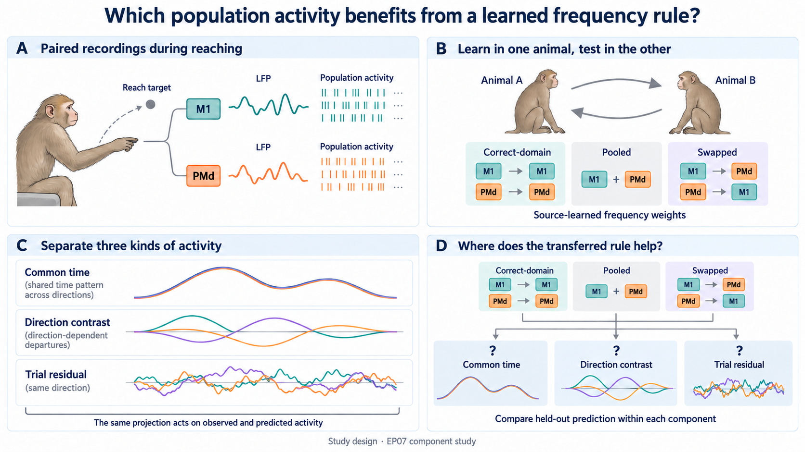

# EP06 component plan: what does a recording-domain frequency rule recover?

Status: integrated manuscript role, 2026-09-30, with the adopted October 10
amendment below. EP06 is a component of EP07's history-and-population-components
paper. No supported final result, reserved-session test or third-animal test is claimed;
existing continuation authority and the EP07 freeze/opening prerequisite persist.

Amendment 2026-10-02: before analysis, distinguish unscoreable rivals from
measurable rivals lacking a joint-region consequence. The manuscript role,
three components, and numerical margins are unchanged.

All three rules are compared within every component. Curves illustrate
task-defined projections, not measured fits or frequency bands; M1/PMd remains
a recording-domain comparison confounded with arrays. The primary residual
fingerprint and nomination rules remain in the contract.
[Imagegen prompts](ep06_question_imagegen-v2-prompt.md).

## October 11 evidence-led successors and first recording controls

Adopted after the first twelve development comparisons, before the following
fits or control scores. The provisional leader is starting_10 (low-six-band
PCA/CCA, covariance regularization 0.01, prediction ridge 0.01, prototype).
Its signed profile fails the unchanged omission requirement. The successor
question is whether one canonical mode or covariance whitening instability
limits recovery: retain every date, band, trial, electrode and rank.

- **adaptive00:** retain per-band training-standardized electrode PCA2 and
  spike PCA2, but predict both residual coordinates from both electrode
  coordinates using ridge 0.01 and an unpenalized intercept, without CCA.
- **adaptive01:** retain the leader's one-mode CCA and prediction ridge 0.01,
  increasing covariance regularization from 0.01 to 0.1 in both views.

Both use the same low-six profile and prototype classifier. Publish all 28
full-nine-band fitted/prediction cells before either successor score; each
band fits independently, so unused high bands enter neither low-band mapping
nor profile normalization. Compare each successor with starting_10 using the
previously fixed paired-reference improvement rule. Each successor counts once
as a scientific comparison; its challenger decision is not another trial. With
required controls unfinished, neither can reset patience or authorize promotion.

The first four control comparisons apply to the frozen starting_10 recipe:

| ID | Fixed intervention and interpretation |
| --- | --- |
| control00_metadata | Source-only logistic, penalty 1, on log1p native-unit count, training-finite electrode count and training-trial count; source means/SD only, constant source columns zero in both panels. Metadata accuracy at least as high in both directions weakens the neural-specific explanation; lower accuracy cannot rule out unmeasured array effects. |
| control01_leaveout | Omit each development session once and refit both source classifiers on the remaining panels; seven omissions comprise one influence comparison. Report each direction and the original raw signed omissions. |
| control02_band | Independently permute the six profile-band score labels within each session, using the same permutation for M1 and PMd. PCG64/SeedSequence (6006202, animal index, original session position), no redraw. Refit source classifiers. This is one fixed frequency-label sensitivity, not a permutation significance test. |
| control03_mismatch | Refit the same PCA/CCA recipe after a within-direction whole-trial LFP mismatch in both training and evaluation. Independently map each role with PCG64/SeedSequence (6006201, animal index, original position, role index), role indices training 0 and evaluation 2. Use a randomized ordering and nonzero cyclic shift within each direction; mappings are bijective with no fixed trial and shared across regions. Publish donor identities before reading values. Keep spikes, target trial IDs and whole native-time trajectories unchanged. |

Animal indices are Mihili 0 and Chewie-L 1; original development positions are
(1,2,4) and (1,2,4,5). All controls retain complete paired support. No undefined
case is dropped, imputed or redrawn. The mismatch refits all fourteen cells
and freezes their predictions before reading evaluation outcomes. Report band
recovery and both accuracies against the original recipe. A single shuffle
does not establish a sampling distribution or a quantitative chance cutoff.
Its survival is evidence against a frequency-specific or trial-coupling
explanation, as applicable; completion alone never means the control passed.
The existing requirement that every required control pass before neural
regional interpretation remains unchanged and unresolved at this stage.

These six scientific comparisons would bring the total to 18 if all are
available, with four of six post-starting comparisons being controls. Folds,
cells, conditional label assignments and implementation tests are not extra
trials. This batch cannot end the search at its minimum, waive remaining
controls or open the four reserved dates. Calibration values remain closed.

## October 11 selected-electrode units and elapsed-time controls

After the first eighteen comparisons, adopt two further registered development
controls, each counting once only if the full seven-date paired comparison is
available. Retain starting_10 as the fixed reference; neither successor
improved it, all fourteen model candidates failed signed-profile stability,
and its classification survived the fixed within-direction trial mismatch.
These controls clarify the recording-support and behavioral-time alternatives.

**control04_selected_electrode_units:** keep the existing fifteen selected LFP
electrodes per region. Before reading arrays, use the authentic unit-guide
electrode coordinate to retain every native unit recorded on one of those
electrodes, preserving native unit order. Publish indices, guide identities,
retained counts and which selected electrodes carry units. Keep every trial,
date, region, band and native time bin; refit the original PCA2/CCA recipe and
low-six prototype on this restricted population. Fewer than two units or
failure of the existing training rank-two requirement makes the entire control
unavailable; never redraw electrodes, lower rank or drop a date. Apply the
same unit restriction to training and evaluation. This is a spike-unit
restriction to selected LFP electrodes: it does not remove LFP electrodes
lacking native units, reproduce a bidirectional source-method intersection or
establish that all matching/contamination controls passed. Its population axes
and energy denominator differ from the original, so compare classification
robustness while reporting the changed target support explicitly.

**control05_elapsed_time:** reuse each original starting_09 frozen population
axis and training direction-by-bin spike template. The source metadata reader
requires idx_startTime=1; native bin k in the extracted window has elapsed
coordinate `(window_start+k)*0.03` seconds from the first-bin origin (no claim
about bin centers). Center this coordinate by its training mean within each
direction/native-bin cell, then divide by its pooled training population SD
(zero SD uses one). Fit a single elapsed-coordinate ridge predictor, penalty
0.01, unpenalized intercept, to the same two-dimensional training residual.
Freeze all transforms and predict from evaluation timing metadata only. This
matches the one-canonical-coordinate predictor's input dimension while using
no evaluation spikes to define a predictor.

Report the single timing baseline's residual-energy score in each session and
region against each of the six original LFP scores using the identical original
target and denominator. The direction-by-time-only baseline predicts zero in
this residual space and therefore scores zero when the common energy is
positive. A nonpositive/nonfinite energy is unavailable, never zero. Do not
manufacture a nine-band timing profile, a timing classifier or a second
scientific trial for the algebraic zero baseline. No score-selected band or
post-hoc timing family is nominated by this diagnostic.

Publish all fourteen restricted-unit fits/predictions and all fourteen timing
fits/predictions before either new outcome score. Calibration and reserved
values remain closed. Twenty available comparisons would meet the minimum,
not stop the search or waive the ten-valid-trial post-minimum patience rule,
maximum 48, remaining controls or final freeze. No candidate is promoted.

## October 11 magnitude and LMP comparisons

After twenty valid comparisons, select this fixed six-comparison block before
its classifier fits or scores. Original CCA LMP recovery in M1 is positive and
exceeds the fixed linear elapsed-time baseline on all seven development dates.
That observation selected this exploratory branch after multiple bands and
models were inspected; it is neither fresh validation nor a prespecified sign
test. PMd is not uniformly absent, and the centered representation retains
relative LMP information. These comparisons test particular representation and
recording alternatives rather than attributing prior failure to normalization.

For a declared K-band physical score vector s, let m be its signed arithmetic
mean. Fit c=median(m) and q=1.4826*median(abs(m-c)) over the source animal's
paired regional rows only. A nonpositive or nonfinite q makes the comparison
unavailable, without epsilon, imputation or alternate scale. For K>1 retain
the existing h=(s-m)/||s-m|| and use [h,(m-c)/q], with fixed 1:1 block weights
and no final row normalization. Zero/nonfinite centered shape remains
unavailable. For K=1 explicitly use the signed amplitude [(s-c)/q] alone;
there is no shape coordinate and no repair to the old shape-only classifier.
The classifier is the existing mean-logloss logistic objective with penalty1
and unpenalized intercept. Freeze source scaling for target application and
refit every label-dependent source classifier under the 128 paired-label
assignments. No target distribution, target label or target accuracy fits a
transformation. All original solver, tie and unavailable conventions remain.

| ID | Fixed comparison | Category |
| --- | --- | --- |
| control06normalization | Full-nine original CCA profiles, shape plus signed mean amplitude, compared with exactly matched shape-only starting_11 | Normalization control |
| control07lmp | Original CCA singleton LMP, signed-amplitude logistic1 | Feature control |
| control08selectedunits | Identical singleton LMP rule on completed selected-electrode-unit CCA profiles | Population-support control |
| control09mismatch | Identical singleton LMP rule on completed within-direction trial-mismatch CCA profiles | Trial-pairing control |
| adaptive02 | Singleton LMP from the completed two-electrode-PC ridge mapping, with the same signed-amplitude logistic1 | Mapping successor |
| adaptive03 | Original CCA low-six profile with 0.5–4Hz omitted uniformly from every region and date; existing shape-only prototype on the remaining five bands | Feature successor |

Each comparison reuses its own completed physical recovery scores and actual
population design. The restricted-unit comparison retains its changed axes
and energy denominator; these are not silently equated with the original.
Record original LMP minus the existing mismatch and elapsed-time scores as
descriptive comparisons, without another trial count or inferential test.
The singleton's band-label permutation is an identity and cannot establish
a frequency-specific pattern. No singleton result becomes a multifrequency
signature or substitutes for the joint regional and component requirements.

Keep the raw equal-session signed profile and all seven omission requirements
on each comparison's declared physical band support. Merely adding magnitude
to unchanged full-nine scores cannot repair that profile's prior failed gate.
The five-band ablation keeps every observed score unchanged, including the
original extreme 0.5–4Hz result in its original reports; it neither clips that
value nor omits Chewie October14. Both successor decisions use the original
paired-reference improvement convention and the unaccepted starting_10
comparator. Conditional references are not adaptive-search correction.
Better accuracy alone cannot pass unfinished controls or reset patience.
Also contrast adaptive02 directly with control07 descriptively to isolate the
neural mapping change; comparison with starting_10 changes both mapping and
profile representation. A singleton raw cosine is sign concordance (+1 or
−1), with a zero mean unavailable, not evidence of multifrequency geometry.

All six available comparisons would bring the total to26, with ten controls
among fourteen post-starting comparisons. Each counts once, including all
label assignments and omissions. Post-minimum patience is currently zero;
without qualified improvement these six valid comparisons advance it to six.
The original 96-hour clock, 48 maximum, ten-comparison patience, required
controls and final-opening rules remain. Calibration values and all four
reserved dates stay closed. No new neural fit or raw-data access is needed.

## October 11 LMP and five-band robustness controls

After26 valid comparisons, original CCA singleton LMP and the five-band
prototype (adaptive03, indices0,2,3,4,5) have complete positive raw signed
agreement and all seven positive omissions. Neither has a qualified material
improvement. The singleton classifier drops to50%/50% under both mismatch
and selected-unit restriction. Test these already observed leads with four
fixed controls before choosing another classifier:

| ID | Fixed robustness comparison |
| --- | --- |
| control10lmpleaveout | Omit each development session as a whole paired unit once; refit the original CCA singleton-LMP magnitude logistic1 comparison on the remaining panels. Recompute source median/MAD only from the reduced source when it changes. |
| control11low5leaveout | The same seven omissions for adaptive03's fixed five-band, shape-only prototype classifier. |
| control12low5selectedunits | Adaptive03's identical five-band prototype applied to the completed selected-electrode-unit profiles. |
| control13low5mismatch | Adaptive03's identical five-band prototype applied to the completed within-direction trial-mismatch profiles. |

Each seven-omission series counts as one influence comparison, following the
original influence-control convention. Both animal directions are refitted
and scored in every omission; the omitted session is absent from that
sensitivity comparison, not a new predicted test session. Retain every slot.
If any required fit is unavailable, the entire influence comparison remains
unavailable; no best subset, omitted-fold average or fallback scale replaces
it. The completed full-panel raw-sign omission reports remain separate from
these classifier influence tests. The two recording controls retain all128
paired-label references, raw sign and omissions on the declared five bands.
All comparisons reuse completed physical scores and authentic population
designs; no neural fit, calibration access or reserved opening occurs.

The selected-unit control changes the population target and does not by itself
identify a causal artifact. The fixed mismatch is one intervention, not a null
distribution. These tests assess robustness of the specified exploratory
recipes; completion alone does not certify the remaining required controls.

Four available controls with no qualified improvement would give30 valid
comparisons, fourteen controls among eighteen post-starting comparisons and
ten nonimproving valid comparisons after the minimum. This satisfies the
existing stopping rule; it is not a new trial cap or a waiver of missing
promotion evidence. A negative development closeout can retain untested
reserved dates, report the exploratory LMP lead and explicitly distinguish
unsupported regional transfer from absence of neural coupling.

## October 11 initial comparisons and development references

These choices are adopted before any EP06 neural fit or profile score under
the existing authority to implement and resume the open development search.
They instantiate the registered model families, not a closed final menu or
a new primary endpoint. All seven development sessions, paired regional
roles, movement window, native counts, training-template residual score,
15 fixed electrodes and the existing budgets remain unchanged. No EP07 score
or fitted state enters a recipe.

The first twelve comparisons are:

| ID | Bands in classifier profile | Electrode representation | Spike PCA rank | Mapping | Classifier |
| --- | --- | --- | ---: | --- | --- |
| starting_00 | All nine singletons | Mean of 15 | 2 | Ridge 0.01 | Cosine prototype |
| starting_01 | LMP plus five power bands through 50 Hz | Same as 00 | 2 | Same frozen fit as 00 | Cosine prototype |
| starting_02 | All nine | Mean of 15 | 2 | Ridge 0.001 | Cosine prototype |
| starting_03 | All nine | Mean of 15 | 2 | Ridge 0.1 | Cosine prototype |
| starting_04 | All nine | Mean of 15 | 4 | Ridge 0.01 | Cosine prototype |
| starting_05 | All nine | Median of 15 | 2 | Ridge 0.01 | Cosine prototype |
| starting_06 | All nine | Same as 00 | 2 | Same frozen fit as 00 | Logistic, penalty 1 |
| starting_07 | Low six, as 01 | Same as 00 | 2 | Same frozen fit as 00 | Logistic, penalty 1 |
| starting_08 | All nine | Same as 00 | 2 | Same frozen fit as 00 | Logistic, penalty 0.1 |
| starting_09 | All nine | Per-band electrode PCA, rank 2 | 2 | Regularized CCA, one mode | Cosine prototype |
| starting_10 | Low six, as 01 | Same as 09 | 2 | Same frozen fit as 09 | Cosine prototype |
| starting_11 | All nine | Same as 09 | 2 | Same frozen fit as 09 | Logistic, penalty 1 |

All use centered, unit-L2 regional profile shape and no across-session
alignment. Six distinct fitting recipes are sufficient; reuse their frozen
predictions and score subsets for low-frequency/classifier variants. Every
frequency block is fit independently, so unused high-frequency blocks do not
enter low-frequency predictors, population axes or profile normalization.
Nearby ridge penalties may yield nearly identical normalized shapes; these
are regularization comparisons, not evidence for different mechanisms.

For CCA, standardize each band's 15 electrode columns using training means
and population SD (zero SD uses scale 1); fit training PCA rank 2 with the
same numerical rank and loading-sign conventions as the spike PCA. Spike
PCA uses unresidualized training counts. CCA receives the two electrode
coordinates and two training-template residual population coordinates. Center
both over equally weighted training rows, use covariance divisor n, and add
0.01 I to both covariance matrices before symmetric inverse-square-root
whitening. The leading left singular vector defines the single canonical
loading in electrode coordinates. Fix its sign by the largest absolute
loading and retain its whitening scale without another normalization. Fit
the scalar canonical score to both residual coordinates using ridge 0.01
and an unpenalized intercept. Deployment uses only frozen training transforms.
Require both requested PCA ranks; semidefinite residual targets and zero
cross-covariance remain valid, with no invented association-strength gate.
No deficient band, unit, trial or session may be dropped or given a lower rank.

For each fixed candidate, enumerate all 128 independent within-session swaps
of M1/PMd labels in the declared three-Mihili/four-Chewie order. Refit every
label-dependent source classifier; cache only identical source fits and
label-independent target predictions. Report both ordinary balanced
accuracies and the inclusive upper-tail count divided by 128. Retain ties
and all assignment positions; any undefined assignment makes the complete
reference unavailable, without dropping, redrawing or imputing it.

These are candidate-conditional development diagnostics, not a selection-
adjusted complete-search test or two independent directional hypothesis tests.
Independent session-label exchangeability is an explicit, unverified
assumption in repeated recordings with region tied to array. A small joint
reference fraction cannot create additional independent target animals or
days. Later promotion must address the complete-analysis control and the
other registered confounds; these initial ranks alone authorize no promotion,
reserved opening or claim. The source-fixed target-label reference has only
16 or 8 assignments, and each final two-session direction has only four;
do not impose or advertise an unattainable 5% final exact test.

Also report a reference for selecting among this fixed initial twelve only:
for each of the same 128 assignments, choose the candidate with the highest
equal-mean directional accuracy minus 0.5, breaking exact ties by lowest
starting ID. Retain its ID, both accuracies and mean score. Compare the
ordinary selected score with all 128 selected scores using the inclusive
upper-tail count/128. Do not prefilter candidates by ordinary performance or
controls. Any unavailable candidate/assignment makes the complete menu
reference unavailable; retain partial evidence without selecting from a
smaller available subset. This adjusts for the fixed twelve-way maximum,
not subsequent adaptive selection, and a strong mean can still hide a weak
direction. It is a diagnostic within these comparisons, not an extra counted
scientific trial or satisfaction of the complete-search/both-direction rule.

Signed agreement uses the raw, equal-session mean M1-minus-PMd vector in
each animal: require positive cosine and positive cosine after each of the
seven session omissions. A zero/nonfinite required mean makes agreement
unavailable. Report separately the cosine after centering the two mean
vectors across bands, since a raw cosine can be driven by an overall offset.
Neither cosine implies that every band's sign agrees. Classifier omission
refits and other required controls remain separate work.

Before seeing initial scores, fix the search's material-improvement heuristic:
on the same 128 label assignments, compare the new and incumbent equal-mean
directional accuracy-minus-chance scores. Let q be the 122nd ordered absolute
deviation of their paired differences from its median. Improvement must be
at least 1/96 (the common score grid), strictly greater than q, and pass the
applicable controls to reset patience. Any incomplete reference cannot reset
patience. This is a conservative search heuristic, not a confidence interval
or selection-adjusted significance test. The minimum 20, maximum 48 valid
trials, patience 10 after the minimum, two successor trials, two challenger
decisions and minimum 40% post-starting control fraction are unchanged.

## October 10 eleven-session amendment (adopted)

**Scientist decision: adopt the reviewed joint exclusion before scores.** Exclude
Mihili 2014-03-06 in both regions from EP06 and EP07 because its released
spike arrays failed native-count validity. This supersedes the proposed wait
in the October 6 draft; that unsent request never started a response deadline.
The twelve-session alternative is not the active contract. This records the
human decision, not a new outcome opening or empirical launch.

The prospective sample-size amendment is fully specified below. Historical
twelve-session qualification records remain intact. No source conversion,
replacement session, date renumbering or additional exclusion is permitted.

| Animal | Development dates | Reserved dates, unchanged |
| --- | --- | --- |
| Mihili, 2014 | February 17, February 18, March 4 | March 3, March 7 |
| Chewie-L, 2016 | September 29, October 5, October 7, October 14 | October 6, October 21 |

- **Source fitting and target nomination:** Mihili-to-Chewie uses all three
  retained Mihili development sessions for source fitting and four Chewie
  outer folds, with the other three target sessions nominating in each fold.
  Chewie-to-Mihili uses four source development sessions and three Mihili
  outer folds, with the other two target sessions nominating. All three
  component candidates must be numerically scoreable in both regions on
  every available nomination session. Existing candidate-specific sign,
  mixed-sign-rival and 0.01 tie rules remain. Missing folds cannot count as
  agreement.
- **Stability and final nomination:** require the same family in all three
  Mihili folds and at least three of four Chewie folds, no tied fold, and no
  left-out regional-sign contradiction. Final nomination uses all three
  common scoreable Mihili sessions and at least three of four Chewie sessions,
  including every available common session. Each final nominee must match
  that direction's stable outer-fold family; the two directions must agree
  before a shared component claim. Failure remains unresolved or unsupported
  under the existing distinctions, not permission to relax support.
- **Support prediction H:** use the other six development sessions or all
  seven for a reserved prediction. Keep the existing pooled median/MAD
  calculation: references are two Mihili plus four Chewie sessions when a
  Mihili target is omitted, and three plus three when a Chewie target is
  omitted. Do not substitute an animal-weighted median. Keep the fixed
  +/-0.25 thresholds and missing/nonfinite/zero-scale abstention rules.
- **Scientific summary and uncertainty:** preserve
  `0.5 * (BA_Mihili_to_Chewie + BA_Chewie_to_Mihili) - 0.5`, report both
  directions, and retain the component margins. Resample whole trials within
  direction with paired regions, and sessions within animal for the declared
  session-level uncertainty, then weight the two directions equally. Such
  conditional resampling is not population inference from two animals;
  fixed-fit uncertainty does not include model-selection uncertainty.
- **Reserved support:** keep all four named dates and require at least three
  non-abstaining predictions with evaluable outcomes and none wrong.
  Unresolved outcomes cannot be counted correct. One observed outcome class
  cannot establish a preservation/failure boundary. All existing electrode,
  rank and role-support requirements remain; further session loss requires
  a new review rather than another automatic reduction.

This is weaker training and nomination support in Mihili, not equivalent
precision to the original design. The claim remains a two-animal,
shared-corpus component analysis with recording-domain/array confounding,
not an independent replication or transferable population boundary.

Adoption is joint with the [EP07 five-new-day rules](../../episode07_lfp_session_transfer/outputs/paper_plan.md).
EP06 fitting/scoring still follows EP07's full freeze and primary opening.
The session/trial roles and actual openings described in the October 6
shared-exposure proposal must be recorded before future fits; no sibling
outcomes or fitted state may feed EP07 development. Its reader boundary stays
procedural, as documented. The operative contracts and living specifications
now adopt this roster and arithmetic. The live EP21 companion still imports
EP06 scoring/nomination code, its twelve checks and EP06 ASTRA; those paths
remain unchanged until the coordinator explicitly clears them. Nomination
rosters, two/three-session selection and final-to-stable-family binding remain
executable blockers while that dependency is protected. Dormant stability/H
changes must not silently accept the superseded roster. This records adoption;
no EP06 role export, neural opening, test or job was performed. Existing resume
authority persists, with the EP07 freeze/opening prerequisite still applying.
There is no budget reset or new approval gate for routine implementation.

## October 6 joint source remedy and fallback proposal (unadopted)

Historical proposal retained below. Its pending-choice language and six-session
contract describe October 6; the adopted October 10 amendment above supersedes
them without rewriting the source evidence or prior decision history.

The metadata inventory is complete for 12 sessions and 3,090 trials. The
[source handoff](source_handoff.md#current-structural-result--october-6-0533-utc)
records the passing bounded reader, 30-ms bins, success labels and shared
trial-struct pairing without neural/velocity value access. Header/guide
completeness is not verified count representation, 15-electrode support or
population rank. Those requirements and the EP07 freeze/opening dependency
remain distinct from the completed metadata inventory. The
blocking count-representation failure concerns Mihili March 6, which is EP06
chronological position 5 and a development session. The current contract
requires review if either animal has fewer than six eligible paired sessions;
dropping March 6 cannot be treated as an ordinary missing-file repair.

Recommendation: first use the [existing EP07 correction request](../../episode07_lfp_session_transfer/outputs/experiment_log.md#2026-10-03--source_support--completed-inventory-and-source-handoff).
Propose a response window of 14–21 days from the scientist's actual send date,
then choose whether to adopt the joint fallback below. No request has been
sent and no deadline has started. A passed response must authenticate native
counts or a documented lossless representation correction for the exact
original trials; rounding or an assumed conversion is not a remedy.

**Recommended fallback for review:** exclude March 6 from both EP06 and EP07,
before any scores, retain all other named dates, and keep EP06's reserved
sessions fixed by date: Mihili March 3 and March 7; Chewie-L October 6 and
October 21. Do not renumber a five-session list and move another session into
or out of the reserved set. This leaves seven development sessions (Mihili
three, Chewie-L four) and the same four reserved sessions.

The required EP06 sample-size review must resolve these concrete changes
before this fallback can be adopted:

- A left-out Mihili development session would have only two other Mihili
  nomination sessions, whereas Chewie-L retains three. The present
  other-three and all-three-scoreable rules cannot be applied literally.
  Proposed replacement: use all remaining target development sessions in
  each fold, require all three component candidates scoreable in both regions
  on every nomination session, and keep the existing sign and tie rules.
  This is a weaker two-session nomination for Mihili, not equivalent evidence.
- The proposed final nomination uses all three Mihili and all four Chewie-L
  development sessions, with at least three common scoreable sessions per
  animal as currently required. If either direction cannot nominate, retain
  the unavailable result rather than relax support again.
- Development reference medians/scales would use the other six of seven
  sessions and reserved references all seven, replacing the current
  other-seven/all-eight formulas. Preserve equal animal weighting for the
  scientific summaries and report each transfer direction and session.
- Four reserved sessions still cannot establish a precise transferable
  boundary. Retain the companion, exposed-release claim and report the
  reduced training support. No third-animal claim follows.

**Shared exposure record proposed, not yet instantiated.** The current date
rules make EP06 reserved March 3/October 6 EP07 historical-training days, and
reserved March 7/October 21 EP07 target days with calibration, development and
held-out trials. EP07 will therefore use outcomes from EP06-reserved dates.
Record exact session/trial identities, each episode's role, permitted reader,
actual opening and freeze dates, and any transferred information in one shared
exposure ledger before future fits. At present no completed shared ledger or
neural opening is claimed. EP06 remains after EP07's full freeze and primary
opening unless an explicit compatible joint-role amendment is adopted.
Later EP06 reserved results are disclosed same-corpus procedure checks, not
fresh confirmation or independent replication. A ledger does not itself
change access permission.

All of this section is a recommendation awaiting adoption. The six-session
rule, active dates, margins, roles, inference, budgets and access order remain
binding; no model, simulation or job is activated.

## Scientific role in the paper

EP07 owns whether earlier days add value over equally tuned today-only fitting,
then whether the increment requires the correct LFP--spike trial pairing.
EP06 asks a different question: can source-animal M1/PMd frequency rules recover
a specified projected population component better than pooled or swapped
rules? A regional classifier is only the entry analysis. The useful consequence,
its recording-support boundary, and its failure are the potential contribution
to the combined paper.

For example, an advantage for a direction-invariant time course would locate
the useful frequency rule in common task structure; an advantage for `P_E`
would locate it in the declared trial-residual projection. **Neither result
by itself proves EP07's history-specific coupling.** EP06's projectors separate
activity components, while EP07's capacity-matched residual refit and paired
mismatch increment test what historical information adds beyond today-only.

## The question in plain language

For each recording session, the primary analysis asks how well LMP and each
registered LFP band predict the nearby spike population's single-trial
residual, after a direction-by-time mean learned on training trials has been
removed. This produces one residual frequency profile for M1 and one for PMd.

The first question is whether the M1–PMd difference learned in Mihili labels
whole Chewie sessions, and whether the reverse direction also works. The second
question is whether the difference is useful: do frequency weights learned for
the correct region improve prediction of held-out population activity compared
with one pooled rule, while deliberately swapping the region labels makes
prediction worse?

The explanatory question is more specific: in a separate projection of the
unresidualized response, does the advantage belong to the common time course,
the direction-specific departure from that course, or the trial residual? Can
a rule fixed on development sessions predict the outcome of sessions held out
across acquisition dates? This follow-up cannot redefine the residual primary
result.

With only four reserved sessions, the present release cannot estimate a
transferable support boundary precisely and may not sample both sides of it.
EP06 is therefore assigned to the EP07 manuscript. A separate paper would need
newly specified evidence with additional sealed sessions and useful precision;
it is not the current workstream.

The array is different in M1 and PMd, so the paper must always distinguish a
reusable recording-domain result from a pure cortical-area claim.

## What would be new?

| Prior work | What is already known | What EP06 must add |
| --- | --- | --- |
| Gallego-Carracedo et al., eLife 2022, [doi:10.7554/eLife.73155](https://doi.org/10.7554/eLife.73155) | LFP-to-population relationships in these recordings depend on frequency and differ across M1, PMd, and area 2. | Do not present the basic regional difference as new. Predict which prespecified projected population component benefits from the regional rule and whether calibration-visible support predicts held-out session outcomes. |
| Ince et al., PLOS ONE 2010, [doi:10.1371/journal.pone.0014384](https://doi.org/10.1371/journal.pone.0014384) | Frequency-dependent spatial LFP patterns in motor cortex carried reach-direction information. | Test a region-linked LFP-to-population profile rather than target direction, using whole-session cross-animal transfer. |
| Hall et al., Nature Communications 2014, [doi:10.1038/ncomms6462](https://doi.org/10.1038/ncomms6462) | Multichannel motor-cortical LFPs estimated neuronal firing and supported real-time biofeedback. | Ask whether the useful frequency rule differs reproducibly between the two recording domains; EP06 does not test online control. |
| Gallego et al., Nature Neuroscience 2020, [doi:10.1038/s41593-019-0555-4](https://doi.org/10.1038/s41593-019-0555-4) | Low-dimensional population dynamics can remain stable over long periods. | Directly test whether a region-linked LFP rule transfers across animals rather than inferring it from latent stability. |
| Safaie et al., Nature 2023, [preserved dynamics across animals](https://www.nature.com/articles/s41586-023-06714-0) | Aligned motor population dynamics and behavior decoding already transfer across animals performing similar behavior. | Generic cross-animal latent transfer is not new. The candidate contribution is the consequence of a frozen source frequency rule for a prespecified activity component. |
| Hacker et al., bioRxiv 2026, [July 31 revision](https://www.biorxiv.org/content/10.64898/2026.01.03.697516v2) | Spike--high-gamma alignment in inferotemporal cortex depends on population-magnitude versus distributed-pattern coding; this is a preprint. | Do not claim first component-dependent spike/LFP agreement. EP06 tests task-defined projections and a recording-domain weighting consequence in this motor release. |

Reproducing the source paper's regional plot, finding one good band, or
classifying folds from the same session would not be enough. Before scored
analysis, compare the exact component-and-cross-day prediction with the source
paper, its supplements and code, and later reports using the same dataset.
The publication-role decision is already EP06 within EP07. Exact source/code
overlap can still narrow or remove a claimed component advance; this writing
decision neither certifies novelty nor creates a new independent study.

## Separate manuscript ownership from outcome permission

Keep EP06's original acquisition-position split with the adopted exclusion:
Mihili development 1, 2, 4; Chewie development 1, 2, 4, 5; reserved 3, 6 in both.
Do not renumber original Mihili position 5 or move any reserved date. Preserve
its whole-trial training/calibration/evaluation roles. EP07's chronological
and within-target roles differ. An EP06 fit or score can therefore reveal
spikes still closed in EP07, even if its own EP06 role is legitimate.

On the shared corpus, EP06 neural fitting/scoring follows EP07's full analysis
freeze and single primary opening, unless a scientist approves compatible
prospective joint roles before relevant scores. No EP06 outcome, fitted weight,
or candidate feedback enters EP07 development; no sibling output becomes an
EP06 run input. EP06 still freezes its own final procedure before its own
reserved-session opening. This is sequencing of existing roles, not silently
merging splits, granting execution authority, or making exposed data fresh.

If EP07's primary result fails, EP06 may report its bounded domain/component
result but cannot turn the combined history claim positive. Likewise an EP06
component failure does not erase a supported EP07 primary result. Publish each
effect with its own fitting roles, score denominator, uncertainty, and evidence
status rather than treating two analyses of the same trials as replication.

## Study sequence

### 1. Test whole-session transfer in both directions

Use three Mihili and four Chewie development sessions. Learn one complete
M1–PMd profile rule from all three Mihili sessions and test all four Chewie
sessions; reverse using all four Chewie source sessions and three Mihili targets. Fit
all scaling, population summaries, LFP-to-population models, reliability
weights, alignment, and classifier parameters on the permitted training side.

The primary target is always the single-trial spike residual after subtracting
a training-only direction-by-time mean. No component family is selected for the
primary profile.

Report both balanced accuracies separately, their equal-weight mean, and every
session. Trials, time bins, electrodes, bands, and population coordinates are
measurements within a session; they do not increase the number of animals.

### 2. Show what the classifier recognized

Plot the signed M1-minus-PMd difference for every registered feature block and
every session. Any highlighted band must be chosen by a development-only rule,
not because it looks clean in reserved sessions.

The figure should let a reader answer:

- Does the same part of the profile have the same sign in both animals?
- Does the difference survive equal trial, electrode, population-rank,
  reliability, and model-capacity budgets?
- Does it remain without 100–400 Hz power and on matched electrodes and units?
- Can recording metadata or missing channels classify the sessions just as
  well?
- Does one session or one profile component control the result?

If only the final classifier score is stable, the biological interpretation is
unknown.

### 3. Ask whether the difference improves prediction

After the first result is fixed, use the source animal's M1 and PMd profiles to
create three fixed ways of combining frequency-specific predictions in the
other animal:

| Rule | Scientific question |
| --- | --- |
| Correct region | Do source-learned M1 weights help target M1 and source-learned PMd weights help target PMd? |
| Pooled | Would one common frequency rule work just as well for both regions? |
| Swapped region | Does deliberately giving each region the other region's weights hurt? |

For the residual consequence in this section, source-animal development
sessions alone fit the M1, PMd, and pooled frequency weights. Section 4 repeats
the same source-only rule separately for each projector. Swapped is exactly the
M1/PMd permutation. A target session may fit its population axes, scaling, and
each band's base predictor on target training trials, but it cannot refit a
combining weight.
Calibration trials only provide the support index; evaluation trials only
provide the component score. Correct, pooled, and swapped therefore combine the
same held-out bandwise predictions. No rule receives extra coefficients,
different trials, extra electrodes, or a different population dimension.

The proposed explanation predicts a meaningful correct-minus-pooled advantage
in both animal directions and worse performance after the weights are swapped.
If the regional weights are almost identical, or the bandwise predictions are
too similar for the mixtures to differ, call the test inconclusive. That is not
evidence that a pooled biological rule is sufficient.

### 4. Project the unresidualized response, then predict a session outcome

This follow-up starts again from the unresidualized spike response. Training
freezes the population axes and three trial-space projectors:

| Component | Projector |
| --- | --- |
| Common time | `P_C`: direction-invariant time effects |
| Direction × time | `P_D`: sum-to-zero direction-by-time contrasts after removing `P_C` |
| Trial residual | `P_E`: the remaining within-direction, within-time trial activity |

The [detailed component specification](component_details.md) expands each
family without changing its endpoint:

- **Common time:** the equally direction-averaged trajectory, including any
  level already present in the frozen coordinates. A useful source-domain
  rule here helps common task structure, not which individual trial fluctuates.
- **Direction × time:** the average direction-specific departure from that
  common trajectory. Static direction offsets remain included; this is not
  a newly centered pure interaction or an isolated movement-intention signal.
- **Trial residual:** each trial's departure from its evaluation direction/time
  average. It can contain unmodeled behavior, state, recording variation and
  noise; a useful rule here is not by itself a causal coupling mechanism.

All three must be measured with the same correct/pooled/swapped consequence
test, not ranked by component energy or absolute prediction score. Keep the
nomination cross-fit and unscorable cases unchanged. This added detail leaves
model combinations searchable within the current grammar and budget; it does
not preselect a preferred component, band or decoder.

The inner product gives equal total weight to every reach direction, equal
weight to trials within a direction, and equal weight to analyzed time bins.
With this direction balance, `P_C` and `P_D` are orthogonal and
`P_E = I - P_C - P_D`. Thus `P_C + P_D + P_E = I` on the frozen-axis analysis
space. The projectors use the frozen direction/time design and training-defined
population axes, never an
evaluation spike value. Training fixes the direction set, time grid, contrast
coding, and axes; evaluation contributes only its preassigned direction labels
and time bins when the operators are applied.

Observed evaluation cell means enter only `P_k Y_eval`; a rule's prediction
uses `P_k Yhat_eval` formed from its own predicted means. `P_E` is not the
primary residual: the latter subtracts a training-only template and therefore
also retains evaluation-versus-training cell-mean shifts. A component score
cannot replace the residual-only profile. Common-time utility does not imply
trial identity, and trial-residual utility does not imply EP07 history benefit.

For component `k`, compare the genuine held-out target `P_k Y_eval` with the
held-out prediction `P_k Yhat_eval`. The score is
`1 - sum||P_k Y_eval - P_k Yhat_eval||^2 / sum||P_k Y_eval||^2` under the same
direction-balanced norm. Correct, pooled, and swapped share this target and
denominator. This measures fraction of component energy predicted, not
explained variance, and may be negative.

A positive minimum component-energy gate is fixed from development and
known-answer synthetic tests before final evaluation. Apply it to the target
denominator divided by total direction-balanced evaluation weight, so extra
trials cannot make a weak component appear scoreable. A nonfinite result or
normalized target energy below that gate is unscorable and unresolved. It is
never called a failure. For each component, report
`G_region = score(correct) - max(score(pooled), score(swapped))` separately for
M1 and PMd before any average. Preserve the component only when both gains are
positive and their equal-region mean is at least 0.01. Two nonpositive gains are
a failure. Opposite signs, an unscorable region, or a mean between 0 and 0.01
are unresolved.

Use three Mihili-target folds and four Chewie-target folds. The other two
Mihili or three Chewie target development sessions establish numerical scoreability of all
three components in both regions. An unscoreable rival leaves the complete
comparison unresolved, with no nominee. Eligibility is then candidate-specific:
regional gains must agree in sign in every nomination session. A measured
mixed-sign rival remains visible but does not veto another eligible candidate.
Nominate the largest median equal-region gain among eligible candidates;
top medians within 0.01 are tied, and no eligible component gives no nominee.
This is the best eligible joint-region account, not a global numerical winner
over mixed-sign rivals. Only a valid prefold nominee receives
a frozen support prediction and evaluation regional gains; the other two
evaluation components remain unopened in that fold. After the prospective
three- or four-fold assessment is recorded, the previously unopened development
components may be scored for a final selection using all retained sessions; they
cannot alter the outer-fold
record. Final medians use common numerically scoreable sessions for all three
components in both regions: all three Mihili sessions or at least three of four
Chewie sessions, including every available common session. Sign
consistency applies to each eligible candidate across that set, not every
rival. Stability requires the same nominee in all three Mihili folds and at
least three of four Chewie folds, no fold tied within the 0.01 margin, and no
left-out M1/PMd sign contradiction. Missing folds cannot count as agreement.
Known failed conditions imply instability; missing evidence remains unresolved.
Each final nominee must match its direction's stable family. Both transfer
directions must then make the same final untied
nomination before any reserved outcome is opened.

The frozen prediction uses only calibration-visible quantities:

- reliability: the Spearman–Brown-corrected correlation between component
  frequency profiles from two fixed, direction-balanced calibration halves;
- profile distance: the root-mean-square bandwise distance from the applicable
  source-animal regional prototype, divided by development between-session
  variation; a zero or nonfinite bandwise scale forces an abstention; and
- support index: standardized reliability minus standardized profile distance.

For a cross-fitted development prediction, the other six development sessions
set the reference median and scale; all seven set them for a reserved
prediction. Standardization subtracts that median and divides by 1.4826 times
the median absolute deviation; a zero scale or nonfinite split-half reliability
forces an abstention. The pooled references are two Mihili plus four Chewie
or three plus three depending on the omitted animal; there is no animal-weighted
median substitution. The support index has equal fixed weights and no
outcome-fitted coefficient. An index at or above 0.25 predicts preservation; an
index at or below -0.25 predicts failure; the middle is an abstention. Write the
prediction for every reserved session before any of its evaluation trials are
scored.

A generic-quality explanation predicts parallel gains for all three components
and equal or better prediction from recording metadata. A calendar gap noticed
after failure is not an explanation. Positions 3 and 6 are held out across the
acquisition dates; they are not both later sessions.

Report both regional gains, the resulting session status, every prediction,
and every abstention. Whole-trial resampling within direction with paired regions quantifies within-session
measurement error. Session resampling stays within animal, the two transfer
directions receive equal weight, and each animal direction and leave-one-session
result is shown separately. The support summary gives exact correct, wrong, and
abstained counts with an interval over sessions. A within-corpus prediction
needs at least three non-abstaining reserved predictions with evaluable outcomes
and no wrong prediction. Unresolved outcomes cannot count as correct.
Even four correct predictions from only one outcome class do not establish the
boundary. With four reserved sessions, wide uncertainty is expected and cannot
support a stand-alone boundary claim.

### 5. Use the reserved sessions once

The two reserved sessions from each animal can test the final classifier and
the prediction consequence only if both results are specified before they are
opened. Reveal all four sessions together. The fixed recipe may fit its planned
session-specific base models on training trials, but it cannot change feature
support, model family, weights, thresholds, or exclusions after any reserved
result is visible.

Because related work has already exposed the release, this is a procedural
within-corpus test rather than independent confirmation.

### 6. Carry the unchanged rule to a third animal

A later third-animal study must use the same profile construction, classifier,
frequency rules, thresholds, and support. It is a separately planned study and
must report every compatible session. If no suitable simultaneous M1/PMd source
exists, the paper must retain its two-animal scope.

## Rival explanations and decisive checks

| Rival explanation | Direct check | If it wins |
| --- | --- | --- |
| Ordinary reach direction explains the result | Direction-and-time baseline and whole-trial LFP-to-population pairing shuffle | No evidence for the proposed regional population relationship |
| Array quality reveals the region label | Metadata-only classifier and matched trial, channel, rank, reliability, and missingness support | Recording or hardware fingerprint; no neural regional interpretation |
| High-frequency spike leakage creates the profile | Low-frequency-only analysis, high-frequency exclusion, and matched electrode/unit checks | Limit the result to a spike-rich recording feature |
| Flexible population summaries or models create separability | Capacity-matched alternatives and smoothness/dimensionality-matched surrogate activity | No profile-specific evidence |
| Frequency labels leak the answer | Verify feature guides and shuffle band labels through the full analysis | Invalid regional interpretation |
| One animal or session drives the score | Both transfer directions and leave-one-session analysis | Narrow or reject the transfer claim |
| Correct-region weighting has more freedom | Apply all three fixed weight sets to the same bandwise predictions | No benefit attributable to the regional rule |
| Evaluation outcomes alter a projector or fitted weight | Verify projector idempotence, orthogonality, sum-to-identity, direction-imbalance invariance, and identical application to observed and predicted activity | Invalid component explanation |
| Target data silently adapt the regional weights | Trace every weight to source development and verify swapped is the exact M1/PMd permutation | Invalid cross-animal consequence |
| A nearly empty component produces an unstable ratio | Apply the development- and synthetic-fixed positive energy gate before computing regional gains | Unscorable and unresolved component |
| The three mixtures cannot meaningfully differ | Check weight separation and diversity of the bandwise predictions | Consequence is inconclusive |
| Generic recording quality, not component organization, drives the benefit | Ask whether all three components' regional gains move together and compare the frozen support index with a fixed metadata-only rule | No component-level population-organization claim |
| Calendar drift explains every failure | Ask whether the pre-fixed calibration-visible support index predicts held-out failures beyond elapsed days | Treat unexplained loss across acquisition dates as a failed prediction, not a discovered mechanism |

Matching measured hardware features does not remove unmeasured array effects.
The strongest wording remains about the two recording domains unless a future
design breaks the region–array link.

## When to deepen, narrow, or stop

| Evidence | Next action and permitted claim |
| --- | --- |
| Both classification directions pass, the correct-region rule beats pooled, and the same component and frozen support prediction work on reserved sessions | Report the component result within EP07; a stand-alone boundary claim still needs additional sealed sessions on both sides of the boundary. |
| Classification and average prediction transfer, but the component family or support prediction does not | Keep the useful result as part of EP07; do not force a separate EP06 paper. |
| Classification transfers but correct-region does not beat pooled | Report a stable label with no demonstrated prediction benefit; stop the stronger interpretation. |
| The regional rules or bandwise predictions cannot be distinguished | Call the consequence inconclusive and seek a better-powered prespecified test. |
| The two animal directions disagree | Treat the result as animal-specific; do not average away the disagreement. |
| Recording metadata or matching explains the result | Reframe as a hardware or recording-quality result, or stop. |
| Only high-frequency or spike-rich features survive | State that boundary and stop the broad LFP claim. |
| The reserved sessions fail | Preserve the development result and the failed transfer; do not switch candidates. |
| No third-animal source exists | End with a two-animal scope and a concrete future-data requirement. |
| Precision is too low to distinguish meaningful effects | Call the result unresolved; a wide interval is not evidence for equivalence. |

## Figure ownership in the EP07 manuscript

| Figure | Scientific judgment | Evidence shown |
| --- | --- | --- |
| Main figures 1--2, owned by EP07 | Does history help, and does its increment depend on correct trial pairing? | EP07's two-comparator primary, frozen bridge, residual refit, and incremental pairing endpoint; no EP06 score substitution. |
| Main figure 3, EP06 component | Which projected activity benefits from a recording-domain frequency rule? | Frozen common-time, direction-contrast, and trial-residual projections; correct/pooled/swapped predictions; both regional gains and animal directions; low/high-frequency scope and array limitation. |
| Figure 3 supporting diagnostics | Is the component consequence identified and measurable? | Signed all-band profiles, classification directions, equal-support and metadata controls, session influence, uncertainty, and indistinguishable-rule failures. |
| Figure 3 support prediction | Did the calibration-visible rule predict the four reserved outcomes? | Cross-fitted reliability/distance, every prediction and abstention, component energy, failures and uncertainty. Four sessions do not establish a transferable boundary. |
| Future main figure 4, owned by a separately frozen EP07 forward study | Does the chosen explanation work on genuinely new days? | Only if compatible new data become available; no current third animal/day is claimed. |

EP05's behavioral reach-deviation figure and EP08's acquisition-value figure
belong to distinct questions, not duplicate population-decoder papers. Figure
placement does not reduce EP06's existing required controls or invent a figure
quota. The current concept PNG is retained; the older SVG is historical.

The abstract should state that the primary score was residual-only, name the
nominated projected component, say whether the frozen support prediction worked,
report both animal-transfer directions, and state the hardware and sample-size
limits. “M1 and PMd differ” is already too broad and too close to the source
publication to be the conclusion.
