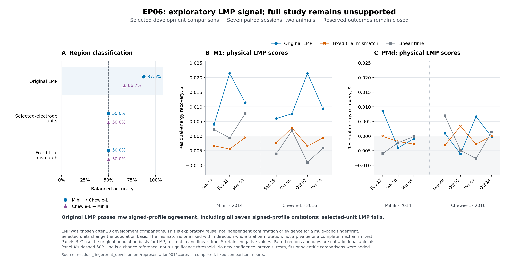

# EP06 development result: no supported candidate under the current design

October 11, 2026. The development search completed **30 valid comparisons**
and reached its prespecified stop: ten valid comparisons after the minimum
of20 without a meaningful improvement that also passed the required controls.
The original clock and budgets were retained. This ends this development
search; it does not claim that every planned model or follow-up was run.

No candidate is promoted. No final analysis or four-session reserved opening
is authorized by these results. Calibration values and all four EP06 reserved
dates remain closed. The unresidualized component-consequence, component
nomination and support-prediction analyses were not performed.

## What the real data showed

The seven development sessions contain paired M1/PMd recordings from **two
animals**. Every primary profile measures recovery of held-out single-trial
spike-population residuals relative to a training-only direction/time template.
Negative recovery scores are preserved. Dates, regions, trials, bins and
population coordinates are repeated measurements, not extra animals.

| Comparison | Mihili→Chewie balanced accuracy | Chewie→Mihili balanced accuracy | Main limitation |
| --- | ---: | ---: | --- |
| Starting low-six CCA prototype | 75.0% | 83.3% | Raw signed profile fails omissions; a source-session omission reduces one direction to50%. |
| Original CCA LMP amplitude alone | 87.5% | 66.7% | Signed scalar contrast is stable, but removing either Mihili February18 or March4 reduces Chewie→Mihili accuracy to50%. |
| LMP on units from selected LFP electrodes | 50.0% | 50.0% | Classification and signed stability are lost on the changed population target. |
| LMP after within-direction trial mismatch | 50.0% | 50.0% | Classifier advantage is lost; the two animals' small signed means reverse together. |
| Five-band CCA prototype, omitting0.5–4Hz everywhere | 75.0% | 66.7% | Raw sign is stable, but removing Mihili March4 reduces the directions to62.5%/50%. |
| Five-band prototype on selected-electrode units | 37.5% | 33.3% | Classification and raw omission stability fail. |
| Five-band prototype after trial mismatch | 75.0% | 83.3% | Classification survives even though raw omission stability fails; accuracy alone is not evidence of trial-specific coupling. |

The session omissions remove that paired session from the entire sensitivity
comparison. In Chewie→Mihili, removing a Mihili date changes the target panel;
these results do not identify a causal source-training dependence.

**An exploratory predictive lead remains:** original M1 LMP recovery is
positive and exceeds both the fixed linear elapsed-time baseline and the
single fixed within-direction mismatch on every development date. Original
M1 LMP scores range from0.00399 to0.02143; PMd comparisons are mixed. LMP was
selected after multiple bands/models were observed. This is not a fresh
seven-date sign test, independent replication, behavioral adjustment or a
mechanistic result. The restricted-unit control changes population axes and
energy, so loss of accuracy establishes sensitivity, not an artifact's cause.

The LMP scalar M1−PMd means are+0.011046/+0.010797 for the two animals;
mismatch changes these to−0.001194/−0.000263. A scalar cosine of+1 under both
conditions means within-condition sign concordance, not preservation of the
original direction or evidence of multifrequency geometry. The original LMP
conditional label-reference tail fractions are0.125/0.5; the five-band
prototype's are0.125/0.40625. These fixed-candidate diagnostics do not correct
for the adaptive search or establish strong evidence in both directions.

[Vector PDF](../../figures/lmp_controls/ep06_lmp_controls.pdf).

## Search accounting and evidence

| Completed stage | Valid comparisons | Evidence |
| --- | ---: | --- |
| Starting full/low-frequency models | 12 | [starting001](starting001/scores/complete.json) |
| First two mapping successors | 2 | [adaptive001](adaptive001/scores/complete.json) |
| Metadata, influence, band-label and trial-mismatch controls | 4 | [controls001](controls001/scores/complete.json) |
| Selected-electrode units and elapsed-time baseline | 2 | [support001](support001/scores/complete.json) |
| Magnitude/LMP branch: two successors and four controls | 6 | [representation001](representation001/scores/complete.json) |
| Two classifier influence series and two five-band recording controls | 4 | [robustness001](robustness001/scores/complete.json) |

Total: **12 starts+4 successors+14 controls=30**. Fourteen of18 post-starting
comparisons are controls, exceeding the40% requirement. At least two
evidence-led successors and two explicit challenger decisions were completed.
No qualified improvement reset patience. The six magnitude comparisons and
four final controls are the ten valid nonimproving comparisons after20.
Cells, omission folds,128 conditional label assignments, deterministic model
replays, figure rendering and implementation checks are not additional trials.

The last four controls completed at08:17:39 UTC in attended Slurm job47354289.
All four new implementation checks passed in that allocation, and changed
ASTRA validated. Resource use, scheduler completion and earlier charges are
retained in the [execution log](../../experiment_log.md); there is no budget
reset or automatic continuation of this stopped search.

## What this conclusion does not establish

The result is **no supported candidate under this search/design**, not absence
of LFP–spike coupling, equivalence of cortical regions or exhaustion of the
registered model space. Recording region remains confounded with its array.
Only two animals were studied, using historically exposed development data.

The complete adaptive-analysis label reference, full matching/reliability and
contamination controls, smoothness/dimension-matched population surrogate,
additional time windows, area-2 sensitivity and empirical component/support
follow-ups are not established by these reports. Their incomplete status is
not a pass. The failed robustness evidence and prespecified search stop leave
no eligible final procedure to take to the reserved dates. A future question
or renewed search requires an explicit separate design and budget; it cannot
silently relabel these development observations as confirmation.
