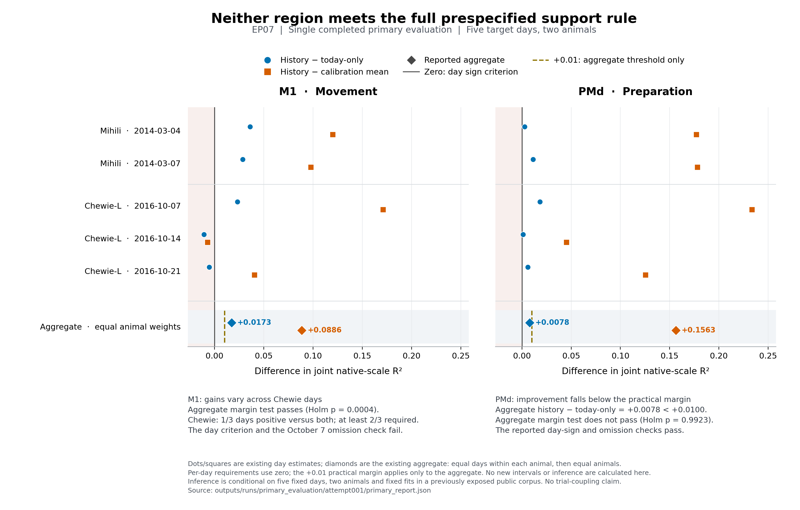

# EP07 outputs

[Completed primary result figure (PDF)](figures/primary_evaluation/ep07_primary_result.pdf)

Rendered and visually inspected October 11, 00:42 Pacific. No related job
remains live; the figure displays the completed result without new inference.

**October11,00:30 Pacific — primary evaluation complete; no region passes the full rule.**
History-minus-today gains are M1 +0.0173 R² and PMd +0.0078 R². M1 fails the
cross-day stability requirements; PMd falls below the fixed0.01 margin.
All five days and9999 paired bootstrap draws are retained. No mechanistic
claim follows. See the [result and limits](experiment_log.md#2026-10-11-0030-pacific--primary_evaluation--completed-neither-region-meets-the-full-support-rule)
and [primary report](runs/primary_evaluation/attempt001/primary_report.json).
Job47351138 subsequently completed, including the EP06 preparation. See
[terminal accounting and independent review](experiment_log.md#2026-10-11-0031-pacific--primary_evaluation--terminal-accounting-and-independent-interpretation).
Earlier dated entries below are historical.

**October11,00:24 Pacific — final evaluation continuation submitted: job47351138.**
All39 paired empirical comparisons per stream and four required recoveries
remain complete. An empty Bash-array launch error stopped the predecessor
before any primary stage; the focused script repair now submits only the
unstarted primary evaluation and conditional EP06 export. No scientific
comparison, verification suite or final opening is repeated.
See the [submission](experiment_log.md#2026-10-11-0024-pacific--primary_evaluation--unstarted-primary-submitted).
Earlier dated entries below are historical.

**October11,00:21 Pacific — all four required recoveries passed.**
The bounded numerical continuation finished in77seconds; cumulative validation
time is about91seconds. All16 case/region/stream cells passed without changing
scientific thresholds. Job47350382 now proceeds toward the fixed primary
evaluation. No final biological result is claimed yet.
See the [completed qualification](experiment_log.md#2026-10-11-0021-pacific--known_answer_cases--all-four-fixed-recoveries-passed).
Earlier dated entries below are historical.

**October11,00:19 Pacific — bounded continuation submitted: job47350382.**
Requested1 CPU/7GiB/one hour. It reuses the passed recovery cell and all39
paired empirical evaluations per stream, performs the30 remaining recovery
fits under the explicit numerical exception, then opens final data only if
eligible. EP06 preparation follows only a completed EP07 primary opening.
See the [submission](experiment_log.md#2026-10-11-0019-pacific--primary_evaluation--bounded-continuation-submitted).
Earlier dated entries below are historical.

**October11,00:12 Pacific — all ten empirical controls complete; numerical repair needed.**
The study has39 completed paired evaluations per stream. Job47346999 stopped
before final data access because one required elastic-net recovery fit exhausted
its iteration cap. This is unresolved numerical qualification, not a biological
finding or a measured recovery failure. One completed recovery cell passed and
is retained. A bounded continuation is being prepared; no related job is live.
See the [observed result and accounting](experiment_log.md#2026-10-11-0012-pacific--alternative_explanations--all-ten-controls-complete-numerical-qualification-incomplete).
Earlier dated entries below are historical.

**October 10,23:56 Pacific — controls running: job47346999.**
Actual1 CPU/7GiB on sh03-06n11. All4 repaired control tests,4 new frozen-fit/
scorer tests and ASTRA validation passed. Ten empirical controls are underway;
four required recoveries and the eligible final opening remain pending.
See the [compute evidence](experiment_log.md#2026-10-10-2356-pacific--alternative_explanations--running-repaired-and-final-transport-tests-pass).
Earlier dated entries below are historical.

**October 10,23:55 Pacific — continuation submitted: job47346999.**
The ten unstarted controls and four bounded recoveries run before an eligible
single primary opening. Requested1 CPU/7GiB/1hour; all source is independently
reviewed and new transport tests run on compute. The29 complete matched
comparisons are retained with no repeated search. See the
[submission](experiment_log.md#2026-10-10-2355-pacific--alternative_explanations--primary_evaluation--continuation-submitted).
Earlier dated entries below are historical.

**October 10,23:54 Pacific — matched development search complete:29 paired comparisons.**
All15 retained starting pairs and14 adaptive pairs are complete; the unchanged
adaptive cap stopped search. Fixed leaders: history adaptive07,development
R2=0.07452; today adaptive03,R2=0.05957. Job47345111 failed only the control-test
gate after preserving all adaptive results. That isolated test fixture is now
corrected and reviewed. A bounded continuation is selected for the unstarted
ten controls, four required recoveries and an eligible single primary opening.
No job is currently live, no control has run, and held-out data remain closed.
See the [results and continuation](experiment_log.md#2026-10-10-2354-pacific--alternative_explanations--primary_evaluation--remaining-work-selected).
Earlier dated entries below are historical.

**October 10,23:48 Pacific — real adaptive comparisons running: job47345111.**
Actual allocation1 CPU/7GiB on sh04-04n22. The29 shared checks and6 held-feature/
publication checks passed. One of12 control tests has an isolated argument-
construction defect, so controls remain gated until its focused repair; the
unaffected adaptive fits continue. No held-out data have been opened.
See the [diagnosis](experiment_log.md#2026-10-10-2348-pacific--matched_search--running-one-control-test-fixture-defect-isolated).
Earlier dated entries below are historical.

**October 10,23:46 Pacific — completion batch submitted: job47345111.**
The remaining adaptive real-data comparisons and all ten fixed finalist controls
share one bounded allocation:1 CPU,7 GiB,at most1 hour. The original stopping
rule remains active. Four required known-answer checks have a separate600second
cap inside the same job. All new source has independent review; affected tests
run on compute before their dependent stage. Held-out data remain closed.
Both scientist-approved amendments are operative with no pending decision.
See the [submission record](experiment_log.md#2026-10-10-2346-pacific--matched_search--alternative_explanations--completion-batch-submitted)
and [operational attempt](runs/matched_search/adaptive002/).
Earlier dated entries below are historical.

**October 10,23:27 Pacific — 22 paired real-data comparisons complete; both amendments adopted.**
Job47340578 completed all seven adaptive pairs, adding to the15 completed
starting pairs. The scientist approved retaining those15 starts with at least
three valid adaptive pairs and the prospective interpretation of all ten
finalist controls. Neither decision remains pending. The original search
clock, attempt cap and scientific thresholds remain in force.
The current leader has global development R2=0.07215 with history and0.05957
today-only; these are exploratory results. Three consecutive valid pairs have
not improved either incumbent by0.002, so the seven-pair patience stop has not
been reached. [Completed batch](runs/matched_search/adaptive001/progress.json)
retains its historical pre-amendment starting-incomplete label; the
[current adoption and completion record](experiment_log.md#2026-10-10-2327-pacific--matched_search--adaptive-batch-complete-and-both-amendments-adopted)
explains the new operative rule and accounting.
The next work is adaptive continuation and implementation of the required
finalist controls. Nine adaptive dependency checks and four inference checks
passed in the completed job; the subsequently amended controller's three
updated checks remain unrun. No job is currently live, no finalist is selected,
and held-out data remain closed. Earlier dated entries below are historical.

**October 10, 22:55 Pacific — focused repair RUNNING: job47338419.**
Only unscored starting08/10 are retried, with unchanged models and KKT tolerance,
a larger bounded iteration cap and fresh-residual convergence verification.
Allocation: 2 CPUs, 14 GiB, at most two hours on sh03-06n05. Both affected
elastic-net checks, all four source-weight checks and ASTRA validation passed;
real fitting has begun. The 14 complete paired comparisons remain intact.
No adaptive or held-out evaluation is launched. See the
[selected repair](experiment_log.md#2026-10-10-2253-pacific--matched_search--final-numerical-repair-selected)
and [operational attempt](runs/matched_search/attempt002/).
Earlier dated entries are historical.

**October 10, 22:50 Pacific — real development results for14 of16 starting pairs.**
Job47336768 closed incomplete: starting08/10 failed elastic-net convergence in
both streams, and their scores were withheld. The other14 paired comparisons
are retained in [development feedback](runs/matched_search/attempt001/development_feedback.json).
All36 component checks and ASTRA validation passed. Cost:0.2844444444 allocated
CPU-hours. A focused numerical diagnosis precedes the final allowed retry of
only those failed models. Adaptive search and final checks remain; held-out
data are closed. See the [result and repair record](experiment_log.md#2026-10-10-2250-pacific--matched_search--fourteen-starting-pairs-scored-two-convergence-failures).
The source-weighting extension is separately implemented and reviewed; its four
focused checks are unrun and it did not enter these starting fits.
Earlier dated execution entries below are historical.

**October 10, 22:41 Pacific — first starting-search job RUNNING.**
Slurm job **47336768** is on sh03-06n05 with four CPUs, 28 GiB and a two-hour limit for
the sixteen starting history/today pairs. Four numerical workers follow the
[fixed starting recipes](tools/starting_recipes.py). The
[selected attempt](runs/matched_search/attempt001/) runs 36 focused component
checks before fitting; a separate scorer may then open development targets for
complete paired predictions. Passing checks and fitted models are not yet
verified. Held-out data remain closed. See the
[scope, metric, resource and clock record](experiment_log.md#2026-10-10-2239-pacific--matched_search--first-sixteen-real-data-pairs-selected).

**October 10, 22:31 Pacific — primary fitting pipeline in progress.**
The [native trial adapter](tools/native_trials.py),
[invariant LFP features](tools/lfp_features.py) and
[conditional frozen bridge](tools/population_bridge.py) are implemented and
source-reviewed. Their twelve focused tests remain unrun. Regression, primary
population transport and direction/time handling are being connected; no
empirical candidate has been fitted or scored. See the
[implementation record](experiment_log.md#2026-10-10-2231-pacific--matched_search--frozen_bridge--fitting-foundations-implemented-primary-assembly-selected).

**October 10, 22:24 Pacific — real-data roles complete for all 11 retained sessions.**
Job47334643 completed successfully. The [published report](runs/source_support/attempt002/source_support_report.json)
covers2873 eligible whole trials; [separation checks](runs/source_support/attempt002/data_separation_report.json)
passed, and [trial roles](runs/source_support/attempt002/trial_roles.csv) record
the EP06 overlap. Candidate, scorer and held-out files are separate. The job
cost0.0633333333 allocated CPU-hours, including33 passing EP21 component checks.
Model fitting, bridge qualification and scientific inference remain unfinished;
their code is being implemented. See the [completion record](experiment_log.md#2026-10-10-2224-pacific--source_support--data_separation--eleven-session-views-published).
Earlier submission/running entries below are historical.

**October 10, 22:17 Pacific — eleven-session preparation running: job47334643.**
The [new attempt](runs/source_support/attempt002/) requests 1 CPU, 7 GiB and
at most one hour. It prepares the approved real-data roles and shared EP06
exposure metadata, with no model fit or scientific score. Historical attempt001
is preserved. Slurm confirms RUNNING on sh03-06n11; the focused roster check
passed and the first retained session was prepared. Full publication is pending.
See the [execution record](experiment_log.md#2026-10-10-2215-pacific--source_support--attempt002-selected-for-execution).

**October 10 — eleven-session amendment adopted; role export is next.**
The [approved joint plan](paper_plan.md#october-10-eleven-session-amendment-adopted)
now governs GOAL, DATASETS, search policy and the preparation/reader rosters.
Mihili March 6 is excluded in both regions; retained new-day weights are 1/4
for Mihili and 1/6 for Chewie-L. The historical twelve-session catalog and
failed attempt001 remain intact. Fresh attempt002 will export the eleven
retained sessions and shared EP06 session-role metadata under the unchanged
split seed. Model search, bridge qualification and scientific scorers remain
unfinished. See the [adoption record](experiment_log.md#2026-10-10-pacific--source_support--eleven-session-amendment-adopted)
and [bounded preparation recipe](astra/v0.0.14/astra.yaml).

[Public release and signal-method links](../DATASETS.md#public-online-resources--checked-october-6-2026)
now sit directly in DATASETS. The excluded March 6 count correction remains
unavailable but is no longer required for this retained panel.

**October 6, Pacific — earlier source findings reconciled:**
[DATASETS](../DATASETS.md#the-two-neural-settings) now carries the already
authenticated LMP/eight-band guide semantics and the completed eleven-session
direction/window support, alongside the unchanged March 6 count defect.
The prepared role-reader boundary is documented as procedural; no complete
role pack, fitted bridge or neural score was published. These facts were
already in the October 3 log and are not a new qualification run.

**October 6, Pacific — online findings added:** the
[public-source check](paper_plan.md#public-source-check--october-6-2026-pacific)
records the official 2022 file inventory and author preprocessing code. No
authenticated March 6 correction was found; square-root/smoothing operations
do not establish a reversible repair for the released file. Browser failures
and a zero-open-issues listing are not proof no correction exists. The exact
remaining source request is retained; no payload or scientific rule changed.

**Historical October 6 source remedy, superseded by the adoption above:** the [living plan](paper_plan.md#october-6-correction-request-and-joint-fallback-unadopted)
links the existing unsent correction request and proposes a 14–21-day reply
window, then a jointly reviewed March 6 exclusion fallback. Both episodes'
sample-size and shared-exposure consequences are explicit. No request has
been sent, deadline started, session excluded or active rule amended.

October 3: all twelve fixed files received source qualification in coordinator
allocation 46424502. Eleven pass; **Mihili 2014-03-06** fails native-count
validity in both M1 and PMd across all 217 trials, beyond floating-point noise
and without a supported simple rates-to-counts conversion. The exact native-
count source request is in the log. That attempt stopped pending an
authenticated correction or explicit scientific amendment; the latter is now
adopted. No role pack was published and no model was fitted or scored. See
[the current log entry](experiment_log.md),
[all remaining-session eligibility metadata](runs/source_support/attempt001/remaining_source_validity.json),
[the count diagnosis](runs/source_support/attempt001/count_validity_diagnosis.json),
[structural metadata](runs/source_support/attempt001/structural_inspection.json),
[the steward](tools/prepare_role_views.py), and
[the candidate reader](tools/view_access.py).
Development targets and held-out features/targets remain closed to candidate
code. Separation is procedural and enforced by these runner interfaces; the
same account can still reach the original public source.

[ep07_question_imagegen-v2.png](ep07_question_imagegen-v2.png) is the current
study schematic, with zero-centered illustrative residuals and explicit
correct/mismatched trial identities. [Exact prompts](ep07_question_imagegen-v2-prompt.md)
record generation and the accepted local correction. The older PNG and
[SVG](ep07_question.svg) are historical assets; no image contains observed
EP07 evidence.

The [paper plan](paper_plan.md) now owns one history-and-population-components
paper: EP07 establishes earlier-day added value and its incremental trial-
identity explanation; EP06 provides a separately specified recording-domain
component consequence. EP05 remains about reach deviations and EP08 about
acquisition value. Their outcome roles are not merged, and EP06 scoring cannot
expose EP07's still-closed trials during development.

Development search stays broad and adaptive within the declared model grammar
and numerical budgets. Residual models are not preselected; calibration-visible
indicator exploration has no two-indicator cap. Final procedures, not the
whole exploratory pool, are frozen before applicable final outcome access.

Current development fitting and feedback are linked above. Final day-level
comparisons, alternative-explanation checks, uncertainty and the final report
remain unfinished.

The local [experiment program](astra/v0.0.14/astra.yaml) lists already required
stages; the execution log distinguishes completed preparation, partial
development search and remaining final work.
Explanatory diagnostics cannot rescue a
failed primary result, and no genuinely new-day source has been selected.
Large source data remain outside Git; temporary computations belong in the
episode-specific scratch directory.
