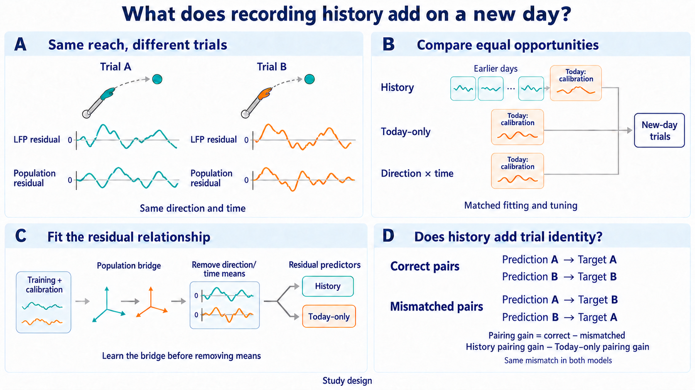

# EP07 paper: does recording history preserve task structure or same-trial coupling?

Status, October 20, 2026: EP07's single primary evaluation is complete;
neither region meets the full support rule. EP06 remains its recording-domain
component study. The synthesis below includes released EP05/EP08 evidence
from the same public corpus; it does not combine their estimands or data roles.
The original conditional designs below are retained as history, not instructions
to restart search or open further outcomes.

## What the completed EP05–08 comparisons establish

**When does LFP prediction carry information beyond task structure, and how
dependable is that information across recording and calibration conditions?**
This connects the four questions without treating them as four independent
replications. They use overlapping recordings from Mihili and Chewie, two
animals; Chewie's implants, recording days, electrodes and trials do not add
independent animals. The effects below have different targets and denominators
and must not be pooled into a common effect size.

| Question and support | Released result | Scientific interpretation |
| --- | --- | --- |
| EP05: does the correct trial's M1 LFP predict its reach deviation? Sixteen M1 sessions, two animals; exposed development. | After 45 comparisons, the W/HW blend gives primary ΔR² **0.002679** and trial-identity increment **0.004559**, below the **0.01/0.005** margins. Separate scalar calibration gives **0.002733/0.004211**, also below both. | Small predictive and pairing signals remain; calibration improves total prediction while reducing trial-identity gain. Neither a practically qualifying decoder nor a population mechanism is established. [Closeout](../../episode05_sensorimotor_lfp/outputs/primary_development_report.md), [calibration](../../episode05_sensorimotor_lfp/outputs/runs/fixed_hw_correction_calibration/attempt001/interpretation.md). |
| EP06: does a regional LFP frequency profile transfer between animals, and how sensitive is residual prediction to recording support? Seven exposed development dates; two animals. | No supported candidate after 30 comparisons. In the separate support panel, all-unit M1 LMP recovery is **0.01168**, or **0.01081** after HF projection; four-unit matched pools give **0.00111/0.00098**. | Prediction depends on the sampled population; changed targets/axes prevent attributing that dependence to contamination or cortical region. Some classification survives trial mismatch. [Closeout](../../episode06_lfp_regional_fingerprints/outputs/runs/residual_fingerprint_development/development_closeout.md), [support result](../../episode06_lfp_regional_fingerprints/outputs/experiment_log.md#2026-10-13--lmp_support_followup--complete-small-prediction-survives-hf-projection-support-and-stability-remain-limiting). |
| EP07: do earlier days add value beyond equally tuned today-only fitting? Five target days in two animals; completed single internal held-out evaluation. | History-minus-today ΔR² is **0.017275 in M1** and **0.007772 in PMd**. M1 exceeds the mean margin but only **1/3 Chewie days** improves against both comparators; omitting October 7 leaves Chewie at **−0.008173** against today-only. PMd is positive on all five days but below **0.01**. | Neither region passes the full rule. A positive average is insufficient evidence for dependable transfer. The conditional residual/pairing analysis did not run, so the information carried by history remains unresolved. [Released primary result](experiment_log.md#2026-10-11-0030-pacific--primary_evaluation--completed-neither-region-meets-the-full-support-rule). |
| EP08: can available calibration information predict electrode value or guide acquisition? Eight development sessions, two animals. | The 41-comparison policy search found no initializer-robust policy. In the separate information-value analysis, the primary **32-trial** predictor worsens prediction in both animal means; only **0/4 Chewie and 1/4 Mihili sessions** improve. The **64-trial** sensitivity has small positive animal means. | More calibration is a useful lead, not a replacement endpoint or demonstrated acquisition benefit. Removal loss is specific to the fitted decoder. [Policy result](../../episode08_lfp_electrode_trial_policy/outputs/final_report.md), [information-value result](../../episode08_lfp_electrode_trial_policy/outputs/runs/offline_information_value/attempt001/information_value.md), [session signs](../../episode08_lfp_electrode_trial_policy/outputs/README.md). |

The shared finding is limited, condition-dependent predictive information.
EP05's shrinkage tradeoff, EP06's population-support sensitivity, EP07's day
heterogeneity and EP08's calibration sensitivity make recording support and
estimation quality important surviving explanations. They do not establish one
common cause. In particular, none licenses absence of LFP information, pure
regional physiology, mean-only transfer, or a causal electrode-value claim.
These completed comparisons justify a coherent account of the conditions
under which prediction succeeds and fails, rather than four further searches
for a more favorable model. The existing stops remain scientific outcomes;
they are not unresolved engineering failures.

EP05 and the later EP06/EP08 explanations are exposed-development evidence.
EP07's trial bootstrap is conditional on its five fixed target days and two
animals, not uncertainty over newly sampled animals or days. The EP06 and
EP08 reserved sessions remain closed under their own roles; cross-episode
overlap does not make them fresh project-wide confirmation. No sibling
predictions, outcomes or fitted state become analysis inputs through this
manuscript synthesis.

### Most informative future comparison — proposal only

On separately approved new recording days, cross **calibration amount and
LFP electrode support**, retaining one common untouched spike-population
target and evaluation-trial set across the comparisons. This would directly
test dependence on the available observations rather than merely repeat the
current history-versus-today contrast. Freeze the support/calibration grid,
matched fitting opportunities, effects and practical margins prospectively;
retain every day and report animal/day results. New days in existing animals
test day robustness; a compatible new animal is needed to extend the animal
claim. No such new source is asserted available here.

Within each condition, compare history and equally tuned today-only prediction,
and their **incremental correct-versus-within-direction-mismatched trial
advantage**. A history gain confined to sparse calibration/support would
strengthen a limited-observation explanation; a gain that survives generous
calibration, matched support and trial-identity controls would weaken that
explanation. A primary gain without incremental pairing would weaken the
trial-specific transfer account, without proving mean-only transfer. Keep the
population target fixed so that changing the predictor support cannot itself
change the score's denominator. A known-positive sensitivity control at the
chosen margin must succeed before interpreting a null; otherwise the contrast
remains underidentified. This comparison would test conditional predictive
accounts, not identify a biological mechanism.

This is a proposed future design, not a selected run or an amendment to any
completed endpoint. It grants no new-data access or held-out access, does not
reopen the four episode searches, and does not merge their data permissions.
Dataset selection, any changed estimand and a prospective protocol require a
separate scientist decision before execution.



Residual curves are schematic and the matching rows denote fixed predictions,
not measured gains. History and today-only have matched search opportunities;
the illustrated residual comparison is an example, not a closed model menu.
Unsupported pairing does not establish mean-only or geometry-only transfer.
[Exact imagegen prompts](ep07_question_imagegen-v2-prompt.md).

## Original conditional argument

A new day has only a nominal 20% calibration sample. Three earlier days might
help estimate the usual response to each reach, align population coordinates,
or preserve an LFP relationship to the fluctuations of a particular trial.
These are different statements. The paper first asks whether history helps
at all, beyond both a new-day direction/time mean and an equally tuned
today-only model. Only a supported primary result permits the explanatory
story.

The candidate advance is **history-specific same-trial information**: after
learning and freezing a population bridge, the history model gains more from
correct LFP--spike trial pairing than today-only does. Average trajectory
alignment or a high absolute LFP prediction score is not that result. If the
pairing increment fails with useful precision, the paper reports a boundary
on what history preserved; wide uncertainty stays unresolved.

EP06 asks a supporting but different question: which projected population
component benefits from source-animal recording-domain frequency weights,
relative to pooled and swapped weights? Its classifier is not the manuscript's
main discovery, and its component scores cannot rescue EP07's primary test.

## What the closest primary papers already cover

| Prior work | Established overlap | Remaining candidate contribution |
| --- | --- | --- |
| Gallego-Carracedo et al., eLife 2022, [source paper](https://pmc.ncbi.nlm.nih.gov/articles/PMC9470163/) | This release already shows frequency- and region-dependent LFP associations with latent population dynamics, including stability across sessions and behavioral periods. Its analysis concatenates trial activity; it is not merely an average-response comparison. | Chronological history added value over matched today-only fitting, then the incremental correct-versus-mismatched residual pairing endpoint. Do not republish the basic frequency profile as new. |
| Ahmadi et al., Scientific Reports 2021, [LFP-to-spiking inference](https://www.nature.com/articles/s41598-021-98021-9) | LFP predicts several spiking measures, with LMP particularly informative; the work also examines channel count and electrode distance. | Not another good LMP decoder. Identify what historical information survives after limited target calibration and trial-identity controls. |
| Gallego et al., Nature Neuroscience 2020, [long-term latent stability](https://www.nature.com/articles/s41593-019-0555-4) | Aligned latent dynamics support stable behavior decoding despite turnover of recorded neurons. | LFP-to-native-population residual prediction and history-specific pairing, not another demonstration of stable latent trajectories. |
| Sussillo et al., Nature Communications 2016, [historical variability](https://pmc.ncbi.nlm.nih.gov/articles/PMC5159828/) | Large historical datasets and augmented neural variability already improve robustness to recording changes. | Identify the surviving information relative to an equally tuned today-only model; history or additional training rows alone are not novelty. |
| Degenhart et al., Nature Biomedical Engineering 2020, [low-dimensional alignment](https://pmc.ncbi.nlm.nih.gov/articles/PMC7822646/) | Low-dimensional spiking alignment stabilizes an intracortical BCI. | This study is an offline, target-calibrated LFP-to-spike test, not demonstrated online stabilization. |
| Karpowicz et al., Nature Communications 2025, [NoMAD](https://pmc.ncbi.nlm.nih.gov/articles/PMC12089531/) | Dynamics-based unsupervised manifold alignment improves long-timescale behavioral decoding in monkey motor recordings. | EP07 is not a competing state-of-the-art stabilization algorithm. Its narrower endpoint asks whether LFP residuals carry history-specific trial identity. |
| Hacker et al., bioRxiv 2026, [July 31 revision](https://www.biorxiv.org/content/10.64898/2026.01.03.697516v2) | In inferotemporal cortex, spike--high-gamma agreement depends on magnitude versus distributed-pattern coding. This is a preprint, not settled universal physiology. | Do not claim first component-dependent spike/LFP agreement. EP06's task projections and EP07's chronological pairing increment ask different, bounded motor-recording questions. |

This focused comparison supports proceeding with a conditional mechanistic
question, not declaring the field unsaturated or proving the exact endpoint
has never been studied. The selected public release provides an internal test
of the distinction, not an independent replication of its own source paper.

## Public-source check — October 6, 2026 Pacific

The official [Dryad record](https://datadryad.org/dataset/doi:10.5061/dryad.xd2547dkt)
displayed August 16, 2022 version files and an August 29, 2022 update date.
It lists `Mihili_CO_20140306.mat` at 476.64 MB. No corrected-file notice was
visible in that record. This verifies the displayed inventory, not the bytes
of a replacement or the absence of a correction in every possible source.
The [author repository's open-issue list](https://github.com/BeNeuroLab/Relationship_between_latent_dynamics_and_LFP/issues)
showed zero open issues; that is not an exhaustive correction-history search.

The author's
[`fCCA.m`](https://raw.githubusercontent.com/BeNeuroLab/Relationship_between_latent_dynamics_and_LFP/master/MainAnalysis/fCCA.m)
applies `sqrtTransform` to the selected spike field, followed by
`smoothSignals` with width 0.05. This is downstream analysis code. It neither
identifies the released March 6 arrays as already transformed nor supplies
an authenticated lossless inverse. Squaring, rounding or assuming a rate/count
conversion therefore remains unsupported. The
[repository README](https://github.com/BeNeuroLab/Relationship_between_latent_dynamics_and_LFP)
points to TrialData, not a corrected March 6 export.

The browser could not retrieve the linked Dryad README download (HTTP 403)
or the GitHub commit-history page. Those surfaces remain unverified; their
retrieval failures are not evidence that a remedy is absent. No MAT payload,
array value or held-out outcome was opened. Published descriptions appeared
in the public landing/search output but were not used for model selection or
outcome interpretation.

**Historical October 6 source recommendation, superseded as a prerequisite by
the adopted amendment below:** identify a release-specific correction notice,
original exporter or authenticated replacement providing the original 30-ms
native counts for both `M1_spikes` (43 columns) and `PMd_spikes` (86 columns),
with all 217 trial identities, guides, events and simultaneous LFP alignment
preserved. If no such public artifact is identified, use the precise unsent
provider request below. Repeating qualification of the unchanged invalid file
would not supply that information. No corrected export was found by this
bounded lookup, no author was contacted, and no source substitution, joint
exclusion amendment, new role or launch is adopted by recording these findings.

<a id="october-10-eleven-session-amendment-for-decision-unadopted"></a>

## October 10 eleven-session amendment (adopted)

**Adopted by the scientist: jointly exclude Mihili 2014-03-06 before any
scores and proceed with the eleven valid sessions.** The earlier
14–21-day response window never started because the source request was not
sent. This adopted amendment replaces that proposed wait; no
provider contact or elapsed deadline is implied.

The exclusion applies to both regions in EP07 and EP06, based solely on the
completed native-count validity check. Preserve the historical twelve-date
qualification evidence. Do not guess a rate/count conversion, remove units,
substitute a session or later reinsert a corrected day after freeze without
a separately declared revision.

| Animal | Earlier days, unchanged | Retained new days |
| --- | --- | --- |
| Mihili, 2014 | February 17, February 18, March 3 | March 4, March 7 |
| Chewie-L, 2016 | September 29, October 5, October 6 | October 7, October 14, October 21 |

1. **Primary effects:** retain joint held-out R2 within each day/region for
   history versus each of the two registered comparators. Average days
   within animal, then animals equally: each Mihili day has weight 1/4 and
   each Chewie day 1/6. Use these weights in every bootstrap draw. Do not
   pool days or weight by trial/neuron count. Preserve the adjusted 0.01 R2
   criterion against both comparators and one-sided Holm correction across
   M1 and PMd at familywise 0.05.
2. **Full-panel support:** require positive means in both animals, positivity
   on both Mihili new days and at least two of three Chewie new days.
   A positive day means both comparator differences are positive on that
   same day. Preserve every other primary eligibility/success condition.
3. **Five omission checks:** omit each retained new day in turn from frozen
   predictions, reweight the remaining days equally within animal, and keep
   animals at 1/2 each. For each comparator require a positive aggregate
   point estimate and positive remaining means in both animals. Do not
   refit, repeat search, add omission confidence intervals or impose a new
   significance/multiplicity campaign. The 2/2 and 2/3 frequency rules apply
   to the full panel only. These are influence checks, not independent
   replications or tests against a new 0.01 margin.
4. **Uncertainty:** retain 9,999 paired whole-trial bootstrap draws within
   each retained day/direction, seed 7007999, with time bins and neurons
   kept together and comparator pairing preserved. This estimates uncertainty
   conditional on five fixed new days and two animals; it does not estimate
   variation across newly sampled days or animals.
5. **Explanatory work:** use the same two/three-day aggregation for all
   residual and correct-versus-mismatched pairing endpoints. Preserve the
   0.01 margins, frozen bridge, 9,999 derangements, adverse non-derangeable
   tails, all eight directions, and existing source links and interpretation
   gates. Benefit forecasting has five outer held-day folds, not six, and
   remains exploratory until evaluated on genuinely new days. An unavailable
   retained day-region stays unavailable; do not silently drop it and
   renormalize the remaining panel.
6. **Unchanged support and search:** preserve the native windows, at least
   15 eligible complete trials per direction, nominal 20% calibration and
   at least six development and six held-out trials per direction, electrode
   and bridge/rank gates, role restrictions, model search, comparator tuning,
   numerical margins, seeds and resource ceilings. No additional failed
   session is automatically excluded.

The joint [EP06 amendment](../../episode06_lfp_regional_fingerprints/outputs/paper_plan.md#october-10-eleven-session-amendment-for-decision-unadopted)
keeps its four reserved dates, changes development support to three Mihili
and four Chewie sessions, and specifies source fitting, nomination, stability
and H arithmetic. EP06 still follows EP07's full freeze and primary opening;
no EP06 outcomes or fitted state enter EP07 development. Record their shared
session/trial roles and openings before future fits. Procedural access control
and previously exposed public data do not become fresh confirmation.

Claims must identify these two animals and five fixed new days, with reduced
precision and robustness relative to the original six-new-day design.
GOAL, DATASETS, search policy and preparation/reader rosters now implement
this amendment. The original twelve-session source catalog and failed
attempt001 remain historical evidence; fresh attempt002 prepares only the
eleven retained sessions with the unchanged trial seed. Its existing
`trial_roles.csv` gains original session positions, joint regions and EP06
session roles; the report records preparation-only exposure, not a scientific
opening or a compatible joint trial split. Primary/explanatory scorers, matched
model search and benefit forecasting still need implementation. No payload,
role export, test or job was run while applying the amendment, and no consumed
resource or started clock is reset. Root coordinates the next bounded export.

<a id="october-10-proposed-starting-count-amendment-unadopted-conditional"></a>

## October 10 starting-count amendment (adopted)

**Adopted by the scientist after the final numerical repair.** Retain the
sixteen attempted starting configurations and fifteen complete paired
evaluations. `starting_08` exhausted its two permitted numerical attempts
without a valid complete pair. A prepared prediction panel alone is not a
completed scientific evaluation. This amendment changes the required complete
starting count and adaptive minimum; all other commitments below remain fixed.

The completed repair now satisfies those factual conditions: `starting_08`
failed the unchanged `1e-5` KKT tolerance after 100,000 sweeps in both streams;
`starting_10` completed its paired development evaluation. The
[repair feedback](runs/matched_search/attempt002/development_feedback.json)
records fifteen accumulated complete pairs and an unscored `starting_08`.
Final job accounting and numerical diagnostics belong to the experiment log.
Numerical nonconvergence is not evidence against history transfer.

The adopted rules are:

| Commitment | Adopted rule |
| --- | --- |
| Starting configurations | Retain all sixteen attempted identities and both streams' attempt history; count fifteen complete paired starting evaluations. |
| `starting_08` | Mark unavailable because its permitted numerical attempts were exhausted. Do not score an incomplete pair, impute a score, replace the configuration or make a third attempt. A successful today-only fit alone does not make a complete pair. |
| Minimum adaptive work | Require at least **three valid paired adaptive successors**, instead of two, before the finalist stage. Every pair supplies one opportunity to each stream. |
| Maximum adaptive work | Keep the existing **fourteen attempted adaptive pairs** ceiling. Numerical failures consume attempts and costs but cannot supply a missing valid pair. This is not fourteen valid pairs plus additional failed attempts. |
| Adaptive stopping | Preserve patience of seven consecutive valid pairs improving neither stream by at least `0.002 R2`, subject to the revised three-valid-pair minimum; preserve the model-space and resource stopping rules. Failure to reach the minimum is an incomplete search. |
| Finalist controls | Keep exactly ten paired alternative-explanation evaluations, with no replacement finalist after a failed scientific check. |
| Complete paired evaluations | `15 + 3 + 10 = 28` through `15 + 14 + 10 = 39` per stream; 56–78 jointly. Count actual complete evaluations, not intended configurations or unscored artifacts. |
| Post-starting control share | The minimum remains `10 / (14 + 10) = 41 2/3%`, or 41.67% when rounded. |

Any partial outcome contact remains disclosed and charged; the
complete-pair totals must not erase it or authorize extra scoring to repair an
accounting shortfall. Both streams must satisfy the matched-opportunity rule.
Preserve every failed attempt, consumed CPU-hour and elapsed search time. The
96-hour search clock, 800 aggregate CPU-hour limit, 32-core concurrency limit,
500-GB temporary-storage limit and existing retry limits do not restart or
increase. Preserve the complete registered model menu, fixed trial/session
roles, primary and explanatory estimands, margins, bootstrap/derangement
counts, seeds, multiplicity and animal/day support rules.

Development continues under the existing execution authority using this
amended accounting. Do not describe the original sixteen-complete-start
requirement as satisfied. All remaining finalist checks, analysis freeze and
one-opening conditions remain binding; adoption alone is not a scientific
result or completion of those stages.

<a id="october-10-proposed-finalist-control-interpretation-unadopted"></a>

## October 10 finalist-control interpretation (adopted)

**Adopted by the scientist as the prospective interpretation of the required
checks.** The existing contract names ten controls and four
known-answer cases and disqualifies a finalist that fails a scientific check.
It does not specify a performance-loss threshold for each control, the exact
perturbations or the known-answer recovery tolerances. Those omissions must
be resolved prospectively, rather than choosing convenient rules after the
control results are seen.

The adopted interpretation keeps all ten paired development opportunities
mandatory. Each intervention must preserve its declared roles, whole-trial
identity, native axes and intended unchanged quantities. Apart from this
intervention integrity, hard pass/fail expectations for the ten controls are
limited to mathematically justified invariance and calibration-comparator
identity checks specified before execution. Changes in prediction scores are
reported as sensitivity evidence unless a particular scientific acceptance
criterion is separately specified prospectively. There is no blanket demand
that every disruption eliminate the primary gain. A genuine failure of an
adopted scientific criterion still makes the selected finalist ineligible;
do not substitute a runner-up. An unavailable or technically invalid control
is incomplete, not a pass or a negative scientific finding.

Use the frozen finalist recipes, hyperparameters, seeds, ensemble membership
and ensemble mixing coefficients throughout. Refit the affected feature,
population and regression parameters under each declared intervention; do not
optimize a new recipe on control feedback. Apply one
globally declared intervention per check across days and regions. An
unaffected today-only control remains an explicit paired slot, not permission
to transfer its evaluation allowance to history. A justified identity may
reuse the unchanged predictions, with that reuse disclosed; it cannot be
reported as newly fitted evidence or an additional independent result.

| Required control | Adopted intervention convention and scientific reading |
| --- | --- |
| 1. Shuffle earlier-day labels | Define precisely whether nominal source identity or chronology is being changed. Preserve each source's complete pack and independent neuron axis. A consistent nominal relabeling with equal or source-data-bound weights can be invariant; score loss is not universally expected. Specify how any position-bound masses move before running. |
| 2. Break earlier-day trial correspondence | Use one fixed whole-trial derangement of LFP relative to spikes within source day and direction; keep native trajectories and region assignments together. Refit affected history state; today-only is unchanged. Direction/time means can survive, so unchanged primary gain does not by itself fail this control. |
| 3. Break calibration-trial correspondence | Apply the same fixed within-direction calibration derangement to both streams, then refit affected state. Preserve the correctly paired development task. This disrupts trial pairing while preserving cell means; it need not destroy valid mean-based prediction. |
| 4. Remove earlier-day information | Rebuild the history finalist's own architecture using calibration only, including feature statistics, population state, means and regression. No history-fitted state may survive. This is not necessarily the independently optimized today-only finalist. Report the change; do not invent a `0`, `0.002` or `0.01 R2` degradation veto without prospectively adopting it. |
| 5. Retain the direction/time template | Both streams emit the target-calibration direction-by-native-bin mean already defined in the contract, with no LFP-derived predictor. Require identity with that comparator. This does not show that all history-assisted task-mean transfer is absent. |
| 6. Replace source weights by equal weights | Preserve total source mass and calibration mass; give sources equal relative shares. Refit only affected components. An already equal-weight history model and the unaffected today-only model are justified identity controls. No observed score loss limits evidence for a weighting contribution in this control; it neither establishes general equivalence nor invalidates primary prediction. |
| 7. Omit earlier day 1 | Remove that chronological source from all affected fitting state and refit the frozen recipe, preserving total source versus calibration mass. Report influence without importing the separate target-day omission sign rule. |
| 8. Omit earlier day 2 | Apply the same source-omission convention to position 2, without choosing a different recipe or mass convention from the result. |
| 9. Omit earlier day 3 | Apply the same source-omission convention to position 3. These are refitted source sensitivities, not the five frozen-prediction target-day omissions in the primary decision. |
| 10. Remove the first active optional component | Retain the registered priority: alignment, whitening, feature scope, aggregation, nuisance adjustment, source-coordinate structure. Define active components and their replacement operations prospectively. Robust scaling is not automatically whitening; a mandatory representation cannot simply be removed. Specify a justified identity when no listed optional component is active. |

For an ensemble, apply the declared intervention to its members while keeping
membership and mixing weights fixed. Required fitting-role extensions for
source removal are control-specific; do not secretly relabel held-out data or
weaken ordinary candidate fitting guards. Failure to recover a supported
control fit remains visible rather than prompting a more favorable source
subset, rank change or extra control sweep.

This interpretation preserves the distinction between **primary history-added
prediction** and **history-specific trial-identity explanation**. Preserved
means can carry primary benefit through a within-direction mismatch. The
separately fitted residual comparison and registered incremental pairing
endpoint remain necessary for the stronger coupling claim. Failure of that
claim does not retroactively erase an otherwise valid primary result, and it
does not establish that only the mean transfers. The existing primary margins,
multiplicity, day support and five frozen-prediction target-day omission rules
are not changed by this amendment.

### Concrete ten-control conventions selected before execution

The following implements the adopted interpretation for the currently
implemented primary, weighted-primary and two-member ensemble grammar. It
selects intervention rules before finalist-control feedback; it neither
selects a finalist nor opens an evaluation role.

1. **Nominal earlier-day labels:** rotate the display aliases of the three
   chronological source packs, `source1 -> source2 -> source3 -> source1`.
   Keep actual date, trial identity, complete native pack, independent neuron
   axis and any date-bound mass together. The fitter consumes actual dates
   and arrays, not these display aliases. Reuse unchanged predictions and
   require exact identity. This explicitly tests nominal-label invariance;
   it is not a permutation of chronology or evidence against temporal drift.
2. **Earlier-trial mismatch:** fixed seed7007101, one nonzero cyclic shift of
   complete LFP trajectories within each original source day/direction.
3. **Calibration mismatch:** the same construction with seed7007102 within
   each target calibration day/direction, shared by both streams.
   For both mismatches sort original trial IDs by numeric suffix; derive
   local PCG64 state from SHA256 of compact ASCII JSON
   `[seed, animal, original_day, direction]`, interpreted as eight explicit
   little-endian uint32 SeedSequence words. Draw one shift uniformly from
   `1..n-1`. The key omits region, stream and target context, so identical
   source trials have identical donors in every use. Require the complete
   paired M1/PMd fitting roster before interpreting arrays. Preserve response
   counts, recipient identities, native axes and correctly paired development
   observations. Record an explicit donor trial for each recipient. This is
   one fixed disruption, not a uniform all-derangements sample or the9,999
   held-out explanatory bank. A stratum without a possible mismatch fails
   technically; it is never replaced by an identity. Refit every affected
   feature, population, weighting and regression quantity.
4. **Remove history:** fit the history finalist's original architecture on
   target calibration alone, with no source-derived feature, population,
   design, weighting or regression state. Calibration row mass sums to1.
   Keep the declared rank and hyperparameters; source maps are absent. The
   ordinary history fitting interface still requires all three sources.
5. **Template:** independently compute the existing target-calibration
   direction/native-bin mean and emit it for both streams. Require exact
   prediction/axis/identity agreement with the published comparator.
6. **Equal source weights:** keep the original total source mass and target
   mass, dividing the source total equally among the three sources. Learned
   weighting is removed, not re-tuned. An already equal-weight member and
   the today-only member reuse their unchanged predictions exactly.
7. **Omit source1**,8. **omit source2**,9. **omit source3:** remove that
   chronological source from every affected fitted object. Fixed masses
   preserve their retained relative proportions and rescale to the original
   source total; learned rules are refitted on the retained two sources with
   unchanged parameters and original source total/target mass. No excluded
   source may contribute feature bounds, PCA, means, maps or weight fitting.
10. **First optional component:** choose once per finalist, globally across
    all ten settings and all ensemble members, the first active category in
    the existing priority. In the implemented grammar any non-`none` alignment
    selects alignment removal: replace it by `none` with no alignment
    regularization and refit affected members. Robust feature scaling is not
    whitening; all current recipes keep all nine bands and require an
    electrode-invariant aggregation, so those categories do not imply an
    available removal. If alignment is absent, remove the active nuisance
    adjustment: control-only `none` means no task indicators, no feature or
    response cell-mean subtraction, and no cell-mean restoration; native-count
    PCA centering/restoration remains necessary. Apply the selected category
    only to members in which it is active; disclose unchanged member reuse.

For all ten paired slots, unaffected today-only predictions are reused
exactly and remain a declared paired contact, not an independent new fit.
For ensembles retain the original member identities and mixing coefficients,
applying the same intervention category to each member before averaging
native predictions. Integrity means exact donor/recipient and retained-source
membership, unchanged response/native axes, fixed recipes and correct refit
scope; it does not impose a score-decrease threshold. Permutation preservation
of direction/bin multisets is exact; any numerical summaries are descriptive.
Exact reuse and comparator identity use elementwise equality, with no tuned
tolerance. An unavailable required fit remains incomplete. No new outcome
threshold, alternative seed or favorable replacement subset is permitted.

### Four known-answer recoveries remain required

The four cases are not waived or replaced by generic plumbing tests. Use one
bounded fixed construction per case with the selected pipelines and their
declared hyperparameters. Before generating or fitting a case, specify its
native support and axes, generation rule, oracle quantity, comparison
statistic, numerical tolerance, fixed seed, runtime/resource cap and stopping
condition. The concrete selection below precedes generation and fitting; it
does not establish that any finalist has passed.

| Fixed case | Known answer that must be specified and recovered |
| --- | --- |
| Stable relationship | The declared shared relationship or predictions; a history advantage is not mandatory when target calibration already identifies the relationship. |
| Drifting relationship | The declared changed mapping or expected pooling compromise, with its identifiability under the selected alignment made explicit; no invented requirement that an arbitrary model detect drift or gain from it. |
| No relationship | The chosen conditional-mean/no-trial-coupling answer, retaining a defined score denominator; good mean prediction can coexist with absent trial coupling. A single finite case does not calibrate false-positive rates. |
| Shifted latent scale | The declared native-scale predictions under an explicitly identifiable scale change; distinguish input, latent-coordinate and physical-count scaling rather than assuming universal scale invariance. |

A genuine recovery failure retains the existing finalist-ineligibility and
no-runner-up consequence. A runtime or numerical failure is unresolved
qualification, not a recovered answer. Do not search seeds, add cohorts,
expand sweeps, replace the selected model with an easier zero-penalty model,
or tune tolerances to make the cases pass. Costs remain inside the unchanged
episode budget. The selected criteria and completed checks must precede the
final eligibility decision. This record opens no held-out features or outcomes.

#### Fixed four-case construction and recovery criteria

Use one synthetic Mihili/20140304 target scope, its three historical day
identities, both exact native M1/PMd windows and both streams. Each source and
target calibration has16 trials/direction; evaluation has32/direction, two
balanced copies with disjoint IDs. This represents16 calibration/32 development/
32 unused trials out of80 per target direction. No real evaluation reader is
used. Keep16 native neurons and16 electrodes per band, with distinct day
guides and fixed day-specific column permutations. Seed7007400 governs only
storage/electrode/neuron permutations, never a model seed or a searched case.

For direction d, native bin b and within-direction trial t=0..15, define
`h=(-1)^(d+b-first_native_offset)` and `x=(-1)^bit0(t)`. Five LFP bands encode
x and four encode h: use +1 on `8+2*s` electrodes and -1 on the remainder,
where s is the corresponding sign. Moments/quantiles and histogram features
therefore retain these signs without matching electrode identities. Define
Walsh signs `w_m=(-1)^popcount(m&t)` for m=2..15, set
`q=(w_2,...,w_15,h*w_2)`, and contrast noise
`eta=sum(q_k*(e_k-e_16), k=1..15)`. Native integer counts are
`Y=64*1+(4*h+beta_day*x)*1+eta`, followed by the fixed day column permutation.
Noise has exactly zero mean within each direction/bin/x cell and each numeric
trial-ID alternating half, lies perpendicular to the common signal direction,
and supplies the remaining15 native response dimensions. Verify these exact
properties before fitting. Only the shared leading signal and its mean anchor
are identified; no recovery of every noise-space orientation is claimed.

| Case | Fixed generation and native conditional-mean oracle |
| --- | --- |
| Stable | beta=+8 on every day; both streams' oracle is `64+4*h+8*x`. |
| Drift | Sources beta=+8, target beta=-8. Today oracle is `64+4*h-8*x`. Each history member's conditional squared-error pooling oracle has slope `beta*=8*(S-T)/(S+T)`, where S/T are its frozen total source/calibration masses. Use the fixed weighted member oracles for an ensemble. This is recovery of the declared pooling compromise, not automatic drift detection or correction. |
| Null | beta=0 everywhere, oracle `64+4*h`. Balanced noise retains native variance while x has exactly zero conditional coupling. |
| Latent response gain | Starting from stable, set `Y_gain=64+2*(Y-64)` with unchanged LFP on all days. Oracle `64+8*h+16*x`. This doubles physical population-latent deviations, including contrast noise; counts remain integer/nonnegative. It is neither an unknown target-only scale change nor an assertion of exact network equivariance. |

Feature distributions match across days, giving zero calibration-similarity
distance. Split-half mean anchors match, giving reliability1; hence learned
relative source weights are equal in these cases, with their original total
mass preserved. Their computed values must agree with these oracle quantities
within1e-8. This arithmetic tolerance does not substitute for prediction recovery.

For every case, stream and region, require conditional-mean NRMSE at most0.20
against the centered oracle (NMSE at most0.04), retaining every native output
coordinate. Also require `abs(beta_hat-beta*) <= 0.20*max(abs(beta*),1)` native
counts, where beta_hat is half the balanced +x/-x prediction contrast averaged
over native units and cells. An intercept-only prediction fails the nonconstant
oracle gate; a stable mean-template-only prediction fails its coupling gate.
Null permits at most0.20 counts of fitted x coupling and does not estimate a
false-positive rate. Require finite predictions and exact role/identity binding.

Keep actual selected ranks, penalties, network seeds and300 training epochs.
The common signal is retained by every available primary rank. With10 centered
x-sensitive feature columns, each +/-x/2, the scalar ridge attenuation is
`1/(1+0.4*lambda)`; the elastic-net slope is
`soft(beta*,lambda*rho/2)/(1+0.4*lambda*(1-rho))`. These scalar calculations
describe regularization bias, not a replacement fit. A four-unit ReLU
representer bounds approximation/penalty feasibility for the selected low
penalties; it does not guarantee that fixed-epoch training reaches that solution.
Check the selected recipe against these declared families/penalty bounds before
generation. An unsupported recipe requires a prospective specification, never
a changed tolerance after observing a failed case. Current incumbent members
and the remaining selected comparisons have low-penalty linear maps or ReLU
networks with penalty at most0.01.

Run exactly these four constructions, originally at most32 member fits across four cases,
two regions, two streams and at most two members. Total cap600 seconds on
1 CPU/7 GiB, one numerical thread and zero GPUs, bundled with substantive
computation. No repeats, added seeds, searched cohorts, replacement recipes or
tolerance tuning. A complete recovery failure makes that finalist ineligible;
timeout or numerical failure leaves qualification unresolved. This is a narrow
identified-signal recovery suite, not broad validation of biological mechanisms.

### October 11 bounded numerical continuation

The first qualification attempt stopped on a numerical convergence error,
after13.77209186553955 active seconds,3 attempted member fits and2 completed
member predictions. Its stable/M1/history ensemble passed. Today-only
starting09 then exhausted1000 iterations with fresh-residual KKT error
0.0026085344030212449 above its fixed1e-5 tolerance; it produced no scored
prediction. Preserve that original attempt and successful result.

Under the scientist's existing delegated repair/compute authority and the
episode's two-attempt numerical limit, select one explicit exception to the
local32-fit/no-repeat wording: **33 cumulative attempted fits for32 unique
member tasks**, including the one already failed numerical attempt. Reuse the
completed stable/M1/history cell without refitting or rescoring it. Retry only
the failed stable/M1/today-only/starting09 task, from zero because no optimizer
checkpoint exists, and execute the other29 unattempted tasks once. Any new
numerical error, deadline exhaustion or scientific recovery failure stops;
there is no further retry, successful-cell repeat or runner-up substitution.

Use an execution-only maximum of100000 elastic-net iterations for starting09
in all eight today-only case/region tasks. This ceiling is a stored recipe
field and is disclosed as an override, not byte-identical execution. Preserve
the selected statistical model, objective, penalty, L1 fraction, rank, feature
recipe, seed, weights, KKT tolerance1e-5 and recovery thresholds. Every other
member retains its original execution settings. Previous converged empirical
search/control fits remain valid and are not repeated.

Round the first attempt's active duration conservatively up to14 seconds and
allow at most586 additional active seconds on1 CPU/7GiB. The total remains
600 seconds, inside the original800CPU-hour and96-hour episode limits.
Store the new result at
`runs/alternative_explanations/qualification_repair001/known_answer_report.json`;
retain the original report and selected models under attempt001. Primary
eligibility must verify this exact predecessor, reused cell, sole repeated
task, unchanged scientific settings, full16 passing cells and32 unique
completed tasks, with33 attempts and the cumulative time bound. This explicit
numerical exception does not waive any known-answer case or permit held data
access before qualification is complete.

## October 6 correction request and joint fallback (unadopted)

Historical proposal preserved below. The October 10 adopted rules above now
supersede its waiting recommendation and provisional robustness wording.

Source qualification is complete for the twelve fixed dates. Eleven pass;
Mihili March 6 fails native-count validity in both regions across all 217
trials. The [existing precise request](experiment_log.md#2026-10-03--source_support--completed-inventory-and-source-handoff)
asks for the original 30-ms counts or an authenticated lossless correction,
preserving the 43 M1 and 86 PMd columns, original trial identities, guides,
events and simultaneous LFP correspondence. It has not been sent. No guessed
rate conversion, rounding, unit removal or substitute session is proposed.

Recommendation: the scientist sends that request and sets a 14–21-day
response window from the actual send date. Record the date when sent; do not
pretend that this draft starts a deadline or authorize provider contact.

**Fallback proposed for explicit adoption before any scores:** if a usable
correction is unavailable at the chosen deadline, remove March 6 from both
EP07 and EP06, retaining the other named sessions and both regions together.
EP07 keeps all three earlier days per animal. Its new days become Mihili
March 4 and March 7, plus the unchanged three Chewie-L new days. Preserve
equal day weighting within animal and equal animal weighting, the 20% trial
calibration split, native windows, two comparison models, 0.01 R2 margins,
bridge gates and the stated resource ceiling.

This is a scientific amendment: the present two-of-three-new-day rule cannot
silently apply to two Mihili days. Proposed replacement is positivity on both
remaining Mihili days, the unchanged two-of-three requirement in Chewie-L,
and every available leave-one-new-day-out check. Report five new days, not
six, and the reduced robustness/precision. Do not treat extra trials as extra
animals or claim equivalence of the amended and original designs. Reconcile
every three-day aggregation and explanatory follow-up clause before activation;
this paragraph alone does not implement the amendment.

EP06 would retain March 3/March 7 and October 6/October 21 as its exact reserved
dates. March 6 is EP06 position 5, its fourth Mihili development session;
dropping it leaves only three development sessions there and triggers the
mandatory [EP06 sample-size review](../../episode06_lfp_regional_fingerprints/outputs/paper_plan.md#october-6-joint-source-remedy-and-fallback-proposal-unadopted).
Do not renumber sessions after exclusion. EP07 already plans to fit or score
on these EP06-reserved dates, so the proposed shared exposure ledger must
record date/trial roles and actual openings for both episodes. EP06 remains
same-corpus companion evidence after EP07's full freeze and primary opening,
not fresh confirmation. No ledger, role pack, neural opening or new job is
created here. The current twelve-session design remains operative pending
the correction or explicit joint amendment.

## Planned evidence sequence

The sequence below records the original design. The primary evaluation is
complete and did not satisfy its full support rule; its conditional explanatory
branches remain unperformed. These prospective instructions do not reopen
the completed search or authorize further outcome access.

### Search broadly before freezing the final comparison

The paper question does not dictate a small model shortlist. Explore the
declared feature, alignment, weighting, regularization and mapping families
adaptively on permitted development feedback. The sixteen starts are diverse
seeds, not final model nominations; successor proposals can reject as well as
refine the favored explanation. Residual predictors need matched opportunities
and the correct residual target, not a fixed architecture chosen now.

Likewise, calibration-visible mechanism indicators have no two-indicator
exploration cap. Freeze a final model and analysis only before their applicable
held-out evaluation. Broader search does not change target-day information,
fitting/scoring roles, primary estimands or practical margins, and does not
enlarge the current evaluation or compute budgets.

### 1. Establish history added value

For the current primary opening, persist both complete selected fitted panels
before accessing held features. Freeze exact global recipes, ensemble weights,
preprocessing, native-unit reconstruction and the calibration baseline, along
with the existing bootstrap/IUT/Holm and animal/day/omission rules. Save both
complete prediction streams before a separate scorer claims the single outcome
opening. Both phases preserve the literal held-out role. This is procedural
separation under one account, not operating-system isolation.

The conditional residual/bridge/trial-identity branch is **not performed in
this primary evaluation**. Its absence cannot establish mean-only transfer or
trial-specific coupling. Primary support, if obtained, supports the specified
predictive comparison only. Later explanatory choices on these exposed outcomes
are exploratory and need newly sequestered days for confirmation. This follows
the existing primary/conditional distinction; no residual criterion is waived
for a coupling claim.

Keep the exact six source and five target days in [GOAL.md](../GOAL.md), the
nominal 20% calibration split, native 30-ms counts, and separate M1 movement
and PMd preparation settings. History and today-only receive identical
development evaluation budgets:16 attempted starts with15 complete pairs after
the adopted numerical-failure amendment, at least3 valid successors within14
attempts, and10 paired alternative-explanation checks, or28--39 completed
evaluations per stream. Preserve failed attempts and separately report partial
contacts; no outcome or clock is reset.

Report joint native-neuron `R2_SSE` differences by target day, average the two
Mihili or three Chewie-L days within animal, and give the animals equal weight
(day weights 1/4 and 1/6, also in every bootstrap draw). The margin remains
`0.01 R2` against **both** comparators; paired whole-trial uncertainty uses
9,999 draws with one-sided Holm across the two settings. Animal agreement,
day support, each target-day omission, and all required falsifiers remain
binding. Neither search patience (`0.002 R2`) nor a component score is the
primary effect threshold.

### 2. Freeze a bridge while the anchors still exist

Different days retain different neuron sets. Training and calibration
unresidualized spikes alone define each population basis, the common
direction-by-time anchors, source-to-target maps, and target reconstruction
loading. Freeze these objects before subtracting means or fitting residual
predictors. No neuron or electrode number is treated as a stable identity.

The existing rank/support gates stay unchanged: ranks 16, 12, 8, 4 in that
order; at least 64 common direction-by-time cells and four per dimension;
full centered rank; condition number at most 30; and cross-day support ratio
at least 0.05 on every source link. With centered anchor matrix `A_d = Q_d R_d`,
the ratio is `sigma_min(Q_source' Q_target) / sigma_max(Q_source' Q_target)`.
If no rank passes, the aligned explanation is unavailable for that day/region;
do not relax a gate or omit the inconvenient source. A supported bridge is a
measurement step, not evidence that residual coupling survives.

This freeze applies separately inside each candidate/fitting fold before its
residual fit or score; it does not preselect one bridge for the entire search.
Training/calibration-only bridge fitting remains unchanged. Primary success
gates the final coupling interpretation, not exploration of residual candidates
in the matched development search.

### 3. Fit a genuinely residual-only task

Estimate each day's direction/time means only from permitted training or
calibration trials and remove them from both LFP inputs and spike targets.
Fit capacity-matched history and today-only residual predictors through the
frozen bridge. The predictor receives neither the mean template nor
direction/time labels or uncentered activity. Score native-neuron residuals;
coordinate-space scores are diagnostics.

Subtracting a mean from a completed prediction and target leaves its squared
error unchanged. That recentering is not this test. The fitted residual task
and the correct-versus-mismatch comparison are both needed.

### 4. Distinguish a shared mean error from trial identity

For frozen history (`H`) and today-only (`T`) prediction sets, define:

```text
Delta_correct = R2(H_correct) - R2(T_correct)
Delta_mismatch(p) = R2(H_paired_by_p) - R2(T_paired_by_p)
pairing_increment = Delta_correct - mean_p Delta_mismatch(p)
```

Each `p` is a whole-trial derangement within the same target day, region, and
direction. Apply the identical `p` to both models; preserve all time bins;
forbid original-identity self-pairs; refit nothing. Both terms retain the
same mean estimates, map, task condition, sample size, and today-only pairing
signal. The endpoint isolates the extra dependence on identity attributable
to history, not the history model's absolute pairing score.

Use the registered 9,999 fixed-seed mismatch bank and recompute its center
inside each of 9,999 paired whole-trial bootstrap draws. Non-derangeable draws
retain the adverse infinite tail, never a convenient redraw. The residual
gain and pairing increment both need simultaneous lower bounds above
`0.01 R2`, with the adopted two/three-day equal-within-animal aggregation and
unchanged Holm rule.
All eight directions need at least six held-out trials. The full numerical
contract remains in GOAL and SEARCH_POLICY.

| Explanation | Discriminating pattern | Wording permitted |
| --- | --- | --- |
| Primary gain without an identified explanation | Primary gain, but no supported separately fitted residual increment | History helps the primary prediction task; mean-only transfer is not established. A failed or imprecise residual comparison does not identify the mechanism. |
| Residual benefit with unresolved mechanism | Residual increment without the incremental trial-identity criterion | History helps residual prediction; same-trial information remains unsupported. Aligned geometry and shared mean-estimation error are compatible explanations, not identified findings. |
| History-specific coupling | Both residual and pairing increments clear their margins | Earlier days add same-trial LFP--population information in the declared setting. |
| Spike-rich high-frequency signal | Gain is confined to 100--400 Hz or spike-rich electrodes | State the frequency/recording boundary, not a general field-potential mechanism. |
| Insufficient support or precision | Bridge unavailable, disagreement, or wide uncertainty | Unavailable or unresolved; neither absence nor equivalence. |

### 5. Use EP06 to locate the recording-domain component

EP06's primary remains its residual-only frequency-profile transfer test in
both animal directions. Its separate explanatory analysis projects genuine
held-out unresidualized activity and predictions with the same frozen
common-time, direction-by-time, and trial-residual projectors. Source-animal
frequency weights are correct-domain, pooled, or exactly swapped; target
training may fit base predictors, not the combining weights.

In the combined paper, this asks **where a domain-specific frequency rule is
useful**, not whether EP07 history transfers. Keep EP06's component-energy,
nomination, support-index, abstention, and four-reserved-session rules in its
own contract. Low-frequency-only and 100--400 Hz removal, proximity and quality
controls explain signal scope. Measured matching cannot eliminate unmeasured
array differences. M1/PMd is a recording-domain contrast; EP07 additionally
confounds region with epoch. Neither contrast proves a pure cortical effect.

This is design-level integration only. The episode splits differ, so EP06
scoring must follow EP07's full freeze and one primary opening, or an approved
compatible prospective joint-role design. No sibling outcomes, fitted weights,
or candidate feedback may enter EP07 development. Do not rename an exposed
component analysis an independent holdout or animal replication.

### 6. Predict a new day's benefit, then seek real new days

Search an open pool of calibration-visible mechanism indicators, with
source/calibration trajectory agreement and source-prediction disagreement
as examples rather than a fixed list. Compare regularized forecasting rules
using day-wise development cross-fitting; indicator selection, scaling and
tuning must all exclude the day being predicted. No numerical indicator-count
cap is imposed in advance, and no future non-calibration target enters a
feature. There are five outer held-day folds. Search breadth is not evidence
strength: five target days cannot
establish a flexible benefit boundary or population-level generalization.
Inspect selection instability and simple baselines; freeze the chosen rule
before a genuinely new-day test. A concise final explanation is desirable,
but is not a prerequisite or cap on exploration.

This benefit forecast, low-frequency specificity, and extra component
diagnostics remain **planned explanatory follow-ups**, not newly activated
primary analyses or new vetoes on the original primary result. Freeze their
full procedures before the applicable outcomes are accessed. A diagnostic
selected after results belongs to development evidence and cannot confirm
itself. Only newly sequestered days can forward-test that selected explanation;
no compatible new source or third animal is currently selected.

## Figure ownership in the combined manuscript

| Figure | Main question | Evidence owner |
| --- | --- | --- |
| 1 | Does history add value beyond both matched comparators on every fixed target day? | EP07 primary, both animals/settings and all negative scores. |
| 2 | Is the surviving information a mean/geometry result or history-specific trial identity? | EP07 frozen bridge, residual refit, and paired mismatch increment. |
| 3 | Which component and signal family benefits from a recording-domain frequency rule? | EP06 component consequence plus shared signal-boundary interpretation; no independent replication wording. |
| 4 | Can calibration-visible measurements predict benefit on genuinely new days? | Separately frozen EP07 forward study, only if suitable data become available. |

EP05's figure remains about reach deviations, and EP08's about marginal
acquisition value. Do not duplicate decoder plots into four papers or count
reuse of these recordings as four independent biological demonstrations.

## When to narrow or stop

A clean primary failure stops the history-coupling story. A supported mean-only
boundary can be reported, but a routine decoder comparison may belong as a
technical result rather than sustain a paper alone. A positive residual score
without incremental pairing stays bounded. A useful EP06 component can be
included even if it is not independently publishable; a failed EP06 component
does not negate an otherwise supported EP07 primary effect.

The strongest eventual conclusion names the exact setting, frequency scope,
information that survived, calibration regime, animals/days, and evidence role.
It remains an offline result using provider-preprocessed LFP features, not
causal LFP-to-spike influence, stable cells/electrodes, an online BCI benefit,
or generalization to a new animal. The concept figures remain schematic;
the [released primary figure](figures/primary_evaluation/ep07_primary_result.pdf)
shows the completed result. The conditional mechanism branches remain
unperformed.
