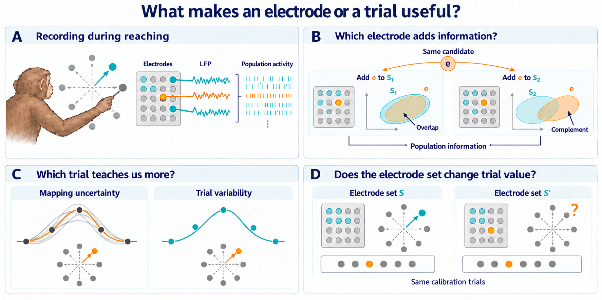

# EP08 outputs

**October 13 — eight-session information-value follow-up complete.**
The primary32-trial comparison does not improve prediction in either animal;
only0/4 Chewie and1/4 Mihili sessions improve. The prespecified64-trial analyses
have small positive animal means, reported as exploratory sensitivities rather
than a replacement result. All35,160 fits, three focused checks and ASTRA
validation completed; cost0.021111111CPUh. The original41-comparison policy
conclusion and all four closed reserved sessions remain intact.
Read the [complete four-comparison result](runs/offline_information_value/attempt001/information_value.md),
[figure](figures/offline_information_value/attempt001/information_value.png),
and [interpretation/accounting](experiment_log.md). No automatic follow-up is selected.
Earlier launch/preparation entries below are historical.

**October 13 — information-value analysis submitted as 47687188.**
The complete eight-session real-data panel and its three focused checks are
selected in a bounded 1 CPU/6 GiB/35-minute job. See the [execution log](experiment_log.md).
Earlier preparation entries below are historical.

**October13,20:44UTC — distinct information-value continuation authorized and implemented.**
The [adopted design](information_value_design.md) tests whether fitting-derived
conditional gain predicts electrode-removal loss beyond quality and marginal
association on the same eight development sessions. The runnable complete panel
and three focused checks are prepared; compute execution and checks are unrun.
The original41-comparison policy conclusion remains complete, the previously
exposed evaluation trials support exploratory claims only, and all four reserved
sessions stay closed. See the [implementation/resource handoff](experiment_log.md).

[Public online resources, checked October 6](../DATASETS.md#public-online-resources--checked-october-6-2026): original session downloads, task/acquisition documentation and authors' analysis code, with compatibility limits.

2026-10-04, 08:08 UTC: **development search stopped at 41 valid comparisons**.
Adopted terminal status: `development_only_no_initializer_robust_policy`.
Root and independent scientific/stopping reviews passed. The
[final development report](final_report.md) and
[machine-readable summary](development_summary.json) disclose the reconstructed
26-comparison patience count and sufficient alternative checks/coverage.

Average target-correspondence benefit is **+0.003353 Q**, but Mihili reverses
in one initializer order and only one of its four session effects is positive
after averaging orders. A stable initializer-independent useful policy is
not established. All four held sessions remain closed; no held protocol,
further source work, final confirmation or canonical transition is selected.

See the [initializer figure](figures/initializer_robustness_attempt001.png),
[PDF](figures/initializer_robustness_attempt001.pdf),
[50-row data](figures/initializer_robustness_attempt001.csv), and
[adoption/validation record](experiment_log.md). The dated entries below are
historical execution milestones.

Earlier execution milestones follow.

2026-10-04,07:55UTC: **41 valid comparisons; initializer robustness screen
fails despite a positive average correspondence signal**. Mean-three-order
candidate Q is0.206962 versus control0.203609, **+0.003353**, positive in both
animal means. Mihili reverses in order1 and only1/4 of its mean-order session
effects is positive. The288.673-second run completed2,280 models, with exact
within-order full96 replay and held sessions closed. See the
[complete evidence and scientific stop/held recommendation](experiment_log.md).
Root rendered and visually checked the
[initializer figure](figures/initializer_robustness_attempt001.png),
[PDF](figures/initializer_robustness_attempt001.pdf) and
[50-row CSV](figures/initializer_robustness_attempt001.csv). Mihili's only
positive mean-order session is20140304; removing it reverses the animal mean.
The recommendation is to stop further development fitting once root settles
the remaining obligations, retain a limited development-only claim, and keep
held data closed unless a narrower prospective test is explicitly selected.
No new incumbent, patience reset or automatic completion is claimed.

Earlier execution milestones follow.

2026-10-04,07:54UTC: **three-initializer robustness complete;41 valid
comparisons**. The [complete report](runs/development_search/initializer_robustness_attempt001/initializer_robustness.json)
finished all eight session groups in288.673seconds,119,952KiB peakRSS, adding
two panels only. Root selected the reviewed completed-report extraction and
figure rendering in compute; scientific interpretation awaits derived
evidence. No further source work is selected and held sessions stay closed.
See the [completion and analysis boundary](experiment_log.md).

Earlier execution milestones follow.

2026-10-04,07:47UTC: **new compute allocation verified; robustness dispatch
selected;39 completed comparisons unchanged**. Root verified46464685 on
`sh03-01n68.int`,oneCPU/6GiB,ending08:17:21UTC, and selected the exact frozen
600/630-second run into fresh`initializer_robustness_attempt001`. Root then
dispatched it at07:48:08UTC; the first session completed285 models with scores
withheld. Passing checks and prepared roles are reused. Full completion and
outcomes are not yet claimed. See the [actual dispatch record](experiment_log.md).

Earlier execution milestones follow.

2026-10-04,07:44UTC: **separate initializer roles complete; next scientific
allocation selected;39 comparisons unchanged**. All24 session/order roles
were prepared without neural reads in the
[new metadata artifact](runs/source_support/initializer_robustness_roles_attempt001/initializer_robustness_roles.json).
Root selected a new attended30-minute,one-CPU/6GiB allocation for the exact
600/630-second robustness run after closing the current allocation. No new
grant or scientific launch is claimed yet. See the
[role completion and prospective resource selection](experiment_log.md).

Earlier execution milestones follow.

2026-10-04,07:43UTC: **robustness static review complete; checks and role
preparation selected;39 completed comparisons unchanged**. Root and
independent review passed all four modules; peer review passed eleven focused
fixtures. All eleven then passed in4.773seconds, and changed ASTRA validation
passed without warnings. Root dispatched fresh metadata-only role preparation
in current46463321. The full600/630-second scientific run requires a new
verified allocation. Role completion and scientific launch are not yet
claimed. See the
[selected sequence](experiment_log.md).

Earlier execution milestones follow.

2026-10-04,07:37UTC: **initializer robustness adopted and implemented;
39 completed comparisons unchanged**. The
[fixed three-order/five-label recipe](initializer_robustness_proposal.md)
keeps the old96 fitting whitelist and40 evaluation trials, prepares separate
roles, and fits285 models/session before evaluation. The
[runner](tools/development_initializer_robustness.py) averages seed SSE within
order, then Q across orders; historical full96 equality is not assumed.
Independent review/fixtures and changed ASTRA checks precede the selected
600/630-second scientific branch. Root alone chooses a sufficient allocation.
See [implementation, exact commands and stopping-audit limits](experiment_log.md).
Reaching41 would not itself complete the episode or open held sessions.

Earlier execution milestones follow.

2026-10-04,07:27UTC: **raw initializer candidate/control complete;39 valid
comparisons**. The [complete report](runs/development_search/initializer_raw_marginal_attempt001/initializer_raw_marginal.json)
has candidate Q0.205697 and own-control contrast **+0.004017**, positive in
both animal means, with Chewie reversing under one omission. Its incumbent
contrast is only **+0.000664** overall and negative in Mihili, so the challenger
screen fails and root retains residual marginal selection. The97.267-second
run completed760 models with exact replays and held sessions closed. See
[closeout, limits and costs](experiment_log.md). The
[initializer-robustness successor](initializer_robustness_proposal.md) and its
subsequent adoption are recorded above.

Earlier execution milestones follow.

2026-10-04,07:25UTC: **raw initializer full comparison launched;37 completed
comparisons unchanged**. All ten fixtures passed in1.409seconds; changed ASTRA
schema/semantics passed without warnings. Root dispatched the exact adopted
eight-session run at07:25:13UTC in allocation46463321,270seconds internal/
300seconds external, with more than25minutes remaining. Scientific scores
remain unreleased. See the [actual checks and dispatch record](experiment_log.md).

Earlier execution milestones follow.

2026-10-04,07:18UTC: **raw initializer marginal comparison adopted and
implemented;37 completed comparisons unchanged**. The
[fixed recipe](initializer_raw_marginal_proposal.md) retains direction-related
association when freezing the paid initializer's electrode order, then uses
the unchanged residual decoder. Five matched label controls preserve direction
means. New code and the [selected270/300-second full-cohort command](experiment_log.md)
are ready. Root and independent static reviews passed. Root selected the ten
fixtures and ASTRA validation immediately after its current job in verified
46463321, followed on passing checks by the exact adopted eight-session run.
No test result, launch or extra comparison is claimed yet. See the
[runner](tools/development_initializer_raw_marginal.py) and adoption record.

Earlier execution milestones follow.

2026-10-04,07:12UTC: **CV-utility candidate/control complete;37 valid comparisons**.
The [complete report](runs/development_search/initializer_cv_utility_attempt001/initializer_cv_utility.json)
has candidate Q0.202768 versus control Q0.200032 (**+0.002737** overall),
but Mihili's contrast is negative. The candidate also loses **0.002265** to
the marginal incumbent, with both animal means negative, so both screens fail.
Most single-electrode internal validation utilities were negative and remained
unclipped. The99.593-second combined run reused the pilot, completed760 actual
decoder fits plus73,728 proxy fits, and replayed references exactly. Held
sessions stay closed. See the [scientific closeout and full costs](experiment_log.md).
The subsequent [direction-inclusive initializer proposal](initializer_raw_marginal_proposal.md)
and adoption are recorded above. It freezes the original raw association
ranking through later acquisition while keeping the current residual decoder.

Earlier execution milestones follow.

2026-10-04,07:09UTC: **CV-utility resource pilot complete; remaining seven
selected before scientific-score release;35 valid comparisons unchanged**.
The [preserved pilot](runs/development_search/initializer_cv_utility_pilot_attempt001/initializer_cv_utility.json)
completed in11.304741seconds with68,908KiB peakRSS and no comparison charge.
Root selected600seconds internal/630seconds external for the remaining
seven sessions in allocation46460577, provided the full630-second reserve
remains before launch. The completed pilot is reused once after all new fits.
The changed ASTRA schema/semantics passed. Root dispatched the
[exact remaining command](experiment_log.md) at07:10:30UTC in46460577,
with more than12minutes left. It is running; scientific scores remain
unreleased and no comparison increment is yet claimed.

Earlier execution milestones follow.

2026-10-04,07:01UTC: **cross-validated utility selector adopted and implemented;
35 completed comparisons unchanged**. The [fixed recipe](initializer_cv_utility_proposal.md)
uses strictly internal16/24-row proxy fits and8-row validation, signed utility
without clipping, and five target controls restricted to internal fitting rows.
The [new pilot/remaining runner](tools/development_initializer_cv_utility.py)
retains true validation and actual decoder targets, and separates proxy work
from decoder fits. Root selected the complete Mihili20140217 resource pilot,
270seconds internal/300seconds external, with scientific scores withheld.
Root and independent static reviews passed. All eleven fixtures passed
in1.119seconds and ASTRA schema/semantics passed. Root dispatched the selected
pilot at07:08:58UTC in allocation46460577 on`sh03-01n68`, one CPU/6GiB,
ending07:22:53UTC. It is running with no scientific-score release or count
increment. See the [adoption, checks, exact command and remaining-work boundary](experiment_log.md).

Earlier execution milestones follow.

2026-10-04,06:55UTC: **initializer logdet comparison complete;35 valid comparisons**.
The [complete report](runs/development_search/initializer_logdet_attempt001/initializer_logdet.json)
has Q0.197742, **−0.001800** versus matched uniform selection and **−0.007291**
versus supervised marginal selection. Both prospective screens fail. Chewie's
uniform contrast stays negative under every omission; both animals lose to
the marginal incumbent under every omission. The32.924-second run completed
all160 fits with exact replays. Nine fixtures and ASTRA validation passed;
held sessions stay closed. See the [closeout and diagnostic/cost evidence](experiment_log.md).
The [next proposal](initializer_cv_utility_proposal.md) estimates single-electrode
predictive utility using validation folds strictly inside each original
initializer view, with target controls restricted to internal fitting rows.
Its subsequent adoption is recorded above; no completed CV-utility result is yet available.

Earlier execution milestones follow.

2026-10-04,06:47UTC: **target-free logdet selector adopted and implemented;
34 completed comparisons unchanged**. The [fixed recipe](initializer_logdet_proposal.md)
uses fitting-only residual X and exactly32 greedy input-diversity choices,
with no Y in the selector API. The [new runner](tools/development_initializer_logdet.py)
retains true-target decoding and reuses completed matched uniform,
repeatability and marginal references only after all160 new fits. Root and
independent scientific review passed. Focused fixtures, changed ASTRA
validation and actual attempt selection remain pending coordinator compute.
The bound is180seconds internal/210seconds external, one CPU within4GiB;
root closed prior allocation46458807 at06:47UTC. See the
[adoption and exact proposed command](experiment_log.md).

Earlier execution milestones follow.

2026-10-04,06:42UTC: **high-power-only pair finalized;34 valid comparisons**.
The [complete report](runs/development_search/high_power_correspondence_attempt002/high_power_correspondence.json)
shows Q0.197552 versus own label-control Q0.191158 (**+0.006394**), positive
in both animal means under every session omission. It loses **0.007481** to
the three-band incumbent. Residual prediction beyond direction means is
+0.012948 overall, but Mihili reverses under one omission. Differences in
feature information and capacity prevent a spectral-mechanism interpretation.
The0.416-second finalizer reused all760 fits with zero source reads/refits;
the original95.225-second attempt remains preserved. Thirteen fixtures and
changed ASTRA validation passed; both replays are exact and held stays closed.
See the [scientific closeout and complete cost record](experiment_log.md).
Root rendered and visually checked the [spectral comparison figure](figures/high_power_correspondence_attempt001.png),
[PDF](figures/high_power_correspondence_attempt001.pdf) and
[210-row CSV](figures/high_power_correspondence_attempt001.csv), using finalized
attempt002 as the source. The subsequently adopted
[target-free residual-logdet comparison](initializer_logdet_proposal.md) is recorded above.

Earlier execution milestones follow.

2026-10-04,06:36UTC: **all HF fits complete; finalization-only repair prepared;
32 valid comparisons unchanged**. The [preserved first attempt](runs/development_search/high_power_correspondence_attempt001/high_power_correspondence.json)
completed eight sessions and760 fits in95.225seconds, then failed at historical
reference comparison because legacy marginal cells did not save `null_SSE`.
Scientific scores remain unreleased. Root approved a narrow schema repair
and [separate finalizer](tools/finalize_high_power_correspondence.py) that
reuses all fits with zero source reads or refits. Fresh attempt002 will retain
original costs and record its separate finalization cost. Focused repair
checks are pending; see the [failure, repair boundaries and command](experiment_log.md).

Earlier execution milestones follow.

2026-10-04,06:18UTC: **high-power-only comparison adopted and implemented;
32 completed comparisons unchanged**. The [fixed recipe](high_power_correspondence_proposal.md)
uses only native100–200/200–400Hz features, with two real coordinates per
electrode, matched target-label controls and true-target decoding. The
[new runner](tools/development_high_power_correspondence.py) preserves both
information barriers and compares old spectra only after all new fits.
Root and independent scientific/static review passed; all eleven focused
fixtures passed in0.777seconds and ASTRA schema/semantics passed without
warnings. Root selected one full eight-session
attempt,270seconds internal/300seconds external, one worker after EP05's
four-worker phase. Allocation46458807 is verified on`sh03-01n05.int`,
four CPUs/12GiB,06:21:37–06:51:41UTC. EP05's worker phase is running;
HF has not launched and requires at least300seconds of remaining reserve.
See the
[adoption, resource selection and exact command](experiment_log.md).

Earlier execution milestones follow.

2026-10-04,06:11UTC: **initializer conditional-gain pair complete;
32 valid comparisons**. The [complete report](runs/development_search/initializer_conditional_attempt001/initializer_conditional_gain.json)
has candidate Q0.202159 versus own control Q0.199744 (**+0.002415**), positive
in both animal means under every session omission. It nevertheless loses
**0.002874** to the marginal incumbent, with both animal means negative and
every overall omission negative, so the challenger screen fails. Residual
prediction beyond direction means is+0.017555 overall and remains positive
in both animals under omissions. The complete pilot-plus-remaining work took
102.968seconds, with760 fits and exact replays; four held sessions stay closed.
See the [scientific closeout and full resource accounting](experiment_log.md).
Root rendered and visually checked the [conditional comparison figure](figures/initializer_conditional_attempt001.png),
[PDF](figures/initializer_conditional_attempt001.pdf) and
[68-row CSV](figures/initializer_conditional_attempt001.csv) in allocation46457171.
The subsequently adopted [high-power-only comparison](high_power_correspondence_proposal.md)
is recorded above; its scientific results are not yet available.

Earlier execution milestones follow.

2026-10-04,06:08UTC: **conditional resource pilot complete;30 valid
comparisons unchanged**. The [Mi20140217 pilot](runs/development_search/initializer_conditional_pilot_attempt001/initializer_conditional_gain.json)
completed all95 models/960 greedy choices in11.925seconds,68,376KiB RSS,
with scientific scores withheld. Root selected the remaining seven sessions
at600seconds internal/630seconds external in the current one-CPU/6GiB
allocation46457171, preserving the completed pilot for reuse after all new
fits. The changed ASTRA schema/semantic validation passed without warnings,
and root launched the remaining
phase at approximately **06:10UTC**. It is running with no scientific-score
release or count increment yet. See the [resource evidence and exact command](experiment_log.md).

2026-10-04,06:02UTC: **initializer conditional-gain pair adopted;
30 completed comparisons unchanged**. The [fixed recipe](initializer_conditional_gain_proposal.md)
uses the original alpha1 greedy conditional proxy and five matched
within-direction target-label controls, with true-target decoders and
sets frozen after initialization. The [new pilot/remaining runner](tools/development_initializer_conditional.py)
preserves completed work and defers reference JSON until all new fits.
Root selected a complete Mi20140217 resource pilot,270/300seconds, in the
verified one-CPU/6GiB allocation46457171. Root and independent static review
passed, all nine fixtures passed in1.124seconds, and ASTRA schema/semantics
passed without warnings. Root selected immediate pilot execution; actual
start timing remains unobserved here. Its scientific scores remain withheld.
See the
[adoption, exact pilot command and remaining-phase boundaries](experiment_log.md).

2026-10-04,05:57UTC: **initializer repeatability pair complete;
30 valid comparisons**. The [complete report](runs/development_search/initializer_repeatability_attempt001/initializer_repeatability.json)
has Q0.201855 versus uniform control Q0.199543 (**+0.002312**), positive in
both animal means but only+0.000145 in Mihili, which reverses under two
omissions. Repeatability loses to the target-linked incumbent by **0.003179**
with both animal means negative, so the challenger screen fails. Omitting
Chewie20161006 reverses that overall comparison, demonstrating influence
without authorizing exclusion. The107.166-second run completed760 fits and
both replays exactly; four held sessions remain closed. See the
[scientific closeout, seed/tie diagnostics and costs](experiment_log.md).
The subsequently adopted conditional-gain comparison is recorded above;
the named complementarity endpoint stays closed and existing uniform-reference
evidence is not recharged.

Earlier execution milestones follow.

2026-10-04,05:51UTC: **initializer-only repeatability pair adopted and
prepared;28 completed comparisons unchanged**. The [fixed recipe](initializer_repeatability_proposal.md)
uses the original raw-X three-band repeatability formula without targets in
the selector API, with five uniformly shuffled physical-ID order controls.
The [new runner](tools/development_initializer_repeatability.py) preserves
true-target decoding,30-order/95-model information barriers and historical
all96 replay. Root and independent static review passed; all eight fixtures
passed in0.328seconds in verified allocation46457171 on`sh03-01n68.int`,
one CPU/6GiB. ASTRA schema/semantics passed without warnings, exit0. After the
prelaunch selection record, root observed actual270/300-second full-cohort
launch at **05:56:07UTC** in that allocation. It is running; no completed
comparison or valid-count increment is claimed yet. See the
[adoption and exact command](experiment_log.md).

2026-10-04,05:46UTC: **LMP-only candidate/control complete;
28 valid evaluations**. The [complete report](runs/development_search/lmp_correspondence_attempt001/lmp_correspondence.json)
shows true selection Q0.199333 and control Q0.198621: **+0.000712**, with
positive means in both animals but an overall reversal when Chewie20161005
is omitted. Residual prediction beyond direction means is+0.014728 overall
and positive in both animals under every omission. LMP selection loses
0.005701 to the three-band rule; dimension and capacity change with the bands,
so this does not isolate contamination. Both prospective sign screens pass
with the stated limitations. The86.657-second run completed760 fits and both
replays exactly; held sessions remain closed. See the
[full interpretation, seed sensitivity and costs](experiment_log.md).
Root rendered and visually checked the [four-panel figure](figures/lmp_correspondence_attempt001.png),
[PDF](figures/lmp_correspondence_attempt001.pdf) and
[44-row CSV](figures/lmp_correspondence_attempt001.csv) at05:50UTC. Allocation46456142
was then closed at05:50:33UTC; the completed evidence is preserved.
The subsequently adopted initializer-only repeatability comparison is recorded
above; actual decoder targets are still acquired and used despite its
target-free ranking rule.

Earlier execution milestones follow.

2026-10-04,05:40UTC: **native-LMP candidate/control adopted and prepared;
26 completed comparisons unchanged**. The [fixed recipe](lmp_only_correspondence_proposal.md)
uses one actual guide(0,0) coordinate per electrode in both selection and
decoding, with the same five target-label maps and true-target decoders.
The [new runner](tools/development_lmp_correspondence.py) and one-band reader,
scalar selector and E-wide initial fitter passed root's static review.
All seven independent fixtures passed in0.100seconds at05:44UTC in verified
allocation46456142. ASTRA schema/semantics passed without warnings, exit0. Root has
recorded the exact270/300-second full-cohort attempt in that one-CPU/4GiB
allocation before launch. Root observed actual launch at **05:45:08UTC**;
the attempt is running and no completed result or count increment is yet
claimed. See the
[adoption, exact command and BR retrieval limits](experiment_log.md).

2026-10-04,05:31UTC: **initializer correspondence control complete;
26 valid evaluations**. The [complete five-seed result](runs/development_search/initializer_target_label_control_attempt001/initializer_target_label_control.json)
shows true initial marginal Q0.205033 versus control Q0.199653, a
**+0.005381** contrast. Both animal means are positive, so the prospective
directional screen passes, but Mihili's gain is only+0.000390 and becomes
negative when its20140303 session is omitted. All overall fixed-prediction
omissions remain positive; seed2 also reverses the Mihili contrast. This is
limited development evidence for useful initializer correspondence, with no
causal, contamination-free or joint-acquisition claim. The99.608-second run
completed all640 fits with zero all-96 score replay error and held sessions
unopened. See the [scientific closeout and actual costs](experiment_log.md).
The [report-backed figure](figures/initializer_target_label_control_attempt001.png),
[PDF](figures/initializer_target_label_control_attempt001.pdf) and
[37-row CSV](figures/initializer_target_label_control_attempt001.csv) were
rendered and visually checked by root in allocation46456142. The subsequently
adopted LMP-only sensitivity is recorded above; no spike-free or unchanged
three-band-capacity claim is made.

Earlier execution milestones follow.

2026-10-04,05:22UTC: **initializer target-label control adopted and prepared;
25 completed evaluations unchanged**. The [prospective fixed recipe](initializer_target_label_control_proposal.md)
randomizes only the within-direction target correspondence used by the paid
initializer's marginal electrode selector. Five ordinary seeds form one
control; all decoders keep true targets and the original marginal result is
reused. Root and the independent EP05 reviewer passed the full static review;
all seven [scientific fixtures](tools/test_initializer_target_label_control.py)
passed in0.071seconds and ASTRA schema/semantics passed without warnings in
attended allocation46456142 on`sh03-01n68`, one CPU/4GiB. Root selected the
[new runner](tools/development_initializer_target_labels.py) for bounded
270/300-second full-cohort execution after the EP05 resource pilot. Selection
was followed by actual launch at **05:29:39UTC** in the same allocation;
the new attempt is running, with no scores released or count increment yet.
See the
[adoption, observed checks and exact command](experiment_log.md).
All four held sessions remain closed; the previous completed result follows.

2026-10-04,00:35UTC: **reverse-animal comparison complete;25 valid evaluations**.
The [eight-session report](runs/development_search/reverse_animal_electrode_attempt001/reverse_animal_electrode_value.json)
has candidate Q0.202760, below initial marginal selection by **0.002274** with
losses in both animals. Its+0.000546 gain over the own-label control fails the
required two-direction screen because Mihili is negative; two of three control
seeds individually beat the candidate, and omitting Chewie20161006 reverses
the average gain. Improvement over the previous learned rule is+0.000941,
below the existing0.001 progress resolution. The run completed in72.198s with
zero common all-96 replay difference and explicit inherited donor costs.
See the [full closeout](experiment_log.md). Search remains incomplete and the
four held sessions remain closed.

Earlier execution milestones follow.

2026-10-04, approximately00:20UTC: the fixed
[reverse-animal learned-value comparison](reverse_animal_electrode_value_proposal.md)
is adopted and prepared, with **23 completed evaluations unchanged**. It uses
four other-animal donor sessions in each direction and the same three-seed
label control; inherited donor supervision and early parsing of its combined
report are explicit. The [new runner](tools/development_reverse_animal_electrodes.py)
and [six focused fixtures](tools/test_reverse_animal_electrode_value.py) passed
root's compute checks: all six in0.071s and ASTRA schema/semantics without
warnings. Root selected270s internal/300s external,1CPU within4GiB.
At00:28:02UTC root verified attended allocation46441736 on`sh03-06n50.int`,
one CPU/4096MiB/30minutes. Following the approximately00:31UTC prelaunch
handoff, root confirmed actual full eight-session launch at **00:34UTC**.
At that launch observation no scientific scores were released and the count
was23; completion is recorded above. See the
[prelaunch record and exact commands](experiment_log.md).
No held session or named explanatory endpoint is opened.

2026-10-04,00:17UTC: **learned selector/control completed;23 valid evaluations**.
The [complete eight-session report](runs/development_search/learned_electrode_attempt001/learned_electrode_value.json)
gives learned Q0.201819, losing **0.003214** to initial marginal selection and
**0.001603** to its donor-label control. Both animal means lose; every overall
session omission preserves both losses, although Chewie's signs reverse when
its20161006 session is omitted. The exact all-96 replay difference is zero.
The [log](experiment_log.md) records seed variation, the larger donor-information
cost and83.538s combined component runtime. Required search and reverse-animal
transfer remain incomplete; held sessions remain closed.

Earlier execution milestones follow.

2026-10-03, 23:58 UTC: **grouping control completed; 21 valid evaluations total**.
The [complete three-seed report](runs/development_search/mapping_grouping_control_attempt001/mapping_grouping_control.json)
has Q **0.200320811382**, improving on the mapping heuristic by
**+0.004502659106** while remaining below balance by **−0.001845134990** and
mean-value by **−0.002280833735**. Both animals and all four order means
improve on mapping; seven of eight sessions improve. Every session remains
below balance and mean-value. Randomized utility grouping reduces the
heuristic's loss without rescuing it or identifying sensor–trial coupling.
All required counts completed, endpoint replay is zero, and held sessions
remain closed. See the [execution and interpretation record](experiment_log.md).
The [learned-electrode proposal](learned_electrode_value_proposal.md) was
subsequently adopted at approximately00:04UTC onOctober4. It explicitly adds
donor supervision and matches target-session acquisition cost rather than
total training information/cost. New implementation and seven scientific
fixtures are ready; root ran all seven successfully in0.027s. The selected
complete first-target pilot is270s internal/300s external on one CPU within
the attended4GiB allocation46440428, and completed in15.490s with79,436KiB
peakRSS. Its scientific scores remain withheld. The remaining seven sessions
started at00:14UTC with540s internal/600s external, reusing the completed pilot
after all new fits and preserving the old all-96 replay requirement. Count21
is unchanged until the cohort finishes. See the
[launch record, measured costs and exact command](experiment_log.md).

2026-10-03,23:27UTC: **mapping comparison completed;20valid evaluations total**.
The acquired-LFP mapping heuristic loses to balance by **−0.006347794Q** and
to mean-value by **−0.006783493Q**, with losses in both animals, all eight
session means, all four order means and every fixed-prediction session
omission. The [complete report](runs/development_search/mapping_variance_attempt001/mapping_variance.json)
retains all20cells and intermediate profiles. It completed in271.200s with
273,288KiB RSS and exactly zero endpoint score replay error. Four held sessions
remain closed. This rejects the benefit of this specific heuristic in these
comparisons, not mapping-informed acquisition generally; see the
[interpretation and actual costs](experiment_log.md).
The report-backed [figure](figures/mapping_variance_attempt001.png),
[PDF](figures/mapping_variance_attempt001.pdf) and
[plotted-value CSV](figures/mapping_variance_attempt001.csv) show every session
and order contrast plus both animals' full checkpoint profiles. Root rendered
and visually checked them at 23:47 UTC; all 124 plotted rows replayed, with
zero shared-endpoint difference and no additional fits or valid evaluations.

Root adopted the [three-seed direction-grouping control](mapping_grouping_control_proposal.md)
to test whether real direction grouping contributes to that loss. It preserves
same-history geometry/counts and true decoder targets, randomizing only acquired
row utility groups; the twelve seed/order histories may diverge. The
[core](tools/mapping_grouping_control.py), [runner](tools/development_mapping_grouping.py)
and [six scientific fixtures](tools/test_mapping_grouping_control.py) passed
static review and root compute checks at 23:41 UTC: six fixtures in 0.040s,
ASTRA schema/semantics without warnings, and shell syntax. An initial runner
syntax error was repaired and the complete suite rerun; see the log.
Root selected the
[20-minute batch](tools/mapping_grouping_control01.sbatch),1CPU/2GiB, no retry;
root submitted it once at 23:42 UTC as job **46439887**. Its concrete commands
and completed checks are in the [log](experiment_log.md).
Three seed-level SSEs are averaged, with no prediction ensemble or favorable
seed selection. The batch has now completed as recorded above, adding one
comparison and bringing the total to21. The40minimum and shared112ceiling
remain unchanged; no named explanatory endpoint was activated.

2026-10-03, 23:05 UTC: **arrival-order comparison completed; 19 valid
evaluations total**. Across three fixed new orders, mean-value improves on
balance by +0.000363758 Q (+0.000606264 over intermediate checkpoints), below
the adopted 0.001 search resolution. Both animal averages are positive, but
order 0 Mihili and order 2 Chewie are negative. Omitting Chewie20161006 leaves
only +0.000029010 overall and a negative Chewie mean. Mean-error loses
−0.003908758 Q. This is insufficient robustness for the modest target-only
allocator gain, not a completed or negative answer to the full episode.
See the [complete report](runs/development_search/arrival_order_attempt001/arrival_order.json)
and [execution record](experiment_log.md#2026-10-03-2305-utc--development_search-arrival-order-result-and-mapping-successor).
Endpoint replay is exactly zero; all four held sessions remain closed.

The [mapping design-index comparison](mapping_variance_proposal.md) was adopted
after that result and subsequently completed above. Its fixed initializer
coordinates and empirical acquired-row expectation do not provide calibrated
uncertainty or establish sensor–trial coupling.

2026-10-03, 22:33:32 UTC: **trial allocation completed; 18 valid evaluations
total**. On the common initializer-normalized scale, balanced Q is0.200114,
mean-value allocation0.200766 and mean-error allocation0.198233. Their gains
over balance are **+0.000652** and **−0.001882**; restricting to the informative
48/64/80checkpoints gives+0.001086 and−0.003136. Value gains are positive in
both animal means but only five of eight session means, with two losses and
one tie. Error improves four session means despite losing in both animal means.
See the [completed report](runs/development_search/trial_allocation_attempt001/trial_allocation.json)
and [actual interpretation/accounting](experiment_log.md#2026-10-03-2233-utc--development_search-trial-allocation-completed).
Initial32/final96 models are shared, with exactly zero contrasts. This is a
direction-mean proxy comparison on repeatedly exposed development data,
not a general information-gain or coupling claim. The next recommendation is
a [fixed-initializer arrival-order falsifier](trial_arrival_order_proposal.md);
the coordinator adopted this single robustness comparison, subsequently
completed above with one shared evaluation and zero method families. The source-backed
[paired-effect figure](figures/trial_allocation_attempt001.png) and
[PDF](figures/trial_allocation_attempt001.pdf) show all session reversals and
animal checkpoint profiles without confidence intervals or additional fits.
Four held sessions remain closed.

2026-10-03, 22:22:23 UTC: **acquired-only comparison completed; 16 valid
evaluations total**. Initial marginal selection reaches Q **0.205033** versus
fixed random **0.201775** across its separate twenty-cell protocol. Its gain is
0.005728 in Chewie and 0.000789 in Mihili, with five of eight session means
positive. Selection first observes all96 electrodes for32trials, so its modest
performance gain is not an equal-acquisition-cost advantage. The all96 branches
coincide; initial replay differs by at most3.33e−16. See the
[complete report](runs/development_search/acquired_only_attempt001/acquired_only.json)
and [actual results and costs](experiment_log.md#2026-10-03-2222-utc--development_search-acquired-only-completed).
The [trial-allocation comparison](trial_allocation_proposal.md) subsequently
completed: use the globally fixed random branch to isolate trial
allocation at its explicit lower observation cost, while preserving selection
as a later comparison. Initial rank/alpha and evaluator scaling stay fixed;
mean-value and mean-error allocation share balanced initial/final fits.
All four held sessions remain closed; this choice uses already exposed
development results. The coordinator rendered and viewed the
[acquired-only figure](figures/acquired_only_attempt001.png) and
[PDF](figures/acquired_only_attempt001.pdf) from the completed report alone,
showing animal/session evidence and the unequal initial observation costs.

2026-10-03, 21:50:17 UTC: **residual selection completed; 15 valid evaluations
total**. Marginal residual selection leads at Q **0.202708**, conditional at
0.201434, and the within-direction permuted-target selector at 0.197046;
matched random reduced-rank ridge is 0.197790. Conditional selection exceeds
its permutation control in all eight sessions, but does not beat marginal
selection in aggregate. This supports target-linked residual selection without
establishing an advantage from conditioning on retained electrodes.
See the [completed report](runs/development_search/residual_selectors_attempt001/residual_selectors.json)
and [actual execution record](experiment_log.md#2026-10-03-2150-utc--development_search-residual-selection-completed).
The [acquired-only comparison](acquired_only_proposal.md) was subsequently
completed as recorded above. Held sessions remain closed.

2026-10-03, 21:40:46 UTC: **temporal/rank/kernel panels completed; 12 valid
evaluations total**. Reduced-rank residual ridge has the largest current aggregate Q,
**0.197790**, versus temporal ridge 0.193312, kernel ridge 0.191807 and unchanged
mean residual ridge 0.188342. The reduced-rank gain is concentrated in Chewie;
Mihili's mean is slightly lower than its prior reference, so this is no
cross-animal winner claim. See the [completed capacity comparison](runs/development_search/capacity_comparison_attempt001/capacity_comparison.json)
and [actual accounting](experiment_log.md#2026-10-03-2140-utc--development_search-temporalrankkernel-completed).
The [residual selection recipe](residual_selection_proposal.md) was adopted at
21:46 UTC and has now completed. All four held sessions remain closed.
The coordinator's source-backed [capacity figure](figures/development_capacity_attempt001.png)
and [PDF](figures/development_capacity_attempt001.pdf) read only the completed
report, showing the same twelve cells and four sessions per animal, without
confidence intervals and with unequal rank-tuning opportunities disclosed.

2026-10-03, 21:32:46 UTC: **D/W/R completed**, bringing the shared total to
**nine valid evaluations**. Direction-only Q is 0.181856; direction-residual
random ridge reaches **0.188342**, improving every session mean. Raw repeatability
and conditional selection still carry within-direction trial information:
correct pairing adds 0.068320 and 0.068546 Q respectively, despite their lower
overall Q. Residual ridge adds 0.006486 over direction-only, with a 0.006248
pairing increment. These are development results, not coupling or acquisition
efficiency claims. See the [completed comparison](runs/development_search/direction_controls_attempt001/direction_controls.json)
and [actual evidence and accounting](experiment_log.md#2026-10-03-2132-utc--development_search-dwr-completed).
The [next representation/capacity recipe](representation_capacity_proposal.md)
was adopted at 21:36 UTC and its three panels have completed as recorded above. All four held sessions
remain closed.

2026-10-03, 21:16 UTC: **five selector/control panels completed** in allocation
46430982, bringing the shared total to **six valid evaluations**. Direction
repeatability leads at Q **0.148469**, followed by marginal target association
0.144147 and conditional target association 0.128715; the fixed random
baseline is 0.088754. Those three improve every session mean. Diversity and
target-permuted selection perform below the baseline. This makes direction-only
prediction and within-direction trial information the next competing
explanations to test. See the [completed selector report](runs/development_search/selector_comparison_attempt001/development_selectors.json)
and [actual results and accounting](experiment_log.md#2026-10-03-2116-utc--development_search-five-selector-panels-completed).
All four held sessions remain closed; the global search is incomplete.
The [next direction-confounding comparison](direction_confounding_proposal.md)
was adopted prospectively at 21:25:58 UTC and has now completed through its
[trusted evaluator](tools/development_direction_controls.py), as recorded above.
The source-backed [selector figure](figures/development_selectors_attempt001.png)
and [PDF](figures/development_selectors_attempt001.pdf) show the completed five-panel comparison.

2026-10-03, 20:55:33 UTC: the complete eight-session random-subset development
baseline finished in job **46429138**, charging **one valid evaluation**.
Animal-balanced Q was **0.088754** (Chewie 0.081471; Mihili 0.096037).
The four held sessions remain closed. See the
[completed baseline](runs/simple_comparisons/development_baseline_attempt001/development_baseline.json)
and [execution log](experiment_log.md). This is a reference comparison, not a
scientific winner or completed 40–112-evaluation search.
The coordinator-generated [baseline figure](figures/development_baseline_attempt001.png)
and [PDF](figures/development_baseline_attempt001.pdf) show the completed
electrode/trial curves by animal; they introduce no new fits.

The [first development-comparison recipe](development_comparison_proposal.md)
has been prospectively adopted for development. Its metadata-only trial-role
preparer completed on job 46429138: eight sessions, 320 reserved evaluation
trials, no neural access. The shared training-only fitter, cost pilot and fixed trusted development
evaluator passed independent source review. Three focused tests and the
training-only pilot passed before the full baseline. The metadata-role ASTRA
validation passed; later recipe validation is recorded by the coordinator.
Five matched selector/control successors have a
[prospective recipe](selector_comparison_proposal.md) and
[evaluator](tools/development_selectors.py); all five are now **completed**.
It introduces no compulsory initializer or held-session opening.
The [latest execution entry](experiment_log.md#2026-10-03--prospective-first-development-comparison-and-trial-handoff)
also records why the complete optional reference is unsupported by the known
17-trial direction, without excluding that session or closing open exploration.

The current scientific question is **what makes electrode and calibration
information valuable, and when can that value be predicted?** The
[open-exploration amendment](open_exploration_design.md) keeps models,
summaries, training/calibration information and initialization open. No
separate 16-trial pilot is compulsory. Offline value analysis and sequential
acquisition have different information/cost claims. The
[acquisition-principle proposal](acquisition_principle_proposal.md) gives
candidate linear proxies and falsifiers, not a required model. Additional
explanatory scoring remains unactivated. The original matched-budget numerical
protocol is preserved as an **optional 16-trial reference**, not the global gate.

The current [concept figure](figures/ep08_episode_series-v6.png) retains v5's
EP05/EP12-inspired style. It shows center-out reaching, conditional electrode
information, uncertainty versus trial variability, and sensor-dependent trial
value. Panel C has equal schematic observation counts, not a prescribed pilot.
Panel D changes physical electrode membership at equal set size and keeps
calibration trials fixed. The [imagegen prompt](figures/ep08_episode_series-v6-prompt.md) and
[earlier protocol overview](ep08_open_exploration-v3.png) are retained. The
[v2 figure](ep08_conditional_value_principle-v2.png) and
[prompt](ep08_conditional_value_principle-v2-prompt.md) depict the optional
16-trial reference only.
The [earlier PNG](ep08_question_imagegen.png) and
[SVG](ep08_question.svg) remain historical design assets, not current results.

The baseline through the arrival-order comparison comprised the historical
first nineteen evaluations. The current completed search contains 41 valid
comparisons and the adopted [development-only final report](final_report.md).
Its session/animal results, control comparisons and stopping reconciliation
remain visible. No further run is selected; optional held, reference and
explanatory branches retain their prospective conditions and the unspent
single held-session opening.

The proposed paper logic is in [paper_plan.md](paper_plan.md). Large source
data remain outside Git, and temporary computations belong in the
episode-specific scratch directory.

The [ASTRA worklist](astra/v0.0.14/astra.yaml) records the planned study paths,
including offline value exploration independent of an acquisition-policy win.
The [execution log](experiment_log.md) records all completed comparisons and
the terminal adoption. Additional explanatory scoring margins and a compatible
third-animal source belong to unselected future branches; they are not missing
requirements for the completed limited report or a generalization claim.
