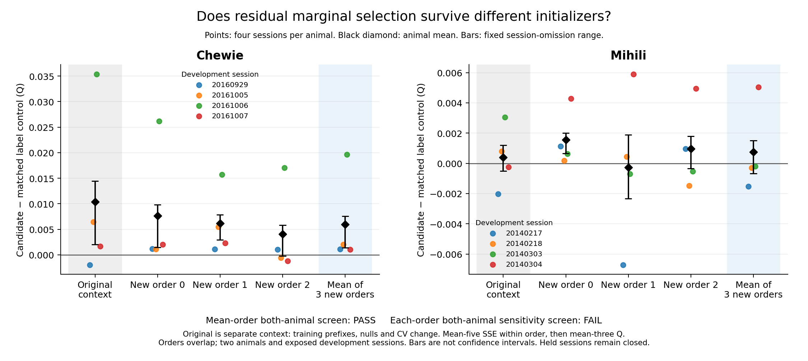

# EP08 development report

Adopted by the coordinator at **2026-10-04 08:08 UTC**, after root and
independent scientific/stopping reviews passed. Terminal status:
`development_only_no_initializer_robust_policy`. This is a local research
conclusion, not a canonical BR transition or a held-session confirmation.

## Conclusion

Early residual marginal electrode selection shows **average usefulness of
within-direction LFP-to-population target correspondence** in the eight
development sessions. A stable initializer-independent useful acquisition
policy is **not established**. The positive average survives three
prespecified initializer conditions, but Mihili reverses in one condition and
three of its four session effects are nonpositive after averaging conditions.
The retained rule is therefore a development reference, not a confirmed
deployable policy or a demonstrated joint electrode/trial principle.

Development search is stopped at **41 valid comparisons**, using the
coordinator's reconciled patience and coverage
record. All four internal held sessions remain closed. No further method,
source fit, held protocol or final confirmation is selected. A later held
test would require its own prospective decision and would use the still
unspent single shared opening.

## What was compared

The development cohort contains four Mihili and four Chewie sessions. The
current acquisition branch pays for a 32-trial initializer across all 96
electrodes, then uses immutable selected sets of 8/16/32 electrodes or the full
96-electrode reference, evaluated at 32/48/64/80/96 acquired trials. Every cell uses the
original native-unit population target, the same three ten-bin LFP means and
the qualified fitting-only direction-residual reduced-rank ridge procedure.
The 40 evaluation trials per session stay excluded from selection and fitting.

The selected electrode sets are frozen before later source acquisition.
Within-direction label controls alter only the initializer's ranking targets;
the actual decoder and its tuning always use true targets. Five control SSEs
are averaged within each cell's common denominator before deriving Q. The
control tests useful trial correspondence for this selection procedure; it
does not remove all neural signal from the actual decoder or establish a
causal biological mechanism. Acquisition cost includes the all-electrode
initializer: `32*96+(n-32)*E` LFP electrode-trials plus `n*U*10` target values.

The last comparison generated three ordinary, fixed-seed initializer/queue
conditions inside the **same original 96 fitting-trial whitelist**, preserving
all 40 evaluation identities. It fitted all 285 models per session across the three
conditions before the shared evaluation read. For each condition, the control
first averages five SSEs; the final summary then averages three order-specific
Qs. Changed prefixes, null normalizers and initializer-conditioned CV mean
that old/new Q differences are not a pure effect of electrode selection.
Full-96 identity is required within a condition, not across conditions or
against historical fits. The [adopted robustness recipe](initializer_robustness_proposal.md)
contains the complete seed, role, fitting, aggregation and exposure rules.

## Main evidence and its limits

The original-initializer residual marginal rule had Q 0.205033454630 versus
its own label-control Q 0.199652641190, an average contrast of +0.005380813441.
Both animal means were positive, but the Mihili mean reversed when its
influential 20140303 session was omitted. That result motivated the subsequent
initializer sensitivity test; it was not treated as stable confirmation.

The [completed three-initializer comparison](runs/development_search/initializer_robustness_attempt001/initializer_robustness.json)
has candidate Q **0.206961554814**, control Q **0.203608952102** and an
average contrast of **+0.003352602713**. Chewie's mean contrast is
**+0.005951295867**, Mihili's **+0.000753909558**. The average-order
both-animal screen passes; the stricter each-order/both-animal screen fails.

| Initializer condition | Chewie candidate−control Q | Mihili candidate−control Q |
| --- | ---: | ---: |
| New order 0 | +0.007628248045 | +0.001556363571 |
| New order 1 | +0.006146406697 | −0.000268015477 |
| New order 2 | +0.004079232860 | +0.000973380580 |
| Equal mean of three | +0.005951295867 | +0.000753909558 |

All four Chewie mean-order session contrasts are positive. In Mihili, only
20140304 is positive (+0.005039955715); 20140217, 20140218 and 20140303 are
−0.001537820410, −0.000285359402 and −0.000201137670. Omitting 20140304
makes Mihili's mean −0.000674772494. Order 2 also reverses in Chewie after
omitting 20161006 and in Mihili after omitting 20140304. Positive overall
omission means therefore do not establish stable effects within both animals.

All five mean-order seed contrasts are positive in both animal means, with
overall contrasts +0.002213210212 to +0.004634906161. This does not supply
additional biological replication: the orders overlap in fitting trials and
share evaluation outcomes, and the five controls are computational replicates.
There are two animals. Resource cells, orders and label seeds do not increase
that biological sample size.

Residual prediction beyond the direction-only model is +0.018001283899 overall,
Chewie +0.035391883749 and Mihili +0.000610684049. Mihili's omission range
includes −0.000033816534. Neither a direction-only explanation nor uniformly
stable residual benefit across sessions is established by the aggregate.

[PDF](figures/initializer_robustness_attempt001.pdf) ·
[50-row figure data](figures/initializer_robustness_attempt001.csv).
The original initializer is separate context. Black ranges show fixed-model
session omissions, not confidence intervals; the animal axes are separately
labelled. Root rendered and visually checked these outputs.

## Why the incumbent was retained and search can stop

The direction-inclusive raw challenger achieved +0.000664022442 over residual
marginal selection overall, but its contrast in Mihili was −0.000396407187. It failed the
both-animal challenger screen and fell below the existing 0.001-Q search
progress resolution. Internally cross-validated utility, target-free
repeatability/diversity and greedy conditional ranking also did not establish
a stronger matched-support incumbent. Low-frequency/high-power comparisons
changed input bandwidth/capacity and remain spectral sensitivities, not pure
spike-contamination or mechanism tests. No new-order first score is promoted
over the original-role incumbent.

The [prospective development rule](development_comparison_proposal.md)
requires at least 40 total valid comparisons **and** 20 consecutive valid
comparisons without the specified progress, applicable coverage and sufficient
alternative checks. It does not require a mandatory 60-comparison floor.
The coordinator's conservative reconstruction starts after the completed
13–15 residual-selector block and counts **26** subsequent valid comparisons
through 41 without an adopted same-support 0.001-Q improvement or frontier
reset. New 20-cell support at 16, arrival-state evidence at 19 and new initializer
conditions at 40 do not reset patience merely by providing a first score.
The robustness screen was prospectively defined as sensitivity evidence,
without a new progress reset or automatic promotion rule.

After the first 20 comparisons, the conservative control set
21, 23, 25, 26, 28, 30, 32, 34, 37, 39, 41 contains **11 of 21** comparisons (52.38%),
exceeding the 40% requirement. Completed exploration spans random and
repeatability/reliability rules; marginal, conditional and diversity ranking;
decoder/rank/tuning changes; direction residualization; acquired-only fixed,
value, error and mapping trial rules; learned and reverse-animal ranking;
spectral ablations; target-label controls; session omissions; and initializer
robustness. Actual adaptive successors and challenger decisions include
learned-to-reverse-animal transfer and repeatability/conditional/CV/raw
challenges followed by retention of residual marginal selection.

The open-design amendment makes the 16-trial reference families optional and
keeps named explanation endpoints prospective. Their unactivated status is
not an unfulfilled gate for this narrower development-only conclusion.
There is no identified applicable gap requiring another fit for this terminal
route. The absence of held, explanatory and independent-animal evidence
restricts the conclusion explicitly.

## Execution and remaining evidence boundary

The last full comparison ran in job 46464685 on `sh03-01n68.int`,
07:48:08.567193–07:52:57.239909 UTC: 288.672735 seconds wall,
283.796948 seconds CPU, 119,952 KiB peak RSS. It completed 2,280 actual models,
45,600 inner fits and 228,000 capacity scores. There were 29,952 fitting-read
calls and 320 evaluation trials, 324,176,640 logical bytes and 30,094,080 unique
native bytes. Within-order full-96 replay error is zero. Eleven independent
fixtures and ASTRA validation passed. The [experiment log](experiment_log.md)
preserves attempts, failed finalization and repairs, actual resources and all
decision transitions; shared allocation costs are counted once by root.

This report does not claim held confirmation, a joint electrode/trial
principle, conditional removal-value prediction, repeatable next-direction
benefit, neural causality, deployment savings or generalization to a new
animal. All four held sessions remain unopened. Their future use would need
one prospectively frozen protocol covering the retained claim, comparators,
data assignments, scoring, meaningful-effect decision and limits. The 0.001
search resolution and optional reference's 0.005 criterion do not automatically
supply such a held decision. No such protocol or opening is selected here.

The [machine-readable development summary](development_summary.json)
records the adopted limited terminal status and stopping reconciliation.
