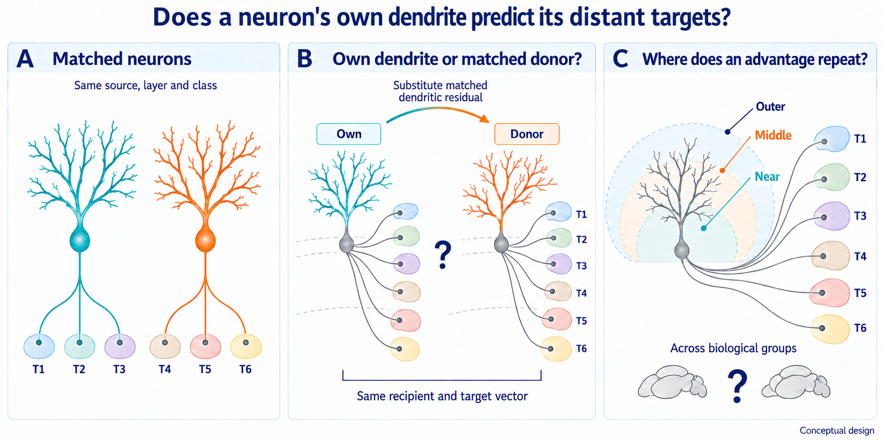

# EP09 paper plan

## October 6 public-source lead — brain 236174 and provider key 16124

The original [TeraVR Methods, Data preparation](https://www.nature.com/articles/s41467-019-11443-y)
explicitly associates brain 236174 with `Gnb4-IRES2-CreERT2;Ai139`. The
[BrainTell gallery](https://braintell.org/projects/fullmorpho/) lists that exact
brain ID and links its [genetic-information table](https://braintell.org/projects/fullmorpho/genetic_info.txt).
The table's `BrainID / GeneticBackground` row is
`16124 / Gnb4-IRES2-CreERT2;Ai139-hyg_236174-16124`. This supplies an
original-provider alias/genotype lead for the exact-key mismatch below.

**Identity/genotype reconciliation completed, October 6 Pacific:** the
[direct metadata observation from job 46842156](runs/metadata_feasibility/attempt002/provider_alias236174_observation_job_46842156.json)
returned exactly one matching supplement row, row 81. It explicitly records
Animal ID `236174`, Image ID `16124`, fMOST and
`Gnb4-IRES2-CreERT2;Ai139`, with `BIL meta (20231223)` provenance. Its
target description is `Claustral and cortical Car3+ IT`, referencing Peng
et al. 2021, and its source locator is
[`mouseID_236174`](https://download.brainimagelibrary.org/7f/53/7f537a62e521a26a/mouseID_236174/).
The animal ID is absent from the existing 38-animal join. This authenticates
the previously unresolved identity/genotype; it does not add qualified
primary-population IT support, missing layers or donor pools. The current
12-driver-animal/two-potential-donor-animal bound remains unchanged.

The
[PMC copy of the primary TeraVR Methods](https://pmc.ncbi.nlm.nih.gov/articles/PMC6677772/)
was retrieved successfully and confirms the brain/genotype statement above.
The saved [public metadata schema](runs/metadata_feasibility/attempt002/public_metadata_schema.json)
separately defines column A as `Animal ID` and column B as `Image ID`; the
current join code matches source brain IDs only against B. The bounded
[`reconcile_brain236174_provider_alias.py`](tools/reconcile_brain236174_provider_alias.py)
confirmed the explicit A/B pair without opening source-cell or morphology
payloads. The original brain key `236174` and frozen join/summary artifacts
remain unchanged. Reuse the observation as correction evidence; if a later
operation needs an integrated join, create a separate derived output with
explicit original brain, animal and image fields. Do not add a general
fallback join rule or borrow EP11 data. The
BrainTell gallery's 45-neuron listing also differs from the current 43-cell
SEU-A1876 metadata group, so gallery counts cannot establish cell-level lineage.

## October 6 metadata feasibility and unadopted exploratory route

**Verified correction:** EP09's own
[`genotype_support_summary.json`](runs/metadata_feasibility/attempt002/genotype_support_summary.json)
reports 38 matched brains and 38 distinct animals. Six Cux2, five Plxnd1 and
one Tlx3 animals have documented cortical IT-driver support: at most 12 before
source/layer, donor and quality restrictions, not 12–13 verified eligible
animals. The preserved exact-key join still lists brain 236174 / 43 cells
as unmatched, but the separate original-provider observation above now
authenticates its animal/image/genotype identity. EP11 data, roles and results
were not used. The correction does not enlarge the primary IT-driver cohort.

The active policy already contains `stop_or_downgrade_to_grouped_development_evidence`.
That permits proposing the route below; it does not itself remove the active
12/8 requirement or approve any workload. Twenty is a registered design
minimum without a demonstrated power justification in the reviewed records.
The proposed nine-animal floor is also not a precision guarantee.

**Completed refinement from existing permitted metadata; no new count job.**
The October 3 exact-key join already retains all necessary per-animal
`source_layer_counts`. Reading those small saved tables is within the existing
metadata-only scope and the instruction to continue; it needs no new access
approval. The table below is a manual transcription and cardinality deduction
from [that retained join](runs/metadata_feasibility/attempt002/brain_genotype_join.json),
not a new workbook read or scientific-code run. No additional entrypoint,
allocation or compute budget is needed to establish this bound; the existing
join and genotype-summary tools and their outputs remain unchanged.

Preserve exact animal, recorded source region, recorded layer and genotype
keys. The provider's non-axon target descriptions support Cux2 L2/3 or L4,
Plxnd1 L2/3 or L5, and Tlx3 L5. Missing or incompatible layers are not
authenticated IT membership through that driver annotation. Genotype is only
the available coarse independent class: any required finer class can split
these pools, so these counts remain upper bounds even before calipers.
The policy's actual `minimum_donors_per_pool` remains unset. Its
`minimum_allowed_value: 4`, together with no self donor, means a potentially
usable exact stratum needs at least five recorded cells even at that floor.
No donor threshold is selected by checking this necessary condition.

| Animal / image ID | Exact genotype | All recorded cells | Largest driver-compatible exact source/layer stratum | Strata with at least five cells |
| --- | --- | ---: | ---: | ---: |
| 314107 / 17300 | Plxnd1-CreER;Ai82;Ai140 | 6 | 2 | 0 |
| 325875 / 17543 | Tlx3-Cre_PL56;Ai82;Ai161 | 10 | 2 | 0 |
| 351325 / 17786 | Plxnd1-CreER+PhiC31-neoAi166 | 4 | 0 | 0 |
| 351327 / 17787 | Plxnd1-CreER;Ai166 | 12 | 1 | 0 |
| 351331 / 17788 | Plxnd1-CreER+PhiC31-neo;Ai166 | 4 | 1 | 0 |
| 374706 / 18461 | Cux2-CreERT2;Ai166 | 12 | 3 | 0 |
| 374707 / 18452 | Cux2-CreERT2;Ai166 | 7 | 1 | 0 |
| 374712 / 18453 | Cux2-CreERT2;Ai166 | 105 | 9 | 7 |
| 380470 / 191812 | Plxnd1-CreER;Ai166 | 32 | 1 | 0 |
| 382148 / 18864 | Cux2-CreERT2;Ai166 | 115 | 7 | 3 |
| 420489 / 191801 | Cux2-CreERT2;Ai166 | 5 | 1 | 0 |
| 423019 / 191803 | Cux2-CreERT2;Ai166 | 1 | 0 | 0 |

Zero in the largest-stratum column denotes no compatible recorded layer,
not verified biological absence.
The only strata passing this cardinality condition are:

| Animal | Exact source / layer : recorded cells | Total cells in these strata |
| --- | --- | ---: |
| 374712 | MOp / L2/3: 9; MOs / L2/3: 9; SSp-bfd / L4: 7; SSp-m / L4: 9; VISp / L2/3: 9; VISp / L4: 5; VISrl / L2/3: 5 | 53 |
| 382148 | MOp / L2/3: 6; MOs / L2/3: 7; SSs / L2/3: 6 | 19 |

Thus **at most two authenticated animals and 72 recorded cells in ten strata**
could contribute under the currently documented driver-compatible exact keys.
These are not qualified donor pools or a selected cohort. Stable paired cell
identity and duplicate resolution, finer non-axon class, soma-position and
quality calipers, morphology integrity, joint donor support, coordinate
validity, axon observability and positive/negative target support remain
unresolved. No morphology, axonal value, EP11 crosswalk or closed outcome was
read. Those further restrictions can only reduce the bound for the current
keys; authentic corrections or new independent annotations could change the
keys or labeling route and therefore require a fresh feasibility assessment.
In particular, missing layers remain unresolved. Brain 236174's
animal/image/genotype mapping is authenticated above and no longer a missing
provider fact; incorporation into a future derived join remains an engineering
step, without altering the preserved historical artifact.
For example, Plxnd1 animal 380470 has five missing-layer cells alongside one
L5 cell in each of SSp-m and SSs. Authentic layer recovery could change those
pools; the missing cells cannot be assigned L5 just to meet the donor floor.

**Recommendation after the refinement:** the current annotation route
supports neither the original 12/8 study nor the proposed nine-animal
exploratory route. Do not launch a fit or lower the proposed floor to make
these records pass. The draft route below remains unadopted and conditional
on additional authenticated support; it is not a ready next experiment.
Additional support must address source/layer/class donor cardinality, not
only increase the raw animal count. A future passing metadata count alone
would still not authorize payload access or a fit.

The proposed empirical route would have these concrete limits:

- Keep the correct-recipient versus coherent matched-donor dendrite contrast
  and the context benchmark; do not replace a failed donor comparison with
  a more favorable benchmark. Preserve recipient targets/missingness and
  forbid axon-derived IT labels and matching predictors.
- Hold out one whole animal at a time. Fit feature transformations, nuisance
  adjustment, donor-representation rules, models and tuning on training
  animals only. Use held-out recipient/donor dendritic metadata only for
  the frozen outcome-blind substitution; never its axonal outcomes for
  model or target selection. Targets must retain the existing training-fold
  positive/negative-group requirements.
- Nine animals leave eight in an outer training fold, which meets only the
  nominal eight-training-group floor for optional shared Platt calibration.
  Inner grouped fits can have fewer groups; a calibration method is available
  only where all of its own support rules pass. Do not silently lower the
  four-positive/four-negative support requirement or treat nine as sufficient
  for all targets, tuning folds or explanatory analyses.
- Report every animal's paired effect and an equal-animal aggregate, target
  support, failures and influence. Treat cross-validation as exploratory
  development evidence in this exposed lineage, never an independent audit,
  confirmation, equivalence result or population-level mechanism proof.
  Insufficient donor/target support remains unavailable, not a zero effect.
- Before any outcome access, reconcile the shared EP09/10/11 exposure ledger
  and explicitly amend the original audit-specific decision and qualification
  obligations, including the stopped simulation program. This draft neither
  launches nor silently waives those obligations. Cost the complete empirical
  workload before adopting it; no fit budget is invented here.

The metadata refinement above is complete under existing access; it is not
awaiting approval. Any future exploratory amendment remains a separate
scientific decision after adequate support is demonstrated. The active 12/8
roles, original budget, outcome boundaries and scientific thresholds remain
unchanged. No roles, features, targets, models or audit openings were produced
by this revision.

## Working title

**Within-class dendritic residuals predict exact long-range target vectors in
cortical IT neurons**

The title is earned only if the correct dendrite beats coherent matched-donor
dendritic residuals in held-out biological groups. “Within-class” refers to the
finest outcome-independent strata available here; it does not establish unique
neuronal identity.

## The paper in one sentence

Among independently defined cortical IT neurons matched for biological group,
source, layer, non-axon class, soma position, and quality, test whether the
correct cell's dendrite predicts its exact distal target vector better than
coherent dendritic residuals from matched peers.

## Why this is a paper-level question

The broad question “do dendrites predict axons?” is already occupied.
[Gao et al. 2023](https://doi.org/10.1038/s41593-023-01339-y) established
dendrite–axon correspondence and exceptions in complete single neurons.
[Liu et al. 2026 (online 2025)](https://doi.org/10.1038/s41593-025-02119-6)
linked dendritic microenvironments to long-range organization.
[Sorensen et al. 2026](https://doi.org/10.1038/s41586-026-10424-8)
directly connected local morphology, cortical position, multimodal identity,
and specific projection targets. Therefore, M1 beating M0 is a required
benchmark, not the discovery.

The sharper tension comes from [Peng et al.
2021](https://doi.org/10.1038/s41586-021-03941-1), who reported that within
cortical L2/3, L4, and L5 IT populations, individual target-subset selection
appeared unrelated to soma depth or dendritic morphology. EP09 asks at what
resolution coupling remains after known context and class structure are held
fixed:

> anatomical context, shared class or neighborhood, or within-class cell-level
> residual coupling?

## Source and rhetoric boundary

SEU-A1876 contains 1,876 morphologies. [Liu et al.
2024](https://doi.org/10.1038/s41467-024-54745-6) report that 1,736 are
refinements of previously released neurons and 140 were newly annotated.
Consequently, this is predominantly a prospective adjudicative reanalysis of
the Peng-2021 data lineage.

Whole-group development and audit roles can establish internal grouped
reproducibility within SEU-A1876. They do not establish independent biological
replication. A lineage-disjoint analysis of newly annotated cells is optional
only if those cells independently satisfy the group, exact-target, and donor
support rules.

## The biological population

The intended primary population is cortical L2/3, L4, and L5 IT neurons whose
IT membership comes from genetic, experimental, or source metadata independent
of the cell's axonal target vector. The provider `Projection class` field is
axon-derived and cannot define eligibility.

This is a real feasibility gate. If an outcome-independent IT definition or
the required donor pools do not exist, EP09 does not silently broaden the
cohort or derive class from the outcome. It stops or becomes a benchmark study
without the proposed headline claim.

## Competing explanations

### H1 — Within-class cell-level residual coupling

The correct dendrite beats coherent matched-donor residuals for exact target
vectors, and the correct-minus-donor scale × exact-target template repeats
across held-out biological groups.

### H2 — Shared class or neighborhood organization

M1-correct beats context, but it is equivalent to matched donor dendrites.
This is consistent with reusable class or neighborhood-level information,
without a demonstrated same-cell residual. Equivalence does not identify its
biological mechanism.

### H3 — Benchmark-only dendritic information

M1-correct beats M0, but the correct-versus-donor interval establishes neither
superiority nor equivalence. This confirms broad predictability without
resolving its biological scale. If the primary instead succeeds but the
exact-target template fails a valid test, retain the narrower within-class
residual-coupling result without the proposed structural rule.

### H4 — Context or measurement proxy

The apparent effect fails matching, nuisance, common-pair, calibration,
overlap, or group-influence requirements.

### H5 — Context is sufficient at the tested scale

The benchmark upper bound excludes `delta_morph`, and the locked procedure
has adequate synthetic sensitivity at that margin.

### H6 — Unresolved

Outcome-independent IT labels, independent groups, exact targets, donors,
probability support, or precision are inadequate. Missing support is not a
negative biological result.

## Analysis 1 — Correct dendrite versus matched donor: primary

Development selects and fits one M1 pipeline on correct cell–dendrite
pairings. During held-out prediction, the fitted outcome model and calibrator
remain fixed.

For each recipient, compare:

- **M1-correct:** recipient context plus its own dendritic representation.
- **M1-swap,j:** the identical fitted model after transferring one frozen
  matched peer's complete standardized dendritic residual vector into the
  recipient context and reapplying recipient missingness.

Donors are matched within biological group × source × layer × independently
defined non-axon IT class, with frozen calipers on soma position and
axon-independent quality. A development-frozen dendrite-only neighborhood may
tighten matching. It cannot substitute for any required stratum.

Multiple no-fixed-point donor plans are frozen from development-only
qualification. No audit result may select a donor, loosen a caliper, remove a
recipient, or switch matching schemes.

For group \(g\) and donor plan \(j\):

\[
C_{gj}=B_g(M1_{\mathrm{swap},j})-B_g(M1_{\mathrm{correct}}),
\qquad
C_g=\operatorname{mean}_j C_{gj}.
\]

The primary estimand is

\[
\Delta_{\mathrm{cell}}=\operatorname{mean}_g C_g.
\]

The positive primary claim requires its one-sided lower bound to exceed the
frozen `delta_cell` margin, the required benchmark and nuisance superiority
to pass, acceptable group influence, and every matching, support, calibration,
and common-pair gate. Sensitivity must be adequate at both scientific margins.

Because the donor vector is transported into recipient context, the paper calls
it a **coherent matched-donor dendritic residual**, not a literal untouched
native tree.

## Analysis 2 — Native dendrite versus context: required benchmark

- **M0:** source, layer, independently defined non-axon class, soma location,
  batch, and axon-independent acquisition or dendrite quality.
- **M1-correct:** exactly the same context plus native dendritic blocks.
- **N0:** a frozen bank of independent-block false dendrites used to check
  unequal feature capacity.

For each biological group:

\[
D_g=B_g(M0)-B_g(M1_{\mathrm{correct}}).
\]

The benchmark lower bound must exceed `delta_morph`, M1-correct must beat the
simultaneous nuisance envelope, and the result must survive influence,
calibration, and synthetic-sensitivity checks. This benchmark is necessary for
a positive primary interpretation but is not itself the novelty claim.

## Analysis 3 — Which scales couple to which exact targets?

Fixed E0/E1 models are used only for interpretation:

- **E0:** context only.
- **E1:** context plus every prespecified dendritic scale block.

The decisive matrix retains every exact supported target as a column. For
dendritic block \(b\), exact target \(t\), group \(g\), and frozen donor plan
\(j\):

\[
S_{btg}=
\operatorname{mean}_j\left[
B_{gt}(E1^{[b\leftarrow\mathrm{donor}\ j]})
-B_{gt}(E1_{\mathrm{correct}})
\right].
\]

Development freezes the block basis, exact-target order, robust entry scales,
required signs, minimum matrix norm, and cosine-similarity margin. Audit groups
test that complete template once. Broad target families may summarize the
matrix but cannot replace its exact-target resolution.

E1 and its calibrator are fitted on correct development pairings and remain
fixed for donor substitutions. The donor bank is the same as for the primary;
within each plan, donor identity is coherent across blocks. A structural claim
also requires a positive group-level E1-over-E0 increment, a sufficiently
nonzero template in development and every audit group, the frozen similarity
margin, and simultaneous replication of the required signs.

A positive \(S_{btg}\) is predictive information relative to a matched donor
block. It is not a causal claim about dendritic growth or routing.

## Analysis 4 — Secondary anatomical falsification

One outcome-independent Allen ontology cut provides a readable target-family
summary. Its E1 dendritic increment is compared with 20 matched shuffled
hierarchies that preserve family size and frozen bins for development
prevalence, observation rate, and source-to-target distance.

This test asks whether the exact-target result aligns with meaningful anatomy.
It is secondary: a broad-family result cannot rescue failed exact-target or
correct-over-donor evidence.

## Outcome and score

Each exact cell–target observation is `detected`, `not_detected`, or
`uncertain`. A valid negative requires evidence that the target was
observable. `Uncertain` is missing, never zero.

Within each group, Brier error is averaged over observable cells within exact
target and then equally over targets. Biological groups receive equal weight.
Cells and cell–target pairs do not create extra independent brains.

All target eligibility, tuning, preprocessing, calibration, donor matching,
and template learning occur inside grouped development data. Audit detections
are opened once by the locked evaluator.

## Main figures

### Figure 1 — The biological-resolution question

This image-generated schematic shows illustrative matched neurons, fixed-
recipient dendritic substitution and a scale × exact-target question. Panel B
keeps the recipient's target vector in both copies; it never transfers the
donor's axon or outputs. Target identities, colors, slots and scale bands are
not observed data or frozen scale definitions. There is no verdict panel:
equivalence alone cannot identify a biological cause.
[Exact generation/correction prompts](ep09_conceptual_question-v3-prompt.md).

- context-matched cortical IT neurons with different exact target vectors;
- correct dendrite versus coherent matched donor as the primary contrast;
- M1-correct versus M0 retained as a supporting study benchmark;
- correct-minus-donor scale × exact-target structure from development to
  held-out biological groups; and
- the complete decision table below governs interpretation, including no
  meaningful own-dendrite advantage without an identified biological cause.

### Figure 2 — Is the primary cohort actually identifiable?

- outcome-independent IT-label provenance;
- original-release versus newly annotated lineage;
- biological-group counts and role assignment;
- exact-target observability and positive/negative support; and
- matched-donor pool sizes, caliper balance, overlap, and exclusions determined
  before outcome access.

### Figure 3 — Correct versus matched donor

- groupwise \(C_g\) estimates and the `delta_cell` margin;
- all frozen donor-plan results;
- leave-one-group influence;
- donor balance and common-pair diagnostics; and
- probability calibration.

### Figure 4 — Required benchmark

- groupwise M0 and M1-correct Brier scores;
- \(D_g\) and the `delta_morph` margin;
- M1-correct versus the nuisance envelope; and
- synthetic sensitivity at both scientific margins.

### Figure 5 — Scale × exact target

- frozen development template and audit-group matrices;
- groupwise template similarity;
- simultaneous required-sign results;
- exact-target estimates without favorable-target selection; and
- secondary family aggregation and matched-hierarchy falsification.

### Figure 6 — What the evidence permits

| Correct > donor | Benchmark | Exact-target structure | Supported statement |
| --- | --- | --- | --- |
| Pass | Pass | Pass | Within-class cell-level residual coupling with reproducible exact-target structure |
| Pass | Pass | Contradicts | Within-class residual coupling without the proposed structural rule |
| Equivalent | Pass | Any | No meaningful own-dendrite advantage at the tested scale; consistent with shared organization but not identifying its cause |
| Inconclusive | Pass | Any | Benchmark confirmed; biological resolution unresolved |
| Unavailable | Any | Any | Headline primary unavailable; matching is not relaxed |
| Any | Fail validity | Any | No valid positive claim |
| Not needed | Meaningful benchmark gain excluded with adequate sensitivity | Not needed | Context sufficient at the tested scale |

## Claim boundary

The strongest result remains about reconstructed distal axonal-arbor detections
within eligible SEU-A1876 cortical IT populations. It does not establish
synapses, physiological communication, causal wiring, developmental mechanism,
unique neuronal identity, universal cell type, or independent replication.

## Work required before candidate scoring

1. Verify outcome-independent IT membership and its provenance.
2. Document original-release versus newly annotated lineage.
3. Verify biological-group identity and at least 12 development plus 8 audit
   groups.
4. Freeze exact-target observability and support within the IT cohort.
5. Verify donor support in every source × layer × class × group pool under the
   frozen position and quality calipers.
6. Freeze M0, M1, donor plans, nuisance bank, E0/E1, margins, exact-target
   template, and inference procedures.
7. Demonstrate synthetic recovery and acceptable precision at both scientific
   margins.
8. Confirm the complete workload fits the resource ceiling.
9. Freeze the shared EP09/10/EP11 role ledger before any shared audit outcome is
   opened.

Until the first five items pass, the proposed headline primary is a design, not
an executable study.
