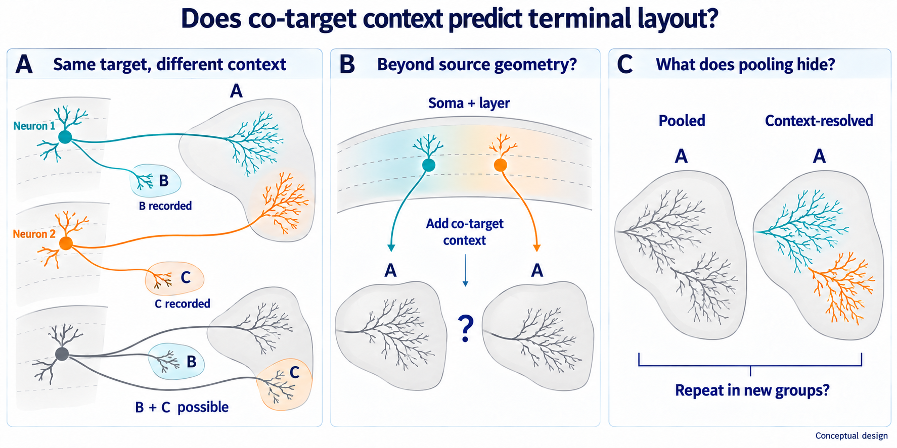

# Outputs

**October 13 — inactive worker-failure diagnostic repair prepared.**
The original M2 study remains closed incomplete. A concrete child-process
telemetry defect explains why the old failures lack terminal gradients/steps;
[a separate reviewed proposal](proposed/m2_failure_telemetry_20261013/README.md)
preserves those scalars before exception transport. It is untested and unactivated,
with no optimizer change or new job. No convergence repair or feasible full-search
cost is established. See the [preparation record](experiment_log.md).

**October 12 — inactive original-M2 reactivation proposal prepared.**
The four recorded convergence failures share one low-rank solver, including
the hybrid model's initializer. Independent source review found no definite
algebra defect; missing terminal diagnostics prevent a firm diagnosis.
See the [proposal](proposed_original_m2_reactivation.md) and
[review record](experiment_log.md#2026-10-12--v3_search--inactive-original-m2-engineering-handoff).
The adopted incomplete closeout remains in force; no new run is selected.

[Public online resources, checked October 6](../DATASETS.md#public-online-resources--checked-october-6-2026): original Gao/SEU archive inventories and the source publication's alternate distribution interfaces.

**October 6 adopted closeout:** the original M2 objective is **incomplete
under computational and numerical limits**. Qualified M1 and its small
exploratory gain are retained; no successor is selected. This is not a
biological negative or evidence that M1 is sufficient. See the
[adoption record](experiment_log.md#2026-10-06--v3_search--scientist-adopted-local-closeout)
and [adopted disposition](paper_plan.md#october-6-review--m2-closure-adopted).
Prior charges, remaining budget and closed outcomes are preserved.

## Current execution — October 3, 2026

This retained October 3 evidence summary precedes the adopted October 6
closeout above; it is not an active-job or launch instruction.

The repaired clean M1 producer `46332190` completed successfully in 2h05m40s.
Its exact artifacts are preserved in
[the current producer directory](stage0/v3_m1_real_fit_single_thread_v3_job_46332190/).
[Independent postflight](stage0/v3_m1_real_fit_single_thread_v3_job_46332190/independent_postflight.json)
passes 91 checkpoints/949 fits, 194 cells/12 groups, saved one-SE decisions,
score/calibration identities and numerical/access bindings. The current fitting
process did not open M0, SWCs, final or unassigned outcomes; the historical
post-fit M0 opening remains recorded.

The [frozen paired comparison](stage0/v3_m1_compare_m0_v1_job_46424502/v3_m1_minus_m0_comparison.json)
passes with an equal-group M1-minus-M0 gain of `0.0026378637` bits/cell
(secondary, exploratory). The [current M1 adequacy gate](stage0/v3_m2_m1_adequacy_gate_job_46424502/v3_m2_m1_adequacy.json)
also passes: gain over uniform `1.59536026` bits/cell, Brier improvement
`0.02930475`, target calibration RMS `0.12149700`. Neither is an M2 result.
The [bounded resource diagnostic with distinct CPU placement](stage0/v3_m2_resource_lower_bound_job_46425841_isolated_cpu3_attempt002/resource_lower_bound.json)
now prevents launching the current M2 implementation under its frozen budget.
Optional-family job `46237243` also has four required nonconvergent cases;
the coordinator stopped its remaining workers and preserved the failed attempt.
The [terminal resource reconciliation](stage0/resource_accounting_20261003_m2_diagnostics_terminal.json)
retains historical usage and releases only the unused reservation; 1,064.35
allocated core-hours remain, below the current 1,900-core-hour lower bound.
The [bounded triangular-solve comparison](stage0/v3_m1_triangular_prefix_job_46428039/paired/paired_prefix.json)
completed in job **46428039**. Six tests passed and both 12-lambda paths agreed
numerically, but wall times were **98.63/98.59 s**: no useful whole-path speedup.
This does not establish complete-permutation feasibility or M2 readiness.
Its batch plus ASTRA check consumed 0.0625 core-hour, leaving approximately
1,064.289 core-hours under the unchanged lifetime ceiling. Optional-family failures remain
unresolved; no further optimization probe or real M2 run is selected.
Permutation diagnostic `46325527` previously timed out; its
in-memory fit cannot resume. These are incomplete-search/technical outcomes,
not biological negatives. Follow the latest
[execution-log entry](experiment_log.md) for actual results and next action.
The within-target terminal-anatomy study below remains a separate unactivated
design; the completed evidence remains development-only Gao v3.

## Current paper design — 2026-09-30

The [scientific goal](../GOAL.md) and [paper plan](paper_plan.md) now place
the within-A terminal-profile contrast across positively recorded co-target
contexts at the center of a planned biological follow-up. Source-space modules,
generic terminal diversity, and co-target laminar association are published
baselines; the candidate must add a consequential pathway prediction and
branch-level explanation beyond flexible continuous source geometry.

Schematic, not observed data. B/C contexts may overlap, zeros remain unknown,
and no target or profile effect is selected here. The built-in imagegen
[final prompt](ep10_within_target_implementation-v2-prompt.md) is saved locally.
The explicit B+C example illustrates overlapping positive contexts; the
pooled/context-resolved drawings use the same schematic arbor locations.
Previous terminal and target-combination figures remain historical.

The preserved Gao v3 execution is a separate development-only positive-observation
track, now closed incomplete for M2. Its thresholds, roles and historical
attempts are retained. The new terminal endpoint is planned, not activated; its
measurement and evaluation-access contract remain to be frozen. No final or
unassigned outcome was opened. Use the latest dated
[execution-log entries](experiment_log.md) for the execution handoff, rather
than treating the older Stage-0 narrative below as current live state.

## Historical Stage-0 narrative

EP10 Stage 0 started on 2026-09-26 UTC under run
`ep10-stage0-20260926T063634Z`. `inputs/` remains read-only. Transient work is
under `$SCRATCH/br_autoresearch/episode10_single_cell_coprojection/`; durable
qualification artifacts are under `stage0/`.

The outcome-blind SEU qualification completed mechanically and returned
`revise_resource_strategy_before_outcome_search`. All 1,876 workbook identities
matched the 1,876 CCFv3 SWC member names, but MOp contains only 17 conservative
specimen groups. That cannot satisfy the frozen 12-development/8-final split.
No SWC contents, target outcomes, voxel payloads, or final outcomes were
opened, and no shared EP09--EP11 role ledger was frozen.

The follow-up [lean Gao MOp qualification](stage0/gao_mop_qualification.md)
found 837 MOp cells across 76 released fMOST brain/sample units, so Gao clears
the necessary specimen-count screen. The provider metadata do not certify
those units as distinct animals. Canonical soma-root-only access established
837/837 atlas-geometry eligibility and froze the 500 um/0.20 common-support
condition. The prospective outcome-blind split is 12 development, 8 final,
and 56 unassigned units; all 15 EP11-overlap units are unassigned.

The target-observation rule and role-safe development handoff are also frozen.
The primary complete-set vocabulary is an outcome-blind 16-coordinate
motor-routing panel; a larger 56-coordinate map is retained for atlas/QC
sensitivity only. The development role contains 209 primary cells, while the
acquisition manifest contains only the frozen 200-cell common-support domain
from 12 groups, with no unsupported, final, unassigned, or EP11-shared files.
Primary modeling is limited to those 200 cells, subject to the
predeclared 190-cell and per-group structural-QC attrition gate. A zero means
not observed in the eligible released reconstruction, not biological absence;
the role-incompatible four-cell `Axon_only` sensitivity is omitted.

The development pass is now complete and fails its frozen gate. Service job
`45438445` downloaded exactly 200 manifest SWCs (625,064,526 bytes), with no
final, unassigned, unsupported, or EP11-shared file. Constructor job `45438680`
found only 5 globally eligible cells: 141 failed tree parsing, 22 had positive
axon in annotation-zero space, 6 extended outside the atlas, and 26 ended in
nongrey structures. Diagnostic job `45439110` established that all 141 parser
failures are transitions out of provider types 10, 11, or 12; the frozen
contract treats those types as terminal-only markers, while the provider files
use them internally. All 12 per-group minima fail. Even treating all parser
failures as eligible would give at most 146/200, below the required 190.

Accordingly, this run stops before candidate search. M0/M1/M2, full-search
nulls, candidate anatomy, final acquisition, and final evaluation were not run.
Final and unassigned trees remain absent. A future revision needs a new
prospectively frozen resource/observation contract rather than replacement,
promotion, tag reinterpretation, or threshold relaxation inside this run.

Stage-0 preflight job `45412269` completed with exit 0. It exactly reproduced
the 200-cell manifest and frozen role split and completed 99 outcome-blind
synthetic exact-normalization suites in 650.99 seconds. The benchmark is a
normalizer-throughput measurement, not a full null-search runtime estimate.

`ep10_v2_evidence_chain.png` is a synthetic design illustration for the four
planned evidence stages: combination and observation, competing explanations,
branching anatomy, and held-out or external validation. It contains no
observed values and is not evidence of execution or a scientific result.

`paper_plan.md` is the contingent manuscript plan. It links possible claims to
required evidence, alternatives, figures, and stop decisions; it does not
report a result or start a follow-up analysis.

Stage 0 is a local exploratory qualification record whose frozen
reconstruction/observation gate returned `revise_or_stop_before_candidate_search`.
It is not Society review, confirmation, scientific acceptance, or a Landscape
transition.
