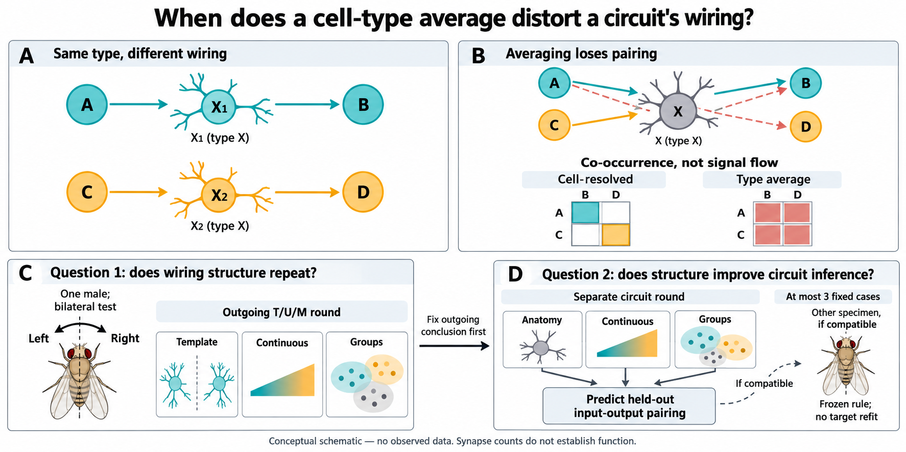

# Outputs

[Public online resources, checked October 6](../DATASETS.md#public-online-resources--checked-october-6-2026): official release, flat-connectome file documentation, API interface and morphology-unit conventions.

**October 6 adopted closeout:** the real-development description and figure
remain complete; the original T/U/M comparison is **incomplete under expired
execution and qualification limits**. The [adopted primary closeout](paper_plan.md#october-6-review--separate-completion-and-adopted-primary-closure)
selects no successor or final/incoming opening. See the [adoption record](experiment_log.md#2026-10-06--terminal_report--scientist-adopted-original-study-closeout).
The expired clock, prior charges and unadopted decoder proposal are preserved.

**Figure complete, October6,00:02UTC:** [three-panel description](figures/observed_outgoing_description/20261005-description01/observed_outgoing_description.png)
and [caption](figures/observed_outgoing_description/20261005-description01/figure_caption.md)
now accompany the completed tables. Rendering and visual review passed;
one-specimen, in-sample limitations remain explicit. See the
[completion record](experiment_log.md#2026-10-06-0002-utc--observed_outgoing_description--figure-complete).

**Completed, October 5:** the bounded real-development description reports
all **816 types and 84,735 neurons**, with 1,632 type-side rows and 816 bilateral
rows. The 126 zero-mass neurons are retained in support accounting. See the
[report](runs/observed_outgoing_description/20261005-description01/descriptive_report.json),
[complete tables](runs/observed_outgoing_description/20261005-description01/),
and [completion record](experiment_log.md#2026-10-05-2301-utc--observed_outgoing_description--completed).
Job **46681509** completed in 25 seconds; independent result review passed.
These are in-sample descriptions from one male fly, not evidence that the
original T/U/M comparison succeeded. Its expired clock and unresolved
qualification remain; final focal types and incoming scope stay closed.

October 4, 20:46 UTC: **the generated oracle chain has ended at its frozen
bound with unresolved precision**. The
[final look-08 aggregate](scientific_qualification/stochastic_oracle_v3/qualification_attempt001/qualification_look08.json)
has 32/35 cells within tolerance; three fail, with eight of 105 coordinate
half-widths above 0.002. The oracle process completed successfully, but its
dependent qualification job failed consistently with the wrapper's required
precision refusal. No SCRATCH stderr was read, and no conformance or full
generated-qualification completion is claimed. See the
[terminal generated-chain record](experiment_log.md#2026-10-04-2046-utc--stochastic_oracle_calibration-final-bounded-look-remains-unresolved-qualification-not-released)
for the exact cells, resource accounting and interpretation. No additional
look, replacement bank, relaxed threshold or restart is authorized.

The original observed-search 120-hour deadline was October 1, 05:57:34 UTC;
the CPU override preserves it. V3 launcher/readiness mismatches and the
canonical-target scoring implementation remain unresolved. The reviewed
[decoder proposal](canonical_target_decoder_proposal.md) remains **unadopted**.
This generated result neither resolves those issues nor authorizes empirical
replay, procedure locking, null searches, circuit work or final connectivity
access. The historical prefix remains attempts, not corrected V3 evidence.

Earlier observations, preserved as history:

October 4, 17:53 UTC: oracle refinement `45736217` remains RUNNING and
qualification `45736218` remains PENDING on its existing dependency. These
are the only jobs in the user's queue. Monitoring resumed after an interrupted
wait with a 3h50m34s gap between scheduler observations; see the
[execution record](experiment_log.md#2026-10-04-1753-utc--monitoring-resumed-after-an-interrupted-wait-existing-jobs-remain-live).
No job was restarted. Current numerical precision is unverified, the stopped
SCRATCH-log route remains stopped, and look 8 is the last scheduled look.

October 4, 10:54 UTC: the [canonical-target decoder proposal](canonical_target_decoder_proposal.md)
has passed independent scientific review and remains **unadopted**. It makes
the missing scoring component and its qualification consequences concrete;
it does not extend the expired observed-search clock or authorize replay.
The existing generated chain continues. See the [proposal record](experiment_log.md#2026-10-04-1054-utc--canonical-target-decoder-proposal-reviewed-not-adopted).

The [earlier empirical-clock and implementation finding](experiment_log.md#2026-10-04-1032-utc--generated-chain-remains-live-empirical-replay-cannot-resume-under-the-existing-clock)
records the independent constraints that remain after this generated chain's
terminal result. No repair or budget amendment has been adopted.

## Current paper design

EP12 asks two scientific co-primary questions: **does within-type outgoing
wiring organization repeat, and does retaining it improve a concrete circuit
inference?** The existing outgoing T/U/M round addresses reproducibility. The
planned circuit round tests input-output pair-mass reconstruction error, with
incoming prediction as supporting evidence, in at most three fixed cases.

These are separate statistical rounds. The circuit round is planned, not
frozen, executed or automatically launched; it cannot amend or rescue the
outgoing result. Circuit support, margins, calibration and any compatible
external specimen still require their own fixed contract. One male's body
sides are not independent animals, and a new incoming aggregation is not
automatically fresh evidence if it shares exposed outgoing edges.

Read the [scientific question](../GOAL.md) and [paper plan](paper_plan.md) for
the competing anatomical/continuous/grouped explanations and novelty limits.

The [current v2 schematic](ep12_conceptual_main_figure-v2.png) was generated
with built-in imagegen; its [exact final prompt](ep12_conceptual_main_figure-v2-prompt.md)
is saved alongside it. All neurons, routes and matrices are hypothetical.
The figure contains no observed values, claimed model winner or evidence of
execution. The [old outgoing-only mockup](ep12_conceptual_main_figure.png) is
retained as historical design material, not the current paper-design figure.

## Recorded execution history

The following execution history is preserved; the 2026-09-30 design/figure
repair did not run, modify or reconcile the existing execution chain.

EP12 was launched on 2026-09-25 and subsequently advanced to real
development-only execution after an explicit user instruction.
The episode lives at
`/oak/stanford/groups/russpold/users/zijiao/br_autoresearch/episode12_malecns_type_sufficiency`;
temporary work belongs at
`/scratch/users/zijiao/br_autoresearch/episode12_malecns_type_sufficiency`.

The episode-specific executor is under `executor/`. Historical controller
evidence from its prior 29-test suite and six-scenario qualification is archived
under `executor_qualification_v3/`; those engineering records are not current
scientific readiness gates. The real development materialization and first
complete fixed-method T/U/M configuration are under `development_run001/`.
`development_run002/` contains the historical provisional 18+9+9 development
prefix: 36 completed trials with no aggregate technical failure. These were
made with a nonconforming U and remain attempts, not a corrected V3 prefix.
Scientific qualification, corrected replay and required post-36 falsifiers remain incomplete;
no procedure is locked, the 99-search null has not run, and final evaluation
has not begun.

`inputs/` remains read-only. Development-role body statistics and outgoing
weights have been opened through the recorded role firewall. Final-role focal
connectivity remains locked and was not materialized or summarized.

`ep12_conceptual_main_figure.png` is the historical synthetic outgoing-only
design mockup, preserved and linked as historical material from `../GOAL.md`.
It contains no observed data and is not evidence of execution, completion,
or a scientific result.
