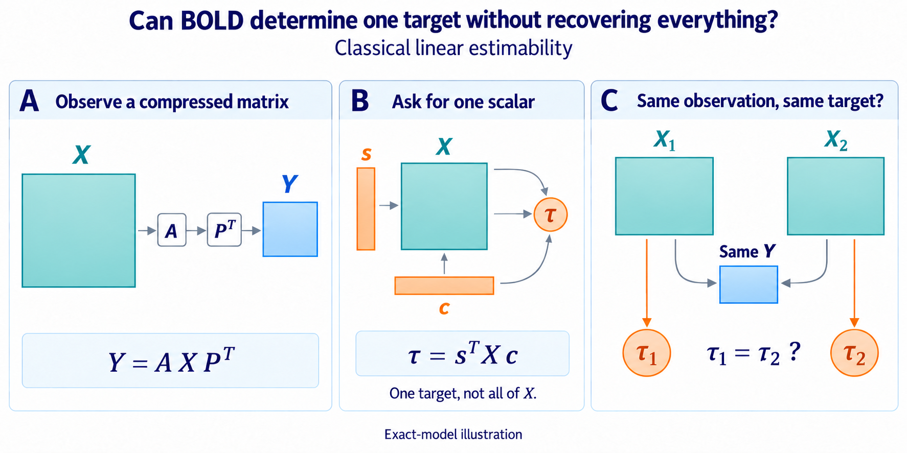

# Paper plan — Exact identifiability of a latent BOLD target

## Manuscript type

A reusable proof-carrying technical reference and lemma package, not an
empirical benchmark or an adaptive-search report. A standalone research paper
would require a substantive contribution beyond the present result.

The deliverable is complete, rather than merely proposed: October 3's
`theorem_verified` result includes the [general proof](exact/proof.md),
[orientation report](exact/runs/attempt001/orientation_report.json) and
[independently authored replay](exact/runs/attempt001/independent_replay_report.json).
All 12 valid exact fixtures and seven invalid-input rejections passed.
The [evidence index](README.md) and [execution record](experiment_log.md)
retain the authorship and finite-suite limits. The report structure below
organizes this existing package and selects no additional matrix sweep.

## One-sentence result

For Y = A X P^T and tau = s^T X c with X free over the full finite-dimensional
latent space, tau is determined by Y exactly when c = 0, s = 0, or both target
directions survive their respective observation row spaces.

## Honest contribution

The underlying linear-functional estimability theorem is classical; see
[Searle (1965), Additional Results Concerning Estimable Functions and
Generalized Inverse Matrices](https://academic.oup.com/jrsssb/article/27/3/486/7026850).
The
episode-specific value is to make its consequence for a separable BOLD
observation model explicit and constructive:

- a zero-aware necessary-and-sufficient criterion;
- a direct readout tau = v^T Y u when identifiable;
- an invisible rank-one perturbation when nonidentifiable;
- an orientation-safe vectorization convention; and
- a proof-carrying exact implementation contract.

This is useful as a technical reference, but the present result does not
establish sufficient standalone research-paper novelty. Finite matrix
exploration or exact implementation certificates do not make the classical
criterion a new theorem.

## Reader-facing question

Can one exact latent contrast be recovered even when the latent matrix itself
cannot be recovered?

The answer is yes. Full injectivity of the observation operator is unnecessary.
Only the prespecified target functional must lie in its row space.

## Main theorem

Freeze column-major x = vec(X), y = vec(Y),
M = P kron A, and ell = c kron s. Then the following are equivalent:

1. tau is constant on every fiber of X -> Y;
2. ell is in row(M);
3. ker(M) is contained in ker(ell^T);
4. adding ell^T does not increase rank;
5. M^T w = ell has an exact solution.

For the separable target, this becomes

c = 0 or s = 0 or
[c in row(P) and s in row(A)].

## Proof structure

### Proposition 1 — General linear criterion

Two latent vectors have the same observation exactly when their difference is
in ker(M). The scalar target is unique on an observation fiber exactly when
ell annihilates that kernel. Row-space/null-space duality gives the remaining
equivalences.

### Proposition 2 — Separable corollary

row(P kron A) = row(P) tensor row(A). A nonzero pure tensor c tensor s belongs
to that product subspace exactly when both factors belong to the corresponding
row spaces. Zero factors require their own branch because tau is then
identically zero.

### Proposition 3 — Positive certificate

If P^T u = c and A^T v = s, then tau = v^T Y u. This is the target readout and
can exist even when M has a large null space.

### Proposition 4 — Negative certificate

When either nonzero target factor misses its row space, construct
Delta X = z d^T so that A Delta X P^T = 0 but
s^T Delta X c = 1. The two latent matrices X and X + Delta X then have the same
observation and different targets.

## Main figure

The three panels separate the compressed observation, one prespecified scalar
and the question of equal targets for observationally indistinguishable latent
matrices. For known operators, exact observations and unrestricted X,
identifiability holds iff `c = 0`, `s = 0`, or both `s ∈ row(A)`
and `c ∈ row(P)`. Matrix/vector glyphs are symbolic, not numerical examples.
This illustrates classical estimability, not a new theorem or empirical
result. Certificates and stability limits remain in the text.
[Exact imagegen prompt set](ep13_conceptual_question-v2-prompt.md).

## Exact examples table

The paper should give a compact table rather than a large benchmark:

| Example | Purpose | Required artifact |
| --- | --- | --- |
| rank-deficient but target-identifiable | separate scalar recovery from full recovery | exact readout |
| temporal loss | show failure through ker(A) | normalized Delta X |
| spatial loss | show failure through ker(P) | normalized Delta X |
| c = 0 or s = 0 | expose the zero-branch exception | zero readout |
| swapped Kronecker order | catch vectorization error | direct y and tau replay |
| non-symmetric idempotent R | catch R versus R^T error | exact temporal witness |

## Section outline

1. **Problem.** A scalar scientific target may be recoverable without the
   latent matrix.
2. **Exact model and convention.** Define X, Y, tau, dimensions, latent domain,
   and column-major vectorization.
3. **General theorem.** Prove the row/kernel/rank/readout equivalence.
4. **Separable BOLD corollary.** Prove the component row-space criterion and
   zero branches.
5. **Proof-carrying certificates.** Give positive readouts and negative
   rank-one perturbations.
6. **Orientation and edge cases.** Show the minimal exact suite and why labels
   alone cannot detect all coordinate mistakes.
7. **Limits.** Separate exact algebra from stability, noise, uncertain
   operators, and biological interpretation.

## Reviewer-facing safeguards

- Define admissible X as the full rational vector space; do not leave it
  implicit.
- Do not claim that finite enumeration proves a universal statement.
- Do not require both row conditions when c or s is zero.
- Do not infer target identifiability from one realized tau value of zero.
- Do not use R where R^T is required.
- Do not equate exact identifiability with a useful noisy estimator.
- Do not claim novelty for the general row-space theorem.

## Potential later extensions

The following could support a larger paper, but they are outside EP13:

- shared-X multi-run operators whose stacked rows identify a target jointly;
- restricted latent classes;
- nonseparable or vector-valued targets;
- uncertain A or P; and
- quantitative stability and variance under noise.

Adding any of them changes the model family and requires a new scientific
decision rather than silent expansion of this contract.

### Proposed successor: target uncertainty, calibration and averaging

**Design proposal, October 4, 2026; not activated.** Ask when uncertainty about
one prespecified contrast comes from measurement noise, and when uncertain
hemodynamics impose an ambiguity that more averaging cannot remove. The
completed EP13 result remains the known-operator, exact-observation reference.
No successor theorem, calculation, simulation or empirical result is claimed.

Start with `y = M_theta x + epsilon`, `tau = ell^T x`, and
`M_theta = P kron A_theta`, keeping P known. Specify a compact bounded latent
class C, a structured HRF parameter set Theta, a fixed nonsingular whitening
map W, and the deterministic noise bound `||W epsilon||_2 <= delta`. The bound
on x must have a scientific interpretation; unrestricted x can make worst-case
uncertainty infinite. Declare HRF gain normalization or gain uncertainty and
whether HRF parameters are shared across conditions or regions. A deterministic
noise region becomes a confidence statement only with justified coverage.

Compare latent/operator pairs, not merely identifiability at each fixed theta:

\[
\omega(\delta;\Theta)=\sup\left\{
 |\ell^\top(x_1-x_2)|:
 x_1,x_2\in\mathcal C,\ \theta_1,\theta_2\in\Theta,\quad
 \|W(M_{\theta_1}x_1-M_{\theta_2}x_2)\|_2\le 2\delta
\right\}.
\]

These pairs can produce the same observation under the allowed noise. Thus
`omega/2` is a worst-case estimation-error lower bound; a positive
`omega(0; Theta)` indicates an ambiguity floor under this model. This is a
standard indistinguishability argument, not a proposed new general theorem.
For example, every fixed positive gain in `y = a x` is invertible, yet unknown
`a in [1-eta, 1+eta]`, with `0 < eta < 1`, leaves multiple possible x values
even at zero noise. This example checks the formulation; it is not the desired
scientific contribution.

The smallest informative comparison is between two prespecified uses of the
same additional acquisition time: repeat measurements with stable latent and
operator parameters under a specified stochastic noise model to justify a
smaller delta at fixed coverage, or obtain independent calibration whose
operator transfers to the target acquisition to restrict Theta. Averaging does
not automatically shrink an arbitrary deterministic worst-case noise bound.
Hold the contrast, latent class, initial acquisition and cost accounting fixed.
Calibration must
have a declared observation model; a known stimulus schedule does not itself
provide known neural amplitude. Start with low-dimensional HRF shape
uncertainty and a target chosen before outcomes. Compare global target bounds
and the resulting acquisition decision against ordinary contrast efficiency
and an existing robust-design criterion. The proposed contribution fails if
the comparison adds only the scalar gain example or reproduces decisions
already explained by those criteria. A finite HRF dictionary supports claims
only for that dictionary; a grid is not a certificate over a continuous set.

Closest prior work limits the novelty claim:

- [Smith et al. (2007)](https://pubmed.ncbi.nlm.nih.gov/17070706/) already makes
  contrast estimability meaningful relative to fMRI noise and effect size.
- [Kao et al. (2013)](https://arxiv.org/abs/1401.1631) already studies maximin
  fMRI design under uncertain HRF shapes using locally approximated covariance.
- [Bekri, Juditsky and Nemirovski (2025)](https://link.springer.com/article/10.1007/s10957-025-02678-5)
  already develops robust inverse estimation under observation-matrix uncertainty.

The potentially useful distinction is a justified *global, target-specific*
ambiguity bound that changes a calibration-versus-averaging decision beyond
these baselines. Novelty is unresolved; further comparison with the closest
methods is required before presenting this as a research contribution.
Preprocessing could later be assessed by its effect on the same target bounds,
but that is only a conceptual connection to information-removal questions in
other episodes, not evidence that they share EP13's model or failure mechanism.

Execution requires an explicit successor contract or amendment defining these
new assumptions, data roles, comparisons and resource limits. This proposal
does not change GOAL.md, DATASETS.md, SEARCH_POLICY.yaml, ASTRA, or their current
claim and access boundaries, and authorizes no new computation or outcome access.

## Current status

The exact package is locally complete as `theorem_verified`, October 3, 2026:
12 valid fixtures and seven invalid-input rejections passed, with independent
certificate replay. See the [completion record](exact/runs/attempt001/completion.json)
and [current navigation](README.md). This is classical technical verification,
not an empirical or biological finding. The successor above remains proposed
and unactivated.
