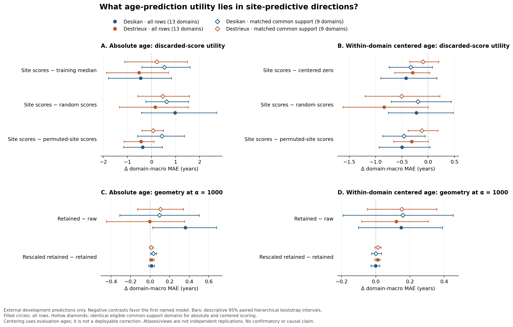
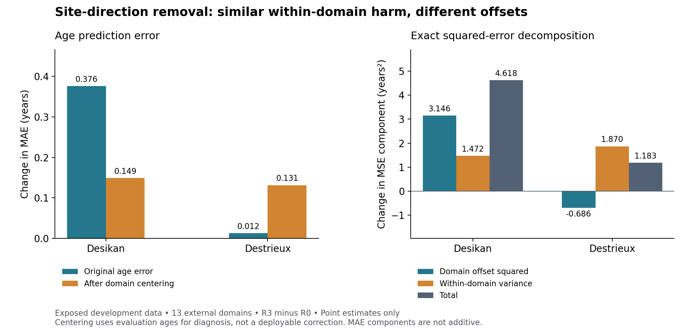

# EP14 outputs

**Complete, October 13: all 31 provider-group compression arms and all three
development views finished.** Anatomical grouping has lower aggregate
equal-domain MAE than each of its three shuffled controls at every fixed
dimension, but does not beat dimension-matched global PCA or raw ridge.
Measurement-family compression at 56 dimensions gives MAE **5.5442 years**
versus global PCA's **5.6289** (difference **−0.0847**, descriptive 95% interval
**[−0.3223, 0.1694]**); participant, worst-domain and oldest-quartile errors
are higher. Its 14- and 28-dimensional versions also have higher equal-domain
MAE than global PCA. No provider arm improves the raw-ridge aggregate endpoint
(5.4685 years), and no additional anatomical advantage is established.

The [complete report](runs/provider_group_compression/attempt001/provider_compression_report.md)
retains every dimension, all three shams and all 30 provider-minus-control
contrasts; [JSON details](runs/provider_group_compression/attempt001/provider_compression_report.json)
include per-view/domain, age, site-probe and representation diagnostics.
See the [figure](figures/provider_group_compression/attempt001/provider_compression.png)
([PDF](figures/provider_group_compression/attempt001/provider_compression.pdf)),
[prospective recipe](representation_research_design.md#october-13-adopted-provider-group-compression)
and [completion record](experiment_log.md#2026-10-13--provider_group_compression--completed).
Intervals are descriptive and uncorrected; overlapping views and previously
exposed participants provide exploratory evidence. All 757 public-validation
rows remain closed, with no dimension selection or candidate promotion.
Job **47686487** completed in **178 seconds on 4 CPUs**, charged once at
**0.197777778 allocated CPU-hours**. Three focused tests and ASTRA passed;
saved-result figures rendered and received independent visual review.

[Public online resources, checked October 6](../DATASETS.md#public-online-resources--checked-october-6-2026): original OpenBHB preprocessing/representation documentation and the pinned RAMP data/starting-kit interface.

October 6 documentation reconciliation: the
[integrated empirical evidence](paper_plan.md#completed-empirical-evidence--reconciled-october-6)
now connects the fixed comparison, all completed projection diagnostics and
the bilateral/objective tradeoff to the paper argument. The dated evidence
and complete result links follow; conceptual designs remain separate.

**Complete, October6 00:29 Pacific:** all five new arms/all three views finished.
Homologous pairing chooses equal penalties and reproduces raw ridge; no additional
anatomical benefit is established. Wider raw regularization improves equal-domain
MAE **5.83→5.47years**, but worsens participant-pooled **6.95→7.52years** and
oldest-quartile **13.57→17.70years**. This is a consequential objective tradeoff,
not an unqualified improvement. Read the [full interpretation](runs/bilateral_regularization/attempt001/interpretation.md)
and [figure](figures/bilateral_regularization_attempt001.png).
Independent reviews, five focused tests, ASTRA and plotting passed.
Shared parent46735127 completed0:0 in7:08 and closed; **0.4755555556CPU-hours**
charged once, including EP01/EP05 analyses. No candidate promotion or holdout
access. The startup observation below is historical.

**New real-data comparison running, October6 00:24 Pacific:** parent
**46735127**,4CPU/16GiB/at most60minutes, compares homologous bilateral
regularization against retuned raw ridge and three matched shuffled pairings.
Five focused arithmetic checks passed inside the allocation. All existing
development views are included; public validation and candidate promotion
remain closed. See the [prospective specification](representation_research_design.md#october-6-adopted-bounded-bilateral-comparison)
and [execution record](experiment_log.md#2026-10-06--bilateral_regularization-bounded-real-data-comparison-selected).
The original negative result and earlier diagnostics below remain preserved.

October 4 final continuation: **exact preservation of fitting age covariance
did not remove Desikan's unseen-domain prediction cost**. The protected
representation gives MAE 6.1621 versus raw 5.8311 years, a +0.3310-year
contrast [descriptive 95% interval 0.0268, 0.6274]. Its improvement over
original removal and its difference from the shuffled control remain uncertain.
Destrieux does not establish a corresponding benefit or harm. See the
[integrated interpretation](runs/covariance_protected_projection/attempt001/interpretation.md),
[complete tables](runs/covariance_protected_projection/attempt001/covariance_protected_report.md),
and [figure](figures/covariance_protected_projection.png).
All six fits passed exact covariance/rank checks, four focused tests passed,
and the attended allocation completed within its shared bound. This is an
empirical methodological boundary, not independent or biological confirmation.

Further continuation: the [cached heterogeneity analysis](runs/projection_heterogeneity/attempt001/interpretation.md)
is complete. Desikan's age-error increase survives every single-domain
omission; Destrieux's nearly flat absolute average combines opposing domain
effects, while centered error still worsens after every omission. The
[fixed linear-age-adjustment intervention](site_information_diagnostic_prior.md#adopted-continuation--projection-heterogeneity-and-age-adjusted-directions)
completed all six outer fits and exact reference parity. It showed no clear
benefit beyond the shuffled-age control and increased the removed directions'
alignment with original age covariance in every fit. See its
[interpretation](runs/age_adjusted_projection/attempt001/interpretation.md).
The [direct covariance-protection counterfactual](site_information_diagnostic_prior.md#adopted-final-counterfactual--exact-fitting-covariance-protection)
above completes the test of the property residualization did not produce.
See the [execution log](experiment_log.md).

Earlier completed diagnostic:

October 4 continuation completed: **Desikan's projection cost persists without
post-projection rescaling**, but the discarded-score age-utility hypothesis
remains unestablished. At fixed alpha1000, unrescaled removal increases external
MAE by 0.3613 years [descriptive 95% interval 0.0274, 0.6808]; rescaling adds
0.0145 years. Destrieux's corresponding removal contrast is uncertain. Age
overlap leaves only 226 participants in nine eligible domains, all younger
than35, and the matched utility intervals include zero. This supports a narrow
pipeline diagnosis, not a biological discovery or independent confirmation.

Read the [interpretation](runs/discarded_direction_diagnostics/attempt001/interpretation.md),
[complete tables](runs/discarded_direction_diagnostics/attempt001/diagnostics_report.md),
[all numerical results](runs/discarded_direction_diagnostics/attempt001/diagnostics_report.json)
and [execution record](experiment_log.md#2026-10-04--discarded_direction_diagnostics--completed).
Four focused tests and every raw/restored check passed. A historical replay
difference of 1.81e-6 years is preserved and diagnosed in the interpretation;
the unchanged legacy pipeline reproduces the new predictions exactly for that
case. The original no-candidate result and closed holdout remain unchanged.

Earlier cached-prediction description:

October 4 follow-up: **centered external age errors worsen in both atlases**
after site-direction removal: +0.148920 years for Desikan and +0.131091 for
Destrieux. All three overlapping views show the same centered-MAE direction.
The near-flat original Destrieux MAE therefore does not demonstrate preserved
within-domain prediction: its squared-error decomposition shows improved
domain offsets partly compensating for worse centered residual variation.
This is an exploratory description of existing predictions, without new model
fits, intervals, a causal conclusion or holdout access.

See the [cached-prediction report](runs/cached_projection_diagnostics/attempt001/cached_projection_report.md),
[complete numerical summaries](runs/cached_projection_diagnostics/attempt001/cached_projection_report.json),
[execution and interpretation](experiment_log.md#2026-10-04--cached_projection_diagnostics--completed),
and [proposed matched-control follow-up](site_information_diagnostic_prior.md#2026-10-04--proposed-follow-up-after-the-fixed-result).

Point estimates from exposed development data; evaluator-only centering is not
a deployable correction. The right panel decomposes MSE; MAE is not additive.

October 3 result: **the fixed comparison completed with no eligible candidate**.
Job **46425131** finished successfully in 22 minutes 47 seconds after all
1,650 inner and 33 outer fit slots and the required controls. R1 bilateral
features improved development age MAE by 1.44%, below the fixed 2% selection
margin; R2 PCA-64 and R3 site-direction removal worsened it by 1.87% and 6.45%.
All three passed the point site-decoding guardrail. The registered disposition
is `development_no_candidate`, so no public holdout opens.

See the [complete result and limitations](experiment_log.md#2026-10-03--fixed-development-completed-no-eligible-candidate),
[development report](runs/fixed_development_comparison/attempt001/development_report.json),
[controls and Destrieux sensitivity](runs/fixed_development_comparison/attempt001/controls_report.json),
and [passing preparation/integrity checks](runs/fixed_development_comparison/attempt001/prepared_bundle_check.json).
This closes the frozen R0–R3 reference. The broader proposed search remains
unactivated, and all public-validation features/outcomes remain closed.

The current question is which neuroanatomical representations and shallow
predictors make age prediction transfer across acquisition domains. The
[paper plan](paper_plan.md) and [open representation design](representation_research_design.md)
use bilateral structure and anatomical grouping as starting hypotheses, not
a closed candidate list. Site is the generalization environment, not a removal
objective.

The [v4 image](ep14_conceptual_question-v4.png) and [built-in imagegen prompt](ep14_conceptual_question-v4-prompt.md)
depict the current question. The [v3 site-centered figure](ep14_conceptual_question-v3.png)
and [v2 four-arm figure](ep14_conceptual_question-v2.png) remain historical.
All diagrams and predictor icons are schematic, not empirical evidence.

The existing [ASTRA program](astra/v0.0.14/astra.yaml) describes the unchanged
operative comparison and the separately adopted development diagnostic.
The broader representation search remains unactivated.
`inputs/` remains read-only; 3,227 development participants remain exposed and
757 public-validation outcomes remain closed with freshness conditional,
not assumed. Transient computation belongs in the episode-specific Scratch
directory.
