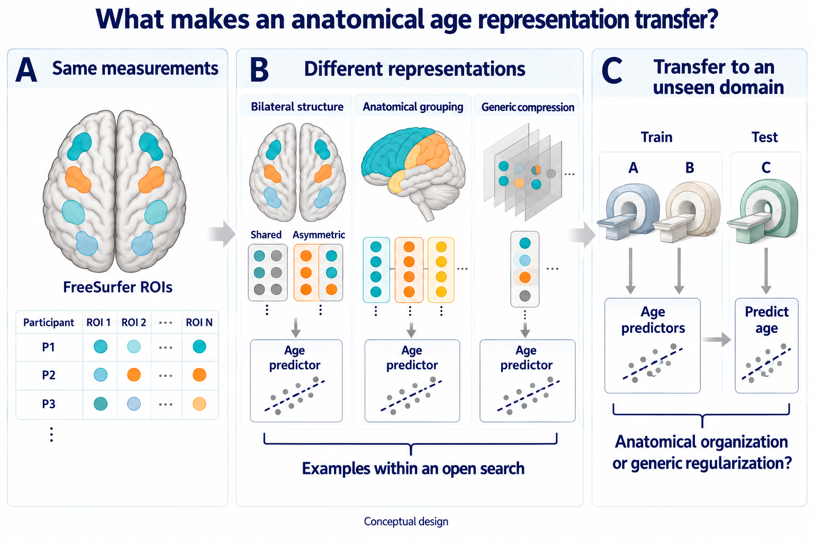

# Paper plan — what makes an anatomical age representation transfer?

## Completed empirical evidence — reconciled October 6

The original R0–R3 reference and the separately adopted diagnostic and
bilateral comparisons are complete. They use the already exposed development
roles; the 757 public-validation outcomes remain closed. These findings now
constrain the paper argument:

| Completed comparison | Observed result and interpretation |
| --- | --- |
| [Fixed R0–R3 reference](runs/fixed_development_comparison/attempt001/development_report.json) | R1 improved age MAE 1.44%, below the fixed 2% margin; R2 and R3 worsened it 1.87% and 6.45%. All three passed the point site guardrail. Adopted disposition remains `development_no_candidate`. |
| [Cached projection attribution](runs/cached_projection_diagnostics/attempt001/cached_projection_report.md) and [domain heterogeneity](runs/projection_heterogeneity/attempt001/interpretation.md) | Centered external MAE worsened in both atlases (+0.148920/+0.131091 years). Desikan's absolute harm survives every single-domain omission; Destrieux's nearly flat absolute mean combines opposing domain effects and offsets. Centering is evaluator-only, not a deployable correction. |
| [Matched projection geometry and discarded-score utility](runs/discarded_direction_diagnostics/attempt001/interpretation.md) | Desikan's removal cost persists without post-projection rescaling: +0.3613 years at alpha1000, descriptive interval [0.0274, 0.6808]. Common age support contains only 226 participants in nine domains, all under 35; utility intervals include zero. Useful discarded age information is not established by this test. |
| [Age-adjusted direction estimation](runs/age_adjusted_projection/attempt001/interpretation.md) | No clear benefit beyond the within-site shuffled-age control; removed directions became more aligned with original age covariance in every fit. This intervention did not achieve the intended covariance protection. |
| [Exact covariance-protection counterfactual](runs/covariance_protected_projection/attempt001/interpretation.md) | All six fits preserved fitting age covariance, yet Desikan MAE remained 6.1621 versus raw 5.8311 years: +0.3310 [0.0268, 0.6274]. The difference from original removal and the sham remains uncertain; marginal covariance preservation is insufficient here, not a mechanism explanation. |
| [Bilateral regularization and matched pairings](runs/bilateral_regularization/attempt001/interpretation.md) | Homologous pairing selected equal penalties and reproduced retuned raw ridge in every view; all three homologous-versus-sham intervals include zero. No anatomical advantage or candidate promotion is established. |

The bilateral comparison also exposes an objective tradeoff. Expanding raw
ridge's alpha grid improves equal-domain MAE **5.831111 → 5.468507 years**,
while participant-pooled MAE worsens **6.949438 → 7.520867**, worst-domain MAE
**9.603874 → 11.976468**, and oldest-quartile MAE **13.568802 → 17.700589**.
The [saved cross-run comparison](runs/bilateral_regularization/attempt001/raw_grid_comparison.json)
uses identical domains and age-quartile boundaries; it has no paired old/new
uncertainty interval. Report all these quantities together, not an unqualified
improvement. The sham alpha choices reached the tested upper bound, which is
a limitation rather than an automatic grid-extension instruction.

These are completed methodological findings on overlapping development views,
not independent confirmation or an aging mechanism. The
[result index](README.md) links the observed-data figures and full reports;
the concept figure and broader design below remain prospective framing.

## The scientific question

Which organization of existing FreeSurfer ROI measurements improves age
prediction at unseen acquisition domains, and what explains that advantage
after accounting for compression, regularization and predictor capacity?

The scientific object is the transferable representation, not site removal.
The [open research design](representation_research_design.md) starts with
bilateral structure and anatomical grouping while leaving families, granularity,
reducers and shallow predictors open. These are hypotheses, not promised results.

Conceptual design, not observations: identical ROI inputs are reorganized or
compressed, then tested for age-prediction transfer. The examples do not close
the search space or designate a winner. Anatomical-specific explanations must
survive matched generic/shuffled controls; full bilateral re-encoding alone
adds no information. [Image-gen prompt](ep14_conceptual_question-v4-prompt.md).

The [v3 site-centered schematic](ep14_conceptual_question-v3.png), its
[prompt](ep14_conceptual_question-v3-prompt.md) and the [v2 comparison](ep14_conceptual_question-v2.png)
remain historical design assets. They contain no results and are not presented
as the concept figure for this revised story.

## What the literature already covers

[OpenBHB (2022)](https://doi.org/10.1016/j.neuroimage.2022.119637) already
benchmarks prediction under acquisition shift. [Zhao et al. (2019)](https://pmc.ncbi.nlm.nih.gov/articles/PMC6819257/)
already use shared and measurement-specific morphometric components with
cross-cohort age prediction. [Korbmacher et al. (2024)](https://www.nature.com/articles/s41467-024-45282-3)
already study hemispheric brain age and asymmetry.

[Leiberg et al. (2025)](https://academic.oup.com/cercor/article/35/6/bhaf154/8171921)
study physical surface scales, not pooling existing ROI summaries.
[Jirsaraie et al. (2023)](https://onlinelibrary.wiley.com/doi/10.1002/hbm.26144)
directly evaluate brain-age generalizability under sampling/acquisition changes.

EP14 cannot claim to invent decomposition, bilateral features, multiscale age
prediction or external evaluation. A useful contribution needs a discriminating
transfer pattern and its strongest surviving alternative, not a new encoding
name or a small MAE win. Novelty remains conditional on that exact result.

## What is operative, and what is not

The **operative frozen comparison is unchanged**: 476 Desikan ROIs, R0 raw,
R1 bilateral basis, R2 PCA-64, R3 removal of four fit-estimated site directions,
one ridge family with the same site-held-out tuning criterion, and one fixed
unconditional linear site probe. Destrieux is non-selecting sensitivity.

Its primary is paired domain-macro external MAE versus R0. The existing -2%
age improvement and +0.01 seen-domain site-BAcc guardrail, deterministic
selection, hard validity checks, descriptive controls, holdout classification,
and one-shot consumption rules still govern it. It can establish only a
controlled predictive-methods comparison.

The broader representation search remains design-approved rather than an
unbounded executable search. The existing ASTRA includes the completed fixed
reference and separately adopted diagnostics/bilateral comparison. Their
specific authority does not activate other candidate ranges, resources,
selection or confirmation endpoints. The
[site diagnostic specification](site_information_diagnostic_prior.md)
records the completed narrow amendments; its conditional-site probe remains
unactivated. No further comparison is selected by this documentation update.

## Two initial arguments to test

**Bilateral regularization.** Compare raw ridge, a common-metric full bilateral
basis and different shrinkage for shared/asymmetric blocks. A full orthonormal
basis with isotropic ridge is an equivalence reference, not more information.
Randomized within-family pairings, equal fitting allowance and explicit scaling
separate a useful anatomical prior from generic blockwise regularization.

**Organized compression.** Compare provider-declared anatomical/measurement
grouping with global PCA and shuffled grouping at comparable output dimensions
and the same predictor. Examine retained-dimension curves and report model
complexity rather than attributing any low-rank benefit to anatomy.

These are entry points, not the complete search. Other representations and
shallow predictors can be considered during development. First match the
learner to isolate representation; then vary the learner to assess whether the
advantage survives. Ensembles improve prediction without necessarily explaining
it. No outcome-based region/age-band selection is permitted.

## What would change the conclusion?

| Interpretation | Evidence needed |
| --- | --- |
| Representation-specific transfer | A paired anatomical contrast improves unseen-domain utility beyond its matched generic/shuffled alternative and remains interpretable across domains |
| Useful generic regularization/compression | Generic or shuffled alternatives explain the benefit; retain the predictive result without an anatomy-specific account |
| Familiar-domain gain only | Better development fit does not survive acquisition-domain transfer |
| Conditional or inconclusive result | Benefit is confined to declared age support, a few domains or one learner, or uncertainty cannot resolve the contrast |

No result identifies a biological aging mechanism. A successful predictive
account need not lower site decodability; the existing reference still retains
its separate frozen site guardrail.

## Keep the search broad and the comparisons interpretable

Do not reduce the episode to two hypotheses or a preset winner. Keep allowed
feature families, bilateral contrasts, anatomical pooling, atlas granularity,
reducers, shallow nonlinearities and small predictive blends as design options.
Instantiate only groupings supported by the declared ROI headers/mappings.

Compare methods on the same declared age support and expose every domain,
worst-domain error and age-range behavior. Any within-domain centered utility
diagnostic is evaluator-only; it cannot provide test labels to the predictor.
All learned preprocessing and models refit within their assigned training
roles, including tuning folds. No future executable amendment may be chosen
from public holdout outcomes.

## Data and evidence limits

The 3,227 official training participants are exposed development. Three RAMP
views overlap; repeat appearances are not independent people or replications.
Report the observed acquisition domains individually and use domain-clustered
paired uncertainty. More participant resampling cannot create new domains.

The 757 public-validation rows remain conditional holdout material: 395 external
age rows and 362 internal site-probe rows. Public labels are not automatically
fresh. The existing one-shot evaluation confirms only one locked comparison if
its exposure review establishes freshness. Unknown or failed freshness makes
it retrospective validation and requires genuinely new confirmation material.

The new search cannot borrow that holdout's apparent freshness without a
separate pre-outcome amendment and evaluator authorization. Once any
candidate-discriminating outcome is visible, adding new endpoints and calling
them confirmatory is prohibited.

## Manuscript displays for the revised question

Figure 1: the representation search axes and actual fit/seen-domain/unseen-
domain age support. Keep the conceptual argument distinct from measured data.

Figure 2: paired unseen-domain utility and generalization behavior across the
candidate families, with the fixed R0--R3 reference and each domain visible.

Figure 3: the selected representation hypothesis beside metric-matched,
capacity-matched and shuffled/generic alternatives. Show scaling/shrinkage or
retained-dimension dependence; do not substitute coefficient maps for utility.

Figure 4: robustness across learner and age support, plus one locked
confirmation only if separately authorized and eligible. Site decodability
belongs in the diagnostic context, not as the manuscript's headline.

## Claim and status

No comparison, search, candidate lock, exposure review or public holdout has
run. This September 30 refocusing restores the original representation
question; it does not report a biological result or execute a broader search.

If only the operative four-arm experiment is completed, the manuscript remains
a focused predictive-methods comparison. A stronger representation paper needs
the prospective amendment, adequate support, a discriminating transfer result
and an honest novelty assessment of that exact result. No causal scanner removal,
biological aging mechanism, clinical utility, disease transfer, private-
leaderboard result, independent cohort replication, or general scanner
invariance is supported by this package.
