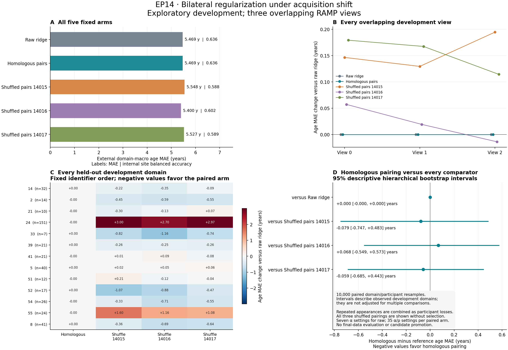

# Bilateral regularization: a transfer-objective tradeoff

The complete development comparison finds **no additional predictive benefit
from differential anatomical shrinkage**. Homologous pairing selects equal
shared/asymmetric penalties (rho=1) in all three views and reproduces raw-ridge
predictions to numerical precision. Both select alpha=10,000. All three
homologous-versus-shuffled-pairing descriptive age intervals include zero.

The expanded penalty grid does expose a consequential tradeoff:

| External error, years | Original raw ridge | Wider-grid raw ridge |
| --- | ---: | ---: |
| Equal-domain MAE, original primary objective | 5.831111 | 5.468507 |
| Participant-pooled MAE | 6.949438 | 7.520867 |
| Worst-domain MAE | 9.603874 | 11.976468 |
| Oldest-quartile MAE, 104 participants | 13.568802 | 17.700589 |

Original raw ridge chose alpha=1,000 in every view; the expanded grid chooses
10,000 throughout. The same input roles, fit-only scaling, ridge solver,
13-domain support and age-quartile boundaries are retained. Equal-domain MAE
falls0.362604years (6.22%), while participant-pooled MAE rises0.571430years
(8.22%). Site-probe balanced accuracy is unchanged at0.635875. This is a
descriptive comparison of completed development reports; no paired old-versus-new
interval was computed. The zero homologous-versus-new-raw interval cannot be
used as uncertainty for the old-versus-new change.

Thus the higher primary-objective score does not establish an overall better
age predictor: the equal-domain objective and participant-average accuracy
favor different regularization settings here. Older-participant errors also
worsen. This does not identify a biological aging or acquisition mechanism.

All fixed arms remain visible:

| Arm | External domain-macro MAE, years | Alpha in all views | Asymmetric/shared ratio in all views |
| --- | ---: | ---: | ---: |
| Raw ridge | 5.468507 | 10,000 | 1 |
| Homologous pairs | 5.468507 | 10,000 | 1 |
| Shuffle14015 | 5.547521 | 100,000 | 0.1 |
| Shuffle14016 | 5.400099 | 100,000 | 0.1 |
| Shuffle14017 | 5.527118 | 100,000 | 0.1 |

No sham is selected by its outcome. Their upper-bound alpha selections are a
limitation, not an automatic instruction to enlarge the grid. Bootstrap
intervals describe the observed development domains and are not adjusted for
multiple comparisons. The three overlapping views are not independent
replications. The original R0–R3 no-candidate result and public-validation
closure remain unchanged; no candidate is promoted.

Independent implementation and outcome reviews passed. All five focused
arithmetic checks passed; ASTRA validation, worker and plotting exited0 in
parent46735127. The worker completed all views in221.207seconds. The parent
also ran the separately scoped EP01/EP05 saved-result analyses, then closed
normally after428seconds on4CPUs, charged once as1712CPU-seconds
(0.4755555556CPU-hours) to EP14. No compute session remains.

[Complete report](bilateral_regularization_report.json) ·
[Old/new raw comparison](raw_grid_comparison.json) ·
[Run status](run_status.json) ·
[Figure](../../../figures/bilateral_regularization_attempt001.png)

