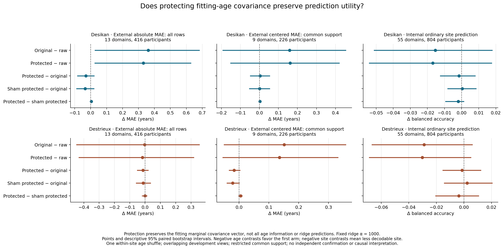

# Preserving fitting age covariance did not remove the prediction cost

**The direct counterfactual succeeded mathematically but did not repair the
Desikan result.** At the fixed ridge penalty of 1000, raw features yield
external domain-macro MAE of 5.8311 years. Removing four directions while
exactly preserving the original fitting age-covariance vector yields 6.1621
years: a difference of **+0.3310 years**, with a descriptive 95% paired
bootstrap interval of **[0.0268, 0.6274]**. This is a new empirical boundary
for this pipeline: preserving marginal fitting covariance is insufficient to
preserve unseen-domain prediction accuracy. It is not a biological discovery,
a new mathematical theorem, or independent confirmation.

## What was changed and verified

For each original atlas and outer split, the existing rank-four site-direction
matrix was projected into the orthogonal complement of the fitting covariance
vector c=Cov(Z,age), then reorthonormalized. The resulting removal matrix W
satisfies Wc=0, so the retained features preserve c. Both references, feature
scales, fitting participants, penalties and scoring stayed fixed. Evaluation
transforms take features only. A second arm protects covariance with one
within-site shuffled fitting-age vector; downstream ridge always uses true
fitting ages. No nuisance-direction classifier was refitted.

All six fits retained four removal directions. Exact true-age protection
reduced the removed squared covariance-norm fraction to approximately 1e-33;
the maximum componentwise difference between original and transformed fitting
age covariance was 1.91e-14. Raw/original predictions and site correctness were
copied from verified source states. Scales and fitting/evaluation identities
matched exactly; all checked reference aggregate age metrics also matched
exactly. These checks concern this counterfactual, not a reinterpretation of
the older historical replay discrepancy.

## Prediction and site-probe results

All-row results cover the same 416 external participants and 13 domains.
Negative differences favor the first arm. Intervals are descriptive 95%
percentiles from 10,000 paired domain/participant bootstrap draws.

| Absolute external MAE contrast, years | Desikan | Destrieux |
| --- | ---: | ---: |
| Original projection − raw | +0.3613 [0.0274, 0.6808] | −0.0032 [−0.4472, 0.3535] |
| Exact protection − raw | +0.3310 [0.0268, 0.6274] | −0.0170 [−0.4317, 0.3175] |
| Exact protection − original | −0.0303 [−0.0821, 0.0207] | −0.0137 [−0.0500, 0.0192] |
| Sham protection − original | −0.0344 [−0.0884, 0.0193] | −0.0127 [−0.0568, 0.0347] |
| Exact protection − sham protection | +0.0041 [−0.0018, 0.0098] | −0.0010 [−0.0182, 0.0118] |

The small improvement over original removal remains uncertain in both atlases.
Desikan's protected-minus-raw point contrast is positive at all five fixed
penalties, ranging from +0.3268 to +0.3665 years. Destrieux's corresponding
point contrasts range from −0.0170 to +0.0314 years; its anchor interval is
wide. No equivalence or atlas interaction is established.

The all-row centered contrasts against raw are +0.1409 [−0.0834, 0.3567]
for Desikan and +0.1079 [−0.0857, 0.2871] for Destrieux. On the same nine
centered-eligible common-support domains, absolute contrasts are +0.1059
[−0.2812, 0.4952] and +0.0945 [−0.1284, 0.3184]; centered contrasts are
+0.1620 [−0.1511, 0.4195] and +0.1355 [−0.0537, 0.3311]. Those 226
participants are younger than 35. Thus the strongest evidence concerns
all-row absolute age error, not established loss of within-domain age utility.

Ordinary seen-site prediction also gives no clear protected-versus-original
separation: balanced-accuracy differences are −0.001540 [−0.012374, 0.007851]
and −0.001323 [−0.015266, 0.012121]. These probes use all 804 internal
participants across 55 observed domains and cannot isolate scanner nuisance
from cohort composition.

## Why the sham comparison needs care

The within-site sham itself almost preserves TRUE fitting age covariance.
It reduces the removed squared covariance-norm fraction from 0.0226–0.0280
to 0.000070–0.000433 for Desikan, and from 0.00186–0.01191 to
0.000294–0.000728 for Destrieux. Consequently, exact versus sham protection
compares exact preservation with already strong approximate preservation.
Its uncertain difference does not show that individual age alignment is
irrelevant. The shuffle preserves between-site age composition, and this one
realization is an active control rather than a permutation null distribution.

Subspace rotation sizes are similar but not matched. The nontrivial principal
angles are 8.65–9.64 degrees for true versus 8.89–10.33 for sham protection
in Desikan, and 2.47–6.26 versus 2.42–7.25 in Destrieux. Projector displacement,
all angles and removed feature energy are retained in the numerical report.
Different directions and rotation magnitudes limit attribution specifically
to age alignment. Near-zero original-versus-itself angles are floating-point
roundoff, not an additional transformation.

## What this continuation establishes

The [cached heterogeneity analysis](../../projection_heterogeneity/attempt001/interpretation.md)
showed that Desikan's worsening survives every single-domain omission, while
Destrieux's nearly flat average conceals opposing domain effects. The
[residualization intervention](../../age_adjusted_projection/attempt001/interpretation.md)
then increased removed original-feature age-covariance alignment in all six
fits. The present direct intervention successfully protects that covariance
but leaves most of Desikan's prediction cost present.

Together these results narrow the explanation: neither post-projection
rescaling alone nor failure to preserve this marginal training covariance
fully resolves the observed pipeline behavior. They do not identify the
remaining mechanism or prove covariance loss played no role in the original
result. Marginal covariance is not total age information; relationships among
features can affect ridge prediction even when that vector is preserved.

All analyses use exposed development data and overlapping robustness views.
Bootstrap intervals condition on these fits, observed domains, fixed support
and one shuffle; they do not represent training or shuffle uncertainty, correct
for the continuing exploratory sequence, or provide independent confirmation.
No additional variant is adopted by this report. The original no-candidate
decision and closed public holdout remain unchanged.

See the [complete contrast tables](covariance_protected_report.md),
[numerical results and geometry](covariance_protected_report.json),
[prospective specification](../../../site_information_diagnostic_prior.md#adopted-final-counterfactual--exact-fitting-covariance-protection),
and [execution/accounting record](../../../experiment_log.md).
Four focused tests and independent static/result review passed. The
representative fit was reused by the completed full run; execution logs and
fitted states are preserved beside this report. Shared allocation cost is
recorded once in the experiment log.
