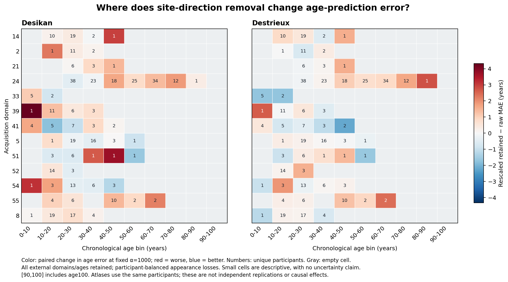

# Interpretation of cached projection heterogeneity

The strongest finding is that **the Desikan age-error increase survives every
single-domain omission, while Destrieux's near-zero absolute-error change hides
offsetting domain effects and persistent centered-error worsening**. These are
descriptive results within the 13 observed acquisition domains, not independent
replication or evidence of a biological mechanism.

For the original R3-style operation (projection followed by fit-only rescaling),
Desikan's external domain-macro MAE change is +0.375854 years. After leaving out
each domain in turn, it remains between +0.310634 and +0.431702 years; centered
MAE changes remain between +0.102287 and +0.204805 years. Thus removing any one
observed domain does not eliminate the aggregate worsening.

Destrieux's corresponding absolute change is only +0.012471 years, but domain
33 improves by 1.698147 years among seven participants. Omitting that domain
raises the aggregate change to +0.155023 years. Equal-domain weighting gives
this small domain the same weight as larger domains, as intended by the
estimand. Its influence makes the near-zero aggregate sensitive to which
domains are represented. Every single-domain omission still leaves Destrieux's
centered MAE change positive; the all-domain centered change is +0.131091 years.

## Projection and rescaling are distinct operations

All comparisons below use the same fixed ridge penalty, alpha 1000. Retained
features use the original standardized metric; rescaled retained features
apply the additional fit-only column scaling used by the original R3 pipeline.

| Atlas | Retained minus raw: absolute MAE | Additional rescaling: absolute MAE | Retained minus raw: centered MAE | Additional rescaling: centered MAE |
| --- | ---: | ---: | ---: | ---: |
| Desikan | +0.361338 | +0.014516 | +0.149076 | -0.000156 |
| Destrieux | -0.003243 | +0.015714 | +0.119563 | +0.011528 |

Values are years. Most of Desikan's observed worsening is present before the
additional rescaling. Destrieux already has worse centered prediction in the
unrescaled retained representation despite nearly unchanged absolute MAE.
Rescaling alone therefore does not account for that centered-error pattern.
Restoring discarded scores in the common metric reproduces raw predictions
to numerical precision, as expected from ridge's preserved Gram matrix.

The squared-error attribution adds a second distinction. For a prediction
correction `c` and raw residual `e`, `Delta MSE = 2 E[e*c] + E[c^2]` exactly.
For rescaled retained versus raw, Desikan has alignment +1.749994 years² and
correction energy +2.867638 years²; Destrieux has alignment -1.424454 and energy
+2.607786 years². Correction magnitudes are similar, but their alignment with
the raw model's errors has opposite signs. In Destrieux, some corrections
reduce existing errors while their nonzero energy increases squared error.
This is an accounting of predictions, not an identified scanner or age mechanism.

## Age support changes the contrast without dropping domains

Every domain has some rows on the earlier fit-defined common age support.
Consequently, domain reweighting contributes exactly zero to the common-minus-all
contrast in this analysis. The original-weight within-domain restriction and
eligible-appearance reweighting remain separate. For rescaled-minus-raw MAE,
these terms are -0.153485 and +0.010709 years in Desikan, and -0.098463 and
-0.002176 years in Destrieux. Supported-subset attenuation therefore cannot be
described as merely excluding acquisition domains. It reflects which appearances
are scored and how their participant weights change. No additive subgroup
decomposition is claimed for metrics recentered separately within each population.

The fixed ten-year bins expose where observations exist and where error changes
occur. Different age bins can contain different acquisition domains, and sparse
cells have little precision. They support descriptive localization, not a claim
that chronological age causally changes the effect or that the pattern follows
within-person aging.

The [report](heterogeneity_report.md) and [complete numerical summaries](heterogeneity_report.json)
retain all 416 participants, 954 appearances, every domain, all ages and all
leave-one-domain-out results. Four reconstruction tests passed in coordinator
Slurm allocation 46581828, and the analysis completed with exit 0. No model was
fit and no new intervals, significance tests or support thresholds were added.
The previously diagnosed historical replay difference remains documented in
the source run rather than relabeled as a passed strict check. These results
do not reopen the original no-candidate decision or the closed public holdout.
