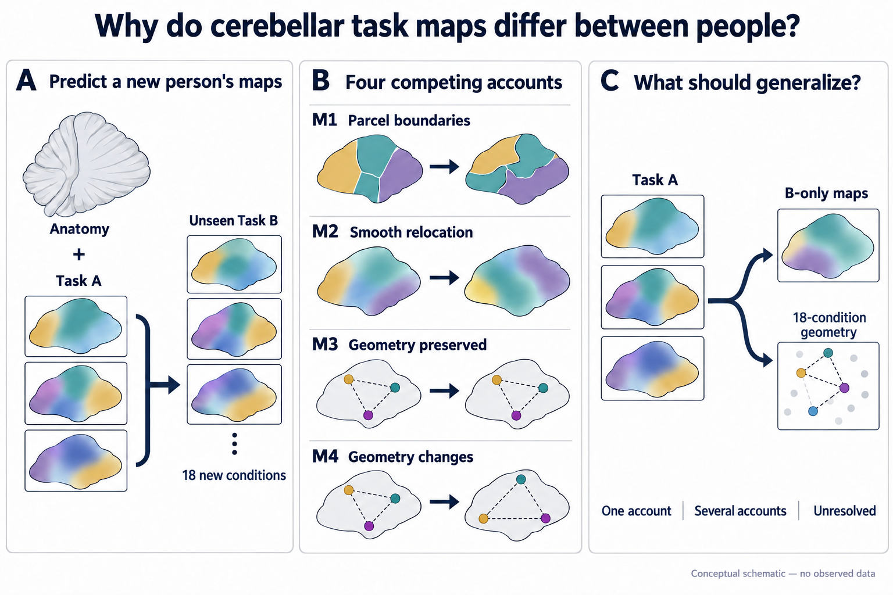

# Why do people have different cerebellar task maps?

## Standing-authority numerical repair — October 13, 2026

For the observed-map route, any of the four canonical M4 fits whose sufficient
full-domain curvature bound refuses, whose local optimizer fails to converge, or
whose otherwise valid local solution misses the original optimality-gap bound may instead certify a unique constrained
minimum using local profile growth and exclusion of every other region in the
original domain. The trace-zero diagonal family uses its coupled profile, or a
balanced vertex proved by strict scalar-dual minima and growth over every full interval.
An alternative balanced-vertex proof uses strict inward derivative separation
on a local box and global lower bounds excluding its entire exterior;
the other three retain every original scalar interval or shear disk and use
exact angular minimization followed by blockwise radial exclusion and growth.
This replaces a sufficient numerical proof method, not the
model, objective, scientific estimand or claim. The original 1e-10 growth/gap
margins, rank tolerance, paired parameters, physical bounds and actual operator
locality checks remain. The existing sufficient-curvature route is tried first.
Unresolved certification still stops the whole panel. Neither exact floating-point
global optimization nor a formal interval-arithmetic proof is claimed.
This implements the root AGENTS.md numerical-repair authority; finite resources
and consumed-time accounting follow its standing rules. Historical attempts stay.

## Adopted supplemental M4 certificate — October 13, 2026

The scientist replied "OK agree with your next steps" after the coordinator
explicitly recommended adopting the replacement numerical certificate and
retrying the real-data fit. This adopts the complete
[written certificate follow-up](outputs/proposed_m4_certificate_followup.md).
The original sufficient bound is retained, with the qualified full-domain
alternative used only when needed. Every original per-block positive-curvature,
rank, gap, optimizer and locality requirement remains. A failed or unresolved
certificate still stops the complete panel.

This applies only to the observed-map descriptive development route on the
single frozen188-location support, with all12 people,18 Task-B conditions,
16 variants and all controls. Reuse the ten passing checks and released data.
Keep the original search start/deadline and consumed charges; a fresh cost003
may run within1CPU/7GiB/24h. Scientific summaries stay private until complete
cost evidence is reviewed and release recorded. Audit stays closed.

## Adopted finite common development support — October 12, 2026

At about 16:18 Pacific (23:18 UTC) the scientist replied "adopt the EP15
finite-support proposal" to the
[finite-support follow-up](outputs/proposed_finite_support_followup.md). For the
observed-beta descriptive route below, one derived common availability mask `M`
replaces the fixed 208-location support. `M` is a subset of the original
anatomical support `M0`: a location stays only if the unchanged strict sampler
returns a valid, finite value in every one of the 9,024 released selected
development maps. `M0` itself is unchanged and remains the support of every
other route. The original 208-point route is kept as a distinct route.

All twelve participants, eighteen Task-B-only conditions, sixteen variants and
every existing control, partition, weight and source exclusion are kept.
Spatial means and equal-voxel losses are taken over `M`, with weight `1/|M|`.
The anatomy-cell geometry is rebuilt on `M` using the proposal's deterministic
floor/ceiling median-split cells. Model families, ranks and parameter counts
are unchanged.

This changes the spatial estimand. `M` uses target Task-B availability,
though no response magnitudes or scores, so results are availability-
conditioned and target Task B is not described as wholly unseen. Nothing is
compared with a 208-location loss. An empty support, insufficient geometry or
a failed numerical certificate stops this route. A stop does not permit a
smaller cohort, a weaker cutoff or another support search.

The machine-readable authority is
`scientist_amendment_20261012_finite_support` in `SEARCH_POLICY.yaml`. The mask
is frozen at188 original locations after the complete9024-map intersection;
its sole binding is `outputs/runs/observed_beta_development/finite_support001/selection.npz`.
The affected variable-support implementation checks passed. This qualifies
the changed implementation, not an empirical model or the original question.
This document releases no data and selects no job.

## Adopted observed-beta descriptive route — October 12, 2026

At 22:29 UTC (15:29 Pacific), the scientist adopted the
[observed-beta follow-up](outputs/proposed_observed_beta_followup.md). This
authorizes the complete fixed development panel to describe prediction of the
supplied beta maps while cross-partition error-independence support remains
unresolved. Only this descriptive route is excepted from that support
prerequisite in the earlier amendments below. Functional map validity,
source/parameter-cache protection, numerical certificates and resource
admission remain required. The original reliable-variation question and its
qualification obligations are retained; the Task-A diagnostic did not pass them.

Keep all twelve development participants, all eighteen Task-B-only conditions,
208 locations, sixteen fixed variants, M0a/M0b and every existing matched
control, run partition, weight and leave-one-person-out source exclusion.
Personalize each target from anatomy and Task A only. Report unadjusted
observed-map squared prediction loss for the complete panel; existing signed
cross-partition statistics may accompany it only with the unresolved error
assumptions stated. Do not report reliable-signal or recovery fractions,
adequacy, equivalence, formal superiority, a winning model class, mechanisms
or a selected positive subset. The original 0.20/0.05 standards are not pass
thresholds for observed-map loss. Audit access remains prohibited.

The machine-readable authority is
`scientist_amendment_20261012_observed_beta` in `SEARCH_POLICY.yaml`.
The descriptive reporting implementation is available. A qualified full-panel fit is authorized once the
coordinator records development release, complete-route cost/resource admission
and remaining budget; this document itself releases no data and selects no job.
All existing resource limits and historical charges remain. The search's
120-hour clock is not reset by adoption or equated with the date of source
preparation; its applicable start and remaining allowance must be recorded
before launch. All earlier requirements below apply except for this explicitly
scoped independence-support exception and its stricter reporting limits.

## Adopted procedural evaluation separation — October 12, 2026

At about 13:10 Pacific the scientist replied "follow your recommendation" to
one evaluation-separation decision covering EP02, EP15, EP17 and EP18. The same
account can read the evaluation data, and the October 3 sandbox route failed
(namespace `ENOSPC`, EP18 job 46427768). Procedural same-account separation
with a disclosed weaker claim therefore replaces EP15's requirement for
enforced reader isolation (a separate execution account, restricted
runtime/Apptainer route or independent steward). No SRCC request is sent.

- Development processes and agents read only the released development-role
  inputs of the twelve development participants, plus Task-B-free shared
  inputs already fixed by this contract, such as the 208-location support.
  Mixed original archives, audit-calibration and sealed audit Task-B
  containers, private reliability values and exposed fitted caches are not
  opened, listed or searched during development.
- Analysis choices are frozen and recorded before any audit access: panel lock
  precedes the calibrator's use of audit anatomy and Task A, and prediction
  lock precedes the single recorded opening of audit Task B.
- Every access to audit-calibration or sealed-audit data is recorded in the
  [experiment log](outputs/experiment_log.md). Unplanned access is disclosed
  and the affected results are marked.
- Every result that uses audit data, and any statement that audit data stayed
  sealed, states that the separation was procedural: same account, not
  technically enforced, data readable by that account. It is never described
  as enforced or blinded evaluation.

The reader-separation precondition is now satisfied procedurally; this is not
OS isolation. Data roles, the exploratory twelve-participant route with
`tau_remaining = 0.20` and `tau_increment = 0.05`, the sixteen fixed model
variants, deferred formal items, thresholds, opening counts, budgets and every
other blocker are unchanged, and the exploratory branch still opens no audit
data. Development access still awaits a separately recorded handoff release.
Empirical fitting also awaits the published-parameter/cache firewall,
functional-validity and error-independence support (GLM7 versus GLM4/5/6
provenance; geometry pairs possibly within one scanning session) and resource
admission. The later observed-beta amendment above excepts only that route
from the error-independence prerequisite. This supersedes the October 6 statement below that the
procedural-reader proposal remains unadopted; reader isolation or separation
requirements elsewhere in this file now mean this procedural boundary.

## Adopted exploratory real-data direction — October 6, 2026

The scientist agreed to prioritize exploratory fits on the existing real MDTB
development data and retain the intended standards of at least 80% recovery
(`tau_remaining = 0.20`) and a five-percentage-point comparator increment
(`tau_increment = 0.05`). These are meaningfulness choices, not evidence that
uncertainty is calibrated or that any model passes. The other five proposed
margin values remain unadopted.

Proceed with the existing twelve development participants after reader
isolation, functional validity and fixed model/source recipes are ready. Keep
the 208-location support, 18 conditions, participant weighting and Task-A-only
target personalization. Report signed map/geometry signal, residuals and
comparator point summaries as exploratory; do not apply the five unset
thresholds or declare adequacy, equivalence, superiority or a uniquely supported
class. Uncertainty remains unfinished. Ratio descriptions require positive
finite signal and must disclose unresolved signal strength and precision.

The original seven-world/100-seed qualification and completed joint inference
are deferred for this exploratory branch, not passed or replaced by seven
fixtures. They remain obligations of the original formal class-decision route
below. The Bonferroni alternative and weaker procedural-reader proposal remain
unadopted. Audit Task B stays sealed and existing resource limits remain; no
simulation expansion or audit opening follows from this agreement. The
[current margin record](outputs/scientific_margin_proposal.md#adopted-scope--october-6-2026)
separates the two accepted standards from the remaining proposals.

Two people can perform the same task while showing cerebellar activity in
slightly different places. That difference could mean several very different
things. The same functional parcels may have different boundaries; the whole
map may be smoothly shifted; the same relationships among tasks may be
expressed in different spatial coordinates; or the relationships among tasks
may themselves differ between people.

EP15 asks which of those explanations is sufficient. For a new participant,
the model sees anatomy and Task A only. It must then predict that person's maps
for 18 Task-B-only conditions that were never used to personalize the model.

The important result is not the model with the largest score. It is whether a
constrained explanation accounts for the reliable individual variation and
passes a prediction specific to its proposed mechanism.

The deepest alternative is a stable change in **condition geometry**: Task A
would have to predict which pairs of unseen Task-B conditions become more or
less similar in that participant. A gain in map similarity alone is not enough.

The [paper plan](outputs/paper_plan.md) sets out the prior-work gap, the deeper
prediction, and the evidence required for each planned figure. No model-class
result is claimed here.

## At a glance

| Question | EP15 design |
| --- | --- |
| What is predicted? | Eighteen Task-B-only cerebellar condition maps for a held-out participant. |
| What may personalize the prediction? | That participant's anatomy and Task A; never that participant's Task B. |
| What explanations compete? | Different parcel boundaries (M1), one smooth relocation (M2), geometry-preserving remapping (M3), or bounded geometry change (M4). |
| What must be explained first? | Reliable between-person differences beyond a development-derived group prediction. |
| What is the deeper test? | Whether Task A predicts the full signed deviation of the 18-by-18 Task-B condition-geometry matrix. |
| What is held out? | Twelve whole participants; their Task B remains sealed until one frozen panel is evaluated. |
| What counts as a positive answer? | One model class is adequate, passes its native signature, and is uniquely supported against the other non-nested explanations. |
| What if no class works? | Reliable Task-B individual variation is not transportable from anatomy and Task A under this design. |

## Why this is worth testing

Previous MDTB work has already shown cross-task individualization, including
participant-specific cerebellar parcellations and predictions for novel tasks.
Crossvalidated condition distances and task-by-task Gram matrices are also not
new by themselves.

EP15 therefore cannot contribute another alignment leaderboard. Its possible
contribution is a model-class distinction:

- if M1 is sufficient, much of the stable difference lies at parcel
  membership or boundaries;
- if M2 is sufficient, one condition-invariant spatial relocation explains
  the maps;
- if M3 is sufficient, people share the same centered relationships among
  conditions even though those relationships are expressed in different
  spatial coordinates; and
- if only M4 succeeds, Task A predicts a stable person-specific change in the
  relationships among unseen Task-B conditions.

That last claim is deliberately hard to earn. M1 and M2 can also change a
voxel-weighted geometry through membership or interpolation. M1 and M2 may
also resemble one another near parcel boundaries, and a local isometry may
resemble a smooth warp. The native signatures and matched controls must
distinguish these cases; a score ranking cannot.

Task set and scanning session are confounded in MDTB. A failed A-to-B transfer
cannot, by itself, distinguish task dependence from session instability. This
is an internal mechanism test in one public release, not an external
replication.

## The four explanations

All classes use the same cerebellar support, Task-B source maps, Task-A input,
condition weights, and scoring code. Each may estimate one positive global
gain from Task A and apply it uniformly to every voxel and Task-B condition.
Condition-, domain-, or voxel-specific target gains are prohibited.

| Class | What may differ between people? | Prediction that must accompany adequacy |
| --- | --- | --- |
| **M1: personalized parcels** | Parcel membership or boundaries; parcel response profiles remain shared | Recovery is enriched near frozen parcel boundaries after matching boundary and interior voxels for reliability; parcel interiors are already adequate |
| **M2: smooth relocation** | One bounded smooth spatial field applied to every condition | The field repeats across Task-A halves, predicts the direction of local B-only residuals from source-map gradients, passes displacement/Jacobian/inverse checks, and beats a matched random warp |
| **M3: shared geometry** | A certified spatial remapping that preserves centered condition inner products | Task-B maps are adequate, individual condition geometry is within the equivalence margin, and M4 adds no material benefit |
| **M4: stable geometry change** | A bounded stretch or shear added to the paired M3 transform | Task A predicts both map residuals and the signed Task-B condition-geometry deviation, beyond M1, M2, and M3; ablating a predicted mode removes its predicted geometry pattern |

Two controls anchor the comparison. **M0a** is the raw development mean in the
frozen anatomical space. **M0b** is a development-fit group-functional
prediction with no target-specific input. M0b is the group reference from
which individual residuals are measured.

Participant derangement, Task-A condition permutation, random local bases, and
matched random warps are falsifiers, not alternative biological explanations.

When reliable individual condition geometry is present, M1 and M2 must explain
it as well as the maps. A parcel or warp result cannot be called sufficient
while leaving the episode's central geometry target unexplained.

## What the model is allowed to learn

Let `G_c` be the development-only source map for Task-B condition `c`.
Development uses leave-one-participant-out pseudo-targets. Shared priors,
bases, profiles, source maps, thresholds, and normalizations are always fitted
without the pseudo-target's Task B.

For the final audit, shared quantities are refitted once using the 12
development participants. A target participant's parameters are then fitted
from anatomy and Task A only, and the same fitted rule predicts all 18
Task-B-only conditions. Audit Task B cannot select a model, support, threshold,
gain, retry, or quality rule.

Published algorithms may be reimplemented. Numeric atlases, bases, response
profiles, maps, checkpoints, or initializers that were fitted with an audit
participant's Task B are prohibited, even if they are public or group
averaged.

## First establish that there is something to explain

Each Task-B condition has two independent eight-run maps. For participant `i`,
condition `c`, and half `h`, subtract the group-functional prediction and
spatial mean to obtain `r_i,c,h`. The reliable individual signal is the
cross-half agreement of pairwise participant differences:

`V_map = weighted mean over c and i<j of <r_i,c,1-r_j,c,1, r_i,c,2-r_j,c,2>`.

After subtracting model `m`'s predicted individual residual, the same
calculation gives `R_map(m)`. When the signal gate is positive,

`F_map(m) = 1 - R_map(m) / V_map`

is the fraction of reliable between-person map variation recovered. The
decision is made with linear contrasts, not a confidence interval on this
ratio. Values are not clipped, and participant-specific ratios are not used.

If reliable between-person variation is demonstrably below the prespecified
signal margin, there is no individual signal for these models to explain. If
the signal interval is too wide, the result is unresolved. Conditions, voxels,
run halves, and condition pairs never increase the biological sample size.

## Then ask whether the relationships among tasks differ

Condition geometry means the pattern of similarities among the 18 Task-B-only
condition maps. Four disjoint four-run partitions produce two independent
crossvalidated 18-by-18 geometry estimates for each participant. Spatial means
are removed, the development source geometry `K0` is fixed, and the one global
gain direction parallel to `K0` is projected out.

The same cross-half pairwise-participant construction yields reliable
individual geometry `V_geom` and residual geometry `R_geom(m)`. The primary M4
prediction is the entire signed matrix deviation from `K0`, not a few
condition pairs chosen after the result. The two independent geometry
estimates ask whether that predicted pattern is reproducible.

This geometry test separates two statements:

- **shared geometry:** individual deviation is small enough to fall inside a
  prespecified equivalence margin; and
- **predictable geometry change:** reliable deviation is present and the
  Task-A-derived model predicts it with a material gain over the alternatives.

A nonsignificant geometry effect establishes neither statement.

## Why M3 and M4 are a fair pair

M3 uses a development-fixed centered basis `B` and an orthogonal transform

`Q_i = I + B(O_i - I)B^T`, with `Q_i^T Q_i = I` and `Q_i 1 = 1`.

Therefore a centered condition matrix `X` satisfies

`(X Q_i)(X Q_i)^T = X X^T`.

M3 can move spatial patterns but cannot change their centered condition
geometry. Its active Task-A subspace must have full design rank and a unique
solution under frozen sign, order, and tie rules; unidentified directions are
removed or fixed to identity.

M4 adds one bounded non-isometric component to that exact M3 instance:

`L_i = Q_i exp(S_i)`, where `S_i = B C_i B^T`.

`C_i` is symmetric, trace-free, low-rank, and bounded in spectral norm. M4 uses
the same `Q_i`, basis, support, preprocessing, and fitting rule as M3. Setting
`S_i = 0` must reproduce M3 within a frozen numerical tolerance. Stretch or
shear directions must pass the same Task-A rank and unique-solution check;
unidentified directions are removed or fixed to zero. This makes the M4
increment interpretable as the value of permitting bounded geometry change
rather than a different pipeline or unconstrained flexibility.

## Fair comparisons and decisive falsifiers

| Alternative explanation | Required test | Interpretation if it wins |
| --- | --- | --- |
| There is no reliable individual signal | Independent Task-B halves and a prespecified positive-signal margin | Stop the personalization claim or report unresolved precision |
| A group prediction is enough | M0b residual signal and adequacy comparison | No evidence that target-specific organization is needed |
| Parcel boundaries explain the gain | Reliability-matched boundary-versus-interior recovery for M1 | Support parcel sufficiency; do not call it a new parcel ontology |
| One spatial field explains the gain | M2 half stability, source-gradient alignment, bounds, inverse consistency, and matched random warp | Support stable relocation; do not infer its anatomical cause |
| Geometry is shared | M3 certificate, geometry equivalence, and bounded M4 increment | Support a shared condition geometry at the tested resolution |
| Flexible geometry merely overfits | M4 Task-A-half stability, full-matrix prediction, and development-frozen mode ablations scored against both observed B geometry replicates | Reject the stable-geometry-change explanation if these fail |
| One person or task domain drives the result | Participant and domain influence analyses | Narrow or reject the class-level conclusion |

A model is **adequate** only when the upper confidence bound on its remaining
reliable variation falls below a margin fixed before candidate scores. A more
flexible model receives credit only when its gain over the relevant simpler
models also clears a separate material-increment margin.

## Data roles and endpoint

The release contains 24 participants. A Task-B-blind rule assigns 12 to
development and 12 to audit, balancing demographic fields, session-rest
availability, and a Task-A-only reliability summary. The roles were fixed on
October 4; [DATASETS.md](DATASETS.md#participant-roles) links the assignment
record. Role-filtered containers are materialized but remain unreleased.

The primary endpoint contains 18 Task-B-only conditions in seven equal-weight
domains: CPRO, prediction, spatial map, movie, mental rotation, emotion
processing, and response alternation. Conditions remain separate for the
geometry matrix. The 14 conditions shared by A and B, including the task-design
rest condition, are opened only as post-decision diagnostics and cannot rescue
the primary outcome.

Every assigned audit participant remains in the accounting. A participant who
fails a frozen evaluator-side finite-value or geometry check causes technical
failure; there is no replacement or reduced-N primary analysis.

## Margins and uncertainty

For the original formal class-decision route, four primary scientific margins
are recorded with scientist approval before candidate-discriminating Task-B
scores. The separately adopted exploratory branch above reports point summaries
without invoking the unfinished class decisions:

| Margin | Question it answers |
| --- | --- |
| `tau_signal` | Is reliable between-person map variation large enough to explain? |
| `tau_remaining` | How little reliable variation may remain for a class to count as adequate? |
| `tau_increment` | How large must a recovery gain be to matter? |
| `tau_geometry` | How much individual geometry variation is still compatible with shared geometry? |

Three additional branch-signature margins govern M1 boundary enrichment, M2
source-gradient alignment over a matched random warp, and M4 mode-ablation
gain on observed geometry. Each signature is a participant-level contrast with
a frozen direction and simultaneous bound. In particular, an M4 ablation must
worsen prediction of the observed geometry projection in both independent B
replicates; changing only the model's own predicted matrix is tautological and
does not count.

The two intended standards are now fixed at `tau_remaining = 0.20` and
`tau_increment = 0.05`; the other five margins and calibrated joint inference
remain unresolved. Formal class scoring is not ready. The exploratory branch
may proceed once its explicit source, model and access prerequisites pass.
Synthetic qualification may test the operating characteristics of
already chosen margins; it may not choose or widen them.

Participant delete-one jackknife pseudovalues provide uncertainty for the
pairwise estimands. Each class claim is the conjunction of all of its required
components, and Holm-inverted one-sided bounds cover the four class claims.
Any interval that crosses a decision boundary is unresolved. With only 12
audit participants, wide intervals are a real possible outcome.

## Development search and one-shot audit

The first 20 valid development trials are fixed in advance: four scientific
representatives from each of M1–M4 and four cross-panel controls. Later trials
may change one scientific operator at a time and must state a prediction,
competing explanation, native falsifier, cost, and retirement condition.

The search requires 40–96 valid trials, at least two adaptive successor cycles,
and at least 40% post-coverage falsification or ablation. Limits are 1,200
CPU-core-hours, 120 wall-clock hours, 32 cores and 128 GiB per trial, no GPU,
and a scratch limit that must be fixed before launch.

Before any real candidate score, the complete decision code must correctly
classify prespecified synthetic worlds—group only, parcels, smooth warp, exact
isometry, stable non-isometry, A/B-specific geometry, and a reliability-only
null—while abstaining in ambiguous regimes. This tests the decision procedure,
not the scientific truth of a class.

Development locks one complete panel: one certified M1, one M2, one M3, one M4
paired to that M3, M0a, M0b, and the negative controls. It does not choose one
cross-branch scalar winner.

For audit, the calibrator sees each audit participant's anatomy and Task A,
writes all predictions with Task B unavailable, and freezes the panel. The
trusted evaluator then opens audit Task B once, computes every branch's signal,
adequacy, signature, increment, and equivalence status, and writes one primary
decision. No refit, retry, threshold change, branch replacement, or second
opening is allowed.

## Planned question figure

The figure below is a synthetic design illustration. It contains no MDTB map
or participant result.

Anatomy and Task A must predict unseen Task-B maps and the full geometry of
18 B-only conditions. The triangles depict relationships among task conditions,
not cortical coordinates: their vertices are conditions and their distances
are representational. M3 preserves these distances; M4 may change them. M1 and
M2 are separate spatial accounts and need not preserve condition geometry.
The small drawings are illustrations, not the 18-by-18 analysis matrix or
observed maps. Several adequate accounts remain non-identifiable. The
[exact generation and correction prompts](outputs/ep15_conceptual_question-v2-prompt.md)
are recorded; the earlier image is retained as historical material.

## Possible conclusions

| Outcome | Evidence required | Meaning |
| --- | --- | --- |
| **Parcel sufficiency** | M1 is the only supported explanation: it is map-adequate, explains geometry when geometry signal is present, and has signal-opportunity- and reliability-matched boundary enrichment | Shared parcel profiles plus personalized membership are sufficient at the registered resolution |
| **Smooth relocation** | M2 is the only supported explanation: it is map-adequate, explains geometry when present, is stable across Task-A halves, predicts source-gradient residual direction, and passes warp controls | One condition-invariant spatial relocation is sufficient |
| **Shared condition geometry** | M3 is the only supported explanation: it is map-adequate, geometry lies within the equivalence margin, and M4 has no material increment | A geometry-preserving correspondence is sufficient at the tested resolution |
| **Stable geometry change** | M4 is the only supported explanation: it is map-adequate, identifiable, and stable, and materially improves both map and full-matrix geometry prediction over M1, M2, and M3 | Task A predicts reproducible individual changes in unseen Task-B condition relationships |
| **Multiple supported explanations** | Two or more non-nested explanations are fully supported, including their native signatures and geometry conditions | The data do not identify a unique mechanism; no simplicity rule may manufacture one |
| **Adequate prediction without a supported mechanism** | At least one class predicts maps adequately, but every candidate mechanism decisively fails a required signature or geometry condition | Some Task-A information transports, but the proposed parcel, relocation, isometric, and non-isometric explanations are unsupported |
| **Reliable but nontransportable** | Individual signal is present, but no Task-A-derived class is map-adequate | Stable Task-B variation remains unexplained under this input contract |
| **No resolvable individual signal** | The upper bound places the signal below `tau_signal` | There is too little reliable between-person variation for the planned mechanism test |
| **Unresolved** | Signal, adequacy, geometry, multiplicity, or precision crosses a decision boundary | These 12 audit participants do not decide the question |

## Data readiness

The Functional Fusion MDTB v1.0 derivative is present in read-only shared
storage. The common forward-transform route, 208-location anatomy-only
support, private Task-A reliability preparation, fixed 12/12 roles and
condition partitions are complete. All 36 role-filtered containers have been
materialized without scientific Task-B evaluation and remain unreleased.
See [the data readiness record](DATASETS.md#what-remains-before-analysis).
Remaining work includes:

- enforcing reader separation and the published-parameter/cache firewall;
- functional finite-value/geometry and independent-error checks under the
  fixed support and partition rules;
- fixing the source geometry, M1–M4 capacities, certificates, numerical
  tolerances and scratch limit for exploratory fits;
- for the later formal route, completing the remaining five margins and
  calibrated uncertainty and meeting its original scientific qualification;
  the 700-run program is deferred for exploratory reporting and its bounded
  replacement remains a proposal; and
- demonstrating that audit predictions can be generated while audit Task B is
  unavailable.

Source availability does not authorize audit Task-B access.

## Claim boundary

A successful EP15 can distinguish among constrained explanations of stable
individual cerebellar organization within this MDTB release and show whether
Task A predicts a specific pattern of Task-B-only condition relationships.

It cannot establish a literal parcel ontology, a universal cognitive
coordinate system, task dependence, causal or behavioral relevance,
generalization to cortex, new participants outside MDTB, another site, or an
independent replication. A flagship confirmation would require a new,
prospectively sealed compatible dataset.
