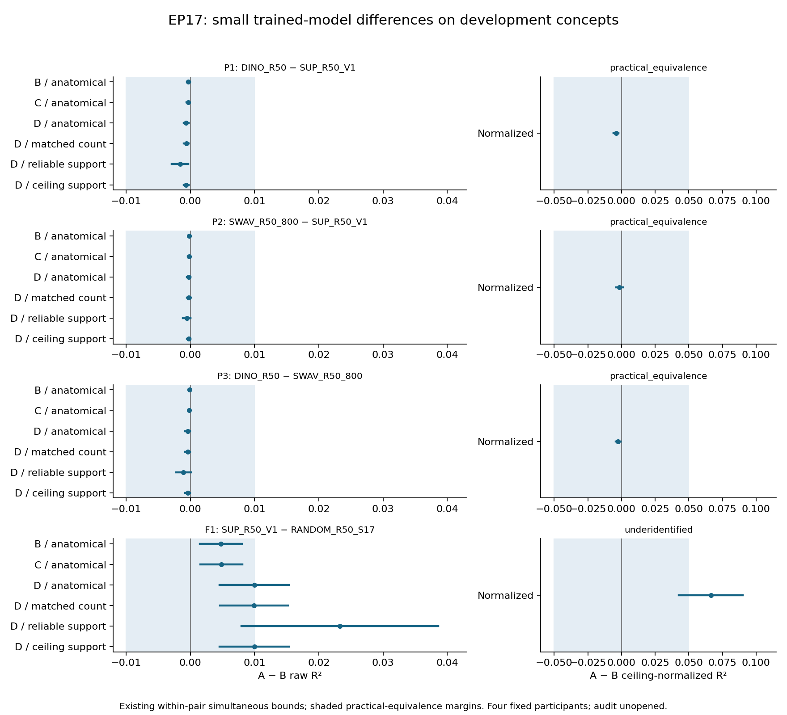

# EP17 outputs

**October13,13:52 Pacific — fixed-panel development complete: practical equivalence for all three trained-model pairs.**
All20 registered comparisons are valid. P1/P2/P3 meet the fixed equivalence
rule across all seven endpoints; no edge shows a qualifying reversal. F1 is
underidentified and nonpromotable. No candidate or audit follows, and the
original adaptive search is not claimed complete.

Read the [complete result and limits](runs/fixed_panel_adjudication/closeout001/development_result.md),
[all20 comparisons](runs/fixed_panel_adjudication/closeout001/all_twenty_comparisons.csv),
or [review and once-only accounting](experiment_log.md#2026-10-13-1352-pacific--fixed_panel_adjudication--complete-fixed-panel-result-published-and-visually-reviewed).

[Download the figure PDF](figures/fixed_panel_development/complete_pair_intervals.pdf).
Earlier dated entries below are historical.

**October13,13:47 Pacific — complete released-panel review passed; report/figure pending.**
The saved panel supports practical equivalence for P1/P2/P3 within the fixed
raw/normalized margins, with no qualifying reversal on any registered edge.
F1 remains underidentified and nonpromotable. All20 primary atoms are valid;
inapplicable H-dependent beta forecasts do not invalidate their primary
comparisons. The reviewed saved-summary report will retain the full panel
without refitting or new inference. No candidate or audit is selected.
See the [review and reporting scope](experiment_log.md#2026-10-13-1347-pacific--fixed_panel_adjudication--complete-released-panel-and-source-review-passed-reporting-selected).

**October13 — fixed20-comparison amendment adopted; saved results released for adjudication.**
All fits/endpoints already exist. The scientist approved the described completion
rule and a bounded closeout after the original deadline. Review uses the entire
existing panel with unchanged scientific gates; audit stays closed.
See the [current log](experiment_log.md). Earlier pending-decision entries are historical.

**October 12, 18:40 Pacific — complete development endpoint computation finished.**
Job **47578351** completed successfully: four model pairs, all five edges per
pair and eight 10,000-draw bootstrap families. The complete private summary
was published; no estimates have been inspected or released. The process took
15.1 minutes and peaked at 3.67 GiB RSS; accounting charges 0.253055556 CPU-hours
once. See the [completion record](experiment_log.md#2026-10-12-1840-pacific--initial_coverage--complete-private-endpoint-panel-published)
and [public report](runs/development_endpoints/panel001/endpoint_report.json).
Trial validity and scientific conclusions remain to be adjudicated. The
fixed-panel proposal is still unadopted and the audit remains closed.
Earlier running-state entries below are historical.

**October 12, 18:24 Pacific — complete endpoint evaluation running.**
Job **47578351** has started on sh02-06n03 with 1 CPU/7 GiB/two hours.
It passed admission of the completed fit002 checkpoint and now runs the
complete development panel. See the [execution record](experiment_log.md)
and [public operational report](runs/development_endpoints/panel001/endpoint_report.json).
No endpoint result or audit opening is claimed; the separate fixed-panel
search proposal remains unadopted.

**October 12, 18:21 Pacific — complete fit002 checkpoint published.**
The [public fit report](runs/nested_prediction/fit002/fit_report.json) records
completion of all 352 PCA fits, 290,976 ridge fits and 96 out-of-fold banks
across the full four-model development panel. The process took 72.5 minutes;
reported peak process RSS was 5,824,360 KiB (5.55 GiB), not an allocation-wide
memory measurement. [Batch status](runs/nested_fit002_job_47577068/status.txt)
records successful fit and wrapper exits. Scheduler accounting independently
confirms COMPLETED 0:0 and 5.07 allocated CPU-hours, charged once. At 01:23 UTC,
the already-submitted endpoint job 47578351 is pending after its prerequisite
completed; no duplicate task is needed.
No endpoint result or audit opening is reported. The separate fixed 20-panel
proposal remains unadopted; complete fitting does not satisfy the current
adaptive-search rule. Earlier entries below are historical.

**October12 — fitting continues; a separate search-design decision is pending.**
The frozen roster supplies20 distinct comparisons while the current adaptive
policy requires at least32. The [inactive fixed-panel proposal](proposed_fixed_panel_search_followup.md)
would complete all20 while preserving numerical/statistical and audit gates.
It has been presented to the scientist; it is not adopted. Existing fit002
and its dependent endpoint stage continue under their current admissions.

**October12,17:26Pacific — all352 PCA fits complete; internal model fitting underway.**
The [public operational report](runs/nested_prediction/fit002/fit_report.json)
records entry into private inner scoring with all four models and eight
participant/ROI groups. Job47577068 is running; endpoint47578351 remains
dependent. No completed checkpoint, final model-ranking result or audit
opening is yet reported. See the [execution log](experiment_log.md).

**October12,17:12Pacific — full fit running; complete endpoint job47578351 queued.**
Fit002 began actual full prediction at00:08:52UTC. Its complete private
endpoint stage47578351 depends on successful47577068 and requests1CPU/7GiB/2h,
preserving the original global deadline and passed checks. No complete fit,
model-ranking result or audit opening is yet reported. See the
[current execution record](experiment_log.md).

**October12,17:06Pacific —47577068 running; all four affected checks passed.**
Actual resources are4CPU/31GiB onsh02-06n03. The adopted narrow rule, pre-score
records and changed ASTRA all pass. The serial EP21 companion precedes the
complete four-worker fit; no checkpoint or scientific result is yet reported.
See the [startup evidence](runs/nested_fit002_job_47577068/status.txt)
and [current execution log](experiment_log.md). Earlier entries are historical.

**October12,17:04Pacific — adopted amendment; fit002 submitted as47577068.**
The scientist approved the [uncertainty-block-only primary-R² amendment](proposed_score_specific_validity_followup.md).
Code retains finite inputs/moments and positive finite SST in every individual
block, with training, validation, calibration, whole-audit variance, secondary
statistics and bootstrap rules unchanged. A new complete fit002 is selected
for4CPU/31GiB/up to8hours. Independent source review passed; the three new plus
one affected checks and ASTRA run inside that substantive allocation. Slurm
accepted the exact requested resources; the job was PENDING at verification.
No test or fit completion is claimed yet. The original240-hour deadline remains
October13 18:29:09UTC. Prior fit001 and diagnoses are preserved; no checkpoint
exists to resume. The scientific audit remains closed. See the
[adoption and finite run selection](experiment_log.md#2026-10-12--prediction_qualification--scientist-adopts-narrow-block-rule-and-fresh-fit002-selected).

**October12,16:15Pacific — complete census isolates the variance-rule failure.**
All training and validation partitions pass. Only four uncertainty blocks in
sub-02/right have exact constant columns at B/C/D; every checked primary-score
denominator remains finite and positive. No fitted model score exists. A
[narrow block-variance amendment](proposed_score_specific_validity_followup.md)
is complete, presented for the scientist's decision and remains **unadopted**. See the
[complete quality report](runs/nested_prediction/fit001_diagnostic002/diagnostic_report.json)
and [execution log](experiment_log.md). Earlier entries below are historical.

**October12,16:01Pacific — the variance-rule stop is confirmed.**
The response-only diagnosis reproduced the failure at sub-02/right, stageB,
block04. This is a fixed protocol eligibility failure; no model ranking was
computed. We are distinguishing its numerical cause and preparing a concrete
scope proposal before any retry. See the
[categorical diagnosis](runs/nested_prediction/fit001_diagnostic001/diagnostic_report.json)
and [execution log](experiment_log.md). No rule has been relaxed.

**October12,15:49Pacific — full fit stopped at response-variance qualification.**
All352PCA fits completed, but the run stopped before private inner scoring and
published no checkpoint. The failed attempt is preserved while its cause is
diagnosed. The next endpoint caller passed source review; two focused tests
are selected within the existing attended allocation. See the
[actual fit report](runs/nested_prediction/fit001/fit_report.json) and
[execution log](experiment_log.md). Earlier running-state entries are historical.

**October12,15:34Pacific — complete real-data development process running.**
Job**47564947** requests4CPU/16GiB/8h for the complete registered panel.
Full image features, actual cost measurement, frozen endpoint family and
required evaluator composition are complete. The PCA checkpoint-layout repair
and affected checks passed. Slurm confirms RUNNING onsh04-04n24; the actual
multiworker check passed and development neural-response loading has begun.
The earlier attended allocation closed successfully. No neural ranking result
or audit score exists from this attempt.
See the [actual startup evidence](experiment_log.md#2026-10-12-1534-pacific--prediction_qualification--full-development-process-running-on-real-responses).

**October 12, 15:21 Pacific — complete real timing probe passed.**
The full development image bank is complete. Repaired cost002 completed all16
PCA fits and8064ridge fits/predictions in22.16seconds of numerical work
(76.76seconds including loading), with1.28GiB peak RSS. No validation response
or model score was exposed. The derived-endpoint binder passed three checks;
the required outcome-free evaluator composition is running before full-fit
admission. See the [cost report](runs/prediction_cost/cost002/cost_report.json)
and [next selected prerequisites](experiment_log.md#2026-10-12-1519-pacific--prediction_qualification--fixed-real-cost-complete-family-binding-and-required-evaluator-composition-selected).

**October12,15:03Pacific — complete real-image feature bank finished.**
All2423 development images, four models and four layers completed in19.55minutes,
peakRSS955124KiB; the private feature bank is complete. Cost-input checks and
changed ASTRA passed; the bounded neural timing probe is admitted. One separate
parallel-fitting fixture defect is corrected and awaiting its selected rerun.
This is feature preparation, not a neural model-ranking result. See the
[completion and cost admission](experiment_log.md#2026-10-12-1503-pacific--stimulus_features--complete-real-development-bank-published-privately)
and [operational report](runs/stimulus_features/full001/feature_report.json).

**October12,14:39Pacific — full development-image extraction running.**
Real pilot002 completed all32 images × four models × four layers in33.92seconds,
reusing seed17. All affected routing/I/O checks and changed ASTRA passed.
Full001 now computes all2423 development images in attended parent47553427,
with1CPU/4GiB,3GiB process-RSS guard and23:05UTC deadline. Actual image access
and feature computation are recorded; completion is not yet observed. This is
private image-feature preparation, with no neural/audit scoring or reader
release. See the [pilot, admission and live attempt](experiment_log.md#2026-10-12-1439-pacific--stimulus_features--real-pilot-completed-complete-development-extraction-admitted)
and [operational report](runs/stimulus_features/full001/feature_report.json).

**October12,14:37Pacific — archive authentication repaired; fresh pilot selected.**
The actual first member opens successfully after correcting a wrapped password
field label; no image bytes were read by that diagnosis. Failed pilot001 and
its seed17 checkpoint are preserved. Explicit pilot002 routing is implemented;
the selected affected checks and32-image cost pilot use the existing attended
parent47553427. Full-development extraction is not yet admitted. See the
[diagnosis and selected next attempt](experiment_log.md#2026-10-12-1437-pacific--stimulus_features--wrapped-field-diagnosed-explicit-pilot002-repair-selected).

**October 12, 14:13 Pacific — pilot companion stopped before its operational log.**
Step **47551249.0** exited 1 after one second; no EP17 operational directory,
launcher-check result or real-image pilot report was created. The pre-log
startup checks are under diagnosis; a memory-environment mismatch is only a
hypothesis. No private-image success or retry is claimed. Independent EP18
image preparation continues. See the [observed failure and next action](experiment_log.md#2026-10-12-1413-pacific--stimulus_features--companion-stopped-before-operational-logging).

**October12,14:07Pacific — first real-image pilot selected; containing job queued.**
EP17's own image archive and private notice are present. The trusted launcher
is implemented and source-reviewed; three focused checks precede its fixed
32-development-image/four-model pilot in a1CPU/4GiB/15-minute step of EP18
parent47551249. That parent is currently pending. No new credential or terms
confirmation is needed; successful decryption and actual features remain
unverified. See the [selection and submission record](experiment_log.md#2026-10-12-1405-pacific--stimulus_features--private-real-image-pilot-selected).

**October 12, 13:10 Pacific — scientist adopted procedural same-account separation** in place of an enforced reader boundary; every audit result must disclose it. Private stimulus delivery still blocks the 32-image pilot. See the [decision](experiment_log.md#2026-10-12-1310-pacific--source_roles--scientist-adopts-procedural-same-account-separation).

**October11,09:21Pacific — all49 selected methods have passing evidence after one repair.**
The original companion in47375558 ran49 methods:48 passed and one failed
because a converted RGB image was not closed. That failed attempt remains
preserved. Explicit cleanup now passes the five affected methods, including
all original feature-value/immutability assertions and preprocessing-error
cleanup, in separate attended job47390492. The other44 methods and unchanged
ASTRA passed in the original companion. The repair session finished
COMPLETED0:0 and used0.018611allocatedCPUh. See
[repair, checks and accounting](experiment_log.md#2026-10-11-0921-pacific--prediction_qualification--image-lifetime-repair-passed-and-compute-session-closed).
This is software validation only. Private stimulus delivery, enforced reader
separation and empirical qualification/resource admission remain unresolved;
no real feature bank, model-ranking result or scientific audit was opened.

**October11,05:44Pacific — audit response adapter implemented;49 checks assigned.**
The original audit interface now preserves all606 images, retained repeats,
eight native axes and B/C/D, using caller-supplied role handles. Independent
source review passed. Its3 checks and the existing46 pending methods will run
as a separate software companion in submitted EP21 pair5 parent47375558;
all remain **unrun**. See [implementation, exact suites and access limits](experiment_log.md#2026-10-11-0544-pacific--prediction_qualification--original-audit-response-delivery-implemented-and-checks-selected).
No private data, model fit or scientific audit has been opened.

**October 10, 22:44 Pacific — twenty composition checks passed.**
The EP21 parent 47329203 completed the endpoint, audit-adjudication and nested
prediction suite: **20 tests passed**, and current ASTRA validation passed.
See the [evidence](runs/scoring_composition_checks_job_47329203/tests.txt) and
[scope/limits](experiment_log.md#2026-10-10-2244-pacific--prediction_qualification--twenty-composition-checks-passed).
Later components' unrun checks and empirical access/integration remain pending;
no private-data fit or scientific audit was opened. Earlier unrun counts below
are historical. The parent is charged only to EP21.

**October 9 — required prediction-cost pilot implemented; five checks unrun.**
The [cost caller](tools/development_prediction_cost.py) now implements the
previously specified fold03–06 training / fold02 prediction probe, leaving
fold01 and validation neural values untouched. It covers every registered
model/setting and fixed 16-column target group, without scoring or choosing
hyperparameters. Root and independent source reviews are complete. Five
focused checks and changed ASTRA validation remain **unrun**, bringing the
pending total to 66; the latest 46 remain outside the unchanged EP21 companion.
No empirical cost or model result was produced. Admitted input delivery,
reader separation and selected resources still precede actual execution.
The [current reader/delivery handoff](source_roles_proposal.md#october-9-current-reader-and-delivery-handoff)
distinguishes these dependencies from already completed copying/calibration;
the stopped namespace route is EP18's, not an observed EP17 namespace failure.
See the [implementation, reporting and resource limits](experiment_log.md#2026-10-09--prediction_qualification-selects-required-prediction-cost-implementation).
Earlier dated entries below are historical.

**October 9 — full development feature producer implemented; five checks unrun.**
The [producer](tools/development_features.py) connects all2423 frozen development
image identities to four fixed models and all four float32 layer banks. It
reuses existing preprocessing/loaders, requires the persisted seed17 artifact,
processes one image at a time and returns immutable panels for the nested fitter.
Independent and root source review are complete. Five new checks remain
**unrun**, bringing the pending total to61; the latest41 stay outside the
unchanged EP21 companion proposal. Actual admitted image delivery, pilot and
full-resource measurement, reader separation and empirical qualification remain
unresolved. No pixels or model parameters were opened and no real feature or
model-ranking result was produced. See the
[implementation and limits](experiment_log.md#2026-10-09--prediction_qualification-selects-full-development-feature-delivery).
Earlier dated entries below are historical.

**October 9 — development response delivery implemented; five new checks unrun.**
The [response adapter](tools/development_responses.py) now connects caller-admitted
development role copies to the nested fitter's complete image-mean panels.
It preserves all 2423 images, retained-repeat means, original columns and B/C/D
bindings, with every header checked before values and shared physical stripes
read once across both ROIs. Independent source review is complete; all five
checks remain **unrun**. The pending new EP17 method count is56, with the
latest36 outside the unchanged EP21 companion proposal. Actual reader release,
full feature delivery, measured resource admission and scientific fitting remain
unfinished. No real response or new model result was accessed. See the
[implementation and limits](experiment_log.md#2026-10-09--prediction_qualification-selects-development-response-delivery).
Earlier dated entries below are historical.

**October 9 — complete prediction-result save/load implemented; five checks unrun.**
The [checkpoint interface](tools/predictor_checkpoint.py) preserves all four
development models, prediction banks, parameter selections and final fitted
state in one private file. Downstream jobs can reuse a completed fit; an
interrupted fit still has no incremental resume. Source review is complete,
but no checkpoint or test has been executed. The pending new EP17 method count
is **51**, with the latest31 outside the unchanged EP21 companion proposal.
Empirical input qualification, enforced reader separation, full freeze/decision
integration and measured production resources remain unfinished. No new
scientific result was produced. See the
[implementation, review and resource limits](experiment_log.md#2026-10-09--prediction_qualification-selects-complete-prediction-bank-persistence).
Earlier dated entries below are historical.

**October 9 — audit correlation and CKA composition implemented; verification unrun.**
The [audit secondary caller](tools/audit_secondary.py) reuses the primary
application's exact immutable response/prediction banks. Only prelocked scales
are available, each with its complete eligible inference family; audit CKA
uses one final rank64 transform and all32 anatomical subsets. Independent
source review completed. Five new checks and one affected application check
remain **unrun**, bringing the pending new EP17 method total to46. The latest26
are outside the unchanged EP21 companion proposal. Production bootstrap cost,
predictor persistence, full freeze/decision integration, qualified empirical
inputs and enforced reader separation remain unresolved. No private data or
scientific audit was accessed. See the
[implementation, review and resource limits](experiment_log.md#2026-10-09--prediction_qualification-selects-audit-secondary-score-composition).
Earlier dated entries below are historical.

**October 9 — frozen audit prediction application implemented; six checks unrun.**
The [array-only application](tools/audit_prediction.py) applies the selected
pair's fixed development PCA/ridge parameters, preserves its common development
baselines and joins whole-block errors to the primary audit endpoint family.
Independent source review completed; its six focused checks remain **unrun**.
There are now41 pending new EP17 methods, with the latest21 outside the unchanged
EP21 companion proposal. Complete relation validation, predictor persistence,
audit secondary composition, empirical input qualification and enforced reader
separation remain unfinished. No audit was opened and no new model-ranking
finding was produced. See the
[implementation, test scope and resource limits](experiment_log.md#2026-10-09--prediction_qualification-selects-frozen-audit-prediction-application).
Earlier dated entries below are historical.

**October 9 — development correlation and CKA compositions implemented; five checks unrun.**
The [secondary caller](tools/development_secondary.py) now supplies separate
complete scale/pair families with pooled voxelwise Fisher-z correlation and
the specified foldwise rank64 CKA. It retains all32 anatomical subset CKAs,
frozen layer/transforms, original columns and whole-block resampling. Root and
independent mathematical/source review completed; all five new checks remain
**unrun**, bringing the new pending EP17 checks to35. The latest15 checks remain
outside the existing EP21 proposal's companion tail. Production memory/runtime,
qualified inputs, reader separation, predictor persistence and audit application
remain unresolved; no model ranking or empirical secondary result was produced.
See the [method, implementation, review and resource limits](experiment_log.md#2026-10-09--prediction_qualification-selects-development-secondary-score-composition).
Earlier dated entries below are historical.

**October 9 — prediction-to-endpoint and explanatory forecast connections implemented.**
The [development bridge](tools/development_endpoints.py) converts the complete
OOF bank into all four signed pairs with common training baselines and the
explicit frozen block order. The [forecast caller](tools/development_forecasts.py)
adds the specified beta cross-fit/refit and fixed support/ceiling forecasts.
Root and independent source review completed, including a fix that binds beta
intercepts to the retained frozen spatial bins. Ten new checks remain **unrun**,
in addition to the earlier20. The new ten are outside the pending EP21 companion
tail; changed ASTRA validation also awaits compute. No real-data model fitting,
ranking or audit followed. Source/reader/resource prerequisites and separate
predictor persistence/application and secondary-score composition remain.
See the [implementation, review and limits](experiment_log.md#2026-10-09--prediction_qualification-selects-prediction-to-endpoint-and-forecast-composition).
Earlier dated entries below are historical.

**October 9 — complete nested fitting composition implemented; 20 new checks unrun.**
The [nested prediction bank](tools/nested_prediction.py) now preserves all four
models,84 settings, six outer folds and the final development predictor, with
training-only transforms and common baselines. Two independent source reviews
completed, including a correction to admit row copies before allocation.
Its six checks join the14 endpoint/adjudicator checks in the unactivated EP21
proposal's existing total time budget. All20 tests and changed ASTRA validation
remain unrun. Actual input qualification, reader separation and measured
resource admission remain unresolved; prediction persistence, endpoint-bank
assembly, explanatory forecasts and audit application are still separate work.
See the [implementation, resource limits and selection](experiment_log.md#2026-10-09--prediction_qualification-selects-nested-prediction-bank-orchestration).
Earlier dated entries below are historical.

**October 9 — endpoint composition and primary audit rules implemented; 14 checks unrun.**
The [array-only evaluator](tools/endpoint_evaluator.py) now combines the seven
primary endpoints and eligible H components with the existing uncertainty
interface. The [primary adjudicator](tools/audit_adjudicator.py) applies the
frozen relation's participant, leave-out, forecast and precision rules, keeping
unspecified negative classifications explicit. Independent source/test review
completed; all14 checks and changed ASTRA validation await coordinated compute.
No empirical score or audit was produced. Nested prediction-bank orchestration,
empirical qualification and effective reader delivery/separation remain
separate requirements. See the
[implementation and limits](experiment_log.md#2026-10-09-1707-pacific--prediction_qualification-selects-missing-evaluator-composition).

**October 9, 16:51 Pacific — missing-h5py repair completed; five checks passed.**
The fixed h5py3.10.0 wheel is installed in the EP17-only package target, leaving
the retained model environment unchanged. All five adapter checks passed
in0.412 seconds and changed ASTRA validation passed. The sequential companion
used17.20 seconds and74,452KiB peak memory within parent47144602, charged once
to EP20. Actual stimulus execution and reader release remain unselected.
See the [completion and evidence](experiment_log.md#2026-10-09-1651-pacific--stimulus_features-runtime-repaired-and-all-five-adapter-checks-passed).

**October 9, 16:13 Pacific — dependency repair selected, not yet executed.**
The missing-h5py repair and the same five source-free adapter checks are
selected sequentially after EP20's live preflight in existing parent47144602,
subject to400 seconds of verified remaining allocation time. The fixed wheel
uses a fresh EP17-only package target; the qualified environment is unchanged.
No new allocation, private-data access or empirical pilot is selected.
See the [selection and limits](experiment_log.md#2026-10-09-1613-pacific--stimulus_features-selects-bounded-runtime-repair-in-existing-allocation).

**October 9, 08:37 Pacific — calibration operators completed; stimulus checks stopped at import.**
In the closed companion slot of parent **47101165**, all four operator checks
passed in **0.299 seconds** and the real saved-calibration operator derivation
completed: **8 participant/ROI groups, 16 beta group-edges**, 2,455,772 private
output bytes, **0.381 seconds** and 55,500 KiB peak RSS. ASTRA schema and semantic
validation passed. The five stimulus-adapter test bodies remain **unrun**:
their module could not import `h5py` in the selected `encoding_model` Python3.11
environment. Correct that runtime binding before rerunning those checks; the
completed operators need no repeat. Actual pixel/feature execution remains
**unselected**, with private delivery and enforced reader separation unresolved.
No model score, reader release or scientific audit followed. The parent is
charged once to EP21, with no additional EP17 charge. See the
[closed evidence and failure](experiment_log.md#2026-10-09-0837-pacific--calibration_support-operators-completed-stimulus-adapter-checks-failed-at-import).

**October 9, 04:33 Pacific — private stimulus-to-feature callable implemented.**
The [fixed 32-image adapter](tools/private_stimulus_feature_pilot.py) joins the
completed development selection to in-memory decoding and the four registered
backbones. Independent source review is complete. The subsequent
[five-check attempt](runs/private_operator_checks_job_47101165/stimulus_adapter_tests.txt)
stopped during module import, as recorded above. The actual pixel/feature pilot remains
**unselected**: authorized private descriptor delivery and enforced reader
separation remain unresolved. Existing source acceptance requires no repeat.
No credential, image or feature was accessed or callable invoked. See the
[implementation and selected check slot](experiment_log.md#2026-10-09-0433-pacific--stimulus_features-private-callable-implemented-source-free-checks-selected).

**October 9, 01:55 Pacific — remaining calibration operator adapter prepared.**
The [adapter](tools/derive_private_operators.py) reuses saved real calibration
maps to construct beta-gain designs, fixed support weights and positive ceiling
operators. Its four checks, actual run and ASTRA subsequently completed in
47101165, superseding the earlier pending descriptions. No model
comparison or reader release has occurred. See the
[implementation and limits](experiment_log.md#2026-10-09-0155-pacific--calibration_support-remaining-operator-adapter-source-reviewed).

**October 9, 01:41 Pacific — copying and full real-data calibration completed.**
Job **47087633** completed successfully in 2090 allocated CPU-seconds, charged
once. All twelve participant/stage products have byte-equal role copies,
within the storage cap. The [terminal report](runs/role_materialization/attempt002/materialization_report.json)
does not release model readers or scientific audit access. In attended
allocation **47090250**, six adapter checks and ASTRA passed; the fixed
real-data pilot completed in 10.41 seconds and about 446 MiB peak RSS.
Full calibration of **8558 original columns** completed in **227.67 seconds**,
with all 12 products and unchanged N=256/q=32 supports generated successfully.
Private maps/supports are verified; model ranking and gain-operator applicability
remain unestablished. Stimulus extraction, features, enforced reader separation
and the evaluator remain next dependencies. See the
[full empirical completion](experiment_log.md#2026-10-09-0141-pacific--calibration_support-full-empirical-maps-and-supports-completed)
and [copy completion/accounting](experiment_log.md#2026-10-09-0134-pacific--role_materialization-complete-attended-calibration-selected).
Earlier running and blocked-copy statements below are historical.
The attended parent47090250 subsequently closed **COMPLETED, 0:0**, at471
CPU-seconds charged once here, including the serial EP20 checks. See the
[allocation closeout](experiment_log.md#2026-10-09-0142-pacific--calibration_support-attended-allocation-closed-and-charged).

**October 9, 01:20 Pacific — private calibration adapter implemented and source-reviewed.**
The [adapter](tools/calibrate_private_roles.py) connects completed private B/C/D
calibration views to the existing numerical/support cores. Its fixed128-column
cost pilot and six focused checks are prepared but **unrun**. Full calibration
duration awaits measured pilot costs. The full copy47087633 was still RUNNING
at01:14:38 Pacific; no active copy payload was opened for implementation.
The clarified builder sequence permits private calibration before worker
release, while keeping candidate fitting's physical reader boundary intact.
See the [implementation and next action](experiment_log.md#2026-10-09-0120-pacific--calibration_support-private-adapter-source-reviewed-fixed-pilot-prepared).

**October 9, 00:53 Pacific — pilot003 succeeded; full copy accepted as 47087633.**
The [pilot](runs/role_materialization/pilot003/pilot_report.json) copied
26,173,440 real neural bytes with exact equality, in 5.27 seconds and about
445 MiB peak RSS. Six column-copy checks passed. Full attempt002 now has one
CPU, 2 GiB and at most three hours. At 00:54:51 Pacific it is **RUNNING**
on sh04-04n24; full-copy completion remains unobserved.
The attended preparation allocation closed normally at 1143 CPU-seconds,
charged once here. See the [accepted full copy and accounting](experiment_log.md#2026-10-09-0053-pacific--role_materialization-full-copy-accepted-as-47087633-attended-preparation-closed).
Trusted copying accessed raw audit-response bytes; scientific audit count is
still zero, and private staging does not release model-scoring readers.
Earlier stopped, unrun and unselected descriptions below are historical.

**October 9, 00:43 Pacific — directory fix verified; column-copy pilot003 selected.**
Nine new checks passed. Pilot002 then stopped before neural access because
the source stores each voxel's complete trial axis in one compressed chunk.
The [adopted traversal correction](experiment_log.md#2026-10-09-0041-pacific--role_materialization-column-traversal-amendment-and-pilot003-selected)
reads bounded 512-voxel stripes across all trials and keeps every original
role and value. The [metadata-only storage projection](runs/role_materialization/compute_job_47086577/column_storage_plan.json)
is 156,301,787,136 bytes including allowances, below the unchanged 160 GiB cap.
The implementation is being prepared in attended allocation47086577;
pilot003 and full copying have not run, and reader handoffs remain closed.
Earlier queued descriptions below are historical.

**October 9, 00:33 Pacific — repaired pilot002 queued in allocation 47086577.**
The exact directory-creation correction is implemented; the task-created
empty parent now has required mode 0700. Nine new focused checks and the
unchanged 64-row pilot scope are selected in the attended 1-CPU/7-GiB/two-hour
allocation. Full copying awaits successful measured pilot costs and review;
no reader release follows. See the [queued execution](experiment_log.md#2026-10-09-0033-pacific--role_materialization-attended-allocation-47086577-queued).

**October 9, 00:27 Pacific — pilot stopped before any neural read.**
The [terminal report](runs/role_materialization/pilot001/pilot_report.json)
identifies an exact-directory-mode check: a new directory inherited setgid
and had mode 2700 instead of 0700. Capacity and metadata checks passed. A
focused creation fix is being prepared; no retry or full copy is selected.
See the [diagnosis and accounting](experiment_log.md#2026-10-09-0027-pacific--role_materialization-pilot-stopped-before-neural-access-at-inherited-directory-mode).
Earlier queued descriptions below are historical.

**October 9, 00:19 Pacific — private copy pilot accepted in EP20 parent 47085635.**
It will run after successful EP20 generation, within its original row, memory,
time and byte bounds. Startup and copying remain unobserved; no reader handoff
or full materialization is open. See the
[accepted execution and evidence boundary](experiment_log.md#2026-10-09-0019-pacific--role_materialization-pilot-accepted-as-the-final-child-of-47085635).
Earlier unsubmitted descriptions below are historical.

October 9: the coordinator's fresh official Oak quota observation has no
cached-data warning, and the exact `outputs/cache` filesystem reports
86,288,309,837,824 available bytes. This resolves the specific October 4
capacity-observation stop. The already-adopted 64-row private-copy pilot is
prepared to resume as a serial child of the forthcoming EP20 allocation,
with its original 2 GiB child limit and 120-second internal/180-second
external deadline. Its ten passing checks are reused. No new job or copy
launch is claimed here; the coordinator must first bind the capacity record
to that allocation and record dispatch. Full copying, encrypted-image
delivery, isolated readers and scoring remain unfinished. See the
[current preparation record](experiment_log.md#2026-10-09--role_materialization-current-capacity-observation-resolves-prior-stop-pilot-resume-prepared).

[Public online resources, checked October 6](../DATASETS.md#public-online-resources--checked-october-6-2026): repository format/processing navigation, stimulus and annotation documentation, and the official open-data access guide.

October 6 reconciliation: [DATASETS readiness](../DATASETS.md#what-must-exist-before-neural-model-comparison)
now includes the completed common universe, roles, structural quotas,
numerical checks and EP18 overlap. The
[adopted prediction specification](prediction_qualification_specification.md)
and corresponding policy fields now consistently record the October 4
decisions; margins are not pending renewed approval. Actual calibration,
feature delivery and isolated readers remain unfinished. See the [record](experiment_log.md).

October 6 public-source update: the
[pinned provider README identifies the password file interface](source_roles_proposal.md#october-6-public-source-update--documented-stimulus-password-interface)
for `images_fmri.zip`. No secret was read. Local authorized delivery and
reader separation remain unresolved; accepted source terms and delegated
margins are preserved. See the [source-update log](experiment_log.md#2026-10-06-pacific--provider-stimulus-interface-documented-without-secret-access).

Earlier October 6, 10:57 Pacific (PDT): the [access and decision handoff](source_roles_proposal.md#october-6-access-and-decision-handoff--recommendations-unadopted)
corrects the supplied review's credential, capacity, isolation and margin
claims. Its generic credential-identification note is superseded above; it keeps
the existing coordinator-adopted margins in force. No secret was inspected;
the reported 159.4/250-TB usage is not a current capacity observation or
reservation. Recommendations remain unadopted; bulk execution and separated
reader handoffs remain unresolved. See the [log](experiment_log.md).

October 4, 23:55 UTC: **allocation46531931 completed normally**. All33
numerical checks pass; the [exact EP17/EP18 metadata comparison](runs/cross_episode_exposure/attempt001/exposure_report.json)
also completed: all3,634 eligible EP17 image identities and720 concepts appear
in EP18's main experiment. Both designs are retained as correlated,
design-exposed studies. Exact [endpoint/audit conventions](measurement_contract_specification.md)
are adopted, both changed ASTRA programs validate, and the compute shell is
closed. See the [log](experiment_log.md) for evidence and one-time accounting.

Bulk neural/image stages remain unlaunched: the bounded copy pilot is prepared as above,
the encrypted archive still needs authorized delivery through the now-documented file interface, and
physical reader-separated handoffs are not established. No candidate score or
audit outcome was opened. Preparation is not a completed scientific result.

Earlier execution observations follow.

October 4, 23:50 UTC: **33 numerical checks passed** in allocation46531931:
calibration, fixed anatomical/reliable supports, measurement operators and
the full10,000-draw crossed uncertainty procedure. The
[test outputs](runs/prediction_qualification/core_checks001/) record the results.
The reviewed [endpoint and audit conventions](measurement_contract_specification.md)
are adopted before scores. Root and two workers now use the remaining bounded
allocation to resolve EP17/EP18 overlap from explicit frozen metadata handoffs.
Neither audit nor any neural/image value is opened by this comparison.
Real feature extraction still needs the existing private credential interface;
the quota/copy route remains stopped. See the [execution log](experiment_log.md).

Earlier execution observations follow.

October 4, 23:30 UTC: **anatomical mapping, archive metadata inspection and
structural quota selection completed**; allocation 46527997 closed normally.
No active job remains. The
[axis report](runs/anatomical_axis/attempt002/anatomical_axis_report.json)
preserves all 881,359 original columns; the
[archive report](runs/stimulus_features/archive_metadata001/archive_metadata_report.json)
confirms all 32 selected members. Independent NiBabel decoding agrees exactly;
all source-label components are retained. Reviewed
[prediction/calibration conventions](prediction_qualification_specification.md)
are adopted, and the tested prediction core is ready. The
[structural report](runs/structural_support/attempt001/structural_support_report.json)
freezes N=256 and 32 voxels per spatial bin for all participant/ROI combinations.
The quota/copy route remains stopped and the encrypted archive needs an existing
private credential interface. Neural values, image pixels, model scores and
audit outcomes remain closed. See the [log](experiment_log.md).

Earlier execution observations follow.

October4,22:55UTC: **46525781 is queued**,1CPU4GiB/20minutes,no-requeue,
for the reviewed anatomical runner's17 fixtures and fixed structural mapping,
plus reviewed model-core checks if ready. No structural outcome is observed.
The [model feature definition](model_pair_registry_specification.md) is now
adopted; exact pretrained-image exposure remains unknown. Neither that record
nor the forthcoming checks activates source feature extraction or neural
scoring. The separate quota/copy route remains stopped before neural access.
See the [log](experiment_log.md).

Earlier execution observations follow.

October4,22:46UTC: the copy pilot's10 fixtures and ASTRA validation passed
on46524139, but the Oak quota query timed out and returned cached usage.
The required current capacity observation is unavailable: **copy pilot stopped
before launch; no neural values read**. No quota retry or copy workaround is
selected. The independently reviewed
[anatomical mapping](anatomical_axis_specification.md) is adopted for bounded
implementation and structural qualification in a suitable4GiB allocation.
Reader handoffs, finite support and scoring remain unfinished. See the
[log](experiment_log.md).

Earlier execution observations follow.

October4,22:33UTC: **all four metadata assignments complete** in21.60seconds.
The [terminal report](runs/concept_role_assignment/full001/assignment_report.json)
records480/120/120 roles, six80-concept folds,24development20-concept blocks
and12audit10-concept blocks. All720concepts/4320images/49980presentations
are preserved. The fixed8-sweep development-block result is not claimed as
a local optimum; no extra sweep is authorized. Neural values remain unread,
and physical reader/handoff qualification remains open. The adopted
[literal-copy pilot](role_materialization_specification.md) is being implemented;
its capacity/layout and focused tests must pass before payload access.
See the [log](experiment_log.md).

Earlier execution observations follow.

October4,22:27UTC: full concept-role assignment submitted as **46523446**,
1CPU6GiB/35minutes,no-requeue, after all23 fixtures and independent review
passed. Fresh [submission logs](runs/concept_role_assignment/submission001/)
and full001 preserve the pilot. Shared preparation46521343 closed normally;
EP17's one-time share is0.186389core-hours. See the [log](experiment_log.md).
Assignment completion is not yet observed; neural handoffs and scoring stay closed.

Earlier execution observations follow.

October4,22:21UTC: the [concept-role pilot](runs/concept_role_assignment/pilot001/pilot_report.json)
completed16.31seconds/292064KiB, with720 concepts,237 fields and all4096 exact
delta checks passing. No roles were assigned. Measured conservative planning
time1485.70seconds supports the selected1800s-internal/1860s-external full
assignment in a fresh35-minute1CPU6GiB job after implementation/review.
The existing allocation supports focused preparation but lacks the full
remaining execution envelope. See the [log](experiment_log.md).

Earlier execution observations follow.

October4,22:10UTC: the [concept-role specification](concept_role_assignment_specification.md)
is adopted for implementation, focused fixtures and a metadata-only timing
pilot after root/independent review. Exact feature arithmetic and a fixed
single-start/eight-sweep method preserve all role/fold/block capacities.
The selected pilot is1CPU/6GiB,300s internal/360s external; it accepts no
source swaps and publishes no roles. Full assignment depends on measured
worst-case costs. See the [log](experiment_log.md).

October4,22:00UTC: shared compute46518769/PTY34288 closed normally after the
selected work, with this episode charged0.1816666667core-hours of the one
0.545core-hour shared allocation. No active compute shell remains. See the
[allocation closeout](experiment_log.md#2026-10-04-2200-utc--shared-allocation46518769-closed-and-accounted).

October4,21:59UTC: [chronology qualification](runs/source_chronology/attempt001/chronology_report.json)
completed in4.375seconds after15 focused fixtures and independent review.
All833 runs/49980 rows are preserved; every participant's constraint graph
is connected and consistent, including the documented out-of-order session.
Eligible-image repeat halves and retained acquisition ranks are qualified.
Role-assignment features/finite optimizer conventions are being specified;
roles, physical handoffs and neural/model scoring remain unactivated.
See the [log](experiment_log.md).

Earlier completed preparation:

October4,21:49UTC: [repaired eligibility attempt002](runs/source_qualification/attempt002/qualification_report.json)
completed in4.714seconds after17 fixtures and independent review passed.
Exactly720 concepts and3634 common repeat-qualified images remain, under the
unchanged prospective rule;128 taxonomy-unmapped concepts are retained.
The exact-ID repair leaves every selected concept mapping unchanged.
Metadata-only chronology qualification is now selected for implementation.
Roles, physical reader separation and neural/model scoring remain closed.
See the [execution log](experiment_log.md).

Earlier evidence:

October4,21:41UTC: the first [eligibility attempt](runs/source_qualification/attempt001/qualification_report.json)
passed all49,980 B/C/D row mappings but stopped before eligibility counts on
a taxonomy ID bridge mismatch. Both source tables passed pinned identity checks.
A [bounded diagnostic](runs/source_qualification/taxonomy_bridge_diagnostic001.json)
found identical1,854 unique-ID sets with eight row-order permutations. Source
concept-name diagnosis is selected before any crosswalk repair or retry.
Roles, chronology and neural/model scoring remain closed. The
[execution log](experiment_log.md) preserves the failed attempt and next step.

Earlier completed evidence:

October 4, 21:13:24 UTC: the [retained-roster reconciliation](runs/released_event_reconciliation/retained001/reconciliation_report.json)
completed all **833 selected runs and 49,980 presentation rows**, with zero
reported errors, 830 newly matched runs and three pilot runs reused. Slurm
46516829 completed with exit 0 after 589 seconds on one CPU
(0.163611111 allocation core-hours). The event stage took 436.05 seconds;
the preceding pinned manifest took 142.62 seconds. See the
[execution log](experiment_log.md) and
[adopted specification](full_event_metadata_reconciliation_specification.md).

This completes the selected retained roster's event metadata, not all source
events or source-role qualification. No neural, pixel or model-feature values,
candidate scores or audit outcomes were opened; behavioral values were not
persisted or reported. The next step is the pending prospective `source_roles`
proposal: freeze repeat completeness, taxonomy and assignment conventions,
then qualify the common universe and assign the 480/120/120 concept roles,
folds and blocks. Those choices and role-filtered handoffs remain unfinished;
scientific scoring stays closed. All 28 preparation fixtures, batch syntax
and changed ASTRA schema/semantics passed before the completed batch.

Earlier preparation:

October4,20:53UTC: the [released-event pilot](runs/released_event_reconciliation/pilot001/reconciliation_report.json)
completed in2.56seconds after16 tests passed. All180 rows from three exact
pinned provider files match the preserved image/order/onset metadata. Full
retained-roster reconciliation is being prepared; roles and neural/model
scoring remain unactivated. See the [execution log](experiment_log.md) and
[adopted specification](event_metadata_reconciliation_specification.md).

This directory contains small, reviewable episode records and planned paper
artifacts. It currently contains a design-stage paper plan and an illustrative
conceptual figure; it contains no neural result.

The current question compares fixed visual representations under response
estimation, voxel-support selection and ceiling weighting. Named DINO, SwAV
and supervised contrasts remain starting comparisons, including the anatomical
bilateral-fusiform support example. Checkpoint/exposure qualification and
numerical margins remain open. This is a measurement comparison, not a causal
self-supervision effect.

2026-10-03: the three nominated official checkpoints are downloaded in the
Git-ignored [`cache/model_checkpoints/`](cache/model_checkpoints/) directory
(310,579,783 bytes total). Safe CPU loading and model compatibility checks
passed in Slurm; see the [execution log](experiment_log.md#2026-10-03---model_pair_registry---checkpoint-acquisition-attempt-001).
This is asset preparation, not a neural result or completed exposure registry.
The next scientific stage remains `source_roles`.

October 3: the [metadata-only steward adapter](tools/source_metadata.py) is
completed attempt 003 as `source_metadata`, a bounded precursor to `source_roles`.
The acquired raw-event directory is empty; provider design/runlist metadata
can still establish presentation identities and repeat structure. The adapter
reads no neural/image/behavior values and assigns no concept roles.
The [completed metadata report](runs/source_metadata/attempt003/metadata_report.json)
covers all four participants and an unqualified common intersection of 3,840
images/720 concepts. It reports zero structural errors and four optional
missing `unionNaN` diagnostic-mask warnings. B/C/D axes and required mask
headers were available; ASTRA validation passed. The
[execution entry](experiment_log.md#2026-10-03--source_metadata--attempt-003-completed-source-roles-remain-incomplete)
records that earlier stage's event/assignment requirements. The retained-run
event reconciliation above now resolves its selected-roster metadata join;
prospective eligibility and assignment remain open. Source roles are **not
complete**; earlier attempts are preserved.

- [Paper plan](paper_plan.md)
- [Scope and novelty review, October 2 (consolidated)](paper_plan.md)
- [Current three-operation conceptual figure, v3](ep17_conceptual_question-v3.png)
- [Exact generation and correction prompts](ep17_conceptual_question-v3-prompt.md)
- [Historical support-specific figure, v2](ep17_conceptual_question-v2.png)
- [Historical three-operation figure, v1](ep17_conceptual_question.png)
- [Planned scientific worklist](astra/v0.0.14/astra.yaml)

The current figure keeps support counts/quotas equal and changes positive
weights on the same voxels. Held-out repetition is not a new explanatory
weighted-mean forecast. Full contract-robust stability requires every eligible
endpoint; the historical v2 depicts only the support edge.

Future scientific outputs must respect the concept roles and reader boundary
in [../DATASETS.md](../DATASETS.md).
