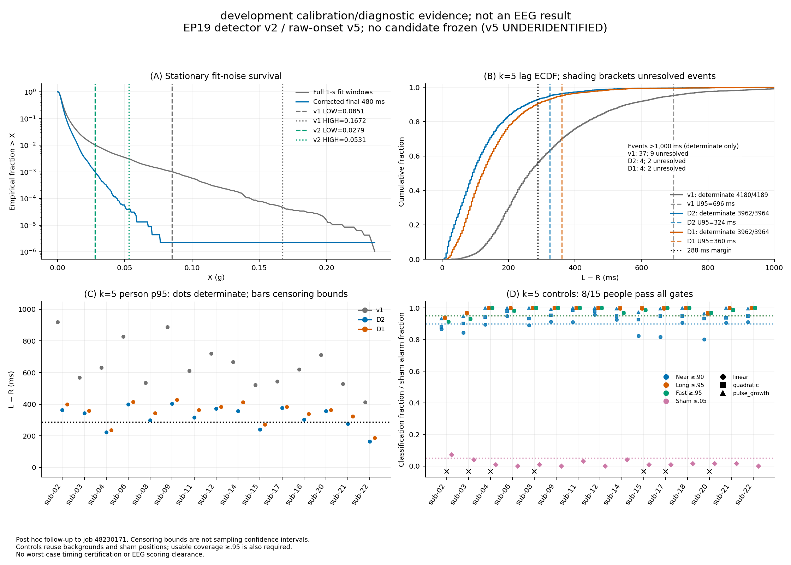
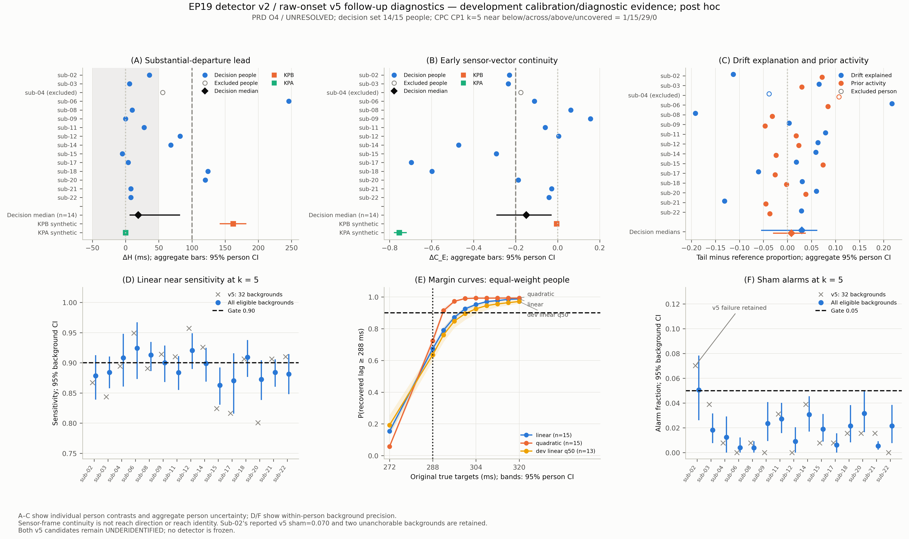

# EP19 source and timing handoff

## October 17: self-paced detector redesign (v2) and acceptance test v5

Follow-up to the [raw-onset result](#result-job-48230171). The noise-only inspection (job 48257954) found that v1's self-paced
LOW (0.085 g) was the q99.9 of still-window samples whose 500-ms baseline reached unscreened time. Over the
support-complete final 480 ms the q99.9 is 0.028 g. Detector rules: [component §1.3](component_details.md#13-self-paced-detector-v2-october-17-pre-declared-before-any-v2-output).
Code: [`detector_v2.py`](code/detector_v2.py), [`run_detector_v2.py`](code/run_detector_v2.py),
[`self_paced_raw_onset_test_v5.py`](code/self_paced_raw_onset_test_v5.py), [`plot_detector_v2_acceptance.py`](code/plot_detector_v2_acceptance.py),
[`run_detector_v2_acceptance.sbatch`](code/run_detector_v2_acceptance.sbatch). The rules below are embedded verbatim in the v5 code.

**Outcome (job 48261284): D2 and D1 are UNDERIDENTIFIED; no candidate frozen** ([result](#result-job-48261284)).
This is development calibration/diagnostic evidence only: 8/15 people passed k=5 controls, cross-k classifications disagreed, and D2 k=5 p95 bounds [324,324] ms give 336 ms with the 12-ms fixed terms.
Preserve the v1 freeze from job 48219799 and keep self-paced primary scoring blocked.

**Follow-up diagnostics (job 48281685; pre-declared, post hoc to v5):** the premature-R diagnostic is **O4 UNRESOLVED** (ΔH 19 [6, 82] ms; ΔC_E −0.149 [−0.292, −0.029]; all known-positive checks passed). With all 2,545 backgrounds, linear near-band sensitivity is 0.893 [0.884, 0.902] against the 0.90 gate, a timing-resolution limit of the reference estimator ([result](#result-job-48281685)). Next: a pre-declared fixed-label gap/H diagnostic; questions about estimator resolution versus gate logic go to the scientist.

### October 17: self-paced detector v2 and raw-onset test v5 — pre-declared before execution

This development-only follow-up is post hoc relative to job 48230171. New template, sham-position, shared-rung and operational choices are assumptions. Existing v1/v4 artifacts remain unchanged.

1. Use only the fifteen named development participants and supplied accelerometer/TRIG readers; never call derivative_onsets or use EEG features.
2. Before candidate output, reproduce D1/v1 non-provider cue fields and every label-array key/value, and reproduce every v4 event/k primary and earliest-sensitivity estimate. A mismatch stops subsequent stages.
3. Fit detector thresholds only from frozen fit-window X[130:250], with v1 quantile scale, rungs {1,1.5,2,3,4}, and conservative HIGH-confirmation window criterion.
4. Apply individual fit-hit ceilings max(1,floor(.05N)), pooled fixed-entry/risk floors .90 and individual risk floor .75. Validation reports only. Shared-rung assumption: advance the common pair when either candidate fails a guard; record every cause.
5. D1 is unchanged v1 replay. D2 suspends at LOW, records that crossing, requires uninterrupted LOW through HIGH and ten following samples, rejects on a drop below LOW, and preserves requalification, cuts, evidence snapshots and exclusive boundaries.
6. Generate and evaluate both candidates. Select the first eligible D2→D1 candidate receiving BELOW_EMPIRICAL_P95_ONLY; otherwise freeze nothing. A common control failure makes both UNDERIDENTIFIED.
7. Stage order is settings; references/backgrounds/templates; controls; labels; event decisions/selection; provider comparison. Each stage requires its predecessor's verified closure and writes fresh artifacts with exclusive creation.
8. Native r(t)=||a(t)-mean(a[t-520,t-20))|| in g, with half-open baseline endpoints and an unsmoothed current sample.
9. Reuse frozen still-window membership and both parities for each person's native reference, using the final 480 ms; require at least twenty windows and finite positive 1.4826*MAD.
10. Primary theta is median+5*1.4826*MAD; k=3 and 8 are locked sensitivities. These person-specific estimator references never initialize or tune the global detector.
11. Search B=max(S-500,L-3000) through L+100 inclusive on available native samples. Require complete validity and support strictly before the admitted evidence endpoint.
12. A complete 40-ms window qualifies when at least 80% of its samples are strictly above theta.
13. Separate bouts by at least 200 ms of nonqualifying window starts. First select the bout with R<=L whose qualifying-window envelope reaches L.
14. Otherwise select the earliest following bout with R>L and first qualifying-window start<=L+60. Its first window may start before L.
15. Require 200 ms of quiet window starts immediately before the selected bout's first qualifying-window start. R is that window's first exceedance; determinate lag is signed L-R.
16. Generic unresolved bounds are [-infinity,+infinity]. A selected bout lacking its left anchor retains [L-candidate_R,+infinity] under the v4 censoring interpretation. Absence of an associated bout is never a successful negative-lag observation.
17. Preserve the v4 earliest-bout, initial 40-ms all-sample-quiet sensitivity unchanged and descriptive. The explicit v4 mode calls the original estimator without the following-bout extension.
18. Backgrounds use the unchanged latest eligible nonoverlapping 2.8-s segment per end-tone+1-s to start-tone interval; require full frozen validity and screen only the final 1.9 s.
19. Select at most 32 backgrounds/person with seed 20261017 and the v4 reservoir stream; require twenty distinct backgrounds. Controls use S=1920 and B=1420 ms.
20. Gated families are linear and quadratic acceleration ramps with theta5 detectability delay 64 ms, plus the continuity-verified pulse_growth family. Descriptive families are 160-ms linear/quadratic ramps and marginal native departure.
21. For each ramp, use u=max((t-T0)/1000,0) and choose the midpoint of the amplitude interval placing the first strict theta5 exceedance at the declared delay. Verify persistent detectability after constructing the full template.
22. Pulse_growth uses a 120-ms raised-cosine pulse of amplitude 4*theta5 and quadratic growth beginning at T0+32 ms. Choose growth amplitude as 1.01 times the nonnegative maximum needed for signed native residual>=2*theta5 from T0+60 through the remaining uncapped template. Verify the pulse alone exceeds 3*theta5 and the complete bout reaches the largest label+40 ms.
23. Marginal departure rises to .99*theta5 immediately before T0+64, reaches 1.05*theta5 there, then increases to 1.10*theta5 over 600 ms. Construct acceleration causally by adding the exact past baseline to this prescribed residual.
24. Use T0=1920 at 250 Hz. At 1 kHz choose the smallest phase in {0,1,2,3} making T_det,5 lie on the detector availability phase. Use one template and one random-direction noisy trace per background/family for all targets.
25. Core targets are fast {0,40,80,120,160}, intermediate {200,240,272}, near {288,292,296,300,304,308,312,316}, and long {320,360,400,448,500,548,600} ms. Early {-40,-20} cells are descriptive.
26. Set synthetic L=T_det,5+target independently of the detector. Cap the shared template at T_det,5+600+100 ms; this common cap preserves every target's existing lookahead.
27. Recompute noiseless detectability after capping. Require exact target equality, detector-clock phase, L>=S, full search support, the 200-ms window-start anchor and the declared associated bout. Invalid cells remain uncovered.
28. Every core and early target is a multiple of 4 ms, so one availability phase serves all targets on a trace (250 Hz ticks 0 mod 4; 1-kHz labels 3 mod 4). Before any output, 448/548 ms replaced a draft's 450/550 ms, which lie off the 4-ms clock. Targets are never rounded or substituted after calibration; an infeasible cell stays uncovered and counts against coverage.
29. At each k, truth is synthetic L minus that k's noiseless detectable onset. Reuse theta5 templates at k=3/8; missing detectable onset means undefined truth. Other-k controls remain descriptive.
30. Consume one deterministic v4-style random direction per background/family, including families with uncovered cells. All targets reuse that trace; close references, background inventory and every calibration row before noisy controls.
31. Evaluate four shams/background at {2096,2296,2496,2696} ms, adding 3 ms at 1 kHz. These equally spaced positions cover early through late supported control labels; their dependence is retained.
32. A sham alarm is a determinate associated R, a selected bout lacking its 200-ms anchor, or invalid/insufficient search support. Valid searches without an associated bout are not sham alarms. Report the v4 any-departure indicator separately.
33. For every person/gated family require at least .95 usable core coverage and twenty distinct backgrounds in each required actual-truth band. Invalid templates/support reduce coverage; unresolved estimates with usable truth fail classification.
34. At k=5 require near [288,320) sensitivity>=.90, long [320,650] sensitivity>=.95, and fast [0,200) specificity>=.95 for linear/quadratic. Intermediate cells affect coverage only; pulse fast and all descriptive-family cells are not additional gates.
35. Require sham alarm fraction<=.05 for every person, using all four positions. All fifteen people must pass; no selected-person subset substitutes for this gate.
36. Use nearest-rank all-event p95 censoring bounds. Failed controls, ineligibility, absent event denominators, >.05 unresolved at any k, a straddling p95 interval, cross-k classification disagreement or participant-list execution imply UNDERIDENTIFIED.
37. Otherwise k=5 lower p95+12>=300 implies FAIL_EMPIRICAL_P95; upper p95+12<300 implies BELOW_EMPIRICAL_P95_ONLY. Keep the separate descriptive 188-ms flag.
38. Report signed U95(L-R)+12, determinate p99/max, per-person p95 bounds, negative lags, totals reaching 300 ms after adding 12, k=3/8 results, exposure, historical backward-LOW support and paired L_D1-L_D2.
39. Close both candidate decisions and selection before projecting acc_start_tick from the frozen v1 cue CSV. Verify cue_tick and start_known_tick by participant/session/run/cue before converting provider values; use no derivative files or provider flag filtering.
40. Health mode writes engineering counts/statuses only for real-event diagnostics, fixes the outcome to UNDERIDENTIFIED, omits real-event lag tables/quantiles/classifications, and skips provider access and plotting. Settings still use all fifteen people.
41. Require an actual Slurm compute shell, at most eight spawn workers within the allocation, and one BLAS/OpenMP thread per process. Refuse nonempty stage directories, changed closure inputs and all artifact replacement.
42. Control failure weakens estimator identification; identified failure weakens the empirical timing argument; BELOW weakens the large-p95-lag alternative only conditionally. People are independent human units; bounds are censoring bounds, not sampling confidence intervals. No outcome certifies worst-case timing or grants EEG scoring clearance.

#### Result (job 48261284)

- **Summary — decision:** D2 and D1 are **UNDERIDENTIFIED**: 8/15 people passed all k=5 controls, and cross-k classifications disagreed. No candidate was frozen.
- **Summary — timing:** D2 k=5 p95 bounds are [324,324] ms (+12=336); D1 bounds are [360,360] ms (+12=372). These numeric FAIL classifications are descriptive while acceptance remains underidentified.
- **Summary — readiness:** Development calibration/diagnostic evidence only: no EEG and no held-out person. Preserve the v1 freeze from job 48219799 and keep self-paced primary scoring blocked; next test the premature-R alternative and control precision under unchanged scientific criteria.

**Execution and declaration.** Job 48261284 completed in 83 s, exit 0, following regressions → settings → controls closed → labels → decisions closed → provider. The detector regression reproduced all 4,432 v1 cue rows' non-provider fields, 4,189 onsets and every label array; the v4-mode estimator reproduced all 12,567 event×k estimates and aggregate metrics. The health-only smoke (48260443; sub-02/15/22) read no lag values. The controls-only check (48260978; 8/15 k=5 passes) was a post hoc diagnostic recorded before the full run; v5 was not revised in response.

Codex gpt-6-astra (max, text only) drafted the design/code in two rounds; Claude reviewed it and corrected 450/550-ms targets to 448/548 ms before any output. Submission 48261201 failed after 10 s with no stage output; the bash-4.2 empty-array error was corrected before the successful run.

**Noise and settings.** Inspection 48257954 reproduced all frozen counts: 3,661 windows, v1 LOW/HIGH, v4 θ and 2,545 backgrounds. Fit X q99.9 fell from 0.0851 g over full windows to 0.0279 g over the support-complete final 480 ms. In 86% of windows exceeding 0.03 g, exceedances occurred only where the 500-ms baseline reached unscreened time; all 24 support-complete exceedances failed a 20-ms block screen.

The declared ladder selected c=1: median 0.002745 g, σ_q 0.025171 g, LOW 0.027917 g and HIGH 0.053088 g. Confirmed crossings were 0/1,901 fit windows and 0/1,760 validation windows; validation remained reporting-only. Pooled fit-background entry was 0.965; at-risk fractions were 0.963 for D1 and 0.955 for D2. The lowest person-level fraction was sub-04 D2, 0.789. Both candidates were noise-admissible; this did not establish timing acceptance.

**Controls.** At k=5, sub-06/09/11/12/14/18/21/22 passed all requirements. Core coverage was 1.00 for every gated family. Of 2,250 calibration cells, 2,235 were calibrated; the 15 uncovered cells were descriptive pulse+growth −40-ms early targets.

| Failing people | Failed k=5 requirements |
|---|---|
| sub-02 | Linear near/long/fast 0.867/0.938/0.912; quadratic 0.879/0.938/0.912; pulse long 0.938; sham 0.070. Two of 32 backgrounds lacked the required 200-ms quiet anchor. |
| sub-03 | Linear near 0.844 and fast 0.931; quadratic fast 0.931; one unanchorable background. |
| sub-04/08/15/17/20 | Linear near only: 0.895/0.891/0.824/0.816/0.801, respectively; sub-15 is the 1-kHz case. |

The post hoc control-row diagnosis is first-exceedance jitter for the gated τ5=64-ms linear ramp: its residual grows slowly through θ5, and one late 4-ms tick can misclassify a true 288-ms lag. This is distinct from the descriptive τ5=160-ms slow family. At k=3, 8/15 people passed; at k=8, 0/15 passed, with linear-near fractions 0.53–0.81. Those sensitivities use θ5-calibrated templates and do not establish acceptance at another reference threshold.

**Timing and exposure.**

| Labels | k=5 determinate p95 (ms) | All-event p95 bounds (ms) | Bounds +12 ms | Status |
|---|---:|---:|---:|---|
| D2 | 324 | [324,324] | 336 | UNDERIDENTIFIED; numeric FAIL |
| D1 | 359 | [360,360] | 372 | UNDERIDENTIFIED; numeric FAIL |
| v1 reference, job 48230171 | 691 | [696,696] | 708 | UNDERIDENTIFIED |

D2 and D1 each produced 3,964 accepted onsets on identical candidate cue enumerations. D2 k=5 had 3,962 determinate events and two unresolved events (0.05%); its median was 92 ms, p90 256 ms, p99 524 ms and maximum 2,464 ms. There were 291 events (7.3%) with lag+12 ≥300 ms. Unresolved-event prevalence was below the declared ceiling and was not the reason for underidentification.

D2 determinate p95 values at k=3/5/8 were 436/324/236 ms; the corresponding all-event p95 bounds were 444/324/236 ms. Thus k=8's 248-ms total is a descriptive BELOW classification with failed controls, not clearance. There were 103 events with lag ≥288 ms at every k. The control-passing subset had D2 k=5 p95 328 ms, descriptive only. Earliest-bout sensitivity gave determinate p95 744 ms, bounds [1132,2540] ms and 4.4% unresolved; 410 primary D2 events ignored a prior separated bout.

| Labels | Accepted onsets | At risk (h) | 300–600-ms positives/scorable |
|---|---:|---:|---:|
| D2 | 3,964 | 2.153 | 21,318/154,964 |
| D1 | 3,964 | 2.253 | 21,976/162,189 |
| v1 | 4,189 | 2.612 | 24,005/187,972 |

D2 had 3,968 armed cues, four armed cues without an onset, 399 unsupported cues versus v1's 172, and 0.157 h pending. The changed event sets and exposure prevent interpreting the v1-to-v2 percentile reduction as a matched effect. On the same candidate cues, L_D1−L_D2 had median 20 ms and p95 80 ms. D2's historical backward-LOW crossing-plus-support p95 of 19 ms is mechanically support-only; it is not a replacement timing guarantee.

**Provider comparison, post-lock.** D2 L−AccStartIndex had median/p95 60/208 ms among 3,577 events; 387 cues lacked a provider value. D1 had 96/236 ms, versus v1's 228/564 ms. At k=5, R−AccStartIndex had median/p95 −16/57 ms. Shared accelerometry limits independence.

**Strongest surviving alternative (post hoc).** R may join low-amplitude pre-reach activity or drift to the later reach, producing a premature reference onset rather than exposing missed reach movement. Among the 291 D2 k=5 events with lag ≥288 ms, the 259 with provider values had R−provider median −260 ms and L−provider median 112 ms; other events had −15 and 56 ms. Long-lag events occurred in all 15 people. These observations and k sensitivity motivate the alternative, but conditioning on large L−R favors early R, and provider agreement is not independent validation. Continuity/occupancy rules do not distinguish drift from reach identity. Pooled event percentiles are descriptive; censoring bounds are not sampling confidence intervals, and repeated events/backgrounds are not independent people.

**Next (post hoc proposal; declare before new output).** First retain the current labels and event set and specify within-person tail/non-tail diagnostics of native-vector continuity, amplitude evolution, baseline drift and quiet-anchor behavior against a fixed later bout segment. Do not require monotone acceleration or equate sensor acceleration direction with reach direction. In parallel, diagnose estimator precision using positive controls at the same 288-ms margin and retain the sub-02 quiet-anchor/sham failures. Development-derived onset slopes may add control strata; they must not replace the original difficult families or remove failing people.

Same-estimand diagnostic and control-precision work is within standing engineering scope. A c=0.75 detector is outside the locked ladder and would be a separate, prospectively declared engineering comparison with every noise and acceptance guard retained; its supplied partial checks are post hoc, not v5 acceptance. Defer that comparison until the reference-onset problem is characterized. Changing the primary k, dropping fast/sham or cross-k gates, or replacing the GOAL's worst-case criterion with p95 requires the scientist. No monotonicity proof establishes that specificity failures are harmless after anchoring, bout selection and unresolved handling. Any BELOW requires passed positive controls at the same margin.

Artifacts: [noise inspection](runs/source_views_and_timing/detector_v2_noise_job_48257954/), [settings/candidate labels/exposure](runs/source_views_and_timing/detector_v2_job_48261284/), [calibration/controls/events/selection/provider](runs/source_views_and_timing/raw_onset_test_v5_job_48261284/), [detector regression](runs/source_views_and_timing/detector_v2_regression_job_48261284/), [v4-estimator regression](runs/source_views_and_timing/raw_onset_v5_regression_job_48261284/). Preserve the [v4 reference result](#result-job-48230171). WAY development non-neural baseline selection can proceed; held-out tuning and normalization initialization remain excluded.

### October 17: premature-R diagnostic and control-precision check — pre-declared before execution

This follow-up is post hoc to v5. Added synthetic shapes, cutoffs, coverage requirements and operational choices are assumptions. It asks whether the v5 tail of long lags (L − R ≥ 288 ms) comes from a premature reference onset R produced by low-amplitude activity or drift (H_A), or from a detector that misses substantial movement before its label L (H_B). Accelerometer continuity cannot establish whether a departure belongs to the reach.

1. Use only the fifteen development people and the supplied accelerometer/TRIG readers: no EEG, WAY or held-out data. The D2 labels, the v5 k=5 onsets, all existing artifacts and both v5 UNDERIDENTIFIED outcomes stay unchanged, and nothing is frozen.
2. Verify the input closures and the fixed counts (3,964 events, 3,962 determinate, 291 tail). Write only into fresh diagnostic directories and stages, and re-check the four new scripts' hashes between stages.
3. Run in an actual Slurm compute shell with at most eight workers and one BLAS/OpenMP thread each. Participant subsets are allowed only in health mode. Health mode writes engineering counts and statuses only: no feature values, synthetic outcomes, decisions, provider output or figure.
4. Stage order: synthetic checks; real features (PRD decision); CPC strata/regression; CPC controls (CPC decision). Provider AccStartIndex is read only after both decisions are closed, with verified cue/start joins, explicit matched denominators and no provider flag filtering.
5. Compare tail events (determinate lag ≥ 288 ms) with reference events (0 ≤ lag < 288 ms) within each person. Require native validity over [ws − 720, L + 100], where ws is the first qualifying-window start, and a later-segment amplitude A_F ≥ θ5. Count every exclusion.
6. Fixed quantities:
   - b0 = mean a over [R − 520, R − 20) and the departure d = a − b0;
   - the later bout segment F = [L, L + 100) and A_F = ||mean d over F||;
   - H = L − t½, where t½ is the first native 40-ms window mean reaching half of A_F (searched through L + 60). If half is never reached, H is censored below −60 ms.
   Quarter-amplitude H, ρ_R, Λ and the moving-baseline versions are sensitivities.
7. Continuity: C_E and C_L are the cosines between the F vector and the 40-ms mean departure at R (C_E) or just before L (C_L). Successive non-overlapping 40-ms windows are descriptive. Also report:
   - the pre-R baseline slope and its 0.27-s residual scale;
   - whether removing that trend un-qualifies the first window ("drift explained"), and the trend's alignment with F;
   - anchor occupancy, prior activity, bout gaps, sample occupancy and rise_per_s.
   Neither monotone acceleration nor a link between sensor direction and reach direction is assumed.
8. Statistics: within-person median differences (proportion differences for indicators), requiring at least three tail and twenty reference observations per feature. H censoring bounds are propagated. People are summarized by their median, with 10,000 person-bootstrap resamples (seed 20261017); the intervals are diagnostic and unadjusted.
9. Synthetic known positives use the 32 cached v5 backgrounds per person and orthogonal direction pairs from SeedSequence([20261017, pid, 7]). S = 1920 ms. Labels are actual D2 labels after a valid, quiet 500-ms arming history. Noiseless flat axes are exempt from the noise-validity screen.
10. Shapes: each sustained ramp is shifted so that its noiseless R is 2160 ms (2163 ms at 1 kHz).
    - KP0 (reference) is an 80-ms raised-cosine step to 4·HIGH.
    - KPA (H_A type) adds a perpendicular drift whose residual is ≥ 1.3·θ5 while X stays ≤ 0.85·LOW.
    - KPB (H_B type) is a collinear ramp (residual ≥ 1.05·θ5, X ≤ 0.98·LOW), plus a small step that crosses LOW and a later HIGH step after F. Nine fixed candidates are tried in order (delays {350, 320, 380} ms × LOW factors {1.3, 1.2, 1.4}); the first with a supported 300–400-ms noiseless lag is used, without consulting any feature.
11. Synthetic set rules mirror the real ones: KP0 events need a noisy reference lag, and KPB/KPA events a noisy tail lag. A person is covered with ≥ 24 usable paired backgrounds for both KPB and KPA. Interpret only the decision set (feature-eligible, covered people), which must include at least twelve people. Sub-04 is expected to be KPA-uncovered: its LOW/θ5 is 1.24, while KPA needs about 1.47.
12. Synthetic contrasts (KPx − KP0 per person) use the same function as the real contrasts. KPB_power: a ΔH estimate ≥ 100 ms with CI lower bound > 0, a ΔC_E CI lower bound > −0.2 and a KPB median C_E ≥ 0.5, so the rule returns O1 on H_B-type data. Per-person synthetic values are descriptive, not gates.
13. KPA_power: a ΔH CI inside [−50, 50] ms, a ΔC_E CI upper bound < −0.2 and a KPA median C_E < 0.5, so the rule returns equivalence plus discontinuity on H_A-type data. KPA_drift_power also requires a drift-explained Δ CI lower bound > 0, a KPA median drift cosine < 0.5 and a KPB median drift cosine ≥ 0.5.
14. Weakens premature R from low-amplitude activity/drift (H_A): O1, a ΔH estimate ≥ 100 ms with CI lower bound > 0 and a ΔC_E CI lower bound > −0.2, given KPA_power. Tail departures then reach half the later amplitude at least 100 ms further before L than reference departures do. O1 motivates testing an anchored-baseline or slope-sensitive detector. It does not establish reach identity or a worst-case bound.
15. Weakens the detector missing reach movement (H_B): O2 or O3. In both, the ΔH CI lies inside [−50, 50] ms, so the extra L − R is spent below half the later amplitude.
    - O2 adds either a discontinuity (ΔC_E CI upper bound < −0.2 and tail median C_E < 0.5) or a drift explanation (drift-explained Δ CI lower bound > 0 and tail median drift cosine < 0.5).
    - O3 instead shows continuity (ΔC_E CI lower bound > −0.2, tail median C_E ≥ 0.5) with no positive drift signature.
    These weaken a substantial miss. They do not validate R or L, or prove that drift is absent.
16. Each statement is evaluated separately with its dependencies: H equivalence needs KPB_power; O1, the discontinuity branch and O3's continuity need KPA_power; the drift branch needs KPA_drift_power. A failed dependency makes only that statement UNDERIDENTIFIED. A supported O1 is reported first, then O2, then O3; otherwise the outcome is O4 (UNRESOLVED, or UNDERIDENTIFIED with reasons).
17. CPC keeps v5's 32 selected backgrounds and their IDs first, then appends every remaining eligible inventory row in session/run/start-tone order. One shared control loop must reproduce every first-32 v5 field exactly before any expanded output; a mismatch stops the stage.
18. Development-slope strata (descriptive):
    - Rise rate = (mean r over [R + 40, R + 80) − mean r over [R, R + 40)) / (0.04 s · θ5), from each person's determinate D2 k=5 events.
    - Strata sit at the person's q10 and q50, for linear and quadratic shapes.
    - Amplitudes come from a doubling bracket, 4,000 geometric grid points per phase and thirty local refinements. Choose the closest rate among phase/cap-valid candidates (ties go to the smaller amplitude) and require ≤ 5% relative error.
    - Target and achieved rates are recorded, and infeasible strata stay uncovered.
19. Keep all six v5 families, the exact targets and truths, the phase/cap/anchor/association rules, k ∈ {3, 5, 8}, and seed key 2 for original directions (key 4 for strata). The gates are unchanged: near ≥ 0.90; long and linear/quadratic fast ≥ 0.95; coverage ≥ 0.95; twenty backgrounds per required band; sham ≤ 0.05; all fifteen people.
20. Report, per trace, the target-320 lag error (and the opposite-signed onset error). Also report margin curves for targets 272–320 and gate intervals from 2,000 background resamples (seed keys 20/21 for all/original backgrounds). Population means and curves use 10,000 equal-weight person resamples.
21. CP1 places each interval below, across or above its unchanged gate, or marks it uncovered. An interval crossing a gate is inconclusive: it does not show that the v5 failure was sampling noise. A systematic synthetic precision failure cannot be repaired by detector changes alone.
22. CP2 calls a cell timing-error consistent only if all of the following hold; otherwise it names association/anchor or target-dependence/coverage limits:
    - the target-320 error covers ≥ 95% of traces;
    - it mispredicts ≤ 1% of near rows;
    - ≤ 1% of near rows are unresolved;
    - the predicted near fraction differs from the observed one by ≤ 0.01.
23. CP3 compares development-slope near sensitivity with 0.90 (descriptive). CP4 reports shams, alarm reasons and unanchorable backgrounds. Sub-02's reported v5 sham fraction (0.070) and two unanchorable backgrounds are retained. Larger prospective samples, reference-resolution changes and gate questions remain scientist decisions.
24. Before this declaration the orchestrator had seen the v5 per-person tail counts, noise references and the pooled v5 control-error distribution. Alternatives compared: three outcome patterns, two H_A signatures, nine KPB candidate shapes (chosen on lag/support only), one KPA shape, one KP0 shape and four descriptive slope strata.
25. Report one 300-dpi six-panel figure labelled "development calibration/diagnostic evidence; post hoc", and exactly three summary lines. Design implications:
    - O1: test an anchored or slope-sensitive detector.
    - O2: run a new reference-association/detrending test; no threshold reduction is indicated.
    - O3: the onset-definition question goes to the scientist before a lower or anchored LOW is tested.
    - O4: no automatic change.
    Nothing here grants EEG scoring clearance.

Code: [`premature_r_diagnostic.py`](code/premature_r_diagnostic.py), [`control_precision_check.py`](code/control_precision_check.py), [`plot_v5_diagnostics.py`](code/plot_v5_diagnostics.py), [`run_v5_diagnostics.sbatch`](code/run_v5_diagnostics.sbatch). The section above is embedded verbatim in the code as `DECLARATION`; Codex gpt-6-astra (max, text only) drafted it in two rounds, reviewed here.

#### Result (job 48281685)

- **Summary — premature R (pre-declared):** **O4 UNRESOLVED** in the 14-person decision set, with all known-positive checks passed. Tail events reach half the later-segment amplitude ΔH = 19 ms [6, 82] earlier, relative to the label, than reference events. Their early sensor-frame direction differs by ΔC_E = −0.149 [−0.292, −0.029] (person medians, 95% person bootstrap). Under the declared rules, neither alternative is weakened and no automatic detector or reference change follows.
- **Summary — control precision (pre-declared):** with all 2,545 eligible backgrounds, linear near-band sensitivity averages 0.893 [0.884, 0.902] against the 0.90 gate (v5's 32 backgrounds: 0.888 [0.864, 0.911]). In 14/15 people the interval straddles the gate; sub-15 is below it. Per-trace onset-timing error accounts for every near-band classification, so this failure is a precision limit of the reference estimator, which detector changes cannot alter.
- **Summary — status:** development calibration/diagnostic evidence only (15 development people, accelerometer/TRIG; no EEG or held-out person). v5 D2/D1 remain UNDERIDENTIFIED and nothing is frozen. The v1 freeze (48219799) is preserved, and self-paced primary scoring stays blocked.

**Execution.** Job 48281685 ran on russpold (sh04-04n24, 8 CPU, 32 GB; 110 s, exit 0). Its stages closed in order: known positives → PRD features/decision → CPC strata with the exact first-32 regression → CPC controls/decision → post-lock provider → figure.

The first health-only smoke (48280333) stopped in the CPC regression (sub-02 `direction_y`) on an AVX2-only RME node. v5's rows were computed on an AVX-512 SIE node, and the BLAS dot product behind the direction norm differs in its last bits. Check 48280993 reproduced all 14,784 sub-02 rows exactly on SKX. The sbatch now requests `CPU_GEN:SKX|CPU_GEN:SIE`; this is an engineering fix only, with no rule changed, and smoke 48281137 passed.

Codex gpt-6-astra (max, text only) drafted the design and code in two rounds and this interpretation in a third. Each round was reviewed here, and O3's KPA_power dependency was added before execution.

**PRD, pre-declared.** Sub-04 was KPA-uncovered, as declared. The power checks on the decision set passed:
- KPB: ΔH 162 [142, 182] ms, median C_E 0.995.
- KPA: ΔH 0 [0, 0] ms, ΔC_E −0.754 [−0.780, −0.718], median C_E 0.246.
- Drift power passed.

On the real data, no declared pattern holds:
- ΔH meets neither O1 (≥ 100 ms with CI > 0) nor equivalence (CI inside ±50 ms; the upper bound is 82).
- ΔC_E meets neither non-inferiority (lower bound > −0.2) nor discontinuity (upper bound < −0.2); the tail median C_E is 0.28.
- Δ drift-explained is 0.030 [−0.055, 0.062], so there is no drift signature.

The intervals are unadjusted diagnostic person-bootstrap CIs.

**PRD, post hoc (descriptive).** Per person, ΔH runs from −5 to 246 ms: sub-06 246, sub-18 124, sub-20 120, sub-12 82, sub-14 68, and the other nine ≤ 36. Pooled over supported events (289 tail, 3,661 reference):
- Tail R→L intervals are intermittent. Sample occupancy median is 0.744 vs 0.962. The longest internal non-qualifying run has median 88 vs 0 ms and is ≥ 80 ms in 61% vs 5% of events.
- The residual falls over the 80 ms after R in 66% vs 32% of events (median rise −5.9 vs +13.5 θ5/s).
- Later-segment amplitudes are similar (A_F 0.079 vs 0.074 g).
- 59% of tail events reach half of A_F less than 100 ms before L. 54 tail events (19%; no reference events) reach it ≥ 288 ms before L, mostly in sub-06 (12/26), sub-20 (9/25) and sub-14 (7/32).

Real reference events have a median C_E of only about 0.56, against about 1 for the synthetic KP0, so the continuity contrast available in real data is smaller than the KPA check assumed. These descriptions do not estimate the prevalence of truly missed reaches.

**Provider, post-lock (descriptive).** 259/291 tail and 3,316/3,671 reference events matched. Median R − AccStartIndex is −260 vs −16 ms, t½ − AccStartIndex +32 vs +28 ms, and L − AccStartIndex +112 vs +56 ms. In most people the provider onset sits near the substantial rise rather than at R. Sub-18's tail is the main exception (R − provider −2 ms, L − provider +320 ms). Because the provider shares the accelerometry and used zero-phase smoothing and manual review, this is agreement, not validation.

**CPC, pre-declared.** All 15 people reproduced v5's first 32 backgrounds field by field.
- **CP1** (k = 5 near band, all backgrounds): 1 cell below the gate (sub-15 linear), 15 across (14 linear plus sub-02 quadratic) and 29 above (quadratic and pulse_growth).
- **CP2:** in all 45 gated cells, the target-320 trace error predicts the near-band classification exactly. 33 cells are TIMING_ERROR_CONSISTENT. The other 12 (sub-02/03/14/20) carry 1.5–3.9% unresolved near rows and are flagged ASSOCIATION_OR_ANCHOR_CONTRIBUTES.
  - Linear lag errors have a median of 0 to +4 ms, p5 of −12 to −21 and p95 of +18 to +45. R is ≥ 4 ms late in 23–39% of traces per person.
  - The linear population margin curve is 0.674, 0.790, 0.871, 0.925 and 0.952 at 288, 292, 296, 300 and 304 ms.
- **CP3:** q10 rise rates were negative in all 15 people, so the q10 strata are uncovered. dev_linear_q50 (13 people) averages 0.866 [0.834, 0.895], with 6 below, 4 across and 3 above the gate. dev_quadratic_q50 (6 people) averages 0.901 [0.874, 0.929].
- **CP4:** sub-02's all-background sham fraction is 0.051 [0.026, 0.078], across the 0.05 gate; every other person is below it. Sub-02's v5 0.070 and its two unanchorable backgrounds stay recorded as the v5 result. Sub-03's v5 fast failure did not recur (linear/quadratic fast 0.966/0.969).

The diagnostic all-background gates pass in 6/15 people; the v5 outcome is unchanged.

| Person | Linear near, v5 (32) → all [95% background CI] | CP1 | Sham, v5 → all [95% CI] | Backgrounds |
|---|---|---|---|---|
| sub-02 | 0.867 → 0.878 [0.839, 0.913] | crosses | 0.070 → 0.051 [0.026, 0.078] | 153 |
| sub-03 | 0.844 → 0.884 [0.858, 0.910] | crosses | 0.039 → 0.018 [0.008, 0.032] | 261 |
| sub-04 | 0.895 → 0.908 [0.860, 0.948] | crosses | 0.008 → 0.013 [0.000, 0.029] | 60 |
| sub-06 | 0.949 → 0.924 [0.873, 0.967] | crosses | 0.000 → 0.004 [0.000, 0.012] | 61 |
| sub-08 | 0.891 → 0.913 [0.886, 0.935] | crosses | 0.008 → 0.004 [0.000, 0.009] | 191 |
| sub-09 | 0.914 → 0.900 [0.868, 0.928] | crosses | 0.000 → 0.024 [0.009, 0.041] | 159 |
| sub-11 | 0.910 → 0.884 [0.855, 0.911] | crosses | 0.031 → 0.027 [0.016, 0.040] | 174 |
| sub-12 | 0.957 → 0.920 [0.890, 0.949] | crosses | 0.000 → 0.009 [0.000, 0.020] | 110 |
| sub-14 | 0.926 → 0.899 [0.869, 0.925] | crosses | 0.039 → 0.031 [0.017, 0.046] | 236 |
| sub-15 | 0.824 → 0.863 [0.830, 0.892] | below | 0.008 → 0.019 [0.009, 0.031] | 224 |
| sub-17 | 0.816 → 0.870 [0.816, 0.916] | crosses | 0.008 → 0.006 [0.000, 0.016] | 80 |
| sub-18 | 0.906 → 0.909 [0.877, 0.938] | crosses | 0.016 → 0.022 [0.008, 0.038] | 150 |
| sub-20 | 0.801 → 0.872 [0.838, 0.904] | crosses | 0.016 → 0.032 [0.016, 0.049] | 197 |
| sub-21 | 0.906 → 0.884 [0.860, 0.906] | crosses | 0.016 → 0.005 [0.002, 0.009] | 327 |
| sub-22 | 0.910 → 0.881 [0.848, 0.914] | crosses | 0.000 → 0.022 [0.008, 0.039] | 162 |

**Strongest surviving alternative (post hoc).** A mixture:
- In most tail events, R looks premature. It marks intermittent low-amplitude activity joined to the reach across internal quiet runs of up to 196 ms (the 200-ms window-quiet rule), with no declared drift signature.
- In a minority, especially in sub-06/20/14, a substantial departure precedes the D2 label by ≥ 288 ms, as a missed or late-labelled slow movement would.

This synthesis is untested, and sensor features cannot establish reach identity.

**Implications for the next detector design.**
- **Pre-declared map:** O4 indicates no automatic detector or reference change. CP1/CP2 show that the near gate for the gated linear family sits at the reference estimator's timing resolution (±1–3 ticks). A detector redesign cannot change this; the estimator's resolution or the gate logic is a scientist question.
- **Post hoc proposal (to be declared before it runs):** a fixed-label gap/H diagnostic. It would test whether tail events with long internal quiet runs carry the p95 tail, and whether the events with H ≥ 288 ms cluster by person. Any anchored-baseline or slope-sensitive detector, or the out-of-ladder c = 0.75, waits for that diagnostic.

**Daily batch:**
1. Near-band gate versus estimator resolution. Recommendation: refine the estimator's onset timing prospectively under the unchanged 0.90 gate first.
2. Whether to authorize a continuity-revised acceptance reference (v6) after the gap/H diagnostic.
3. The standing question of p95 versus the worst-case requirement.

Alternatives compared: three outcome patterns, two H_A signatures, nine ordered KPB candidates (selected on lag/support only), one KPA and one KP0 shape, and four descriptive slope strata. Artifacts: [PRD run](runs/source_views_and_timing/premature_r_diagnostic_job_48281685/), [CPC run](runs/source_views_and_timing/control_precision_job_48281685/), [figure](figures/ep19_v5_followup_diagnostics_20261017.png).

### October 17: fixed-label gap/H diagnostic — pre-declared before execution

This follow-up is post hoc to jobs 48261284 and 48281685; its geometry, synthetic, statistical and operational choices are assumptions. It tests the mixture left by job 48281685: (a) in most tail events (D2 k=5 lag ≥ 288 ms), R is premature, marking intermittent low-amplitude activity joined to the reach across internal non-qualifying runs; (b) in a minority, concentrated in a few people, a substantial departure (H ≥ 288 ms) precedes the label. It tests sensor-departure patterns, not reach identity.

1. Use only the fifteen development people, the fixed D2 labels, the v5 k=5 onsets and the closed PRD features. Re-read accelerometry only through PRD's reader path, for the declared gaps, the pre-split amplitude and the regressions. No EEG, WAY or held-out data.
2. Keep k, every v5 gate, the acceptance rule and the reference estimator unchanged. λ* is a diagnostic property of the fixed R→L interval, never an acceptance reference. Both v5 candidates stay UNDERIDENTIFIED, and nothing is frozen.
3. Before writing, verify the input closures, event joins and fixed counts. Write exclusive files into a new job directory. Run in a Slurm compute shell on AVX-512 nodes, with at most eight workers and one numerical thread each.
4. Rebuild each determinate event's selected bout on [ws − 720, L + 100]. Its R, ws and end must reproduce v5, and supported events must reproduce PRD's longest quiet run, t½ and A_F exactly. PRD's longest quiet run can include a terminal run through L, so it stays separate from the complete internal runs below.
5. An internal run is a complete run of non-qualifying window starts between two consecutive qualifying starts of the selected bout, starting at or before L. Its length is the start count times the native dt (at most 196/199 ms). Its depth is the median native r at those start ticks; the run is deep when that median is ≤ θ3 (the person's k=3 reference).
6. For g = 40/80/120/160 ms (primary 80), split after the last internal run that is both ≥ g long and deep. R* is the first exceedance of the qualifying window that ends that run; without such a run, R* = R. λ* = L − R* and can be negative. The any-run variant (no depth requirement), run details, D2 rejected crossings and the pre-split amplitude are descriptive.
7. Among supported tail events, class B has closed H_lo ≥ 288 and takes priority; censored H is never B. Otherwise class A has λ*_80 < 288 and class C has λ*_80 ≥ 288. These are operational sensor classes, not reach classes.
8. Component (a) predicts that most tail events are class A and that splitting at deep pauses removes the p95 tail. In the decision set, (a) is SUPPORTED when the person-median class-A fraction f_A has CI lower bound > 0.5 and the p95 of λ*_80 (P95*) has CI upper bound < 288. (a) is WEAKENED when f_A has CI upper bound < 0.5 or P95* has CI lower bound ≥ 288 (the p95 tail persists after splitting). Otherwise it is UNRESOLVED, or UNDERIDENTIFIED when a dependency fails.
9. The decision set needs at least twelve people, each with at least three supported tail events and at least 24 usable events of 32 for each of KPG, KPB and KPA. P95* over all 15 people and its CI are reported separately, without extending the subset's controls to excluded people. Every event and the original v5 bounds are kept; the two unresolved events get λ* bounds [−∞, +∞].
10. P95 intervals resample whole people 10,000 times (seed key 40), keeping event multiplicities and separate nearest-rank bounds. Fractions use the PRD person bootstrap. People are the independent units, not events or backgrounds.
11. KPB and KPA are regenerated with PRD's shapes, estimator path and direction stream; any mismatch with the stored rows stops the run. KPG adds two orthogonal flat-top bursts (20-ms edges) before PRD's fast reach step. The first of six ordered plateau/pause candidates that passes the noiseless checks is used: the amplitude rule, the label at the reach, a lag of 300–480 ms, two deep internal runs of 100–180 ms and λ*_80 < 200 ms. All candidates are recorded.
12. KPG_power (sensitivity): the person-median class-A fraction of usable KPG events has CI lower bound > 0.8. KP_specificity: for KPB and for KPA separately, the person-median fraction with λ*_80 < 288 (before B priority) has CI upper bound < 0.2. SUPPORTED needs both checks; WEAKENED needs KPG_power. A failed dependency makes only the affected statement UNDERIDENTIFIED.
13. Component (b) predicts that B events cluster by person and that the clustering repeats across independent halves of each person's runs. T2 applies a within-tail likelihood-ratio statistic G² to the person × B counts, against 10,000 conditional multivariate-hypergeometric draws (seed key 41). Its outcome was largely anticipated from the counts already released.
14. T3 splits each person's runs into halves by alternating position in session/run order and needs at least ten people with at least three supported tail events in each half. It correlates the halves' empirical logits of the B fraction, against 10,000 independent conditional allocations within each half that preserve the person denominators and the half totals (seed key 44).
15. Known positives for T2/T3: 2,000 datasets with shared person logit effects at σ = 0.75 and the observed expected prevalence, each with 2,000 conditional null draws (seed keys 42/43 and 45/46); σ = 0 is simulated too, and its rejection rate's Wilson upper bound must be ≤ 0.075. A non-significant real result counts as NOT_OBSERVED only with power ≥ 0.80; otherwise it is UNDERIDENTIFIED. These check the count pipeline; they do not validate H as reach onset.
16. (b) is SUPPORTED when T2 and T3 are both significant (p < 0.05), WEAKENED when both are qualified NOT_OBSERVED, and otherwise UNRESOLVED or UNDERIDENTIFIED. Descriptive: accepted-event denominators, leave-one-person-out T2, B_abs (also A_F ≥ 2θ5), H thresholds 250/320 and split-half ΔH correlations. The count tests assume exchangeable events within their conditioning; dependence between runs is not modelled.
17. Stage order: known positives, real features, decision, then provider agreement. AccStartIndex is read only after the decision closes, with verified cue/start joins, matched denominators and no flag filtering. Health mode releases engineering counts and statuses only and skips the decision, provider and plot stages.
18. Disclosure: beforehand the orchestrator had seen the job-48281685 summaries, the 54 H ≥ 288 events and three of their per-person counts, and the v5/CPC precision results. Run positions and depths, λ*, class fractions, half values and KPG results were unseen. Alternatives: one class scheme; four gaps, with 80 ms chosen after the PRD's "≥ 80 ms in 61% vs 5%" description; one depth criterion; six noiseless KPG candidates; one σ; one primary H threshold.
19. Report one six-panel 300-dpi figure and three summary lines. Implications: (a) SUPPORTED gives the scientist evidence on a continuity-revised reference (v6); (a) WEAKENED points to continuous or shallow-gap activity and leaves the onset-definition question open. (b) SUPPORTED shows person concentration under the declared count model; (b) WEAKENED does not establish absence or sporadic causes. No outcome changes the observed H exceedances, certifies worst-case timing or grants EEG scoring clearance. v6, gates and p95 versus worst case remain scientist decisions; unresolved outcomes trigger no automatic change.

Code: [`gap_h_diagnostic.py`](code/gap_h_diagnostic.py), [`plot_gap_h_diagnostic.py`](code/plot_gap_h_diagnostic.py), [`run_gap_h_diagnostic.sbatch`](code/run_gap_h_diagnostic.sbatch). The section above is embedded verbatim in the code as `DECLARATION`. Codex gpt-6-astra (max, text only) drafted the design and code in one round; reviewed here, with the wording clarified before any output.

## October 16–17: detector freeze — measured crossing term and timing bound

**Calibration evidence, not a scientific result.** Rules were frozen from development
stationary noise before any detector output
([component §1.2](component_details.md#12-detector-freeze-rules-october-16-written-before-any-detector-output)).
Final job 48219799 (102 s, exit 0) supersedes 48195622 after twelve code fixes from an
independent review (no rule change). The generic replay matched `WayRiskStream` on 84/84 WAY
series (0 grid, onset or label mismatches).
[Summary](runs/source_views_and_timing/detector_freeze_job_48219799/detector_freeze_summary.json) ·
[settings](runs/source_views_and_timing/detector_freeze_job_48219799/detector_settings.json) ·
[exposure](runs/source_views_and_timing/detector_freeze_job_48219799/exposure_by_participant.csv) ·
[figure](figures/ep19_detector_freeze_20261016.png).

Values in ms. The other terms are the fixed allowances below (WAY: position 110 at p95,
clock 2, drift 100 ppm × 660 s = 66, sampling 2; self-paced: 0 + 5 + 4 + 3). The sums
are not joint quantiles.

| Source | Crossing term p95 / p99 / max | Bound, p95 term (pre-declared) | p99 term | Max term | Onsets with per-event total ≥ 300 |
| --- | --- | --- | --- | --- | --- |
| WAY | 67.0 / 102.8 / 172 | **247** | 283 | 352 | 7 / 2,030 |
| WAY, EMG-departure onsets (5-ms EMG term) | 55.8 / 71.8 / 115.8 | 131 | 147 | 191 | 0 / 1,618 |
| Self-paced | 176 / 268.5 / 600 | **188** | 280 | 612 | 36 / 4,189 |

The pre-declared gate passes for both sources. **Post hoc review** (Codex gpt-6-astra, text
only): a p95-term sum is not the worst case that GOAL requires, and the crossing term (a
backward run above the low threshold) cannot see movement below that threshold. Agreement
diagnostics: WAY labels precede HandStart by median 108 ms (92.5% earlier), so HandStart does
not challenge the WAY bound. Self-paced labels follow AccStartIndex by median 228 ms and p95
564 ms (33% by ≥ 288 ms). If AccStartIndex approximated true onset, the self-paced bound would
be 576 ms. Zero-phase smoothing can advance that annotation, but by an unknown amount. This is
the **strongest surviving alternative**.

**Raw-onset follow-up complete (v5, job 48261284): `UNDERIDENTIFIED` for D2 and D1; no candidate frozen.** Only 8/15 people passed primary controls and cross-k classifications disagreed; D2 k=5 p95 bounds [324,324] ms (+12=336) remain descriptive. Preserve the original v1 labels/exposure from job 48219799 and keep self-paced primary scoring blocked ([v5 result](#result-job-48261284); [v4 reference](#result-job-48230171)).
**Follow-up (job 48281685):** the pre-declared premature-R diagnostic is O4 UNRESOLVED, and with all backgrounds the control-precision check puts linear near sensitivity at 0.893 [0.884, 0.902] against the 0.90 gate ([result](#result-job-48281685)). **Next (post hoc):** a pre-declared fixed-label gap/H diagnostic. c=0.75 still needs a separate engineering declaration outside the locked ladder; changes to k, the gates or the acceptance reference require the scientist. Exclude held-out tuning/normalization initialization; WAY development baseline selection can proceed.

**Arithmetic correction.** 100 ppm × 660 s = 66 ms; the classification row below said 68 ms,
but its 220-ms total already used 66.

### October 17: self-paced raw-onset lag test — pre-declared before execution

Tests the strongest surviving alternative above. Rules drafted by Codex gpt-6-astra (max;
text only) over three review rounds, then reviewed here, and fixed before any test output.
Code: [`self_paced_raw_onset_test.py`](code/self_paced_raw_onset_test.py),
[`plot_raw_onset_test.py`](code/plot_raw_onset_test.py),
[`run_raw_onset_test.sbatch`](code/run_raw_onset_test.sbatch). Development data only.

Revised before the full run (post hoc, after smoke jobs 48227088 and 48229838; the three smoke
people stay in the full run). The rules for the full run are:

1. POST HOC revision after smoke job 48227088: sub-02/sub-15/sub-22 outputs were seen; those people remain in the full run. All added numerical/operational choices are assumptions.
2. Scope is development self-paced accelerometer/TRIG only; no held-out people, EEG features, provider-derived selection, or changes to frozen labels/thresholds.
3. Accepted events have finite frozen onset_tick L; S=start_known_tick. Provider column values are excluded from estimation and controls.
4. Native r(t)=||a(t)−mean(a[t−520,t−20))|| in g; baseline endpoints are half-open, and the current sample is unsmoothed.
5. Reproduce frozen stationary-window membership; use the final 480 native milliseconds/window for person median m and s=1.4826 MAD.
6. Require ≥20 stationary windows and finite positive s. Primary θ=m+5s; locked sensitivities use k=3 and 8; unusable references give no_valid_data.
7. Main search is B=max(S−500,L−3000) through L+100 ms with complete validity; qualification is retrospective, but every reported R≤L.
8. A 40-ms window qualifies with ≥80% samples strictly above θ. Primary quiet means no qualifying window starts in the specified half-open interval; its required window support must be observed.
9. Separate primary bouts at ≥200 ms of quiet window starts; choose the bout whose envelope reaches L. Anchor 200 ms immediately before its first qualifying-window start; R is that window’s first exceedance.
10. Keep the earlier descriptive sensitivity unchanged: earliest qualifying bout, initial 40-ms all-sample quiet, and 40-ms all-sample-quiet separators; report disagreements, never use it for decisions.
11. Missing validity gives no_valid_data; missing primary anchor/bout gives indeterminate. Determinate lag bounds equal L−R; unresolved upper is infinity, lower zero except L−candidate for an observed label-reaching primary bout.
12. Control backgrounds are nonoverlapping 2.8-s native segments inside [latest preceding classified end-tone onset+1 s, classified start-tone onset); retain the latest qualifying segment per interval. Require full frozen validity; screen only the final 1.9 s with 100-ms block means within 0.02 g of their mean.
13. Relative control timeline: valid-only warm-up [0,900), still part [900,2800), search B=1420, S=T0=1920 ms; sham L=2696 ms at 250 Hz or 2699 ms at 1 kHz, with 100-ms lookahead. Sham pre-label spans are 1276/1279 ms.
14. Seed 20261017 selects ≤32 eligible backgrounds/person by reservoir sampling; require ≥20 and report interval/eligible/selected counts. Background selection never uses event estimates or provider values.
15. Inject random-direction linear, quadratic, and 0.04-g/120-ms pulse plus quadratic growth beginning 180 ms after T0. Detectable-lag targets: linear/quadratic {80,160,272,288,304,320,400,500}; quadratic adds 600; pulse+ramp {288,304,320,400,600} ms.
16. Calibrate amplitude per person/family using only noiseless profiles, θ5 and frozen LOW/HIGH; search threshold intervals/breakpoints for exact L_nl−T_det targets, cap growth at L_nl+100, reverify equality and support, including T_det−200≥B. Targets never exceed 600; infeasible cells remain uncovered; close control_templates.csv before noisy controls.
17. L is first HIGH with that and the next ten detector samples ≥LOW. Control truth is actual noisy L−T_det, where T_det is the first persistent noiseless-component exceedance; require the same noiseless label-reaching primary bout. Physical L−T0 is descriptive; k=3/8 reuse θ5-calibrated profiles.
18. Uncovered/unsupported/disconnected controls count against ≥95% usable coverage per person/family; require ≥20 distinct backgrounds in each required actual-truth band.
19. At k=5 require ≥90% determinate ≥288-ms classification for true lag [288,320), ≥95% for [320,650], and ≥95% determinate <288-ms classification for [0,200) in linear/quadratic controls.
20. Shams use the declared shorter control search and lookahead; any qualifying pre-label departure, missing initial 40 ms of quiet window starts, or invalid search is an alarm; require ≤5% alarms/person.
21. All participants must pass k=5 controls; other-k controls are descriptive. Report per-k sham fractions in noise_reference.csv; inadequate locked coverage means underidentified without retuning.
22. Use nearest-rank empirical p95 censoring bounds over all events; report determinate-only/per-person p95, event totals ≥300 ms after adding 12 ms, and cross-k long-lag events.
23. Failed primary controls, >5% unresolved primary events at any k, p95 bounds straddling 288 ms, differing classifications across k, or participant-list execution => UNDERIDENTIFIED.
24. Otherwise k=5 p95 lower+12≥300 => FAIL_EMPIRICAL_P95; upper+12<300 => BELOW_EMPIRICAL_P95_ONLY.
25. Also report k=5 metrics restricted to control-passing people, explicitly descriptive and unable to replace the all-participant decision.
26. Failure weakens the 188-ms p95 proxy and 300-ms timing argument; below-limit weakens the large-p95-lag alternative only under these assumptions. Neither certifies a worst-case bound or grants scoring clearance.
27. Flag 188 separately: exceeded if lower+12>188, conditionally compatible if upper+12≤188, otherwise unresolved.
28. Close Stage 1 tables, Stage 2 calibration/controls, and Stage 3 summary before Stage 4 provider access. Only then report R−AccStartIndex and L−AccStartIndex without flag filtering; provider ticks round only within 1e-6 tick of an integer.
29. Bounds address unresolved observations, not sampling confidence. People are independent human units; synthetic realism, shorter-control representativeness, persistence, drift handling and bout association remain assumptions.

#### Result (job 48230171)

**Calibration/diagnostic evidence, not an EEG result. Pre-declared outcome: `UNDERIDENTIFIED`.**

The full run covered 15 development people, 155 runs and 4,189 accepted onsets in 47 s; all 3,661 frozen stationary windows were reproduced exactly. Scope was development accelerometer/TRIG only, with frozen labels and thresholds unchanged. [Run artifacts](runs/source_views_and_timing/raw_onset_test_job_48230171/).

**Design provenance:** v4 was locked before this full run, but rounds 3–4 were post hoc revisions after two three-person smoke runs, including job 48227088. Exposed sub-02/sub-15/sub-22 remain included. This is reused development evidence.

All lag values below are milliseconds; “total” adds the fixed 12 ms. Each k includes all 4,189 events; no event had `no_valid_data`.

| k | Determinate / unresolved | Determinate p95 lag | All-event p95 lag bounds | Bounds + 12 | Determinate totals ≥300 |
| --- | ---: | ---: | ---: | ---: | ---: |
| 3 | 4,168 / 21 | 776 | [796, 796] | [808, 808] | 2,277 / 4,168 |
| 5 | 4,180 / 9 | 691 | [696, 696] | [708, 708] | 1,868 / 4,180 |
| 8 | 4,184 / 5 | 612 | [616, 616] | [628, 628] | 1,453 / 4,184 |

All three lag summaries give `FAIL_EMPIRICAL_P95`, but rule 23 takes precedence: the all-participant primary controls did not pass. Primary unresolved fractions were only 0.50%/0.21%/0.12%; the bounds do not straddle 288 ms, and aggregate classifications agree across k.

The separate diagnostic flag is `EMPIRICAL_LOWER_BOUND_EXCEEDS_188`. Failed validation prevents treating 708 ms as a calibrated true-onset p95 bound. These censoring bounds address unresolved observations, not sampling uncertainty; the independent human units are 15 people.

Every person's k=5 determinate p95 exceeded the lag budget: range 412–920 ms before fixed terms. The primary rule found multiple bouts in 545 k=5 events. The locked, descriptive earliest-bout sensitivity gave k=5 determinate p95 1,204 ms, all-event bounds [2,056, ∞), and 274 unresolved events (6.54%). That sensitivity does not enter the primary decision. Event-level cross-k overlap and onset-disagreement counts were not supplied.

**Controls:** 0/15 people passed all required k=5 controls. Usable coverage failed for 14/15 linear families and all 15 pulse+ramp families; 14/15 people exceeded the 5% sham ceiling. The control-passing-person subset is empty, so its restricted p95 is undefined.

**Post hoc pooled control summary, computed by the orchestrator:** of 10,560 k=5 injections, 9,075 had status `ok`; failures comprised 992 uncovered templates, 480 `truth_not_label_continuous`, 10 insufficient-support cases and 3 without crossing. Among 9,001 determinate usable controls, recovery-error median was 0 ms; 95.0% were within ±20 ms, 2.8% overestimated by >40 ms and 0.1% underestimated by >40 ms.

Fractions classified ≥288 ms were 1.1% for true lag [0,200), 14.8% for [200,288), 91.7% for [288,320), and 99.9% for [320,650). Shams alarmed in 11.3% of 480 cases. At k=8, 96.8% were within ±20 ms and pooled sham alarms were 4.8%; k=8 remains descriptive. These conditional pooled summaries cannot replace participant/family coverage and performance gates.

**Pre-declared post-lock provider comparison:** computed after the decision file was written; provider values were excluded from estimation and controls. Differences are signed, not absolute-error bounds.

| Difference | n | Median ms | p95 ms |
| --- | ---: | ---: | ---: |
| L−AccStartIndex | 3,776 | 228 | 564 |
| R−AccStartIndex, k=3 | 3,761 | −45 | 28 |
| R−AccStartIndex, k=5 | 3,770 | −16 | 60 |
| R−AccStartIndex, k=8 | 3,773 | 8 | 108 |

L−AccStartIndex was ≥288 ms in 33.34% of comparable events. Agreement between separately constructed onset estimates strengthens the lag concern, although both use accelerometry. The strongest surviving alternative is premature raw onset from drift/noise or earlier motion associated with the labeled reach, together with zero-phase advance of provider onset. Synthetic realism, shorter control searches and bout association remain limitations. The current sham rule also counts any qualifying departure, whereas the primary estimator requires a label-reaching bout.

**Next — post hoc follow-up under standing engineering authority:** predeclare a causal self-paced detector redesign, recalibrating global departure thresholds and persistence solely from all 15 development people while preserving the onset estimand, data roles and claims. Freeze global thresholds and development-derived initialization; held-out people cannot contribute to onset tuning or normalization-state initialization. Preserve the original freeze and v4 decision as versioned evidence.

Use a newly declared version of this test as acceptance check, with:

- A verified feasible target grid preserving required truth bands, the ≤600-ms target cap, ≥20 distinct backgrounds per required band and ≥95% usable coverage per person/family.
- Shams aligned with the primary label-reaching-bout, 200-ms quiet, support and validity rules.
- Explicit 1-kHz noiseless calibration verification, including exact detectable-lag equality and sample support.

Retain the numerical performance gates and all-person requirement. Acceptance requires passing controls and all remaining primary gates, including p95 upper+12<300 ms; it yields only `BELOW_EMPIRICAL_P95_ONLY`.

Self-paced primary-horizon scoring remains blocked. WAY development non-neural baseline selection can proceed. Keep the timing-guarantee decision, minimum meaningful primary EEG gain and other unset margins in the single daily scientist question batch.

## October 16: pre-declared source-fact checks (written before the data were read)

Scientist decision of October 16: missing source facts are resolved from papers,
supplements, code and permitted data, or adopted as stated assumptions; provider
contact is optional. The checks below use development data only (WAY P1–P12,
series 1–7; self-paced 15 development people). WAY series 8–9, `AllLifts`,
the eight held-out people and all EEG models stay closed. Code:
[`way_source_fact_checks.py`](code/way_source_fact_checks.py),
[`self_paced_source_fact_checks.py`](code/self_paced_source_fact_checks.py).

New documentary facts found first (October 16):

- WAY article Methods: each WS window "starts exactly two seconds before the LED
  ... turned on"; `LEDOn` is always 2 s; Table 1 gives forces in N and grip
  aperture (computed from stored positions) in cm; EEG was downsampled online in
  Vision Recorder; the automatic cue turns the LED on once the digits have been
  ≥15 cm from the object for 1–3 s; surface-change trials use a researcher
  button plus a 0–2 s random delay. The HS MAT headers are dated February 2014,
  whereas the WS headers are dated October 2013 (separate exports).
- Provider code: load force `LF = FX1 + FX2`, grip `GF = -(FZ1 + FZ2)/2`,
  `LF_Hold` is the mean over 0.6–0.2 s before LED off (the article's "200 ms
  starting 300 ms before" matches the same sample counts at 1 kHz), and every
  position threshold is written in cm/s. Codebook conflict: the article gives
  weight codes 1/2/4 and surfaces 1 = sandpaper, 3 = silk; a utility comment
  gives 1/2/3 and 1 = silk, 3 = sandpaper. The data decide below.
- Self-paced article: Table 1 lists runs per session (238 valid in total);
  accelerometer = Brain Products 3D Acceleration Sensor (S/N ACC20050249,
  manufacturer sensitivity typically 1.45 V/g ± 5%, ±2.5 g); TRIG = cue audio via
  StimTrak into the actiCHamp AUX port, sampled with every other channel;
  `EEGFileNumber` in the derivative files links trials to raw runs and "may not
  always be sequential due to discarded runs". Cue script: `sound(start); pause(12);
  sound(end); pause(7)`. Start/End cues are ~0.54 s (945 Hz) and ~0.42 s (585 Hz) tones.
- Development raw-run counts equal Table 1 in every session except
  sub-03/ses-02 (7 raw runs, 6 listed) — the session whose runs 0009–0011 have
  the stale run-0008 marker `DataFile` line.

Predictions and decision rules (fixed before any value below was computed):

| Check | Rule |
| --- | --- |
| W1 LED cue and polarity | `ParticipantLED > 0.5` = lit. Polarity holds in a file if every WS window has one HS high interval at its expected position and the high duration equals WS `LEDoff − LEDon` within 2 samples; the low-interval reading must fail. |
| W2 WS→HS origin | Locate each window's kin, EEG and EMG rows in HS by differenced-signal correlation. Binding holds if the three streams agree (EMG ÷ 8) and full-window values match exactly. Hypotheses: window start `n0 − 500·trial_start_time = −1000` (start 2 s before the stored time) or `0`. One answer for all 84 files is adopted; disagreement is reported per file. |
| W3 HS LED vs HS motion | First sustained wrist speed >10 cm/s follows the HS LED rise by 0.1–1.5 s in ≥90% of trials, and pre-rise speed stays <10 cm/s in ≥90%. A 2-s LED/kinematic offset would fail both. |
| W4 Force units | `LF_hold_net` = mean(FX1+FX2) 0.6–0.2 s before LED off minus the 1.0–0.2 s pre-cue rest mean. Newtons hold if each weight's pooled median is within ±10% of m·g (1.62/3.24/6.47 N) and per-participant medians within ±15%; the same test fixes the code→mass map. |
| W5 Surface codes | Article map holds if weight series carry one surface code (sandpaper) and friction-series median GF/LF increases with code 1 < 2 < 3; the comment map predicts the reverse. |
| W6 Position units/frame | Centimetres hold if median lift height (Pz1 hold − rest) is +3 to +8, median hold grip aperture ‖P2−P3‖ is 4.5–9, and in no-button trials the LED rises 1–3 s after the last digit–object distance <15 in ≥80%. Inches predict 1.2–3.1 and 1.8–3.5 and fail the 15-cm rule; metres predict 0.03–0.08. Positive lift = +z up. |
| W7 FASTRAK update | Median run of identical Px4 samples during reach: ~4 ⇒ 120 Hz, ~17 ⇒ 30 Hz, 1 ⇒ interpolated. Descriptive; sets a timing-budget term. |
| W8 Cross-clock marker | EEG Σ\|Δ\| around `Magnet` edges. Usable if the mean peak exceeds 5 SD of the pre-edge baseline within ±50 ms in ≥50% of files with ≥3 edges; then drift = slope of per-edge lag on time. Otherwise drift stays assumed. |
| W9 FASTRAK lag at lift-off | Integrate g·(LF−W)/W twice from the first sample with LF ≥ W (W = the trial's own static hold force); lag = observed minus predicted time to 0.2 and 0.5 cm rise. Descriptive upper bound on position-path delay (rod friction can only lengthen it). |
| S1 sub-03/ses-02 binding | Copy-error reading holds if runs 0007–0013 start sequentially with non-negative between-run gaps given their own frame counts, and each of the six derivative runs matches exactly one raw file by frame count and samples, with runs 0009–0011 matching their own stems. The unmatched raw run is the session's invalid run. |
| S2 Invalid runs | One development and (by 238 − 154 = 84 listed vs 85 raw) one held-out invalid run. Frozen eligibility rule: a raw run is eligible iff its number appears in that session's derivative `EEGFileNumber`; for held-out sessions only that column is read, at final evaluation. |
| S3 Accelerometer scale | µV = stored float × header resolution. Static 0.5-s blocks (per-axis SD < 5000 µV); sphere fit per session and pooled. 1 g = 1.45×10⁶ µV holds if the radius is within ±10% of it, centre < 0.1 g, relative residual < 5% and orientation spread > 20°. |
| S4 TRIG and unmarked gaps | Cue bursts from \|ΔTRIG\| (20-ms mean > 20× median). Start→end intervals should cluster at 12 s and end→start at ~7.1 s; any interval > 60 ms from its class median flags a possible unmarked gap. Also report the longest identical-sample run (EEG ch1, TRIG, X); ≥25 flags a possible dropout fill. |
| S5 Run timeline | Within a session, NewSegment starts plus own durations must not overlap. |

Assumptions adopted now regardless of these outcomes, each with its planned
sensitivity analysis, are listed in the October 16 classification section once
the checks have run. No EEG score exists; nothing below can be tuned to one.

## October 16: source-fact classification (current; supersedes the open items below)

Evidence: job 48183086 ([WAY report](runs/source_views_and_timing/source_facts_job_48183086/way_source_facts.json),
[self-paced report](runs/source_views_and_timing/source_facts_job_48183086/self_paced_source_facts.json),
[rule summary](runs/source_views_and_timing/source_facts_job_48183086/source_facts_summary.json)); post hoc
follow-ups in 48184379/48184852 ([summary](runs/source_views_and_timing/source_facts_job_48183086/post_hoc_summary.json));
[figure](figures/ep19_source_facts_20261016.png). Development data only; no
EEG model, no held-out file. Every listed item is resolved or assumed; none is
unrecoverable. Earlier sections of this handoff keep their observation-time
status.

### WAY-EEG-GAL

| Item | Status | Evidence | Assumption, limit or sensitivity |
| --- | --- | --- | --- |
| Clock origin (`trial_start_time`) | **Resolved** | In all 2,712 windows (P1–P12, S1–S7), WS kin, EEG and EMG rows are bit-identical to HS from HS sample `500·trial_start_time − 1000` (EMG at ×8). The first lit LED sample is window row 1000 (2,711; one at 1001), the first unlit row `500·LEDoff`. So the stored field is the HS zero-based time of LED onset, and windows start 2 s earlier. HS time of a WS time τ = `trial_start_time − 2 + τ` (FindEvents/`AllLifts` times use `0.002·(1:N)`: subtract a further 2 ms). `WEEG_GetEventsInHS` (`StartTime + τ`) therefore places events 2 s late. `eeg_t`/`emg_t` are identical across windows within each file. The offset is the same in October-2013 (7) and February-2014 (77) WS exports. | EP19 needs no `trial_start_time`: cues come from the HS LED, per-lift conditions from HS `env`. Series 8–9 unexamined: the evaluator applies the same mapping and checks LED/window agreement before scoring. |
| FASTRAK units and frame | **Resolved: cm** | Lift height median +6.24 (participants 5.58–6.75; pre-declared 3–8 ✓, +z up). Weight-series trials (1,224): LED onset 1.02–3.00 s after both digits were last within 15 of the object (96.1% in 1–3 s; p99 3.000 s), reproducing the documented ≥15 cm for 1–3 s rule; button-route series 7–14 s. Article Table 1 gives grip aperture in cm; provider thresholds are cm/s. Wrist moves (+11.8, −22.5, +8.4) from rest to hold: −y toward the object, x lateral. | Pre-declared misses, reported: hold aperture 10.8 vs 4.5–9 (sensors ride on the nails; post hoc reading); the button-defined 15-cm test was not evaluable because `Button` idles high and the flag marked every trial, so the series-type split is **post hoc**. EP19 uses speed, distance and vertical object displacement only. |
| ATI force units | **Resolved: N** | Static-hold FX1+FX2 minus rest: 1.715 / 3.453 / 6.710 N for 165 / 330 / 660 g (+5.9/+6.7/+3.6% of m·g); all 12 participants within ±15% (pre-declared ✓). Rest offset −0.080 N. Weight codes 1/2/4 = 165/330/660 g (article right; utility comment wrong). | The ~5% excess (cable tube, rods) is immaterial: detectors use departures from a past baseline. Load = FX1+FX2 (up +), grip = −(FZ1+FZ2)/2. |
| LED polarity beyond P1 | **Resolved (development)** | `ParticipantLED` is 0/1 in ≥99.91% of samples; >0.5 = lit in all 84 files. Every window has one HS high interval at row 1000 whose duration equals WS `LEDoff − LEDon` within 2 samples; the low reading fails; no extra pulses. HS LED rise → sustained wrist motion: median 0.47 s, 98.1% within 0.1–1.5 s (✓). | Pre-cue wrist speed <10 cm/s held in 89.9% (pre-declared ≥90%, narrow miss; post hoc: return movements continue when the automatic cue fires, since it needs only ≥15 cm). Series 8–9: same decoder; frozen count/duration check by the evaluator. |
| Filter group delays, residual drift | **Assumed** (position path bounded empirically) | EEG: BrainAmp 0.016–1000 Hz plus online Vision Recorder decimation, both causal. Force: ATI 5–10 kHz bandwidth. Position (post hoc): object rise lags the force-predicted rise by median +6 ms (IQR −10 to +29; p95 +110; p99 +222 ms). Position values change at every 500-Hz sample and the velocity spectrum is flat to 250 Hz, so there is no sample-and-hold or low-rate interpolation signature. No usable cross-clock marker (magnet EEG transients >5 SD in 5/84 files). | EEG delay ≤10 ms (only makes EEG look later), EMG ≤5 ms, force ≤1 ms, position ≤110 ms (p95; friction can only lengthen it), clock ≤2 ms (article) + drift ≤100 ppm × ≤660 s = 66 ms, sampling 2 ms, detector crossing p95 67 ms (frozen; was a provisional 40 ms). Pre-declared p95-term bound 247 ms < 300 ms (EMG-departure onsets 131 ms); p99 term 283 ms, max term 352 ms — see the detector-freeze section above. Sensitivity and input lag below. |

Additional WAY facts resolved by the same checks: surface codes 1/2/3 =
silk/suede/sandpaper (WS text labels; friction-series grip/load 2.51/1.87/1.12;
weight series carry only code 3) — the article's Table 1 surface mapping is
reversed. HS `env` Weight (grams) and Surface (code) switch to the upcoming
lift at the LED rise (agreement with WS codes 100% from +10 ms, 0% at −200 ms),
so condition context is causally available from cue onset, not before.

### Self-paced reaching

| Item | Status | Evidence | Assumption, limit or sensitivity |
| --- | --- | --- | --- |
| sub-03/ses-02 runs 0009–0011 `DataFile` | **Resolved: stale copy line** | Marker starts 11:11:54 → 12:32:18 are sequential with between-run gaps of 73–466 s. The provider derivative has 7 runs, each matching one raw file by unique frame count (101,410–144,700) with samples equal to stored value × resolution (≤0.27 µV); runs 0009/0010/0011 match their own stems, and their headers name their own files. | Use stem-matched triplets; only the `.vmrk` `DataFile` text is stale. |
| Two invalid runs among 240 | **Resolved (development); assumed (held-out)** | The only development Table 1 mismatch (sub-03/ses-02, 7 raw vs 6 listed) is a count error: the derivative holds all 7 runs, and Table 1's 191 trials equal that session's kept trials across all 7 (run 0007 contributes 21). No development run is invalid. The other mismatch lies in a held-out session (85 raw vs 84 listed). | Held-out case assumed to be the same kind of error. Frozen rule: a raw run is eligible iff its session derivative contains a run block with exactly its frame count; the evaluator reads only block sizes, at final evaluation. `EEGFileNumber`/`Comments` are MATLAB string objects that scipy cannot decode. Trial-level `TrialDiscardIndex` is a separate, unadopted choice. |
| Accelerometer units | **Resolved** | µV = stored float × header resolution. Gravity sphere fit over 50,496 static blocks: 1 g = 1.4465×10⁶ µV (0.998 × manufacturer 1.45 V/g), centre 0.020 g, residual 3.7%, orientations span 171° (pre-declared ✓). Rest norm per run median 0.980 g. | Flags: sub-22/ses-01 runs 0006–0007 have a flat X axis (use Y,Z; a dead axis is not stillness); sub-15/ses-02 (1 kHz) reads 1.04 g; peaks of 4.4–5.3 V (≈3–3.7 g) exceed the ±2.5 g range; axis signs differ by session, so use norms and departures. |
| actiCHamp anti-aliasing filter | **Assumed** | Headers: DC/69 Hz at 250 Hz, DC/280 Hz at 1 kHz, software filters off. The operating manual is login-gated. | Causal real-time decimation shared by every channel; group delay ≤5 output samples (≤20 ms / ≤5 ms). Relative EEG–accelerometer–TRIG timing is unaffected. EP19's own 1 kHz→250 Hz resampling must be causal with a fixed delay. |
| TRIG latency | **Resolved (relative); assumed (absolute)** | The article states TRIG, EEG and accelerometry share one amplifier and sampling clock. TRIG records the emitted cue audio: start→end 11.999 s, end→start 7.084 s (p1–p99 11.888–12.200; 6.952–7.188). Playback jitter is upstream of TRIG and does not affect cue timing in the data. | TRIG leads the sound at the ear by ≤5 ms (StimTrak ≤0.3 ms in the manufacturer test; speaker path ≤3 ms). One spurious burst (sub-15/ses-01/run-0001, 221.76 s) means the causal cue detector needs a tone-duration confirmation. |
| Unmarked acquisition gaps | **Assumed absent** (partly verified) | One NewSegment per run; no run of ≥5 identical samples (EEG ch1, TRIG, X) in 155 runs; no session timeline overlaps. Of 4,418 start→start cycles (median 19.080 s), 203 were >60 ms short: 154 compensated by an adjacent long cycle (playback jitter), 17 first cycles of a run (first-sound latency), 1 spurious burst. 31 mid-run cycles in 9 sessions are 0.088–0.372 s short (median 0.116 s) without compensation. | The pre-declared ±60 ms interval rule proved insensitive (1,219/9,000 flagged by playback jitter); the decomposition and a 60-Hz mains-phase test are **post hoc**, and the phase test was uninformative (median SNR 2.4). Sensitivity: re-score self-paced comparisons excluding decision points in those 31 cycles and the next cycle. Spans outside cue cycles are unchecked; they lie outside armed reaches. |

Self-paced worst-case EEG-versus-label timing:

| Term | Bound |
| --- | --- |
| Shared amplifier clock | 0 |
| Accelerometer module response (bandwidth unpublished; assumed) | ≤5 ms |
| Sampling at 250 Hz | 4 ms |
| Causal 1-kHz → 250-Hz reduction (1-kHz runs) | ≤3 ms |
| Detector crossing (frozen pooled p95; p99 268.5, max 600; was a provisional 40 ms) | 176 ms |
| **Total, pre-declared p95 term** | **188 ms** (p99 term 280, max term 612) |

Post hoc: labels follow AccStartIndex by median 228 ms (p95 564 ms), so the bound is contested;
see the detector-freeze section above.

The shared anti-aliasing delay adds nothing to relative timing.

### Sensitivity analyses and implementation rules fixed now (before any EEG score)

1. Timing shift: on the same fitted models, also report the three primary EEG
   increments with the scored label horizon shifted later by 50, 100 and
   200 ms (350–650, 400–700, 500–800 ms; from the existing 18 bins, no refit).
   A conclusion that disappears at +100 ms is reported as timing-sensitive.
   This is a reported sensitivity, not a change of the primary estimand.
2. Self-paced gaps: re-score excluding decision points inside the 31 ambiguous
   cue cycles and the following cycle; listed in the post hoc summary.
3. WAY position-derived baseline inputs lag the decision time by 40 ms
   (lift-off lag p5 −36 ms), so no possible look-ahead enters inputs; labels
   are unaffected in the unsafe direction.
4. Cue sources: WAY `ParticipantLED > 0.5` from HS; self-paced causal TRIG
   detection with tone-duration confirmation; per-lift WAY conditions from HS
   `env` from the LED rise.
5. Held-out checks, run by the evaluator before scoring: WAY S8–S9 LED
   count/duration agreement and window mapping; self-paced run eligibility by
   derivative frame-count membership.

## October 9: downstream wrist-position unit clue

The provider's pinned
[WEEG_FindEvents.m, lines 440–450](https://github.com/luciw/way-eeg-gal-utilities/blob/c81320ab5da20de83b09ec62167200abdcf8c88c/Utilities/WEEG_FindEvents.m#L440-L450)
differentiates supplied wrist XYZ, forms speed and describes its threshold of
5 as “5 cm/s.” The
[derivative helper, lines 500–505](https://github.com/luciw/way-eeg-gal-utilities/blob/c81320ab5da20de83b09ec62167200abdcf8c88c/Utilities/WEEG_FindEvents.m#L500-L505)
uses a 0.002-second interval. **Inference:** this downstream WS wrist utility
expects position values in centimetres. This is more specific than saying
there is no unit evidence; it does not establish the HS export scale,
other sensors' conversions, calibration, or force units. No 0.01 conversion
or retrospective onset algorithm is adopted.

The concrete acquisition question remains how HS_P1_S1 and WS_P1_S1 were
exported: the synchronization/trim counts, the assignment of trial_start_time
relative to the first retained HS sample, and the recorded position/force
scale and calibration. Reusing the same 34 LED events cannot distinguish
the existing origin hypotheses. This documentary clue does not resolve the
two-second discrepancy or the complete onset uncertainty bound.

## Development acquisition settings omitted by the earlier header report

The [completed header reader](code/inspect_development_headers.py) retained Common, Channel and Binary Infos but did
not return the `[Comment]` amplifier setup and software-filter tables. Bounded
text inspection of two already materialized development headers identifies a
useful remaining source: sub-02/session-01/run-0001 records DC/69-Hz cutoffs at
250 Hz, whereas sub-15/session-01/run-0001 records DC/280-Hz cutoffs at 1,000 Hz.
Both inspected amplifier tables bind TRIG/X/Y/Z to physical channels
65/66/67/68, with 0.298023 microvolt resolution. These two examples do not
establish uniform settings across the development recordings.

The [focused reader](code/inspect_development_acquisition.py) extracts these
previously omitted settings from exactly the original 155 development `.vhdr`
paths, using the [completed header report](runs/source_views_and_timing/job_46425841_headers/development_headers.json)
and [materialized-view report](runs/source_views_and_timing/job_46425841_development_view/development_view.json). It
preserves all fifteen development people, leaves the prior report unchanged,
and neither opens archives nor follows DataFile/MarkerFile references. Channel
tables must match their Channel Infos identities and scales; missing or
unsupported acquisition fields remain explicitly unresolved. The four
[text/path fixtures](tests/test_development_acquisition.py) and the extraction
are prepared for the next shared substantive allocation, not yet executed.

The output records stated configuration, not a filter transfer function,
group delay, calibrated acceleration or a certified onset uncertainty bound.
The vendor's [manual index](https://www.brainproducts.com/downloads/manuals/)
requires an account, and the [actiCHamp manual landing page](https://www.brainproducts.com/downloads/manuals/actichamp-actichamp-plus-operating-instructions/)
did not expose version-specific manual text in the coordinator's October 7 UTC
check. Neither a 69/280-Hz cutoff nor current software documentation supplies
the study's missing transfer/delay evidence. No conversion or delay is inferred.

## October 6, 15:49 Pacific: published event generator and remaining exporter gap

Primary source code and repository metadata checked on October 6, 2026
(Pacific) resolve several documentary details. In the provider's pinned
[`WEEG_FindEvents.m`](https://github.com/luciw/way-eeg-gal-utilities/blob/c81320ab5da20de83b09ec62167200abdcf8c88c/Utilities/WEEG_FindEvents.m#L109),
lines 109–114 copy `ws.win(L).trial_start_time` directly into `StartTime` and
copy the stored `LEDon`/`LEDoff` fields. Line 149 constructs the window sensor
time axis as `0.002*(1:numel(GF_Index))`, whose first value is **2 ms**, not
zero. These are downstream event-generation conventions; they do not show
how the earlier raw-to-HS/WS exporter assigned the stored window start after
synchronizing and trimming the continuous streams. The 2-ms sample convention
does not explain or justify correcting the observed **2-second** discrepancy.

The same code, lines 116–148, authenticates the named channel conventions:
grip force uses the negative of each plate's stored FZ channel, load force
uses positive FX, sensor 1 supplies object position, and sensor 4 supplies
wrist position. This identifies code-level signs and channels, not an
authenticated conversion of stored positions/forces to metres/newtons or a
new past-only onset detector. The original [article's sensor description and
Figure 1](https://pmc.ncbi.nlm.nih.gov/articles/PMC4365902/) independently name
the object/index/thumb/wrist sensors and force axes. Its reported calibration
and positional accuracy are general acquisition evidence, not the missing
export scale or calibration coefficients.

The provider repository's [branch listing](https://api.github.com/repos/luciw/way-eeg-gal-utilities/branches?per_page=30)
returned only `master` at the pinned 2014 commit, and its [all-status issue
listing](https://api.github.com/repos/luciw/way-eeg-gal-utilities/issues?state=all&per_page=20)
returned no issues. Those inspected routes supplied no correction or alternate
exporter; this is not proof that no other original acquisition record exists.
The concrete missing evidence remains the raw-to-HS/WS start-field/trim
assignment, authenticated physical-unit conversion, and the complete onset
uncertainty chain. No timestamp shift, calibration value, threshold, empirical
access or forecast is adopted by this documentary update.

## October 6, 11:15 Pacific: official importer and series-origin construction

The additional source investigation examined the provider's downstream
EEGLAB importer and the article's exact timestamp definitions, without reading
any HS/WS array or event record. The public utility repository currently points
to commit `c81320ab5da20de83b09ec62167200abdcf8c88c` (October 1, 2014).

The article's **Data processing** section says that SC/ZOOM and BCI2000 streams
were aligned by sync-channel cross-correlation and that extra samples were
removed at the beginning and end of each series. Its **Data Records** section
defines `trial_start_time` as the absolute start corresponding to `StartTime`;
Table 1 gives `StartTime` relative to the series start, while other event times
are relative to the window and `LEDOn` is always two seconds. It does not give
the per-series trim counts or the export assignments that reconcile these
origins. See the [provider article XML](https://www.ebi.ac.uk/europepmc/webservices/rest/PMC4365902/fullTextXML),
sections `sec9`, `sec14`, `sec15` and Table `t1`.

This makes an export/trim-origin difference a concrete alternative to the
previous padding hypothesis; neither cause is established. The missing
construction is specifically how the exporter assigns `trial_start_time` and
the HS first sample after synchronization/trimming. Repeating the same P1
residual comparison cannot identify that assignment or distinguish both
causes. The documented `eeg_t`/`emg_t` fields give per-row times but their field
descriptions alone do not authenticate their origin relative to the trimmed
HS stream. No access to those vectors is selected here.

In the official [EEGLAB importer](https://github.com/luciw/way-eeg-gal-utilities/blob/c81320ab5da20de83b09ec62167200abdcf8c88c/Utilities/WEEG_MakeEEGLABDataset.m),
lines 51–53 call `WEEG_GetEventsInHS`; the event loop passes its returned times
to `pop_importevent` without a two-second adjustment. The provider's
[conversion function, lines 94–103](https://github.com/luciw/way-eeg-gal-utilities/blob/c81320ab5da20de83b09ec62167200abdcf8c88c/Utilities/WEEG_GetEventsInHS.m#L94-L103)
still adds `StartTime` to each relative event. A commented subtraction on the
liftoff line is inactive and is not a correction instruction. The inspected
[Utilities directory listing](https://api.github.com/repos/luciw/way-eeg-gal-utilities/contents/Utilities?ref=c81320ab5da20de83b09ec62167200abdcf8c88c)
contains event derivation, plotting and EEGLAB consumers, but no separately
named raw-to-HS/WS export constructor. This is a limit of this repository
inspection, not proof that the constructor is unavailable elsewhere.

The importer also scales EEG by 0.1 before import; that code operation does
not define physical position/force conversions or their calibration. No new
source resolves those units, an empirical timestamp correction or the full
strictly-below-300-ms onset bound. The next useful documentary evidence is the
actual raw-to-HS/WS export assignment or an authenticated statement connecting
the trimmed series zero, window zero and stored start field. Forecasting,
sensor fitting, clock shifts and further source-array checks remain unselected.

## October 6: timing, units and decision review — recommendations unadopted

The supplied review identifies useful distinctions, but it does not establish
that timing is no longer a blocker. The cue/risk state and parameterized
[completed-return predicate](component_details.md#11-way-completed-return-predicate-parameterized-development-definition)
already exist. Their required physical conversions, cue availability,
return tolerances and complete onset uncertainty remain unresolved. The
primary **300–600-ms horizon remains unchanged**.

### Clock interpretation and proposed next evidence

The completed P1 comparison found all 34 LED upcrossings and all 34
downcrossings exactly two seconds earlier, within floating-point precision,
than the attempted `trial_start_time + LEDon/LEDoff` convention. Matching
interval durations support higher=illuminated for this file. A common
clock-origin or padding interpretation is consistent with that pattern;
double-counting of pre-cue padding is a hypothesis, not an established cause.
The [preserved comparison](experiment_log.md#2026-10-03-2135-utc--source_views_and_timing-cue-comparison-completed-absolute-origin-unresolved)
did not authenticate absolute clocks or apply a correction.

Recommend preparing one bounded development-only clock test **after** an
explicit candidate origin binding identifies what zero means in each clock,
which source construction supports it, and which independent cue/sync
evidence can distinguish it from alternatives. Declare the sign and exact
transformation before reading further values; preserve original timestamps
and report disagreement rather than fit a shift to make residuals vanish.
A candidate cannot be adopted merely because subtracting two seconds aligns
the same 34 events used to suggest it. An empirical comparison could resolve
the origin without a provider reply if adequate existing source evidence
establishes the binding; it cannot replace missing acquisition facts.

Even a correct constant-origin transformation does not bound clock drift,
sensor acquisition and synchronization, transmission, causal filtering,
resampling, sample discretization or threshold-crossing uncertainty. The
existing worst-case bound must still be strictly below 300 ms, with
confirmation delay recorded separately. Do not shorten the forecast horizon,
move a detected movement backward, or open held-out data to repair this chain.
This recommendation specifies the prerequisite for a later test, not a new
test, source read or timing correction selected here.

### Units and conditional support

A documented conversion from authenticated stored units to metres/newtons is
ordinary source integration. It needs the experiment's unit, calibration,
axis/sign, bias/gain and export information where applicable; plausible signal
magnitudes or manufacturer defaults cannot supply those facts. The existing
15-cm clearance predicate cannot be evaluated in unknown raw units. An
alternative normalized-sensor predicate would be a concrete methodological
amendment requiring its own definition and claim limits; the review's
unspecified "small units amendment" does not activate one.

The completed original S1 panel left P1, P3, P6, P9 and P12 unresolved, with
stationary counts 13/34, 8/34, 16/34, 11/34 and 10/34 respectively; P3 also had
only three fitting-parity windows. Seven participants met the unchanged
conditional support rule. These are S1 support dispositions, not permanent
whole-person exclusions or a dataset-wide scientific failure. Keep all twelve
participants in the record. No favorable subset, replacement session,
threshold relaxation or production detector fit is selected by this review.

### The 19 unset decision fields and the main scientific judgment

The current policy's `margins_required_before_candidate_EEG_scores` block has
**19 null fields**, plus the already fixed probability-sum tolerance of
`1e-6`. Calling all nineteen "effect margins" conflates scientific effect
criteria with numerical, timing, latency and participant rules:

| Kind | Exact unset fields |
| --- | --- |
| Six EEG increments | `real_minus_non_neural_primary_minimum`, `real_minus_zero_EEG_primary_minimum`, `real_minus_surrogate_primary_minimum`, `real_minus_non_neural_near_minimum`, `real_minus_zero_EEG_near_minimum`, `real_minus_surrogate_near_minimum` |
| Noninferiority and readiness | `zero_EEG_noninferiority_margin`, `near_event_readiness_minimum`, `longer_horizon_non_degradation_margin` |
| Model ordering and new-model gain | `model_pair_margin_near`, `model_pair_margin_primary`, `development_new_model_improvement_margin`, `final_new_model_improvement_margin` |
| Factorial equivalence | `factorized_full_reference_equivalence_margin`, `factorial_interaction_equivalence_margin` |
| Numerical tolerance | `block_mutation_numerical_tolerance` |
| Participant rule | `participant_robustness_rule` |
| Timing and deployment | `synchronization_uncertainty_max_ms`, `p95_inference_latency_ms_maximum` |

Additional unresolved settings, such as the non-neural probability floor and
alarm false-positive ceiling, lie outside that nineteen-field block. The list
is not a claim that only nineteen settings remain in the empirical pipeline.

Recommend prioritizing one user-facing scientific judgment: the smallest
meaningful **real-EEG minus non-neural** gain on the primary natural-prevalence
binary log score. Any concrete proposed value should state the logarithm
convention, decision-point prevalence, equal-participant aggregation and
practical interpretation before selection. No value is proposed as proven by
the current support counts. The coordinator can prepare the remaining
contract-preserving choices before scores under existing delegated authority;
other effect/equivalence margins still need scientific justification, whereas
floating-point tolerances need numerical justification. A numerical fixture
cannot select or relax an effect threshold, and a clock tolerance cannot
stand in for missing source timing evidence.

No threshold, role, model recipe, resource limit or source access changes here.
The implemented backends and corrected participant routing remain preparation;
raw feature extraction, final refits and the rest of the empirical pipeline
are unfinished. Source admission and forecasting authorization stay false.

## Preserved source investigation

October 3, 2026, `source_views_and_timing`. Acquisition already exists; no source
was downloaded again. Current preparation has read central-directory metadata,
development BrainVision text headers and three source documents. Raw
development extraction completed in job `46425841`; it read development
payload bytes for stream-copying without displaying signal values. One fitting
WAY file was subsequently deserialized for names/rates/shapes only. No EEG
forecast, held-out signal, derived event value or candidate score was opened.

## Actual development structure

The inventory contains 1,265 archive members. Of the WAY members, 144 belong to
series 1–6, 24 to series 7, 48 to series 8–9 and 24 are unresolved/mixed files. The
first three counts each include HS and WS, so they are not counts of continuous
recordings. Self-paced has 650 development, 359 held-out and 16 dataset-level
members. The raw development subset is 155 BrainVision triplets.

All 155 development headers cover the 15 exact policy participants and include
the complete 29-channel scientific intersection. There are 144 headers at
250 Hz with 39 channels, and 11 at 1,000 Hz with 67 channels. The extra numbered channels do not
change the scientific montage. The recorded format is multiplexed float32;
TRIG and wrist X/Y/Z are explicitly named. Auxiliary units are amplifier
microvolts, so physical acceleration units and sensitivity cannot be assumed.
All this is header evidence, not a measurement of signal clocks, sample values,
gaps or valid movement coverage.

Actual records:

- `runs/source_views_and_timing/job_46425841_inventory/source_inventory.json`
- `runs/source_views_and_timing/job_46425841_headers/development_headers.json`
- `runs/source_views_and_timing/job_46425841_headers/documents/`

## Source semantics that constrain the next step

The official WAY article identifies HS as continuous recordings; WS contains
windows ending after the future LED-off cue. Only HS is eligible for the
prospective raw view. HS_ST lacks the peripheral modalities; AllLifts combines
derived event information and remains excluded. The public HS structure has
`eeg`, `emg`, `kin`, `env`, and `misc`, each with `names`, `samplingrate`, and
`sig`. EEG acquisition used hardware/software anti-alias filtering; EMG had a
global mean removed. Consequently, literal use of released EMG magnitude can
retain an offline offset. A future stationary-baseline-centered path should
demonstrate invariance to that constant rather than assuming a raw baseline.
Published synchronization error alone does not bound the full EP19 chain.
[WAY source methods](https://www.nature.com/articles/sdata201447)

Self-paced documentation identifies TRIG as recorded audio routed through the
amplifier. Its event dictionary describes post-hoc onset extraction and
ultimately selected cup labels. Neither completed target identity nor
future-corrected event timing may become a current predictor. The task script
specifies 12-second start-to-end periods followed by 7-second breaks; its nominal
schedule does not prove recorded cue availability or clock accuracy. Event
TSVs and derivative MAT files are therefore excluded from the raw view.

## Completed development view

`development_member_plan.json` lists exactly 84 WAY continuous HS members
(72 for fitting and 12 for series 7 feedback) plus 465 self-paced raw members,
549 in total and 9,038,196,400 uncompressed bytes. The builder verifies roles,
archive identities and all selected member sizes before any decompression.
It keeps WAY feedback separate, copies only the 15 development people and
leaves every held-out member and source archive unchanged. A fresh scratch
projection is regenerable; the durable acquisition remains its source.
Read-only mode is not represented as a separate evaluator identity.

The selected extraction completed on October 3 at 19:17:32 UTC in job
`46425841`, in 538.5855 seconds, with all 549 declared members and exactly
9,038,196,400 bytes. Its report and selected member declaration are preserved
under `runs/source_views_and_timing/job_46425841_development_view/`. The raw
view remains in episode scratch and can be regenerated from the unchanged
durable archives. No held-out, provider-windowed or derived member was copied.
The separately selected structural inspection completed on `HS_P1_S1.mat`
only, at 19:23:26 UTC in the same job. The actual nested identity keys are
`participant` and `series`; the first failed lookup was preserved. This file
has 119,496 EEG samples by 32 channels at 500 Hz and 955,969 EMG samples by
5 channels at 4,000 Hz. Kinematic, environment and miscellaneous streams are
at 500 Hz with 36, 2 and 6 channels. All 29 scientific EEG channels are
present. Its report is
`runs/source_views_and_timing/job_46425841_way_structure/way_development_structure.json`.
This single structural example does not qualify every development recording,
show clock alignment, or bound acquisition/filter/onset uncertainty.

The next timing stage can inspect development-only stream dimensions,
sampling rates, named sensor channels, sample counts, acquisition gaps and raw
cue availability. It must resolve physical accelerometer interpretation,
WAY clock reconciliation/acquisition response and source-specific valid-run
eligibility before freezing detector thresholds. No current report certifies
the worst-case timing bound strictly below 300 ms.

## Implemented pieces and remaining science

`forecast_components.py` implements finite past-only FIR state with explicit
warm-up/reset, the exact complementary/recent/older-slow reconstruction,
19-category censoring and the existing provisional four-parameter calibration.
Eight focused tests pass under the existing Python 3.12/NumPy 1.26.3/
sklearn1.5.1 module stack. They verify equations and slot mutations; they do
not qualify any reference model, actual 32-event packet or onset detector.

Numeric margins, detector thresholds/coefficient choices, valid-run rules,
the finite model grammar, reference recipes and participant folds must still
be fixed through the declared development-only process. Do not activate a
margin merely because a synthetic fixture passes. No new scientific threshold
or alternate source is introduced here. The primary claim remains prospective
information before the registered sensors detect movement, with the weaker
wrist-accelerometry boundary in the second task.

## October 5, 2026: source mapping clarification

The published utility chain matches the local P1 comparison: [WEEG_FindEvents.m,
lines 109–114](https://github.com/luciw/way-eeg-gal-utilities/blob/master/Utilities/WEEG_FindEvents.m#L109-L114)
copies `trial_start_time` to `StartTime` and preserves `LEDon`/`LEDoff`;
[WEEG_GetEventsInHS.m, lines 94–102](https://github.com/luciw/way-eeg-gal-utilities/blob/master/Utilities/WEEG_GetEventsInHS.m#L94-L102)
then computes `HS_event_time = StartTime + LED_relative_time`. The local scalar
reader preserves those values, and `check_way_cue_polarity.py` uses the same sum.
The saved [P1 cue report](runs/source_views_and_timing/20261003-cue-polarity01/cue_polarity_report.json)
records all 34 onsets and 34 offsets with
`observed_crossing_time - published_reference_time = -2 s`, within floating-point
roundoff. Because every relative `LEDon = 2 s`, the saved summary implies
`raw_onset = trial_start_time` and
`raw_offset = trial_start_time + LEDoff - 2 s`. This is a P1 source/reference
inconsistency, not a demonstrated local arithmetic bug. No automatic two-second
correction is adopted; the export-specific origin remains unresolved. The
provider's plotting example starts the first HS sample at 0.002 s, versus zero
locally; that separate 2 ms convention cannot explain the two-second discrepancy.

[WEEG_FindEvents.m, lines 218–223](https://github.com/luciw/way-eeg-gal-utilities/blob/master/Utilities/WEEG_FindEvents.m#L218-L223)
negates the raw plate FZ channels before averaging grip force:
`GF = -(FZ1 + FZ2) / 2`. This establishes the utility's raw-channel sign
convention, not physical scales or offset calibration. Self-paced raw auxiliary
channels remain in amplifier microvolts; accelerometer sensitivity, physical
units, axis signs and acquisition/filter delay remain unresolved.

The WAY methods' reported synchronization error of at most 2 ms is a
document-level inter-stream alignment statement. It does not bound acquisition
and filtering delays, detector uncertainty, or the full prospective onset chain,
and does not certify EP19's required worst-case bound below 300 ms.

## October 6, 2026: publication supplement page 1 reviewed

The [official article XML](https://www.ebi.ac.uk/europepmc/webservices/rest/PMC4365902/fullTextXML)
identifies the 193,612-byte publication supplement
[`sdata201447-s1.pdf`](https://pmc-oa-opendata.s3.amazonaws.com/PMC4365902.1/sdata201447-s1.pdf).
The completed page-1 extraction and PDF metadata are preserved at
[`source_documents/way_information/20261005-page01/`](source_documents/way_information/20261005-page01/).
The verified source filename is `sdata201447-s1.pdf`; the local preserved name
`Information.pdf` does not establish identity with a separately named
data-release document. The earlier handoff's "Information.pdf supplement"
wording referred to this publication supplement, not a separately verified file.

The PDF has seven pages. Its [first page](source_documents/way_information/20261005-page01/page01.txt)
contains only a contents list: consent begins on page 2, equipment supplier
links on page 4, participant series schedules on page 5, participant information
on page 6, and an instruction checklist on page 7. Only page 1 was inspected
at this stage; the later bounded follow-up is recorded below. Page 1 provides
no sensor conversion, calibration, timestamp-origin, filter-delay or cue-polarity
specification; it does not establish that these
are absent from all provider documentation.

Consequently the P1 source/reference discrepancy remains unresolved, with no
automatic two-second correction. WAY physical position/force scales and
offsets, export-specific clock origins and acquisition/filter delay remain
unverified. The established utility FZ sign convention is not a calibration.
Self-paced accelerometer sensitivity, physical units/axis signs and timing
response likewise remain unresolved. Completed-return tolerances, other-file
cue polarity and the full strictly-below-300-ms onset bound are not established
by this contents page. No detector setting, threshold or data role changes.

## October 6, 2026: equipment and instruction documentation

The coordinator subsequently inspected only pages 4 and 7 of the same
[publication supplement](https://pmc-oa-opendata.s3.amazonaws.com/PMC4365902.1/sdata201447-s1.pdf).
Page 4 identifies Polhemus FASTRAK, an ATI six-axis F/T DAQ manual, actiCAP,
BrainAmp Standard and BrainVision Recorder. Page 7 instructs participants to
reach on red-light onset, lift about 5 cm using thumb and index finger, hold
until the light goes off, then replace the object and rest the hand on the blue
surface. This resolves the documented instruction direction, not stored LED
edge polarity, cue latency or completed-return detection. Supplement pages
2, 3, 5 and 6 remain unread.

The [FASTRAK manual, Rev. G, June 2012](https://polhemus.com/_assets/img/FASTRAK_User_Manual_OPM00PI002-G.pdf)
documents selectable inches/centimeters (glossary C-7; `u` selects centimeters,
printed p. 73), configurable adaptive position filtering (`x`, p. 81), and
filter-dependent response lag (Appendix E-3). Appendix E-1 defines tracker
latency to stop when a solution is ready for output, excluding transmission
and host delays; its externally synchronized example gives 5.5 ms
sync-to-output, while asynchronous operation lacks that precise timing
definition. These are device definitions, not the experiment's settings or an
onset bound. The provider-indexed manual sections were readable; opening the
old PDF URL redirected to the manufacturer homepage.

The supplement's [ATI manual compilation](http://www.ati-ia.com/app_content/documents/9610-05-1017%20DAQ.pdf)
identifies component manual
[`9620-05-DAQ.pdf`](https://www.ati-ia.com/app_content/documents/9620-05-DAQ.pdf).
Provider-indexed revision `9620-05-DAQ-25`, not authenticated as the study-era
revision, states that gauge voltages require bias subtraction and a
sensor-serial-specific 6-by-6 calibration matrix; individual gauges are not
force/torque axes (sections 3.3.1–3.3.3, p. 19). Additional amplifier gain needs
matrix correction (3.3.4, p. 20), calibrated voltage range depends on the
calibration (4.3.2.1, p. 31), and electronics bandwidth varies with gain
(5–10 kHz; 5.2–5.3, p. 37). Bandwidth is not a measured end-to-end delay.
Direct PDF retrieval exceeded the web tool's size limit; no local download or
processing of these equipment manuals was performed.

The concrete source inputs still needed are the experiment's FASTRAK unit,
coordinate-frame, sensor-count, filter, sync/interface and export/resampling
settings; ATI sensor/calibration identity and force units, bias/gain settings,
stored-channel conversion and DAQ/filter timing; and the clock-origin mapping
needed to reconcile P1. Manufacturer defaults do not supply these facts.
Self-paced accelerometer calibration and the complete onset uncertainty bound
remain unresolved. No offset correction, detector threshold, data-role change
or forecasting step is selected.

## October 6, 2026: all seven publication-supplement pages inspected

At 00:37:50 UTC, the bounded documentary review is complete: pages 2, 3, 5 and
6 of the existing [seven-page PDF](source_documents/way_information/20261005-page01/Information.pdf)
were inspected with exact-page `pdftotext` calls to stdout, supplementing the
previous reads of pages 1, 4 and 7. No pages of this particular publication
supplement remain uninspected. Its authenticated source filename remains
`sdata201447-s1.pdf`; storing it locally as `Information.pdf` does not authenticate
its identity with any separately named dataset-release `Information.pdf`.
No additional download, rendering, signal access or scientific computation was
performed.

Page 2 is participant information/consent. It describes lifting about 5 cm with
the right thumb and index finger, position sensors on the hand, index finger
and thumb, surface EMG and an EEG cap. These are placement/task descriptions,
not a complete tracker sensor-count, unit, coordinate-frame or calibration
record. Page 3 is a blank consent form and supplies no acquisition settings.

Page 5 explicitly separates experimental chronology from representation in
the released data structures. Series S1–S7 retain the experimental ordering.
For the remaining conditions, the mapping is:

| Participants | Experimental series 8 / 9 / 10 | Released S8 / S9 / ST (S10) |
| --- | --- | --- |
| P1, P3, P6, P9, P12 | Weight 4 / Weight 5 / Weight 6 | Weight 4 / Weight 5 / Weight 6 |
| P2, P5, P8, P11 | Weight 6 / Weight 4 / Weight 5 | Weight 4 / Weight 5 / Weight 6 |
| P4, P7, P10 | Weight 5 / Weight 6 / Weight 4 | Weight 5 / Weight 4 / Weight 6 |

Only EEG is available on Figshare for Weight 6, represented by
`HS_P1_ST.mat` through `HS_P12_ST.mat`. Thus ST identifies that condition even
when it occurred before the final experimental series. This documentary
file/condition mapping does not establish clock origins, LED edge polarity or
cue latency. It changes neither the frozen S1–S7 development/S8–S9 held-out
roles nor the exclusion of EEG-only ST files from the multimodal raw view.

Page 6 records study-specific quality observations:

- P3: weak EMG-3 (Flexor Digitorum).
- P5: weak EMG-3 and EMG-5 (First Dorsal Interosseus).
- P6: early EEG setup problems and an hour's delay involving electrodes,
  batteries and gel; Polhemus noise on EMG-5.
- P8: unexpected breaks in EMG-1 (Anterior Deltoid) and EMG-5.
- P9: unexpected breaks in EMG-2 (Brachioradialis), with occasional left-hand
  and foot movements also noted.
- P10: rare large EMG-4 (Common Extensor Digitorum) spikes and short EMG-1
  flatlines.
- P12: rare large EMG-4 spikes and brief EMG-3 noise.

P1 is described as not naive to the purpose, P2 as reacting late to light events
and moving slowly, and P4 as receiving more EEG gel before the second series.
The sheet specifies no affected time intervals, numeric validity thresholds or
delay bounds. In particular, behavioral reaction time and the setup delay are
not acquisition-latency calibrations. These notes do not select exclusions,
alter eligibility or certify usable peripheral coverage.

None of these four pages resolves physical position/force units and offsets,
FASTRAK frame/filter/sync/export settings, ATI calibration/bias/gain and DAQ
timing, stored cue-edge semantics, P1's two-second source/reference discrepancy,
completed-return tolerances, self-paced accelerometer calibration, or the full
strictly-below-300-ms onset bound. Those blockers and the existing no-automatic-
correction/no-new-threshold boundary remain unchanged.

## October 6: finite modeling and fold preparation

The coordinator separately authorized completion of the internal model/fold
definition. `component_details.md`, section 5, now specifies the finite
reference and non-neural recipes, the shared model interface, one-operator
secondary menu, and exact whole-participant/whole-series folds. The selected
prospective registry is `model_recipe_registry.json`; `code/model_recipes.py`
enumerates it without opening source files, fitting a backend or forecasting.
All 15 self-paced development people and all 12 WAY people remain represented;
the unresolved support participants are not excluded or replaced. No unchanged
source-support check is repeated.

Each reference family has exactly 12 configurations and three seeds. Final
primary/factorial enumeration requires an explicit development-frozen selection
of one recipe per family; it does not launch another configuration search.
All eight final surrogates and all four factorial conditions remain required.
All3 [focused enumeration/fold checks](runs/model_recipe_checks001/tests.txt)
passed in0.003s, following independent static review. Official ASTRA schema and
semantic validation also passed in46721202. The parent completed0:0 and is
charged once to EP06; see the single execution-log entry for terminal
accounting. These are implementation checks, not scientific simulation work.

This closes the *finite recipe and fold specification*, not the executable
forecasting pipeline. Numerical family backends/adapters, causal filter and
resampling coefficients, surrogate construction and scientific margins remain
internal work. Actual source timing, units/calibration, P1 clock reconciliation,
return/onset qualification and valid-run information remain explicit required
inputs, with no guessed defaults or new access permission. The seven-page
documentary review and its unresolved acquisition facts above are unchanged.

## October 7: interpreting the observed actiCHamp acquisition settings

The completed [155-header extraction](runs/source_views_and_timing/job_46877919_acquisition_metadata/acquisition_metadata.json)
supplies cohort-wide recording settings. Brain Products documents automatic
anti-aliasing before storage, with cutoff information in the header; optional
Recorder filters are a separate stage. Thus the observed `Software Filters:
Disabled` is not evidence of an unfiltered acquisition. The published
second-order Butterworth description must not be assigned to the automatic
anti-alias chain without its specific implementation binding.
[Manufacturer signal-path explanation](https://pressrelease.brainproducts.com/amplifier-signal-pipeline/).

The [current amplifier specification](https://www.brainproducts.com/solutions/actichamp/)
lists approximately 0.596 microvolts/bit for AUX revision 02, whereas these
headers record 0.298023 microvolts. That difference is a reason to retain the
actual header scale, not replace it with the current product value. Neither
number converts voltage into acceleration without the sensor calibration.

No sensor conversion, filter coefficient or delay bound is adopted. The
[vendor operating-manual link](https://www.brainproducts.com/download/actichamp-actichamp-plus-operating-instructions/)
redirected to login; no authenticated retrieval was attempted. Exact historical
acquisition/filter and sensor calibration bindings remain the required inputs.

## October 11: development stream dimensions and unresolved file references

The [completed stream-layout report](runs/source_views_and_timing/job_47355564_stream_layout_retry02/development_stream_layout.json)
retains all155 development runs. Binary sizes support nominal sample counts
for152 runs; three header-reference conflicts remain unresolved without opening
their binary or marker files. Those152 marker files each declare one starting
NewSegment at sample1 with a timezone-unspecified timestamp. Six marker
`DataFile` bindings are not verified, so their segment metadata is not accepted
as aligned to the corresponding EEG. The [execution record](experiment_log.md#2026-10-11-0136-pacific--source_views_and_timing--stream-metadata-complete-with-nine-unresolved-bindings)
contains checks and accounting; no signal array or stimulus label was read.

| Development participant | Session | Run(s) | Mapping still needed |
| --- | --- | --- | --- |
| sub-03 | 02 | 0009,0010,0011 | Authenticate marker `DataFile` binding to the released EEG |
| sub-09 | 02 | 0009 | Authenticate the old marker filename referenced by the header |
| sub-15 | 02 | 0016 | Authenticate marker `DataFile` binding to the released EEG |
| sub-18 | 02 | 0006 | Authenticate the old EEG filename referenced by the header |
| sub-20 | 01 | 0003 | Authenticate marker `DataFile` binding to the released EEG |
| sub-21 | 01 | 0003 | Authenticate the old marker filename referenced by the header |
| sub-21 | 02 | 0009 | Authenticate marker `DataFile` binding to the released EEG |

For the six marker bindings, the present report establishes failure of the
exact reference check; it does not yet distinguish a missing, duplicate or
differently named entry. A same-stem filename alone is not an adopted repair.
These nine runs remain in the declared cohort and are not scientific
exclusions. This issue is separate from the provider's238-valid-versus240-raw
run discrepancy. At this earlier stage, a corrected provider mapping or
authenticated export rule was still needed before using affected aligned signals.

**October11 documentary mapping decision:** the publisher's
[Data Records section](https://www.nature.com/articles/s41597-025-06039-9)
explicitly associates EEG, header and marker files by participant/session/run
stem. With the exact unique frozen release triplets, this supplies a source
rule for metadata association. Select
`publisher_same_entity_filename_contract` explicitly, keep every original
reference and verification flag, and retain any known competing reference to
another extant identified run as unresolved. A fresh bounded metadata run is
selected but has not yet executed. This supersedes the earlier requirement to
obtain provider clarification solely for legacy names; it does not establish
physiological trace identity, sample synchronization or calibration.

**Completed mapping pass:** the [new report](runs/source_views_and_timing/column_stripe_job_47357234_metadata/development_stream_layout.json)
inspected all155 triplets and accepted152 documentary file associations.
The three earlier header-reference skips and three legacy marker names have
a usable documentary mapping. Sub-03/session02/runs0009,0010,0011 each name
the existing run0008 EEG in their marker DataFile field; these three conflicting
associations remain unresolved. All original nine discrepancies remain in
the report, distinct from documentary acceptance. This pass used no signal
values or trial labels and does not qualify physiological alignment.

The four already captured run0008–0011 records have different binary frame
counts and start timestamps. This excludes identical whole EEG files or
identical retained NewSegment records, but does not establish how the repeated
run0008 DataFile text arose. Retain same-file layout facts and withhold the
three absolute marker-clock associations. Seek the targeted source mapping
correction if those starts are needed; no repeat extraction or blanket metadata
stop follows. Physical calibration and full timing qualification remain open.

The152 nominal stored durations total87,058.74seconds, about24.18hours. This
does not measure gap-free acquisition or valid forecast exposure. Physical
accelerometer calibration/axis signs, historical acquisition/filter response,
full onset uncertainty and WAY clock binding remain unresolved. A single
recorded starting marker cannot bound hidden gaps or establish the required
timing uncertainty strictly below300ms.
