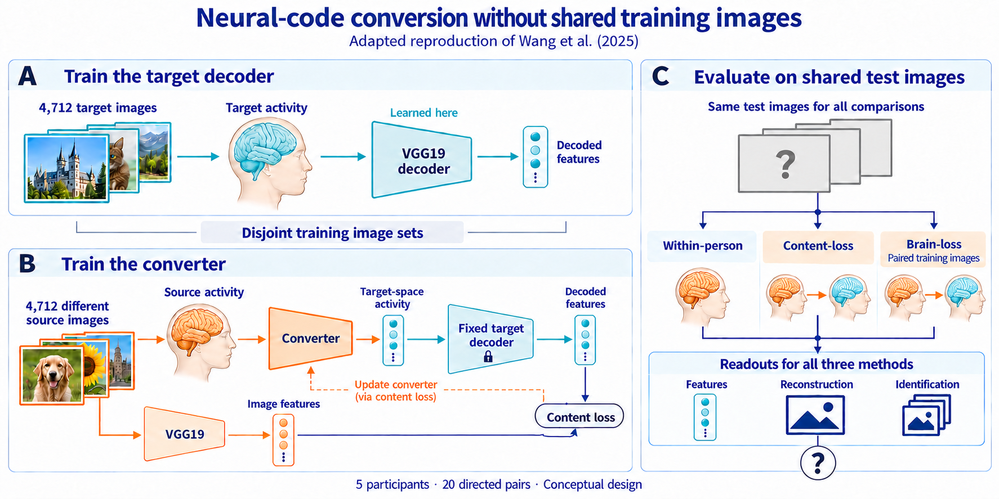

# Outputs

**October 21 Pacific — 18/63 uncertainty batches complete; pending holds cleared.**
Original batches 29–33 and retry002 batches 8–10 all completed successfully,
with published canonical artifacts and closed readers. No new failure or retry.
All 13 temporarily held original children 49–61 were released; post-release
verification finds 28 workers running and 17 draw tasks pending without user holds.
The existing 32-worker ceiling, 48h extended clocks and full scientific scope remain.
The sole finalizer already includes figure and three-line-summary rendering after
all 63 effective successful batches. No complete uncertainty result is available yet.
[Completions, release and next result](experiment_log.md#2026-10-21-pacific--finding_a_feature_decoding--eight-more-batches-complete-and-pending-hold-resolved).
Earlier snapshots below are historical.

**October21 — extend unstarted batches before repeating the diagnosed timeout.**
Original children40–61 were verified held and unstarted, then their existing
jobs received48h limits and were released. Their private caller changes only
clock resources; live workers, scientific options and all63-batch requirements
remain unchanged. Three focused checks and shell syntax passed in48505771.2.
No duplicate or new array was submitted; the total16-worker ceiling remains.
[Extension, validation and release](experiment_log.md#2026-10-21-pacific--finding_a_feature_decoding--extend-only-unstarted-original-draw-clocks).

**October 21 — metadata-read failure repaired without changing the evaluation.**
Original37 stopped with JSONDecodeError one second after an in-place dependency
file edit; that transient read is the leading cause, though the report lacks
the exact failing file. Seven focused/affected checks passed in48505771.1.
Fresh37-only retry48904747 preserves the actual exit1 diagnosis, original
outputs and all63-batch requirements. Dependency records are now published by
atomic replacement. Original throttle9 plus retries3/3/1 preserve16 workers;
the new retry waits for original29, verified live after the throttle change.
The sole finalizer includes all four explicit replacements; no scientific
score or complete interval has been opened by this repair.
[Diagnosis and current execution record](experiment_log.md#2026-10-21-pacific--finding_a_feature_decoding--live-dependency-publication-failure).

**October 21 — ten batches complete; twelve further timeouts have a bound repair.**
Original2–7/27 and all three first retries are complete, totaling10/63 batches.
Original16–26/28 closed at the23.5h application limit. Their isolated retry
array48899908 retains the same inputs, calculations and canonical outputs,
with3CPU/16GiB/48h per child. Three focused tests passed in step48505771.0.
The first retry has finished; original throttle10 plus second/third retry
throttles3 retain the16-worker ceiling. The sole finalizer47716676 now waits
for original-array closure and both remaining retry arrays, while validating
all63 effective closed-successful results, including the completed first retry.
Submission and release are recorded; no complete scientific estimate is claimed.
[Current repair record](experiment_log.md#2026-10-21--finding_a_feature_decoding--third-failure-only-draw-repair).
Earlier queue snapshots below are historical.

**October 20, 14:32 Pacific — eight more original timeouts have bound retries.**
Original8–15 closed at their23.5h application limit; all eight failed records
remain. Their new array48681394 selects only those indices,3CPU/16GiB/48h
each, with the same decoded input, calculations and canonical artifacts.
The original array has13live workers and33pending; first retries0/1/62 are
RUNNING. The second retry is PENDING(Dependency), awaiting original16/17/18.
The verified post-update live-child selection and original throttle10 plus
three workers per retry preserve the total16-worker ceiling without cancellation.
Three focused tests passed in step48505743.2. The sole finalizer is pending
on original-array closure plus both successful retry arrays, and still requires
all63 effective closed successful results. No complete scientific estimate yet.
[Second repair and submission](experiment_log.md#2026-10-20--finding_a_feature_decoding--second-failure-only-draw-repair)
· [Focused checks](runs/software_integration/draw_retry002/tests.txt).
Earlier queue snapshots below are historical.

**October 20, 12:59 Pacific — failed draws resubmitted; complete-result dependency repaired.**
Retry array48670343 selects only original batches0/1/62, with3CPU/16GiB/48h
each, the same scientific calculations and fresh operational records. It is
released and pending after original8–15 close. The original array throttle is
13; retries add at most3, retaining the effective16-worker ceiling after the
currently running workers finish. Successful decode and batches remain intact.
Six focused/affected checks passed in compute step48505743.1. The sole
finalizer47716676 now waits for original-array closure and successful retries,
then requires all63 effective successful closed results; missing batches cannot
be skipped. No complete scientific estimate is available yet.
[Repair and submission](experiment_log.md#2026-10-20--finding_a_feature_decoding--validate-isolated-draw-retries-and-complete-result-join)
· [Check evidence](runs/software_integration/draw_retry001/tests.txt).
Earlier queue snapshots below are historical.

**October 20, 11:01 Pacific — six uncertainty batches complete; three need repair.**
Slurm records batches2–7 complete, batches0–1 timed out at their23.5h
application boundary, and batch62 failed during startup. Sixteen batches8–23
are running and38 batches24–61 are pending; the full63-batch result remains
incomplete. Preserve the successful855-slot decode and completed batches.
The new direct truth reader removes measured HDF read amplification for
future imports while retaining the same values, support and inference.
Its validation and failure-specific repair work are recorded in the
[current log](experiment_log.md#2026-10-20--finding_a_feature_decoding--preserve-completed-batches-and-finish-io-repair).
The original finalizer dependency needs reconciliation with successful
replacement batches; no complete uncertainty estimate is claimed.
The dated queue descriptions below are historical.

**October 19, 14:27 Pacific — decode complete; sixteen draw tasks running.**
Decode job 47586225 completed successfully after 67 h 34 min 19 s. Its
[operational report](runs/finding_a_feature_decoding/amended_full001/decode/report.json)
confirms all 855 slots, zero unavailable slots and published artifacts; its
[closed batch status](runs/finding_a_feature_decoding/amended_full001/decode/batch_status.txt)
records exit 0. The complete scientific evaluation remains pending.
The existing uncertainty array 47586235 now has an effective concurrency cap
of16 (48CPUs/256GiB maximum); all55 formerly held elements8–62 are released.
At14:27 Pacific,16 tasks (elements0–15) were running and47 awaited array slots.
Each retains3CPU/16GiB/24h and one numerical thread.
The live authorization JSON remains at its captured value8 to preserve execution
identity; the [standing-authority scheduler override](experiment_log.md#2026-10-19--finding_a_feature_decoding--scheduler-only-concurrency-override-to-sixteen)
defines the effective cap16 and supersedes the earlier wait-for-quiescence plan.
No running task was stopped or scientific rule changed. All63 batches remain
required before finalizer47716676 produces the result, figure and three-line
summary; its whole-array dependency is unchanged.
The prepared decode contingency is inactive and unnecessary for this completed
stage. Earlier running-decode and partial-file descriptions below are historical.

**October 18 — future retry wiring tested; current evaluation continues.**
The separate [retry caller](converter_training/tools/run_amended_readout_retry.py)
now connects the [lifecycle component](converter_training/tools/amended_decode_lifecycle.py)
to the complete decode, uncertainty and reporting stages while preserving the
scientific scope. It reserves cleanup time and records observed HDF close plus
fsync, retaining failures after later close calls.
All nine tiny-HDF lifecycle tests passed in step 47586225.10
([evidence](runs/software_integration/decode_lifecycle001/tests.txt)); ten caller
and composition control tests and shell/renderer syntax checks passed in step
47586225.11 ([evidence](runs/software_integration/amended_retry_integration001/tests.txt)).
Full scientific-runner integration remains untested. This code cannot certify
the current partial, and no retry profile, resource selection or replacement
job exists. The live evaluation and its queued dependency chain are unchanged;
see the [execution record](experiment_log.md#2026-10-18--finding_a_feature_decoding--future-full-retry-integration).

**October 17 — contingency recovery source prepared; evaluation remains pending.**
The [inactive recovery helper](converter_training/tools/amended_decode_recovery.py)
preserves the complete evaluation and requires an actual failed attempt plus
affirmative successful HDF close/fsync evidence before reusing validated groups.
It does not guarantee recovery of the current partial or change the running job.
[Five fixture tests](converter_training/tests/test_amended_decode_recovery.py)
remain unrun: eager Torch imports exceed the confidence warranted by the available
512 MiB companion budget. They await a suitable substantive allocation; see the
[activation and limits](experiment_log.md#2026-10-17--finding_a_feature_decoding--recovery-engineering-activated).

**October 16, 12:15 Pacific — all 40 models published; complete evaluation is running.**
The last two content jobs,47382257/47382259, completed successfully and published
their models after all1,024 updates. Their operational reports confirm publication:
[p017](runs/content_pair_training/sub07_to_sub03_cuda001/report.json) and
[p019](runs/content_pair_training/sub07_to_sub06_cuda001/report.json).
Decode47586225 is running with successful admission; its partial collection
is growing. File size is not a completion percentage or a scientific score.
The existing63-batch uncertainty array47586235 (at most eight concurrent)
and result job47716676 await their dependencies. See the [execution log](experiment_log.md).
Earlier training/queue snapshots below are historical.

**October 15, 23:18 Pacific — draw concurrency raised from four to eight.**
The complete-model evaluation still requires all20 amended brain and20 content
models, all855 decoded slots and all63 uncertainty batches. Independent batch
writers permit eight concurrent draw jobs with the same3CPU/16GiB/24h limits
and unchanged sampling. The existing decode47586225 → draw47586235 →
report47716676 chain remains pending behind the last two content models.
The grant is updated before phase startup; shared-I/O throughput will be
measured during execution. See the [resource decision and scheduler evidence](experiment_log.md).
Earlier resource selections and progress counts below are historical.

**October 15, 17:55 Pacific — two content models remain; evaluation chain is ready.**
All20 amended brain models and18/20 content models are complete. Jobs47382257
and47382259 are running, with623/667 of1,024 training updates in their public
progress records. Decode47586225, uncertainty array47586235 and the combined
result/figure job47716676 remain queued behind their fixed dependencies.
No decoded scientific endpoint is available yet. See the [execution record](experiment_log.md).
Earlier status entries below are historical.

**October 13 — result figure and three-line summary prepared.**
The [combined finalizer and reporting wrapper](converter_training/finding_a_amended_result.sbatch)
will run the unchanged scientific finalizer, then the
[JSON-only renderer](converter_training/tools/render_finding_a_result.py) in
the same allocation. It will write one figure, a three-line summary and a
disclosure caption under `figures/finding_a_amended_full001/` after all model,
decode and uncertainty dependencies succeed. All five source effects, all
19 layers and the full directed matrix remain visible; missing estimates stay
missing. Results remain pending. See the [execution record](experiment_log.md)
for the actual dependency binding and the [ASTRA program](astra/v0.0.14/astra.yaml)
for artifact definitions. Earlier queue observations below are historical.

**October 13, 16:43 Pacific — sixteen content jobs running, two at the GPU limit.**
Pairs 015 and 016 have started. The remaining two wait on the scheduler's
GPU-per-user limit; the oldest and a newer run show continued training progress.
Two content models and all twenty amended brain models are complete. Decode
and uncertainty analysis still require every model. See the [execution record](experiment_log.md).

**October 13, 15:53 Pacific — fourteen content jobs running, four waiting for GPUs.**
Pair 013 has started. Two original content models and all twenty amended brain
models are complete; decode and uncertainty analysis remain queued behind all
required models. See the [execution record](experiment_log.md).
Earlier queue snapshots below are historical.

**October 13, 14:57 Pacific — thirteen content-model jobs running, five waiting for GPUs.**
Pairs011,012,014 and018 have started. Two content models and all20 amended
brain models are complete; full decoding and uncertainty analysis remain
queued behind all required models. See the [execution record](experiment_log.md).
Earlier queue snapshots below are historical.

**October 13, 14:40 Pacific — nine original content-model jobs running, nine waiting for GPUs.**
Pair 010 has now also started. Earlier starts, pairs 003 and 009, show successful
admission and completed training updates. Two content models and all 20 amended brain
models are complete. Full decode, all 63 uncertainty batches and finalization
remain queued behind their exact model prerequisites. No final prediction result
is available. See the [live-job and progress evidence](experiment_log.md).
Earlier queue snapshots below are historical.

**October12,23:10Pacific — seventeen queued jobs now admit L40S GPUs.**
All20 amended brain models and two original content models are complete;
content pair000 is running and17 content jobs are queued. The actual L40S
measurement and both production-admission checks passed. All17 jobs were
released with V100/H100/L40S eligibility, preserving training and resources.
Full readout still requires all20 content models. See [current evidence and
accounting](experiment_log.md). Earlier queue snapshots below are historical;
no final prediction result is complete.

**October12,19:09Pacific — fresh L40S hardware/cost measurement submitted.**
Job **47592902** has a2CPU/16GiB/1GPU/2h ceiling and retains the complete
original data/model dimensions for four disposable updates. Two focused
checks precede empirical access; no result is yet claimed. The
[selected grant](content_cuda_l40s_measurement_authorization.json) and
[execution log](experiment_log.md) preserve previous attempts and all18
pending production jobs. Production hardware permission remains unchanged.

**October12,19:21Pacific — all20 amended brain models complete.**
Every original ordered pair completed all51 fits and published a fresh
model; all20 jobs are COMPLETED0:0. Together they consumed99.374166667CPUh.
Two original content fits are complete and eighteen await GPU scheduling.
The full readout retains every model dependency. See the
[completion and accounting](experiment_log.md#2026-10-12-1921-pacific--interindividual_converter_training--complete20-model-amended-brain-panel-published).
No decoded result or scientific finding is complete.

**October 12, 18:21 Pacific — complete amended evaluation queued behind all models.**
Decode **47586225**, draw array **47586235_[0–62%4]** and finalizer
**47586258** are released and PENDING/Dependency. The separate
[activated grant](amended_full_readout_authorization.json) and
[exact dependencies](runs/finding_a_feature_decoding/amended_full001/dependency_bindings.json)
require all 20 fresh brain models and all 20 original content models, all
855 decoded slots and the unchanged 1,000 image/1,000 dyadic draws. The old
never-started chain was canceled with zero CPU use; its history is preserved.
See the [selection, actual pair mapping and release](experiment_log.md).

At the latest model snapshot, 20 brain fits were running, two content fits
were complete and 18 content fits were pending. All pending content jobs now
admit the qualified V100 or H100. Five affected hardware checks passed;
the readout reuses eight previously passed methods. The changed ASTRA program
also passed validation. No evaluation or positive scientific result is complete.
Comparability remains not evaluable without its prelocked margin.

**Earlier entries below are historical and are superseded by this entry where
they describe holds, unrun checks or inactive readout authority.**

**October12,18:05Pacific — all eight adapted-readout software checks passed.**
The complete model binding, distributed evaluation and publication methods
pass in7.850seconds, with no skips or empirical inputs. [Evidence](runs/software_integration/amended_readout_companion001/checks.txt)
and [execution record](experiment_log.md) identify the shared EP18 allocation;
changed ASTRA validates. This prepares the full evaluation while model
training continues; no readout grant or scientific result is released.

**October 12 — second original content pair complete; adapted readout checks selected.**
Original sub03→sub05 completed all 1,024 updates and published its model;
job 47375558 is confirmed COMPLETED 0:0. Two original content pairs are now
complete and 18 remain pending. At the coordinator's October 13 00:59 UTC
snapshot, all 20 fresh adapted brain-pair jobs were running.

The separate complete adapted-readout caller and its two tests passed source
review. All eight affected methods remain **unrun**; a bounded software-only
companion is selected inside the forthcoming EP18 recovery parent. No new
readout grant or activation is selected, and original full readout 47382805
remains held. See the [current execution log](experiment_log.md). Earlier
entries below retain their historical observations.

**October12,17:41Pacific — all20 adapted pair jobs are RUNNING.**
The complete20-pair panel is executing as47579378_4 and47579684 indices0–3,
5–19. No adapted model completion or score is yet claimed. Original content
sub03→sub05 has reached1018/1024 updates. Full readout47382805 remains held.
The separate complete adapted readout implementation passed source review;
its six changed-interface checks and execution admission remain pending.
See the [current execution log](experiment_log.md). Earlier entries are historical.

**October12,17:24Pacific — all20 adapted pair jobs submitted; first running.**
All ten affected checks passed in0.325seconds and ASTRA passed. Firstpair004
is running as47579378_4; the other19 were accepted as array47579684, each
3CPU/16GiB/6h. These are fresh fits under the adopted constant-coordinate rule;
original models remain separate. No amended model or score is complete yet,
and full readout47382805 stays held. See the [complete-panel submission](experiment_log.md#2026-10-12-1724-pacific--interindividual_converter_training--complete-adapted-panel-submitted).

**October12,17:20Pacific — first adapted pair submitted as47579378.**
The [separate training grant](brain_constant_panel_authorization.json) now
selects fresh fits for all20 directed pairs. Sub03→sub01 runs first with ten
affected checks; the remaining19 await observed check PASS. Each parent uses
3CPU/16GiB/6h. Original models remain separate and full readout47382805 stays
held. See the [submission and selection](experiment_log.md#2026-10-12-1720-pacific--interindividual_converter_training--first-adapted-pair-submitted).

**October12,17:09Pacific — exact-constant guard passed; separate comparator implementation underway.**
The [categorical result](runs/brain_constant_discriminator/attempt002/report.json)
finds one invalid first-fold sub01 scale, satisfying the adopted exact-constant
and exact-mean rule. No fit, score or test-data access occurred. Independent
implementation/review now proceeds; every subsequent fold must still satisfy
its own guard. Original models remain intact and full readout47382805 stays held.

**October12,17:04Pacific — discriminator attempt002 parent47577068 submitted.**
The separately owned EP17 parent requests4CPU/31GiB/8h and was PENDING at
verification. The unchanged categorical check runs serially before EP17's
four-worker fitting. No guard success or readout release is yet claimed.

**October12 — discriminator import failure diagnosed; manual attempt002 selected.**
Attempt001 stopped after0.477seconds at NumPy import, before data access.
The parent wrapper had unset the package path after loading the NumPy module.
The [new fixed attempt002 lock](protocol_lock_brain_constant_discriminator_attempt002_2026-10-12.json)
preserves that attempt and selects the unchanged calculation serially inside
EP17 fit002's actual4CPU/31GiB parent: one numerical thread,300seconds,
6.5GiB observed processRSS,1MiB categorical output, no separate allocation.
The package-path unset now precedes module loading. Execution and guard
success are not yet claimed; full readout47382805 stays held.

**October12 — constant-coordinate comparator conditionally adopted; bounded discriminator selected.**
The scientist's16:16 decision is now propagated into GOAL, DATASETS and policy.
The [separate regenerated lock](protocol_lock_brain_constant_discriminator_2026-10-12.json)
inherits all original bindings and authorizes only a300-second first-fold
category check inside a substantive parent. The
[adopted conditional rule](proposed_brain_normalization_followup.md) is not yet
implemented or shown applicable. Original lock, validators and models remain;
full readout47382805 stays held. The cancelled first readout did process test
data, but no final collection or completion report was published and no final
score exposure was reported. No new discriminator result is claimed here.

**October12,16:42Pacific — sixteen pending fits released for qualified V100 or H100 hardware.**
Allseven affected software methods passed in18.906seconds and changed ASTRA
passed. The16 original remaining-pair jobs now have the V10032/H10080 Features
expression, nonzero priorities and no user hold; all16 were still PENDING at
verification. See the [checks and scheduler verification](experiment_log.md#2026-10-12-1640-pacific--interindividual_converter_training--qualified-hardware-checks-passed-scheduler-release-selected).
Job IDs, dependencies, training settings and resource limits are preserved.
Source03→sub05 is still running (latest inspected986/1024updates); roster006/007
retain their original V100 requests. Full-readout47382805 remains held for the
conditionally adopted normalization rule's remaining guard/conformance steps. No second completed model or held-out score
is claimed. Earlier entries below describe historical states.

**October12,16:33Pacific — pending-only H100 eligibility amendment under test.**
The16 original remaining-pair jobs are temporarily held while their narrowly
scoped hardware change is checked in EP18 parent47572924. Both previously
qualified exact device families, V100-SXM2-32GB and H10080GB HBM3, are admitted
by the [new amendment](content_cuda_remaining_hardware_amendment.json), preserving
original job IDs, grants, resources, clocks and scientific settings. Source
review passed; scheduler expansion/release waits for the seven software checks.
Active source03 training and its roster entrypoint are unchanged. The full
readout remains held for the separate normalization decision. See the
[selection and hold](experiment_log.md#2026-10-12--interindividual_converter_training--pending-only-qualified-hardware-expansion-selected).

**October 12, 13:30 Pacific — training continues; further evaluation held.**
Full decode 47382805 is now verified PENDING with `JobHeldUser` and priority
zero, preserving its model dependencies and downstream draw/finalizer chain.
This implements the recorded decision to resolve the normalization question
before further held-out evaluation; see the
[selected hold and verification](experiment_log.md#2026-10-12-1329-pacific--finding_a_feature_decoding--protective-hold-selected-for-pending-full-readout).
The scientist-directed cancellation of job47373800 at13:13:27Pacific is
recorded in the [current decision and coordinator verification](experiment_log.md#2026-10-12-1313-pacific--finding_a_feature_decoding--first-readout-cancelled-at-the-scientists-instruction-before-outcome-exposure).
Its partial output is preserved; no final collection or completion report was
published. Actual use was5.726667allocatedCPUh, including the already passed
software companions. No restart or fault diagnosis is selected.
The [normalization proposal](proposed_brain_normalization_followup.md) remains
inactive pending the recorded scientific decision and exposure/lock review.
Two source reviews and a file-size lower bound support stopping before
held-out scoring under the documented source/file identity assumptions;
test-data processing had already occurred. See the current log for the exact
evidence and limits. This inference does not activate the adaptation.
The first content model and12 eligible brain models remain complete. The second
content model reached895/1024updates;18 other content fits remain pending.
Training is unaffected by the evaluation hold. No automatic release or restart
is selected; the scientific decision and applicable lock disposition come first.

**October12,11:21Pacific — first original held-out evaluation running.**
Job47373800 started at11:18:55Pacific onsh04-04n21 with its already selected
3CPU/16GiB/72h allocation. All11 prescribed EP21 checks and ASTRA passed;
the admitted evaluation process has launched. EP19's separate three final-refit
checks and ASTRA also passed within the same parent reservation. See
[startup evidence, limits and next action](experiment_log.md#2026-10-12-1121-pacific--finding_a_feature_decoding--first-original-readout-started-and-required-checks-passed).
No held-out result is available yet. The first content model is complete,
the second reached832/1024updates, and18 other content fits remained queued
at11:20:41Pacific. The partial readout and full three-method claim limits remain
unchanged; the full evaluation chain still waits for its original model roster.

**October12,11:14Pacific — first original content model complete; first readout eligible.**
Sub03→sub01 job47370327 completed all1024 updates and saved its817488352-byte
model; its report and closed batch status agree with Slurm COMPLETED0:0.
Actual allocation use was61.116667CPUh plus30.558333GPUh, preserving prior
charges. See [completion evidence, accounting and next action](experiment_log.md#2026-10-12-1114-pacific--interindividual_converter_training--first-original-content-model-completed).
At11:13:59Pacific, first-readout47373800 was eligible with no remaining
dependency and awaiting scheduling. The second content fit was still running
(latest828/1024);18 others remained queued. All12 eligible original brain
models are complete. No held-out result is available yet; full three-method
Finding A and comparability retain their original not-evaluable limits.

**October11,09:21Pacific — both content fits continue; companion repair complete.**
Slurm confirms47370327 and47375558 RUNNING, with latest inspected progress
156/1024 and5/1024updates respectively. The other18 content parents and both
readout chains remain queued. EP17's separately diagnosed image-cleanup
defect was repaired and its five affected checks passed in an independent,
closed CPU session; [EP17 records the repair and preserved failure](../../episode17_cneuromod_model_ranking_stability/outputs/experiment_log.md#2026-10-11-0921-pacific--prediction_qualification--image-lifetime-repair-passed-and-compute-session-closed).
All submitted EP21 runtime remains unchanged. No content model or held-out
result is complete; the12 eligible original brain models remain complete.

**October11,09:16Pacific — two original content fits running.**
Pair5 job47375558 has started training after its five shared checks and
ASTRA passed; pair4 job47370327 continues. Latest inspected progress was
2/1024 and153/1024updates respectively;18 other content jobs remain queued.
The independent EP19 companion passed all3 checks and ASTRA. EP17 ran all49
checks, with48 passes and one converted-image cleanup failure now under diagnosis;
its ASTRA passed. These are software results, not empirical findings.
See [execution evidence, accounting and limits](experiment_log.md#2026-10-11-0916-pacific--interindividual_converter_training--second-content-fit-running-and-companion-checks-executed).
All12 eligible brain models are complete; both selected readout chains
remain queued on successful model dependencies. Submitted EP21 runtime is
unchanged, and no completed content model or held-out score is claimed.

**October11,07:54Pacific — all12 eligible original brain models complete.**
Every original non-sub01 brain pair completed51 fits and saved its model;
all12 parents finished COMPLETED0:0. Their successful allocations total
58.97CPUh, preserving all earlier failed-attempt charges. See
[final completion, accounting and interpretation limits](experiment_log.md#2026-10-11-0754-pacific--interindividual_converter_training--all12-eligible-original-brain-models-completed).
The eight originally unavailable sub01-related slots remain unchanged.

At07:53:32Pacific, one content fit was RUNNING and19 were PENDING. Slurm
confirms the full decode now waits only for those20 content models; all brain
dependencies are satisfied. Both original readout chains remain queued.
The26 early software checks and ASTRA passed as recorded below; the frozen
decode still performs its required checks before empirical access. No
content-model completion, held-out score or new scientific finding is claimed.

**October11,07:50Pacific — eleven original brain models complete.**
Sub06→sub07 job47376913 completed all51 fits, published its model and
finished COMPLETED0:0. Only sub07→sub03 remains running among the12 original
numerically eligible brain fits. Content47370327 remains running; its latest
inspected progress is104/1024 updates. Both readout chains still wait for
their model dependencies. See [completion and accounting](experiment_log.md#2026-10-11-0750-pacific--interindividual_converter_training--eleventh-original-brain-model-completed).
No content-model completion or held-out result is claimed. The passing early
checks and the original unavailable brain slots below are unchanged.

**October11,07:48Pacific — ten original brain models complete; full-readout checks passed early.**
Four additional original brain models completed all51 fits and saved their
models; Slurm confirms COMPLETED0:0. Two brain fits and one content fit remain
RUNNING, with19 content fits PENDING at07:47Pacific. See
[completion evidence and accounting](experiment_log.md#2026-10-11-0748-pacific--interindividual_converter_training--four-more-original-brain-models-completed).
The original eight sub01-related unavailable brain slots remain unchanged.

All26 full-readout component/admission methods passed in an attended CPU
step, and changed ASTRA validation subsequently passed. The initial terminal
command failed after the tests; its nonzero status is preserved, and only
the unexecuted ASTRA command was repaired. See
[test evidence and limits](experiment_log.md#2026-10-11-0747-pacific--finding_a_feature_decoding--all26-existing-checks-and-changed-astra-passed-on-compute).
The shell exited. This is early software evidence; the frozen decode job
still performs its own required checks before empirical access. Both original
readout chains remain queued on their model dependencies. No completed
content model, held-out score or new scientific finding is claimed.

The dated observations below retain their original evidence states.

**October11,07:31:39Pacific — six original brain models complete.**
Sub05→sub03/sub06/sub07 jobs47376608/47376880/47376883 each completed
all51 fits and saved a model; Slurm confirms COMPLETED0:0. See
[completion evidence and accounting](experiment_log.md#2026-10-11-0731-pacific--interindividual_converter_training--three-source05-brain-models-completed).
Six other brain fits and one content fit are running;19 content fits remain
queued. The original eight sub01-related brain slots remain unavailable.

The complete original readout below is submitted and released. Slurm confirms
decode47382805, draw array47382807 and finalizer47382808 are waiting on
their intended dependencies, with the array limited to4 concurrent tasks.
All26 required checks and changed ASTRA remain **UNRUN** until decode starts.
No completed content model, held-out score or new scientific finding is claimed.

**October11,07:28:45Pacific — complete original Finding A workflow submitted.**
Decode47382805 waits for the29 live model parents; the three completed model
parents are independently accounted for. Draw array47382807 has63 tasks,
at most4 concurrent, after successful decode. Finalizer47382808 waits for
the entire array. All three were submitted held, bound to actual IDs and then
released. See [selection, resource limits and exact submissions](experiment_log.md#2026-10-11-0724-pacific--finding_a_feature_decoding--full-original-readout-selected)
and [dependency graph](runs/finding_a_feature_decoding/full001/dependency_bindings.json).

The [original full-readout grant](finding_a_full_readout_authorization.json)
is now active:4754 additional allocatedCPUh maximum, noGPU,768GiB collection
and776GiB aggregate output. This preserves all224 images,19 layers and855
slots (703 decoded,152 originally unavailable), original1000 image and1000
dyadic draws and all support rules. Runtime remains unmeasured. The26
existing checks and changed ASTRA remain **UNRUN** and must pass in decode
before empirical access. No readout result is claimed. Full three-method
Finding A and comparability remain not evaluable under the original rules;
the normalization follow-up remains inactive. The submitted partial first
readout and all original model jobs remain unchanged.

**October11,07:19:58Pacific — all20 original content fits submitted.**
The ten existing launcher checks passed in an attended CPU companion, and
ASTRA schema/semantic validation passed. The17 remaining original GPU fits
were accepted as jobs47382243–47382259. See [checks, exact job mapping and limits](experiment_log.md#2026-10-11-0715-pacific--interindividual_converter_training--cpu-launcher-qualification-selected).
The latest queue contains10RUNNING fits and20PENDING jobs: nine brain fits
and one content fit are running;19content fits and the dependent first readout
are queued. Three original brain models are already complete. No held-out
score or content-model completion is claimed. The compute test shell exited.

The complete-readout runner is prepared, but its26 tests remain **unrun**
and its [resource profile](finding_a_full_readout_authorization.json) remains
**inactive**. Next: select its finite resources and actual32-model dependency
bindings, then run required checks inside the substantive decode allocation.
The existing partial readout remains fixed. Full three-method Finding A
remains not evaluable under the original missing-pair rule.

The prior SCRATCH access error remains recorded in the
[support draft](experiment_log.md#2026-10-11-0656-pacific--finding_a_feature_decoding--prepare-phase-restricted-runner-and-dependency-scripts).
Affected operations remain stopped; this work used the pre-existing
OAK/node-local layout. The dated entries below preserve earlier observations.

**October11,07:04Pacific — three original brain models complete; full-readout runner prepared.**
Sub03→sub07 job47371561 completed all51 fits and published its model,
joining the completed sub03→sub05 and sub03→sub06 models. See [latest completion and accounting](experiment_log.md#2026-10-11-0654-pacific--interindividual_converter_training--original-brain-pair7-completed).
At07:03:53Pacific,10 fits were RUNNING and3 jobs PENDING. The two queued GPU
parents must pass their shared checks before the17 prepared additional fits
are submitted. No held-out score has been observed.

The full-readout components, phase-restricted runner and three Slurm wrappers
are source reviewed. All26 test methods and the latest ASTRA additions remain
**unrun**; the [resource profile](finding_a_full_readout_authorization.json)
is **inactive**. See [implementation, dependency correction and next action](experiment_log.md#2026-10-11-0656-pacific--finding_a_feature_decoding--prepare-phase-restricted-runner-and-dependency-scripts)
and [full-roster cost](experiment_log.md#2026-10-11-0623-pacific--finding_a_feature_decoding--prepare-complete-original-readout-without-broadening-the-submitted-job).
Resource/access selection, real model-job bindings and checks inside the
substantive allocation are required before empirical execution. Existing
submitted jobs remain fixed. Full three-method Finding A remains not evaluable
under the original missing-pair rule; no full-readout completion is claimed.

The same [current log entry](experiment_log.md#2026-10-11-0656-pacific--finding_a_feature_decoding--prepare-phase-restricted-runner-and-dependency-scripts)
records sh_quota's new SCRATCH access error and an unsent support draft.
SCRATCH operations are stopped; the pre-existing OAK/L_SCRATCH_JOB plan is
unchanged and no filesystem workaround is selected.

**October11,06:12Pacific — remaining-content pair000 submitted as47377474.**
The16 remaining original content fits are prepared and independently source
reviewed. Pair000, sub01→sub03, runs five shared checks before fitting;
the other15 wait for observed PASS. See [scope, resource evidence and budget](experiment_log.md#2026-10-11-0606-pacific--interindividual_converter_training--remaining-sixteen-original-content-pairs-selected)
and [review, submission and current running jobs](experiment_log.md#2026-10-11-0611-pacific--interindividual_converter_training--remaining-content-implementation-reviewed-for-pair000-submission).
At06:10Pacific all nine new CPU jobs were RUNNING, bringing the total to12
running fits. GPU pair5 and the dependent first readout remained pending.
Tests for both queued GPU launchers remain unrun. No held-out score is claimed.

**October11,06:04Pacific — all nine remaining original brain fits submitted.**
Pair009 job47376608 is RUNNING and passed all three shared checks in0.504s
plus ASTRA validation. The other eight prepared jobs have now been accepted;
see [job IDs, evidence and resource accounting](experiment_log.md#2026-10-11-0603-pacific--interindividual_converter_training--remaining-pair-checks-passed-eight-original-fits-selected-for-submission).
Each has3CPU/16GiB/6h and one numerical thread. The nine share a previously
selected maximum162CPUh; all historical charges remain. No new fit completion
or held-out score is claimed. GPU pair5 remains queued at06:03.

**October11,05:59Pacific — first of nine remaining original brain fits submitted.**
Pair009, sub05→sub03, is job47376608 with3CPU/16GiB/6h. Its three shared
checks remain unrun; the other eight prepared fits wait for observed PASS
before submission. See [review and submission](experiment_log.md#2026-10-11-0558-pacific--interindividual_converter_training--remaining-pair-implementation-reviewed-for-first-submission)
and [the complete nine-pair selection](experiment_log.md#2026-10-11-0555-pacific--interindividual_converter_training--remaining-nine-original-brain-pairs-selected).

**October11,05:54Pacific — first original brain pair completed.**
Job47367352 trained sub03→sub05 through all51 fits and published its model;
Slurm confirmed COMPLETED0:0 in1:49:58. See [completion evidence and limits](experiment_log.md#2026-10-11-0554-pacific--interindividual_converter_training--first-original-brain-pair-completed).
No held-out score has been observed. Two other brain fits and one content
fit were RUNNING at05:53; content pair5 and the dependent readout were pending.
The complete three-method finding remains not evaluable under its original
missing-pair rule. Earlier status paragraphs retain their observation times.

**October11,05:46Pacific — second original GPU fit47375558 submitted.**
Original content pair5,sub03→sub05, now has a separately selected2CPU/16GiB/
one V100/48h parent. Five new shared checks run there before fitting; pair6/7
are prepared and wait for observed PASS before submission. The same parent
records EP17's49 and EP19's3 software checks independently. All new checks
remain **unrun** at submission. See [source review, submission and limits](experiment_log.md#2026-10-11-0546-pacific--interindividual_converter_training--original-cuda-roster-implementation-reviewed-for-pair5-submission).
The original four fits remain live and first-readout47373800 waits for47370327.

**October11,05:32Pacific — original evaluation job47373800 submitted.**
It depends on successful GPU training47370327 and requests3CPU/16GiB/72h.
At05:34Pacific, Slurm confirmed PENDING(Dependency), with the exact resources
and no requeue; all four fitting jobs remained RUNNING.
Final independent source review passed; all11 new checks and ASTRA remain
**unrun** and must pass inside the job before empirical access. Four fitting
jobs were RUNNING at submission; latest inspected GPU progress was28/1024.
See [submission, evidence and limitations](experiment_log.md#2026-10-11-0532-pacific--finding_a_feature_decoding--first-original-dependent-readout-submitted).
This is a partial original readout; complete three-method Finding A and
comparability remain not evaluable. The normalization proposal is inactive.

**October11,05:30Pacific — first original evaluation selected.**
One3CPU/16GiB/72-hour readout is selected after successful content training
47370327, preserving all224 images,19 layers and original uncertainty rules.
Eleven new checks and ASTRA must pass before test-data access; they remain
**unrun**. All four fitting jobs were RUNNING at05:29Pacific.
See [scope, resources and limitations](experiment_log.md#2026-10-11-0530-pacific--finding_a_feature_decoding--first-original-readout-selected-under-standing-execution-authority).
The batched reader is now integrated. Complete three-method Finding A and
comparability remain not evaluable; the normalization follow-up remains
inactive. Submission will be recorded separately. Earlier entries preserve
their observation-time status.

**October11,05:22Pacific — bounded bootstrap replay prepared; tests pending.**
A source-reviewed implementation shares each loaded feature block across16
independent draws, preserving all1000 original draws and statistical rules.
This reduces planned provider passes from1001 to64; no runtime speedup has
been measured. The three new checks remain **unrun**, and the first readout
is not yet connected to this dormant alternative. See [implementation,
fidelity and resource limits](experiment_log.md#2026-10-11-0522-pacific--finding_a_feature_decoding--bounded-bootstrap-replay-implemented-but-not-activated).
The four original fitting jobs remain governed by their existing grants;
no test-data access or new submission occurred.

**October 11, 05:13 Pacific — four original fits running; first readout prepared.**
GPU47370327 has recorded18/1024 updates. Brain47367352,47370957 and47371561
remain RUNNING, with no terminal report observed. The first original readout
now has an input adapter, full inference composition and independent source
review. Its five focused tests and changed ASTRA validation remain **unrun**;
no evaluation job or test-data access has started.

See [implementation, resource estimates and remaining prerequisites](experiment_log.md#2026-10-11-0513-pacific--finding_a_feature_decoding--first-original-readout-implemented-execution-remains-closed).
It preserves all224 images,19 layers and the original uncertainty procedures.
The complete three-method finding remains not evaluable under its existing
missing-pair rule. Separate method estimates remain pending. Earlier entries
below preserve their observation times.

**October 11, 04:59 Pacific — all four original fits running; numerical follow-up remains inactive.**
All four selected jobs were RUNNING at04:57:01Pacific. Pair7 **47371561**
passed actual admission and entered full fitting; the GPU fit **47370327**
reached10/1024updates. See [compute evidence and next action](experiment_log.md#2026-10-11-0459-pacific--interindividual_converter_training--four-original-fits-live-inactive-numerical-follow-up-prepared).

The complete three-method Finding A quantitative finding is not evaluable
under the unchanged missing-pair rule. Content/within estimates may still be
reported separately on their own complete supports; available brain dyads
remain descriptive. See the corrected [paper interpretation](paper_plan.md)
and the **[inactive constant-coordinate proposal](proposed_brain_normalization_followup.md)**.
No amended fit, new grant, score or lock change has been adopted. Historical
entries below retain their original observation times.

**October 11, 04:53 Pacific — three jobs running; fourth submitted.**

| Job | Original work | Latest observed stage |
| --- | --- | --- |
|47370327|Content sub-03→sub-01, all1024 updates|RUNNING;7updates recorded|
|47367352|Brain sub-03→sub-05,50CV+final|RUNNING; no terminal report|
|47370957|Brain sub-03→sub-06,50CV+final|RUNNING;3new checks and ASTRA passed|
|47371561|Brain sub-03→sub-07,50CV+final|Submitted; reuses passing common checks|

See [pair6 compute evidence and pair7 submission](experiment_log.md#2026-10-11-0453-pacific--interindividual_converter_training--common-roster-checks-passed-original-pair7-selected-for-submission).
The first three scheduler observations are04:52:30Pacific. No final model or
held-out score has been observed. The [eight-pair prerequisite limitation](experiment_log.md#2026-10-11-0449-pacific--interindividual_converter_training--shared-sub01-prerequisite-establishes-eight-brain-pair-dispositions)
makes the complete original brain-comparator contrast not evaluable; available
pair estimates remain descriptive under the locked rule. No axis/scale
amendment is adopted. Earlier entries below are preserved history.

**October 11, 04:49 Pacific — complete brain-comparator contrast not evaluable under the existing lock.**
The observed sub-01 fold0 normalization failure necessarily affects all8
original brain pairs involving that participant. Seven are source-inferred
prerequisite failures, with no new executions. See [proof, pair table and
claim limits](experiment_log.md#2026-10-11-0449-pacific--interindividual_converter_training--shared-sub01-prerequisite-establishes-eight-brain-pair-dispositions).
The locked missing-pair rule makes the complete20-pair quantitative contrast
not evaluable; available pair estimates remain descriptive without reweighting.
This does not establish absent biological signal or a content-model failure.

The original bounded fits continue: GPU47370327 and brain47367352 were
RUNNING at04:47:16Pacific; new brain47370957 was pending. Pair7 remains
selected but unsubmitted pending shared checks. No scientific axis/scale
amendment is adopted. Earlier entries are preserved historical observations.

**October 11, 04:46 Pacific — third substantive job submitted.**
Original brain pair6 sub-03→sub-06 is submitted as **47370957**, with the
selected3CPU/16GiB/24-hour limit. See [source review and submission](experiment_log.md#2026-10-11-0446-pacific--interindividual_converter_training--original-pair6-ready-for-submission)
and [attempt](runs/brain_pair_training/sub03_to_sub06_001/).
It will run the three common stage checks before fitting; pair7 will reuse
them after they pass. Existing GPU **47370327** and brain **47367352** were
RUNNING at04:46:17Pacific; GPU progress reached4/1024 updates. Earlier
entries are preserved history; no final scientific result yet.

**October 11, 04:43 Pacific — full GPU fit running; two more original brain pairs selected.**
Job **47370327** passed all5new checks and ASTRA, entered the complete original
1,024-update sub-03→sub-01 fit and has recorded update1. Brain **47367352**
continues independently. See [actual compute evidence](experiment_log.md#2026-10-11-0443-pacific--interindividual_converter_training--full-cuda-fit-entered)
and [GPU progress](runs/content_pair_training/cuda001/progress.jsonl).
No final model or scientific score has been observed.

Original brain pairs6/7, sub-03→sub-06/sub-07, are selected for parallel
full897-image fits under separate3CPU/16GiB/24-hour grants. Implementation
and source review are underway, with live job dependencies preserved. See
[selection and joint144CPUh maximum reservation](experiment_log.md#2026-10-11-0443-pacific--interindividual_converter_training--two-additional-original-brain-pairs-selected).
All entries below are preserved historical observations.

**October 11, 04:37 Pacific — first complete original CUDA content pair submitted.**
Job **47370327** requests2CPU/16GiB/one V100-SXM2-32GB/48hours for all
1,024updates of original sub-03→sub-01. The [completed cached measurement](runs/content_resource_measurement/cuda_cache002/report.json)
took105–115seconds/update, supporting a finite30–33hour projection with extra
time for variability and final publication; it is not a duration guarantee.
See [measurement/accounting and selected limits](experiment_log.md#2026-10-11-0434-pacific--content_resource_measurement--cached-measurement-complete-full-original-cuda-pair-selected)
and [source review/submission](experiment_log.md#2026-10-11-0437-pacific--interindividual_converter_training--full-original-cached-cuda-pair-ready-for-submission).
The [full-fit attempt](runs/content_pair_training/cuda001/) awaits actual
allocation/checks; no final model or scientific score yet. Brain47367352 was
RUNNING at04:37:38Pacific. Earlier entries, including inactive preparation,
are preserved historical observations.

**October 11, 04:23 Pacific — repaired measurement and brain fit running.**
Both **47368630** (cached CUDA measurement) and **47367352** (full brain-pair
fit) were RUNNING at04:22:39Pacific. The repaired cache passed all5selected
methods and its then-current ASTRA validation; see [compute checks](experiment_log.md#2026-10-11-0421-pacific--content_resource_measurement--canonical-order-regression-passed-on-compute)
and [measurement attempt](runs/content_resource_measurement/cuda_cache002/).
No terminal report has yet been observed for either job.

The original full1024-update CUDA/cache route is now implemented and source-
reviewed but remains **inactive**, with unset duration/reservations. Its5new
methods and program additions await the eventual substantive allocation. See
[preparation and limits](experiment_log.md#2026-10-11-0423-pacific--interindividual_converter_training--dormant-complete-cuda-route-source-reviewed)
and [inactive profile](content_cuda_pair_training_authorization.json).
Entries below are preserved historical observations.

**October 11, 04:17 Pacific — canonical-order repair submitted.**
Job **47368630** runs the reviewed layer-order repair in a fresh
[cache002 attempt](runs/content_resource_measurement/cuda_cache002/), with
the same2CPU/16GiB/oneGPU/two-hour and scientific limits. See [source review,
focused checks and submission](experiment_log.md#2026-10-11-0417-pacific--content_resource_measurement--canonical-order-repair-ready-for-submission).
Actual checks and empirical measurement await compute. Brain47367352 remains
RUNNING at04:17:39Pacific; failedcache001 and entries below are retained.

**October 11, 04:16 Pacific — cached measurement failed; focused repair selected.**
Job47368045 ended after98seconds with0/4updates and no model. The
[report](runs/content_resource_measurement/cuda_cache001/report.json) retains
the incomplete run. Independent source diagnosis found that the cache used
decoder catalog order while the original training schedule uses reverse order;
the first layer is therefore rejected. The cache now follows that original
schedule, with one changed existing regression awaiting compute. See [failure,
accounting and separately selected repair](experiment_log.md#2026-10-11-0416-pacific--content_resource_measurement--cached-measurement-failed-canonical-order-repair-selected).
No scientific loop or dataset role changed. Brain47367352 remains in flight;
the failed measurement and all earlier records below are preserved history.

**October 11, 04:14 Pacific — cached GPU measurement entered.**
Job **47368045** passed all8focused integration/admission/GPU methods with
clean exits and ASTRA validation, and claimed the four full real-data updates
on V10032GB. See [actual evidence and comparison limits](experiment_log.md#2026-10-11-0414-pacific--content_resource_measurement--cached-cuda-checks-passed-and-empirical-measurement-entered)
and [attempt](runs/content_resource_measurement/cuda_cache001/).
The prior H100 run took20–22minutes per update; a device difference means
future timing differences cannot be attributed solely to the cache.
No terminal cached report yet. Brain47367352 remains independently in flight
at the latest scheduler observation. Entries below are historical.

**October 11, 04:11 Pacific — cached GPU measurement submitted.**
The [GPU report](runs/content_resource_measurement/cuda001/report.json) completed
4/4 updates in5,055seconds, with20–22minutes per update. That remains too slow
to select this reader for full production. See [accounting and cache selection](experiment_log.md#2026-10-11-0406-pacific--content_resource_measurement--cuda-stripe-completed-cached-cuda-measurement-selected)
and the [new bounded grant](content_cuda_cache_authorization.json). Job
**47368045** requests2CPU/16GiB/oneGPU/two hours. Cache integration and all
grant/batch/docs passed independent source review; actual checks and empirical
measurement await compute. See [submission](experiment_log.md#2026-10-11-0411-pacific--content_resource_measurement--cached-cuda-integration-ready-for-one-submission)
and [attempt](runs/content_resource_measurement/cuda_cache001/).
No production model or scientific score.

Brain job47367352 passed all11component checks and ASTRA and entered the full
sub-03→sub-05 fit; no final result has yet been observed. See [compute evidence](experiment_log.md#2026-10-11-0403-pacific--interindividual_converter_training--corrected-memory-fit-entered-all-eleven-companion-checks-passed)
and [attempt](runs/brain_pair_training/sub03_to_sub05_mem16_002/).
This also qualifies the revised collection cap and standalone cache fixtures;
it does not establish empirical collection or cache performance. Entries below
are preserved historical observations.

**October 11, 04:00 Pacific — corrected memory request submitted.**
Job **47367352** explicitly requests3CPU/16GiB/24hours, one numerical
thread, for the full original sub-03→sub-05 fit. See the [submission](experiment_log.md#2026-10-11-0400-pacific--interindividual_converter_training--explicit-three-cpu-memory-repair-submitted)
and [attempt](runs/brain_pair_training/sub03_to_sub05_mem16_002/).
The earlier2CPU request was adjusted to3 by Slurm and refused before input
access; the exact8000MiB-per-CPU partition limit is now reflected in the
request. Tests, ASTRA and actual fitting await compute observation.
GPU47360846 remained RUNNING before submission. Earlier entries are history.

**October 11, 03:55 Pacific — sixteen-GiB brain repair submitted.**
Job **47366908** requests2CPU/16GiB/24hours, with one numerical thread,
for the unchanged full sub-03→sub-05 fit. Independent source review passed;
actual checks and fitting remain pending observation. See the [submission](experiment_log.md#2026-10-11-0355-pacific--interindividual_converter_training--sixteen-gib-memory-repair-submitted)
and [new attempt](runs/brain_pair_training/sub03_to_sub05_mem16_001/).
GPU47360846 was still RUNNING at03:55Pacific. Prior CPU timeout and brain
OOM attempts remain preserved; entries below describe earlier observations.

**October 11, 03:52 Pacific — brain fit exceeded7GiB; resource repair selected.**
Slurm explicitly reports **OUT_OF_MEMORY** for47365414 after642seconds.
No model, partial model or operational result exists; fit progress is unknown.
The failed attempt is preserved, with0.1783333333allocatedCPU-hours charged.
An unchanged full-pair attempt with2CPU/16GiB/24hours and one numerical
thread is being prepared under existing increased-compute authority. See
[failure evidence, memory diagnosis and selected repair](experiment_log.md#2026-10-11-0352-pacific--interindividual_converter_training--memory-failure-closed-sixteen-gib-repair-selected).
GPU47360846 remained RUNNING at03:50Pacific. Entries below are historical;
no scientific outcome is inferred from resource failure or source review.

**October 11, 03:42 Pacific — CPU stripe measurement timed out.**
Job47357865 completed only2/4 updates (~36.5minutes each) before its internal
deadline; no model was produced. The branch was slower than the earlier
baseline and is not selected for production. See the [report](runs/content_resource_measurement/column_stripe002/report.json)
and [accounting and next engineering choice](experiment_log.md#2026-10-11-0342-pacific--content_resource_measurement--column-stripe-timed-out-exact-read-cache-engineering-selected).
An exact selected-channel/read-reuse cache passed [independent source review](experiment_log.md#2026-10-11-0350-pacific--content_resource_measurement--prospective-exact-read-cache-source-review-passed)
but its integration and three compute checks remain pending. GPU47360846
remains pending its result, and real brain fitting
47365414 continues independently. Collection cap source repair passed review
but its revised checks and ASTRA description remain unvalidated.

**October 11, 03:39 Pacific — next original brain pair entered fitting.**
Job **47365414** has admitted1CPU/7GiB/24hours for the complete sub-03→sub-05
brain comparator:897 training images, full native axes and50CV+final refit.
See the [actual checks and remaining collection fault](experiment_log.md#2026-10-11-0339-pacific--interindividual_converter_training--next-brain-fit-entered-native-collection-remains-unqualified)
and [attempt](runs/brain_pair_training/sub03_to_sub05_001/).
Five brain admission/default-diagnostic checks and ASTRA passed on compute.
The fit has claimed its attempt; no terminal result yet. The independent
collection cap child still exits-11 and remains unqualified, without gating
the fit. CPU47357865/GPU47360846 were still running at03:37Pacific.
The public reconstruction runtime passed as recorded below; the failed first
brain pair remains explicit. Earlier entries are historical observations.

**October 11, 03:28 Pacific — full public reconstruction runtime passed.**
Job47363365 completed with one complete19-layer/200-update public-model
reconstruction:492.4seconds,2.45GiB process peak RSS. Authentic generator,
VGG and public statistics loaded successfully. The whole parent cost
0.2158333333allocatedCPU-hours, including its independent brain diagnosis
and checks. See the [qualification report](runs/reconstruction_qualification/attempt001/report.json)
and [closeout and limits](experiment_log.md#2026-10-11-0328-pacific--source_qualification--full-public-reconstruction-runtime-completed).
This was one non-neural runtime fixture, with no published image or score;
empirical reconstruction and the B/C lock remain unchanged. The collection
cap repair still needs compute validation. CPU47357865 and GPU47360846
remained running at03:27Pacific; earlier entries below are history.

**October 11, 03:18 Pacific — brain failure localized; public runtime entered.**
The [diagnostic report](runs/brain_pair_prefix_diagnostic/attempt002/report.json)
identifies zero or nonfinite target fold0 training scale for sub-03→sub-01.
It completed normally without a fit or score. The unchanged pair is not
evaluable under the current full-native-axis rule; further walltime is not
the remedy. See the [interpretation and limits](experiment_log.md#2026-10-11-0318-pacific--interindividual_converter_training--first-brain-failure-localized-before-fitting).
The separate full public reconstruction runtime has claimed its attempt;
completion remains pending. The collection cap repair is being revised at
source level, with its failed compute evidence preserved.

**October 11, 03:15 Pacific — three jobs running;15 focused checks passed.**
New job47363365 runs on sh03-06n11. Its public/core and separate admission
checks passed with clean process exits, and ASTRA passed. The collection
cap-failure child still segfaults; that component is unqualified. The
independent brain diagnostic and full public runtime path remain open in
this allocation. See the [observed checks and remaining fault](experiment_log.md#2026-10-11-0315-pacific--source_qualification--clean-qualification-checks-passed-collection-cap-failure-remains)
and [actual run evidence](runs/reconstruction_qualification/attempt001/).
CPU47357865 and GPU47360846 also remained RUNNING; none had a terminal
measurement/runtime result in that observation. Prior entries below are history.

**October 11, 03:12 Pacific — bounded public reconstruction runtime submitted.**
Slurm **47363365** requests1CPU/7GiB/two hours for one fixed, full19-layer,
200-update reconstruction using the actual public generator/VGG assets.
The [reviewed selection and submission](experiment_log.md#2026-10-11-0312-pacific--source_qualification--public-runtime-and-independent-brain-diagnostic-ready-for-submission)
and [attempt](runs/reconstruction_qualification/attempt001/) distinguish this
runtime qualification from empirical reconstruction or a scientific finding.
The [separately admitted brain-prefix diagnosis](runs/brain_pair_prefix_diagnostic/attempt002/)
shares that parent, stops before fitting and has independent test gates.
Source review passed; compute checks and actual runtime remain pending.
The original B/C lock is unchanged. CPU47357865 and GPU47360846 were still
RUNNING in the03:12Pacific pre-submission observation. Earlier entries below
are retained history; no measurement or failed brain fit was restarted.

**October 11 — reconstruction core and asset adapter implemented; checks pending.**
The [fixed reconstruction core](reconstruction_preparation/reconstruction_core.py)
and [generator archive adapter](reconstruction_preparation/generator_assets.py)
passed independent and root source review. Their five focused checks remain
unrun, as do the three repaired collection checks and revised ASTRA validation.
The [implementation record](experiment_log.md#2026-10-11-0253-pacific--finding_b_natural_reconstruction--original-reconstruction-core-selected)
describes actual remaining model/statistic binding, empirical loading, runtime
and B/C lock requirements. No reconstruction was executed. Reuse the qualified
public AlexNet and [reviewed source binding](reconstruction_preparation/source_binding.md).
CPU47357865 and GPU47360846 remained RUNNING at02:58Pacific, with no terminal
measurement report. Full production resources still depend on these measurements.

**October 11, 02:37 Pacific — H100 measurement running; cleanup defect found.**
GPU job **47360846** passed all4CUDA checks on H100 and claimed the real-data
four-update measurement. EP19's separate8-method child and both ASTRA programs
passed. The EP21 collection cancellation test left an HDF5 cleanup error and
the companion process exited139 despite successful assertions; that suite is
not qualified. The brain-prefix diagnostic was consequently skipped.
See the [actual evidence and repair scope](experiment_log.md#2026-10-11-0237-pacific--content_resource_measurement--h100-measurement-claimed-collection-cancellation-cleanup-failed).
The empirical measurement continues independently, with no terminal report yet.

**October 11, 02:32 Pacific — separate CUDA measurement submitted.**
Slurm **47360846** requests1GPU/2CPU/16GiB/two hours for the unchanged
full four-update measurement. Independent source review passed; four CUDA
checks must pass in the actual allocation before empirical measurement.
See the [selection and submission](experiment_log.md#2026-10-11-0232-pacific--content_resource_measurement--cuda-implementation-reviewed-for-submission)
and [run](runs/content_resource_measurement/cuda001/).
The [separate brain diagnostic](brain_prefix_diagnostic_authorization.json)
allows only the failed pair's first-fold prefix, without fitting or scoring.
New EP21 and EP19 checks share this parent. All execution outcomes remain
pending observation; CPU measurement47357865 continues independently.

**October 11, 02:19 Pacific — full content-training entrypoint prepared.**
The [production entrypoint](converter_training/tools/run_content_pair.py)
preserves the original1024-step full pair and bounded progress monitoring.
Root and independent source review passed; three tests remain unrun.
The [profile](content_pair_training_authorization.json) is inactive with no
selected duration or CPU-hour reservation pending measurement47357865.
The [implementation record](experiment_log.md#2026-10-11-0214-pacific--interindividual_converter_training--original-full-content-entrypoint-selected-for-implementation)
distinguishes this preparation from a launch. The separately reviewed
[brain-prefix diagnostic](converter_training/tools/brain_prefix_diagnostic.py)
also remains unexecuted and grants no retry or empirical access.

**October 11, 02:13 Pacific — Finding A collection implemented; checks pending.**
The [collection adapter](converter_training/tools/finding_a_collection.py)
preserves all855 slots, full decoded features and point vectors, including
explicit unavailable models. Independent source review passed after two
binding/metadata fixes. Its three focused tests and changed ASTRA validation
remain unrun. The [implementation record](experiment_log.md#2026-10-11-0213-pacific--finding_a_feature_decoding--collection-implemented-and-source-reviewed)
states the remaining empirical access, model, storage and runtime work.
Brain-pair failure reporting is also repaired and source-reviewed, but its
changed checks remain unrun and the original cause remains unresolved.
Content measurement47357865 remains running; no empirical evaluation is open.

**October 11, 02:08 Pacific — first brain pair closed without a model.**
Job **47358620** failed with `BrainLossNotEvaluable` after input binding;
final and partial model files are absent. The report does not identify which
numerical condition failed. Actual cost is **0.0438888889 allocated CPU-hours**;
the unused24-hour reservation is released. See the [failure evidence and next action](experiment_log.md#2026-10-11-0208-pacific--interindividual_converter_training--first-brain-pair-closed-without-a-model).
No retry is selected. Content measurement47357865 remains independent;
Finding A collection implementation continues. Earlier submission entries
below are preserved history.

**October 11, 02:01 Pacific — first complete brain-comparator pair submitted.**
Slurm accepted **47358620**,1CPU/7GiB/24h, for sub-03 to sub-01 on all897
tau-train images and complete native axes. The fixed50CV fits plus final refit
have a [separate training-only grant](brain_pair_proposal.json); thirteen
passing component checks are reused. See the [selection and reservation](experiment_log.md#2026-10-11-0159-pacific--interindividual_converter_training--first-full-brain-pair-selected)
and [attempt](runs/brain_pair_training/attempt001/).
The content resource measurement47357865 is independent. This is submission,
not a completed model or twenty-pair result; scientific evaluation remains closed.

**October 11, 01:56 Pacific — checks passed; repaired measurement running.**
Job **47357865** runs on sh03-06n05 with3CPUs/16GiB. All10 selected stripe/
admission methods and ASTRA passed; the prior17 passing interface/loss/
measurement methods are reused. The [new attempt](runs/content_resource_measurement/column_stripe002/)
has claimed the four-update measurement, with no terminal report yet.
See the [evidence and outstanding reservation](experiment_log.md#2026-10-11-0156-pacific--content_resource_measurement--repaired-checks-pass-measurement-claimed).
Numerical equivalence checks passed; actual speedup remains unmeasured.
Production and scientific evaluation remain unactivated. Earlier failed and
preparation entries below are preserved history.

**October 11, 01:52 Pacific — test file-cap defect diagnosed; bounded replacement selected.**
Job47357234 stopped before the empirical measurement:25/27 checks passed,
but the batch's own1MiB file limit blocked two approximately2MiB HDF5 fixtures.
The [repair selection](experiment_log.md#2026-10-11-0152-pacific--content_resource_measurement--fixture-file-cap-diagnosed-repair-selected)
raises only the test subshell's file cap to8MiB, keeps the numerical code and
aggregate resource limits, and reuses passing checks. The completed EP19
companion remains valid and will not be repeated. The failed parent cost
0.0216666667CPU-hours. No speedup or production result is yet available.
Replacement **47357865** was accepted at01:54Pacific for
[column_stripe002](runs/content_resource_measurement/column_stripe002/);
checks and the empirical measurement are still pending observation.

**October 11, 01:43 Pacific — bounded feature-read repair and measurement selected.**
The [selection](experiment_log.md#2026-10-11-0143-pacific--content_resource_measurement--bounded-feature-io-repair-selected)
uses the scientist's standing continuation/compute authority: unchanged
four-update inputs, a bounded column-stripe reader, and one separately funded
3-CPU/16-GiB/two-hour parent after focused equivalence checks. The
[new grant](converter_io_measurement_authorization.json) preserves prior
charges and closed evaluation roles. Independent source review passed and
Slurm accepted **47357234** for the [new attempt](runs/content_resource_measurement/column_stripe001/).
Execution and speedup are not yet established. Production remains unactivated.

**October 10, 22:44 Pacific — full-size content measurement complete.**
Job **47329203 completed successfully**: all four updates took96.36minutes.
The [operational report](runs/content_resource_measurement/attempt002/report.json)
and [accounting/limits](experiment_log.md#2026-10-10-2244-pacific--content_resource_measurement--four-full-updates-completed)
record4.9066666667 allocated CPU-hours for this parent. EP21 ASTRA and all
selected EP06/EP17/EP19 companion checks passed. The measured rate implies
roughly16–18days for1024updates of this pair before unmeasured production costs;
read traffic and the differing process/batch memory peaks need interpretation.
No production converter or scientific result was published. Production and
evaluation proposals remain inactive. Earlier running/unrun statements below
describe their preparation history.

**October 10, 22:24 Pacific — all33 pending brain/Finding A component checks passed.**
The [companion evidence](runs/secondary_component_checks_job_47334643/)
covers13 brain-model interface checks,5 prediction,7 metric,4 primary-inference
and4 secondary-summary checks. The completed EP07 parent carries the sole
compute charge. This does not activate production fitting or empirical
evaluation. The content measurement remains live; full-scale inference cost
and final artifact assembly remain unresolved. See the
[results and limits](experiment_log.md#2026-10-10-2224-pacific--interindividual_converter_training--finding_a_feature_decoding--33-component-checks-passed).
Earlier unrun statements below describe the preparation history.

**October 10 — secondary Finding A summaries implemented, unactivated.**
The [secondary module](converter_training/tools/finding_a_secondary.py) adds
target-incoming sensitivity and the fixed 1,000-draw descriptive dyadic
bootstrap. Root and independent source/API review found no concrete defects.
Its **four tests remain unrun**, as does changed ASTRA validation. Empirical
evaluation and final artifact assembly remain unfinished. See the
[implementation record](experiment_log.md#2026-10-10-2207-pacific--finding_a_feature_decoding-selects-required-secondary-summaries).

**October10 — full primary Finding A panel and image bootstrap implemented, unactivated.**
The [new inference module](converter_training/tools/finding_a_inference.py)
joins all20 pairs/19 layers, a single within-source baseline, equal target/source
weighting and1000 shared-image draws. The scorer now recomputes both metrics
from repeated raw rows and binds exact draw identities. Missing points, supports
or draws stay explicit in the affected summaries and intervals. Source/API
review is complete; **seven scorer and four orchestration tests remain unrun**,
with changed ASTRA validation pending. Full-scale replay cost is unmeasured;
no evaluation job or scientific result is implied. See the
[implementation, memory and remaining work](experiment_log.md#2026-10-10-2200-pacific--finding_a_feature_decoding-selects-primary-panel-and-synchronized-image-inference).
The earlier five-scorer-check count below is historical.

**October10 — complete-layer Finding A scorer implemented, unactivated.**
The [scorer](converter_training/tools/finding_a_metrics.py) computes bounded
pattern/profile correlations over every layer unit, retains undefined counts
and identities, refuses mismatched paired supports and requires all19 layers
for the equal-weight summaries. Root and independent source/API review found
no concrete defect. All **five metric checks remain unrun**, as does changed
ASTRA validation; the live measurement and its companion tail are unchanged.
No empirical test data or scientific score was accessed. See the
[implementation, source precision and limits](experiment_log.md#2026-10-10-2152-pacific--finding_a_feature_decoding-selects-complete-layer-correlation-scorer).

**October 10 — three-method prediction bridge implemented, unactivated.**
The [bridge](converter_training/tools/finding_a_prediction.py) connects supplied
224-image responses and frozen models to bounded within-source/content/brain
decoder predictions, preserving native identity, method-specific normalization,
F/C feature order and explicit float64/float32 representations. Source review
identified and documented the existing EP21 decoder-input precision difference
from the literal NCC brain caller; the frozen interface remains unchanged.
Root and independent review found no concrete defects. All **five new checks
remain unrun**. No empirical test data or scores were accessed, and no evaluation
grant or job was activated. See the [implementation and limits](experiment_log.md#2026-10-10-2140-pacific--finding_a_feature_decoding-selects-frozen-model-prediction-bridge).

**October 10 — first full brain-comparator job prepared, unactivated.**
The [proposal](converter_training_proposal.md#first-full-brain-pair-job-proposed--october-10-unactivated)
and [batch](converter_training/brain_pair.sbatch) cover sub-03 to sub-01,
all 897 tau-train images and all 12,897 source/12,295 target native voxels,
with fifty CV fits and the selected final model. The proposed resources are
one CPU, 7 GiB and 24 hours, charged separately only after activation.
The reader, pair driver and bounded entrypoint have passed root and independent
source review; all **thirteen prepared checks remain unrun**. Runtime and
memory sufficiency are still unmeasured. The [profile](brain_pair_proposal.json)
remains inactive, with no reservation, submission, real tau access or model.
The live content measurement and its companion tail are unchanged.
See the [preparation and review record](experiment_log.md#2026-10-10-2130-pacific--interindividual_converter_training-first-full-brain-pair-job-prepared-for-review).

**October10,21:06 Pacific — job47329203 RUNNING; all11 prerequisite checks passed.**
Job47297605 received three CPUs and stopped at the launcher's exact two-CPU
check after six seconds, before imports, checks or data access. Its logs and
0.005CPU-hour charge are preserved. The corrected request explicitly uses
**3 CPUs /16GiB /two hours**, with one numerical thread and unchanged full-size
measurement scope. Slurm accepted **job47329203** for attempt002 with a
six-CPU-hour reservation. Its [operational outputs](runs/content_resource_measurement/attempt002/)
confirm the actual three-CPU/16-GiB compute shell on sh03-06n05, successful
admission and all11 checks passing in4.216seconds. The empirical resource
measurement is the current stage. Slurm confirms RUNNING at21:06:02 Pacific
with2:18elapsed; no completed updates or result are claimed.
See the [repair and execution record](experiment_log.md#2026-10-10-2102-pacific--content_resource_measurement-allocation-admission-repair).
Earlier submitted/running descriptions below are historical.

**October10,21:11 Pacific — brain-loss final-model publisher prepared.**
The [new save/load helper](converter_training/tools/final_brain_artifact.py)
preserves complete native axes,897 training IDs, final normalization and CV
selection metadata. Independent source review found no concrete defects;
its three checks remain **unrun** and the empirical brain-loss stage remains
unactivated. See the [implementation record](experiment_log.md#2026-10-10-2111-pacific--interindividual_converter_training-final-brain-model-publication-prepared).

**October 10, 16:03 Pacific — content resource measurement submitted.**
The scientist approved increased compute for the disposable four-update
sub-03→sub-01 measurement. After bigmem rejected its16GiB request because of a
256GB minimum, the prepared request uses **2 CPUs / 16 GiB / two hours** on
russpold, with single-threaded kernels. Attempt001 has a separate four-CPU-hour
reservation; the existing decoder result/accounting are preserved. Slurm job
**47297605** was PENDING at16:03:45 Pacific. The [attempt directory](runs/content_resource_measurement/attempt001/)
will contain its prerequisite checks and operational report.
See the [authorization and submission record](experiment_log.md#2026-10-10-1602-pacific--content_resource_measurement-authorized-and-selected)
and [profile](converter_measurement_proposal.json). Production training and
scientific evaluation remain separate later stages. Earlier unactivated
measurement entries below are historical.

**October 9 — next real-data resource measurement refreshed, unactivated.**
The [concrete proposal](converter_training_proposal.md#proposed-full-size-resource-measurement--october-9)
uses sub-03→sub-01,all4712 images/19layers and four full updates, with
**oneCPU,16GiB,at mosttwohours**. Binder, disposable measurement, separate
admission and a one-shot batch are prepared. Eleven new checks and changed
ASTRA validation remain unrun. The same proposed parent now includes only new
EP06/17/19 composition checks; the already completed old checks and EP17
dependency repair are removed. No job has been submitted.
The [profile](converter_measurement_proposal.json) stays `authorized:false`;
the completed decoder grant does not authorize converters. See the
[preparation and bounded next action](experiment_log.md#2026-10-09-0906-pacific--content_resource_measurement-disposable-real-data-sizing-proposal-prepared).
The completed decoder result and accounting below remain valid.

**October 9, 08:37 Pacific — full decoder assembly complete.**
The [closed collection](decoder_training/full_continuation_001/assembled_decoder_manifest.json)
physically validates **74,306,440 units across all five participants and19
layers**, preserving the admitted recovery fragments. Parent47101165 completed
successfully in3h17m55s and is charged once, including all companions. Total
actual use is **440.2625 /500 CPU-hours**, with zero outstanding reservation.
All13 converter reader/driver checks and ASTRA validation passed; the observed
Torch package is2.4.0a0 despite its module's2.4.1 label. Converter training and
scientific scoring remain unactivated. See the
[completion, companion outcomes and accounting](experiment_log.md#2026-10-09-0837-pacific--laion_decoder_training-full-decoder-collection-assembled-and-parent-closed)
and the [unactivated follow-up](converter_training_proposal.md).
Earlier running/unrun entries below are historical.

**October 9, 05:07 Pacific — all fitting workers complete; assembly47101165 running.**
Every submitted fitting assignment has closed and been charged once. Ordinary/
fresh records cover **70,985,864 units**, with **3,320,576** original prefix
units separately registered for recovery: the planned union is all **74,306,440**.
The **1 CPU / 7 GiB / four-hour** assembly is RUNNING on `sh04-04n21`,
confirmed at12:07:02UTC with2:19 elapsed. Its compute-shell header independently
confirms the job, host and allocation. It is validating the complete physical
collection; an assembled decoder or scientific result is not yet established.
Actual use is **436.9639
CPU-hours**, plus the four-hour reservation: **440.9639 / 500 hours** committed.
See the [final closeout and accepted assembly](experiment_log.md#2026-10-09-0503-pacific--laion_decoder_training-all-fitting-workers-completed-full-assembly-selected).
Earlier running-fit snapshots below are historical.

**October 9, 04:46 Pacific — four more fits completed; three remain running.**
Work49, 51, 52 and67 each completed **1,003,520** requested units cleanly.
Closed ordinary/fresh coverage is **67,975,304 / 74,306,440 (91.5%)**;
the 3,320,576 original prefix units remain separate pending assembly validation.
Actual charged use is **421.4906 CPU-hours**, plus 24 reserved:
**445.4906 / 500 hours** committed. Work63, 64 and65 were RUNNING at the
04:46 scheduler observation and cover every remaining fresh unit. Full
assembly and scientific evaluation are pending. See the
[four-job completion and accounting](experiment_log.md#2026-10-09-0446-pacific--laion_decoder_training-four-more-workers-completed).
Earlier running-job snapshots below are historical.

**October 9, 04:30 Pacific — work48 completed; seven fits remain running.**
The repaired work48 (`47081340_47`) completed all **1,003,520** requested units
cleanly. Closed ordinary/fresh coverage is **63,961,224 / 74,306,440 (86.1%)**;
the 3,320,576 original prefix units remain separate pending assembly validation.
Charged use is **401.5856 CPU-hours**, plus 56 reserved: **457.5856 / 500 hours**
committed. Seven remaining fits were RUNNING at 04:30:42 Pacific. Full assembly
and scientific evaluation remain pending. See the
[completion and accounting](experiment_log.md#2026-10-09-0430-pacific--laion_decoder_training-work48-completed).
Earlier running-job snapshots below are historical.

The prepared optional assembly tail now includes the completed EP20 schedule,
EP15 point-panel and EP17 private-adapter code checks. All remain **unrun**;
the primary four-hour allocation/timeout are unchanged. The tail requires
1,250 seconds remaining, with a 1,150+10-second limit. See the
[current selection and exact bounds](experiment_log.md#2026-10-09--laion_decoder_training-complete-pipeline-companion-checks-selected).

**October 9, 04:15 Pacific — two more fits completed; eight remain running.**
Work50 (`47081460_49`, physical `47081665`) and work66 (`47081460_65`,
physical `47082246`) each completed all **1,003,520** requested units cleanly.
Closed ordinary/fresh coverage is **62,957,704 / 74,306,440 units (84.7%)**;
the 3,320,576 original prefix units remain separately registered and unassembled.
Actual charged use is **396.6244 CPU-hours**, plus 64 hours reserved:
**460.6244 / 500 hours** committed. The remaining eight fits were running at
04:15:36 Pacific. Their completion and full assembly are still required;
no scientific score or converter result follows from fitting completion.
See the [closed evidence, accounting and next action](experiment_log.md#2026-10-09-0415-pacific--laion_decoder_training-work50-and-work66-completed).
Earlier running-job snapshots below are historical.

**October 9 — once-bound converter reader source complete; thirteen checks unrun.**
The [unactivated pair driver](converter_training/tools/content_pair_driver.py)
connects fixed decoder/native axes, canonical initialization, full training and
final-only publication. Each content provider now admits the complete catalog
and recovery evidence once against a private review snapshot. Exact review and
allocation checks at pass entry/completion preserve ordinary per-block checks;
standalone reads still admit freshly. Independent source review closed;
**ten reader and three driver checks remain unrun** in the selected optional
post-assembly tail, with unchanged time limits. Converter access and full-scale
resource qualification remain unresolved; no empirical converter is running.
See the [source closeout and limits](experiment_log.md#2026-10-09--interindividual_converter_training-once-bound-reader-source-closeout).

**October 9, 02:52 Pacific — optional checks prepared for the assembly allocation.**
The unsubmitted assembly wrapper now preserves its full primary timeout and
runs separate EP20/EP15/EP17 work only after successful assembly with at least
1,100 seconds actually remaining (updated at 03:00 to include the converter
checks). Independent source review is complete;
the checks and EP17 operator computation remain **unrun**. All ten outstanding
fits were still running at 02:57:17 Pacific. Assembly still requires their complete
terminal results. See the [selected execution and unchanged limits](experiment_log.md#2026-10-09-0252-pacific--laion_decoder_training-optional-post-assembly-companion-work-prepared).

**October 9, 02:13 Pacific — all five I/O complements completed; ten fits running.**
Work62 (`47081788_61`, physical `47081788`) completed its **431,616** fresh
units cleanly. Closed ordinary/fresh coverage is now **60,950,664 / 74,306,440
units (82.0%)**; the original 3,320,576 prefix units remain separately registered
and unassembled. Charged use is **387.7253 CPU-hours**, plus 80 hours reserved:
**467.7253 / 500 hours** committed. The ten ordinary fits were observed running
at 02:12:35 Pacific. Full assembly and scientific evaluation remain pending.
See the [completion and accounting](experiment_log.md#2026-10-09-0213-pacific--laion_decoder_training-all-five-io-complements-completed).
Earlier running-job snapshots below are historical.

**October 9, 01:58 Pacific — fourth I/O complement completed; eleven fits running.**
Work61 (`47081788_60`, physical `47082248`) completed all **381,440** fresh
units with no remaining spans or closeout errors. Closed ordinary/fresh
coverage is **60,519,048 / 74,306,440 units (81.4%)**; the 3,320,576 original
prefix units remain separately registered and unassembled. Actual charged use
is **385.4231 CPU-hours**, with 88 hours reserved: **473.4231 / 500 hours**
committed. The eleven running fits were observed at 01:57:49 Pacific.
Full assembly and scientific evaluation remain pending. See the
[completion and accounting](experiment_log.md#2026-10-09-0158-pacific--laion_decoder_training-fourth-io-complement-completed).
Earlier running-job snapshots below are historical.

**October 9, 01:32 Pacific — third I/O complement completed; twelve fits running.**
Work33 (`47081788_32`, physical `47082191`) completed all **371,200** fresh
units with no remaining spans or closeout errors. Closed ordinary/fresh
coverage is **60,137,608 / 74,306,440 units (80.9%)**; the 3,320,576 inspected
original prefix units remain separately registered and unassembled.
Actual charged use is **383.3944 CPU-hours**, with 96 hours reserved:
**479.3944 / 500 hours** committed. Full assembly and scientific evaluation
remain pending. See the [completion and accounting](experiment_log.md#2026-10-09-0132-pacific--laion_decoder_training-third-io-complement-completed).
Earlier running-job snapshots below are historical.

**October 9, 01:15 Pacific — second I/O complement completed; thirteen fits running.**
Work47 (`47081788_46`, physical `47082247`) completed all **279,808** fresh
units with no remaining spans or closeout errors. Closed ordinary/fresh
coverage is **59,766,408 / 74,306,440 units (80.4%)**, with the 3,320,576
inspected original prefix units still separately registered for recovery.
Actual charged use plus the thirteen remaining reservations is
**485.6569 / 500 CPU-hours**. Full assembly and scientific evaluation remain
pending. See the [completion and budget](experiment_log.md#2026-10-09-0115-pacific--laion_decoder_training-second-io-complement-completed).
Earlier running-job snapshots below are historical.

**October 9, 01:06 Pacific — first I/O complement completed; fourteen fits remain live.**
Work32 (`47081788_31`, physical job `47082190`) completed all **232,960**
requested fresh units with no remaining spans or closeout errors. Its 3,908
CPU-seconds are charged once. Actual use is **380.1617 CPU-hours**, with 112
hours reserved: **492.1617 / 500 hours** committed. Closed fresh/ordinary
coverage is **59,486,600 / 74,306,440 units (80.1%)**; the 3,320,576 inspected
original I/O-prefix units remain separately registered for recovery.
At the approximately 01:01 Pacific scheduler observation, the other fourteen
fits were running. Full assembly and scientific evaluation remain pending.
See the [completion and accounting](experiment_log.md#2026-10-09-0106-pacific--laion_decoder_training-first-io-complement-completed).
Earlier running-job snapshots below are historical.

**October 8, 23:46 Pacific — all fifteen workers running; every startup passed.**
The repaired work48 (47081340), nine fresh workers (47081460), and five exact
I/O complements (47081788) are all running. Work48 passed 85 required checks;
the other nine ordinary workers each passed 74, and every complement passed 35.
All 44 recovery integration checks, 17 EP19 checks and both ASTRA validations
also passed. Original files and failed charges remain preserved.
Used-plus-reserved CPU is **499.0761 / 500 hours**; closed charges are 379.0761
hours. Terminal fit coverage remains **59,253,640 / 74,306,440 units (79.7%)**,
plus 3,320,576 inspected prefix units separately registered for recovery.
No additional fitting submission is needed. Fitting completion, full assembly
and scientific evaluation remain pending.
See the [latest startup observation](experiment_log.md#2026-10-08-2346-pacific--laion_decoder_training-all-fifteen-workers-running-every-startup-passed)
and [accepted jobs and resource accounting](experiment_log.md#2026-10-08-2336-pacific--laion_decoder_training-all-remaining-fitting-assignments-submitted).
Earlier acceptance and startup descriptions below are historical.

**October 8, 23:31 Pacific — repaired work48 accepted as47081340_47.**
The separate one-time startup repair preserves the failed39-second charge and
uses portable tee. It will run85required checks before fitting, then bounded
optional recovery/EP19 checks. Startup is pending observation. Saved coverage
remains79.7%; used-plus-reserved compute is **387.0761 /500CPU-hours**.
See the [review, limits and accepted replacement](experiment_log.md#2026-10-08-2330-pacific--laion_decoder_training-exact-work48-startup-replacement-selected).

**October 8, 23:22 Pacific — work48 startup repair in progress.**
New parent47080265 failed after39seconds because the compute-node `tee` rejects
`--output-error=exit`. All74required checks passed; no work48 fit was admitted.
The failure is charged, with **379.0761 /500 CPU-hours** used and no outstanding
job reservation. A portable logging wrapper and exact manual replacement are
being prepared. Saved coverage remains **79.7%**.
See the [diagnosis and preserved failure](experiment_log.md#2026-10-08-2322-pacific--laion_decoder_training-work48-startup-stopped-by-unsupported-tee-option).
The earlier accepted-job statement below is historical.

**October 8, 23:17 Pacific — all41 outstanding workers completed successfully.**
Fresh Slurm accounting and their closed records agree: 39,621,408 additional
fits, bringing saved coverage to **59,253,640 /74,306,440 units (79.7%)**.
All41 charges are reconciled: **379.0653 /500 CPU-hours used**, with no
outstanding reservation. Full assembly and scientific evaluation remain pending.
Fresh work48 is accepted as **47080265_47**, with startup checks pending; the five
older I/O fragments remain quarantined until the separate recovery is admitted.
See the [wave closeout and next action](experiment_log.md#2026-10-08-2317-pacific--laion_decoder_training-41-worker-wave-complete-fresh-refill-selected).
Earlier running-job observations below are historical.

**October 7, 18:57 Pacific — 41 jobs still running; recovery integration ready for checks.**
Slurm confirms all 41 outstanding parents remain running. The submission,
accounting, remainder fitting and assembly paths now implement the separate
five-fragment recovery review. Source review is complete; compute checks and
activation await sufficient temporary-storage capacity for the next fresh worker.
Validated coverage remains **19,632,232 / 74,306,440 units**; used plus reserved
compute is **479.8744 / 500 CPU-hours**.
See the [implemented routes, selected checks and next launch](experiment_log.md#2026-10-07-1857-pacific--laion_decoder_training-recovery-integration-prepared-41-workers-live).

**October 7, 18:42 Pacific — work15 completed; 41 workers remain running.**
Its **109,156** saved fits raise terminal-validated coverage to
**19,632,232 / 74,306,440 units**. Compute used plus reserved is now
**479.8744 / 500 CPU-hours**. A worker slot is free, but the next fresh worker
would exceed the 16 GB scratch cap by about 190 MB; refill awaits additional
completed workers. The work48 wrapper is prepared, unsubmitted.
See the [closeout and exact resource accounting](experiment_log.md#2026-10-07-1842-pacific--laion_decoder_training-work15-complete-scratch-limits-refill).
The separate recovery review below remains unactivated.

**October 7, 18:40 Pacific — all five interrupted fragments inspected.**
The coordinator accepted recovery of **3,320,576 saved decoder fits**, with
**1,697,024 units** remaining in those five assignments. The separate review
also supports retaining every file within the 500 GB cap. Recovery execution
integration and compute checks remain pending; the live ledger's validated
coverage stays **19,523,076 / 74,306,440 units** until activation.
Work5 cleared its inspections and published its 246,656-unit fitting admission.
The last queue observation remains 42 running workers at 18:27 Pacific.
See the [evidence, recovery decision and resource limits](experiment_log.md#2026-10-07-1840-pacific--laion_decoder_training-closed-inspections-support-exact-recovery).
Earlier queue observations below are historical.

**October 7, 18:27 Pacific — all42EP21 jobs are RUNNING across four nodes.**
The01:27:31UTC scheduler observation confirms no pending job. All36new decoder
workers passed their74required checks and published accepted scratch-policy
admissions. Work5 passed its28checks and ASTRA validation and is running the
bounded read-only inspections before its existing remainder fit.
Used compute plus full reservations is **487.2122 /500 CPU-hours**, within the
unchanged500GB durable and16GB temporary-storage caps.
Terminal-validated coverage is **19,523,076 /74,306,440 units**.
[Accepted jobs, passing startup evidence and next closeout](experiment_log.md).
The five interrupted originals remain quarantined pending separate disposition.
Earlier observations below are historical.

**2026-10-07 17:52 Pacific — clean remainder recovery queued as 46947380_5.**
The incomplete failed-fragment scan is now separate from unrelated fitting.
Two fragments were fully checked without new errors; all five remain quarantined.
The new bundle retains the same two remainders and one CPU / 7 GiB / two-hour
limit. Five fresh workers are prepared to follow its required startup checks.
Commitments are **155.6508 / 500 CPU-hours**; validated coverage is unchanged.
[Inspection evidence, correction and accepted launch](experiment_log.md).
Earlier queue and startup statements below are historical.

**2026-10-07 17:35 Pacific — repaired recovery bundle accepted as 46945868_5.**
It retains the same two real-data remainders and one CPU / 7 GiB / two-hour limit.
Both startup failures remain charged; 100 required checks precede data access.
Two original fits were running at the latest queue reconciliation. Commitments
are **155.4772 / 500 CPU-hours**, with no new validated coverage yet.
[Manual review, fixes and submission](experiment_log.md).
Earlier queue and startup statements below are historical.

**2026-10-07 17:28 Pacific — two original fits running; recovery checks being repaired.**
The recovery parent stopped before data access after 97 of 98 checks passed;
the remaining error is an isolated test-fixture mutation. Its 21 CPU-seconds
are charged. Coverage remains **17,443,652 / 74,306,440 units**, and charges
plus reservations are **153.4772 / 500 CPU-hours**. A separately reviewed repair
is in progress. [Diagnosis and evidence](experiment_log.md).
Earlier startup and queue observations below are historical.

**2026-10-07 17:17 Pacific — replacement46943996_5 accepted; another original worker complete.**
Work0014 completed1,003,396units with exact closed coverage and clean closeout.
Retained terminal-validated coverage is **17,443,652/74,306,440units**. Two
original workers remain active from the last observation. The recovery replacement
will rerun the repaired required checks, inspect the five I/O-failed fragments
read-only, and fit the unchanged work6/work13 remainders. Its startup is pending
observation. Full commitments are **155.4714/500CPU-hours**, including the
failed25-second attempt. [Completion, repair and accepted replacement](experiment_log.md).
Earlier startup/queue snapshots below are historical.

**2026-10-07 17:12 Pacific — recovery startup fixture fixed; replacement being prepared.**
The recovery allocation stopped before empirical access:91of93checks passed,
including all12read-only inspection checks; two test setup errors are fixed.
Its25CPU-seconds remain charged. Both scientific remainder output directories
are absent. Three original workers are still running; a manual replacement
will retain the same1CPU/7GiB/two-hour scope. [Diagnosis and evidence](experiment_log.md).
The earlier queued-bundle observation below is historical.

**October 7, 17:01 Pacific — recovery bundle accepted as46942785_5.**
One1CPU/7GiB/two-hour parent will inspect five failed fragments read-only and
finish work6/work13's72,384 remaining decoder units. Required checks and startup
are pending observation. Three original workers remain active from the last
scheduler observation. Charges plus reservations are **157.8217 /500 CPU-hours**.
[Submission and exact scope](experiment_log.md#2026-10-07-1700-pacific--laion_decoder_training-bounded-recovery-bundle-ready-for-manual-submission).

**2026-10-07 16:55 Pacific — resumed after Oak errors; three workers still running.**
Five failed workers are charged and their fragments preserved pending compute
inspection; they add no validated coverage. Actual use is **131.8217 CPU-hours**,
plus **24 hours reserved** for three running workers, within the 500-hour cap.
An explicit quarantine admission and the existing work6/work13 remainder bundle
are being prepared. [Diagnosis, evidence and recovery scope](experiment_log.md#2026-10-07-1654-pacific--laion_decoder_training-storage-failure-diagnosis-and-manual-recovery-selected).
Earlier job observations below are historical snapshots.

**October 7, 11:41 Pacific — all eight EP21 workers running:**
all eight passed their 36 required startup checks and entered fitting with
four-block publication. Terminal-validated coverage remains **16,440,256 /
74,306,440 units (22.1%)**; current live fits await closeout. Charges plus full
reservations remain **178.1031 / 500 CPU-hours**. Cumulative remainder support
is being prepared without changing running fit writers. See the
[startup evidence and next action](experiment_log.md#2026-10-07-1141-pacific--laion_decoder_training-all-eight-workers-started).

**October 7, 11:24 Pacific — eight fresh workers accepted:**
**46918155_60** and **46918887_13,16,17,31,32,46,61** fill all eight approved
worker slots. Each has required accounting checks before fitting and the
reviewed four-block write option. Startup remains to be observed; no additional
completion is inferred from acceptance. Actual spending plus full reservations
is **178.1031 / 500 CPU-hours**, and terminal-validated coverage remains
**16,440,256 / 74,306,440 units**. See the
[closeout, repair and accepted refill](experiment_log.md#2026-10-07-1108-pacific--laion_decoder_training-seven-completions-and-one-exact-deadline-partial).

**October 7, 11:08 Pacific — wave closed; fresh refill being admitted:**
seven jobs completed, including the exact work_0007 remainder. Work_0013
reached its graceful deadline with **988,352 saved and 14,976 remaining units**,
without fragment uncertainty. Terminal-validated coverage is **16,440,256 /
74,306,440 units**. All eight charges are recorded: **114.1031 / 500 CPU-hours
spent**, with no outstanding reservation at this closeout. A supplemental
review preserves earlier partials; one fresh worker will check the narrow
accounting repair before seven more are submitted. No prediction or scoring
result is claimed. See the [closeout and selected refill](experiment_log.md#2026-10-07-1108-pacific--laion_decoder_training-seven-completions-and-one-exact-deadline-partial).
Earlier running/queued observations below are historical.

**October 7, 05:54 Pacific — all eight workers running; checks pass:**
the work_0007 remainder started as **46891123_6** and passed all 72 required
admission checks. Its optional six publication, five brain-loss and 57
EP02/15/19 checks also passed, with all four ASTRA validations. These are
implementation results; decoder coverage and budget below remain unchanged.
Four-block writes are being prepared only for a future fresh work_0061;
no existing worker changes. See the
[startup and check evidence](experiment_log.md#2026-10-07-0554-pacific--laion_decoder_training-remainder-admission-and-shared-checks-pass).

**October 7, 05:49 Pacific — one completion; exact remainder queued:**
work_0009 completed all 1,003,456 requested units, bringing terminal-validated
coverage to **9,379,200 / 74,306,440 units**. Seven workers remain running;
**46891123_6** is pending for resources to fit work_0007's exact 51,776-unit
remainder. All eight approved slots are occupied. Charges plus full reservations
are **132.0314 / 500 CPU-hours**. Its required and optional checks await startup;
no prediction or scoring result is claimed. See the
[completion, submission and accounting](experiment_log.md#2026-10-07-0545-pacific--laion_decoder_training-work_0009-complete-and-first-remainder-selected).
Earlier observations below are historical snapshots.

**October 7, 03:44 Pacific — active goal; all eight workers running:**
the scheduler confirms all approved slots occupied. Completed-channel logs
plus retained closed work indicate **15.07% provisional training coverage**;
terminal-validated coverage remains 8,375,744 units. Charges plus reservations
remain **125.2667 / 500 CPU-hours**. Work_0007 is prepared for the next free
slot and now includes 50 optional EP02/15/19 checks within unchanged limits;
all are unrun. See the [observation and next continuation](experiment_log.md#2026-10-07-0344-pacific--laion_decoder_training-resume-confirmed-and-shared-checks-selected).

**04:00 update:** all eight workers are still running. The same future child
now includes M0a and random-basis checks: **57 total (EP02 six, EP15 forty-one,
EP19 ten)**, all unrun under unchanged limits.

**October 7, 03:26 Pacific — brain-loss comparison implemented for the later stage:**
the fixed 897-image CV/refit library has passed root and independent source
review. Five focused checks are **unrun**, selected inside future work_0007;
converter/tau execution remains unactivated. That parent's separate EP02/15/19
child now has 40 selected checks after EP15's matched-warp addition, within
the existing shared limits. See the [implementation and test scope](experiment_log.md#2026-10-07-0326-pacific--interindividual_converter_training-fixed-brain-loss-library-prepared).

**October 7, 03:15 Pacific — eight workers running; write optimization prepared:**
the resumed goal is active and all eight approved EP21 slots are occupied.
A four-block publication option preserves the existing 64-unit calculations
and committed results. Six focused checks are prepared for the next selected
work_0007 remainder; they are **unrun**, and the option is not selected by any
job. Charges plus full reservations remain **125.2667 / 500 CPU-hours**.
See the [implementation, limits and next action](experiment_log.md#2026-10-07-0315-pacific--laion_decoder_training-bounded-publication-optimization-prepared).

**October 7, 03:00 Pacific — new participants are fitting successfully so far:**
all eight workers remain running. Sub-03/05/06 have logged their first completed
channels. Closed results plus live completed-channel logs total **10,325,488 /
74,306,440 units (13.90%)**; **8,375,744** have terminal validation. Live counts
await closeout and establish no predictive result. Charges plus full
reservations remain **125.2667 / 500 CPU-hours**. See the
[observed progress and limits](experiment_log.md#2026-10-07-0300-pacific--laion_decoder_training-new-participants-report-completed-channels).

**03:07 update:** the future work_0007 child now includes EP15's M2 and EP19's
temporal baseline: **35 focused checks**, all unrun, within the same bounded
allocation and limits. See the [updated selection](experiment_log.md#2026-10-07-0307-pacific--laion_decoder_training-shared-component-selection-includes-m2-and-temporal-baseline).

**October 7, 02:49 Pacific — resumed; next continuation prepared:** all eight
workers remain running at the latest scheduler observation. The first exact
remainder, work_0007, awaits a free slot and will also host 23 focused EP02,
EP15 and EP19 implementation checks in one optional bounded child. Those
checks are **unrun**, require no separate job and do not open empirical access
in those episodes. Charges plus reservations remain **125.2667 / 500 CPU-hours**.
See the [selection and resource limits](experiment_log.md#2026-10-07-0249-pacific--laion_decoder_training-next-remainder-bundles-three-scoped-implementation-checks).

**October 7, 02:33 Pacific — all eight workers running:**
Slurm confirms all eight EP21 workers running, including the three new normal
partition workers. Work_0016 also passed all five exact-remainder helper checks
in **0.025 s**. The first remainder job is prepared with 72 remaining required
checks but awaits a free slot. Actual charges plus full reservations remain
**125.2667 / 500 CPU-hours**. See the [startup and check record](experiment_log.md#2026-10-07-0233-pacific--laion_decoder_training-all-eight-workers-running-remainder-helper-checks-pass).

**October 7, 02:20 Pacific — repaired startup passes; three fresh workers accepted:**
work_0013 passed all 47 required checks and is fitting real data. Slurm accepted
**46881799_15,30,45** for work_0016/0031/0046, filling all **eight outstanding
worker slots**: five running and three pending at 09:23:25 UTC. Actual charges plus full reservations are **125.2667 / 500
CPU-hours**. Closed retained training coverage is **8,375,744 / 74,306,440
units**; live fits await closeout. EP21's 20 converter checks, 12 assembly checks
and corrected source-loss fixture passed. EP15 checks and EP18 public-label
preparation also completed within the shared parent. See the
[execution and acceptance record](experiment_log.md#2026-10-07-0220-pacific--laion_decoder_training-repaired-startup-passes-three-fresh-assignments-selected).
Earlier pending and failure snapshots below are preserved as history.

**02:30 Pacific:** the exact-remainder dispatch and assembly implementation is
statically reviewed. The first selected continuation is work_0007 when a slot
frees, with required changed-code checks before fitting. No remainder job is
submitted or charged yet; see the [implementation and test selection](experiment_log.md#2026-10-07-0230-pacific--laion_decoder_training-exact-remainder-dispatch-and-assembly-prepared).

**October 7, 02:06 Pacific — startup fixture corrected; replacement being prepared:**
46880582_12 stopped before empirical admission after 12 seconds: 42 of 43
required tests passed, and one negative fixture triggered an earlier valid
guard than expected. The fixture is corrected without relaxing the guards.
The work_0013 shard and optional-child directory are absent. Four earlier
workers continue; a narrowly reviewed replacement is prepared with 47 required
startup checks, all pending rerun. Actual plus outstanding reservations is
**93.2667 / 500 CPU-hours**, and retained coverage stays **8,375,744 units**.
See the [diagnosis and replacement scope](experiment_log.md#2026-10-07-0203-pacific--laion_decoder_training-required-test-fixture-error-stopped-work_0013-before-empirical-admission).

**02:08 Pacific update:** reviewed replacement **46881096_12** was accepted for
work_0013. Its 47 startup checks await execution. Four earlier workers continue;
actual charges plus five full reservations are **101.2667 / 500 CPU-hours**.

**October 7, 01:51 Pacific — one completion and three clean deadline stops:**
work_0008 finished; work_0005–0007 retained exact partial fits at their planned
deadline. Independent closed-metadata review passed. Together with earlier
fits, **8,375,744 / 74,306,440 units** are retained, including **2,654,656**
from these three incomplete assignments; **355,840 units** remain in them.
Four other workers continue. Actual charges plus their full reservations are
**93.2633 / 500 CPU-hours**. A focused dispatcher repair will allow reviewed
partials to coexist with unrelated fresh work; work_0013 is selected first,
with required changed-code checks inside its allocation. No refill is submitted
yet. See the [closeout and continuation record](experiment_log.md#2026-10-07-0150-pacific--laion_decoder_training-four-closeouts-reviewed-deadline-handling-selected).

**01:55 Pacific update:** Slurm accepted **46880582_12 / work_0013** after root
and independent static review. Its **43 required startup checks** are unrun;
their result precedes the other three selected fresh submissions. Four earlier
workers continue. Actual plus all five reservations is **101.2633 / 500 CPU-hours**.

**October 7, 01:24 Pacific — all eight workers running:** both new workers
have entered real decoder fitting. EP19 completed all 155 development headers.
Four EP21 source-caller checks and ASTRA passed; the numerical loss fixture and
converter/assembly suites stopped before their assertions because a wrapper
cleared module package paths. That setup error is fixed in source, with only
the missed checks selected for future work_0013 alongside the prepared EP18
and EP15 children. No decoder result is affected and budget is unchanged.
See the [startup, diagnosis and bounded repair](experiment_log.md#2026-10-07-0124-pacific--laion_decoder_training-all-eight-running-shared-metadata-completes-and-missed-checks-repaired).

**October 7, 01:09 Pacific — two more workers complete; both slots refilled:**
work_0002 and work_0003 added **2,006,976 validated fitted units**, bringing
closed coverage to **4,717,632 / 74,306,440**. Slurm accepted **46877911_10,11**
for fresh work_0011/0012 after exact result and queue checks. There are eight
accepted outstanding workers: **six running and two pending** at 08:10:33 UTC,
with **93.8231 / 500 CPU-hours** actual plus full reservations. The prepared
EP19 metadata / EP21 component children await allocation start. See the [completion and refill record](experiment_log.md#2026-10-07-0108-pacific--laion_decoder_training-fourth-worker-completes-two-slot-refill-selected).

**October 7, 00:48 Pacific — EP18 label preparation selected for a shared parent:**
fresh work_0013 will host the independently authorized public-label task in a
separate child capped at 30 minutes. It needs no additional Slurm job or user
approval; full parent cost remains counted once within EP21's existing ceiling.
This is selected but **unrun**. See the [scope and accounting](experiment_log.md#2026-10-07-0048-pacific--laion_decoder_training-next-refill-bundles-authorized-ep18-label-preparation).

**October 7, 00:35 Pacific — converter implementation prepared:** the bounded
data reader, source-preserving schedule, content-loss engine and full 1,024-step
loop are written and statically reviewed. Checks are **unrun** and selected for
one 180-second child in a future substantive refill. The
[implementation proposal](converter_training_proposal.md) remains unactivated;
stage admission, publication and resource qualification are unfinished.
Current decoder fitting continues under the existing grant. See the
[implementation record](experiment_log.md#2026-10-07-0035-pacific--interindividual_converter_training-components-implemented-checks-pending).

**October 7, 00:15 Pacific — interim training coverage reaches 10.3%:** all eight
workers remain running. Their completed-channel logs plus closed fits report
**7,643,392 / 74,306,440 fitted units**; **2,710,656** have passed terminal
validation, while live progress awaits closeout. See the
[progress evidence](experiment_log.md#2026-10-07-0015-pacific--laion_decoder_training-interim-coverage-passes-ten-percent).

**October 6, 23:27 Pacific — future converter loss correction prepared:**
source review found that the tagged converter uses summed error, while the
historical local fixture checked mean error. The correction and four focused
regressions await the next eligible substantive allocation. Decoder fits and
VGG exports remain valid; all eight worker slots remain reserved. Historical
lock/report bytes are preserved, and converter execution requires the corrected
binding. See the [diagnosis and bounded check plan](experiment_log.md#2026-10-06-2327-pacific--pipeline_conformance-tagged-converter-loss-correction-prepared).
The same next refill will run EP19's already-tested development-header reader
in a separate 75-second child; see the [selected metadata scope](experiment_log.md#2026-10-06-2350-pacific--laion_decoder_training-next-refill-includes-ep19-header-qualification).

**October 6, 23:16 Pacific — all eight workers running:** both replacements
have entered real-data fitting. Job **46864962** passed the previously missed
EP21 ASTRA schema and semantic check. Terminally reported coverage remains
**2,710,656 / 74,306,440 fitted units**; live progress awaits closeout validation.
Actual charges plus full outstanding reservations remain **79.5436 / 500
CPU-hours**. See the [startup and validation evidence](experiment_log.md#2026-10-06-2316-pacific--laion_decoder_training-all-eight-workers-running-astra-repair-passed).

**Historical October 6, 23:01 Pacific — both freed slots refilled:** accepted jobs
**46864089** and **46864962** now cover work_0009 and work_0010. The first
passed all **37 required dispatch/accounting tests** and entered the empirical
worker. All **59 EP18/19/20 component tests** and their three ASTRA validations
also passed in that allocation. Its optional EP21 ASTRA check hit an isolated
shell error; the reviewed repair runs only that missed check in work_0010.
The eight running-or-pending allocations stay within the existing grant,
with actual charges plus full reservations at **79.5436 / 500 CPU-hours**.
At 06:06:34 UTC, seven workers are running and 46864962_9 is pending for
resources; its ASTRA repair remains unrun.
See the [check, repair and second-submission record](experiment_log.md#2026-10-06-2301-pacific--laion_decoder_training-refill-checks-pass-second-fresh-worker-submitted).

**October 6, 22:53 Pacific — two workers completed; first refill submitted:**
work_0001 and work_0004 completed successfully with **1,994,496 new fitted
units**, passing exact closed-result validation and independent metadata review.
Including earlier retained fits gives **2,710,656 terminally reported units**;
this is training coverage, not prediction performance. Job **46864089** was
accepted for work_0009 within the existing grant. The other six workers were
still running, and a second refill waits for this new job's required startup
check result. Actual charges plus full outstanding reservations total
**71.5436 / 500 CPU-hours**. See the
[closeout and submission record](experiment_log.md#2026-10-06-2252-pacific--laion_decoder_training-first-two-workers-close-first-manual-refill-submitted).

**October 6, 22:21 Pacific — all eight workers continue; next checks prepared:**
the coordinator's latest queue observation still shows all eight running.
The 05:15:50 UTC bounded logs reported **4,854,400 additional fitted units**;
terminal validation remains pending. The first manual refill remains
work_0009 alone after certified completion frees a slot. Its prepared shared
prelude now includes EP20's finite acquisition executor, bringing EP20 to
28 pending checks inside a 1,020-second shared ceiling. No new job or budget
reservation was added. See the [current record](experiment_log.md#2026-10-06-2221-pacific--laion_decoder_training-finite-acquisition-checks-bundled-for-first-refill).

**October 6, 21:58 Pacific — eight workers running; manual refill prepared:**
latest bounded logs report **4,452,992 additional fitted units**, with terminal
validation pending. The explicit refill option can admit fresh work after an
individual worker's certified completion, retaining the aggregate eight-worker
and 500-CPU-hour limits. Static review passed; runtime checks remain unrun.
The first prospective refill is work_0009 alone, with changed-code checks inside
that substantive allocation. No new job was submitted while all eight slots
were occupied. See the [implementation and progress record](experiment_log.md#2026-10-06-2158-pacific--laion_decoder_training-manual-refill-prepared-within-the-existing-grant)
and [current dispatch plan](decoder_training_proposal.md#october-6-manual-worker-refill--engineering-revision-within-the-adopted-caps).

The dated snapshots below preserve their earlier observations.

**October 6, 21:08 Pacific — 3.6 million additional units reported:** all eight
remain running and together report **3,600,064 additional fitted units** in
completed channel intervals. This is interim progress, with terminal validation
still pending. See the [progress evidence](experiment_log.md#2026-10-06-2108-pacific--laion_decoder_training-36-million-additional-units-reported).

**Historical startup, October 6, 18:08 Pacific — all eight workers running:** the coordinator's
01:08:38 UTC observation confirms **46839670_0–6** and replacement
**46840840_7**. The replacement passed all **27 guard/accounting checks** and
published its exact `work_0008` admission on `sh04-04n22`. Admission is
`admitted_pending`; no newly completed decoder unit is observed. The original
failed task's 15-second charge is preserved. See the
[startup and direct evidence](experiment_log.md#2026-10-06-1808-pacific--laion_decoder_training-all-eight-workers-running).
Together the eight assignments cover 8,015,424 additional units, each within
one CPU / 7 GiB / eight hours and aggregate concurrency eight.

All four missing participant states completed in **46833971**, with 3,479
allocated CPU-seconds charged once. Required storage checks, seven shared
EP20 R1 checks and six ASTRA validations passed. The included layer attempt
plus state preparation and the stopped pre-admission attempt consumed 20,684
seconds; adding all eight running workers' full reservations commits 69.7456
of the 500-hour aggregate. All 22 shared EP02/15/20 component checks and their
three changed ASTRA validations passed in task 0. See the
[state closeout](experiment_log.md#2026-10-06-1749-pacific--laion_decoder_training-all-four-participant-states-complete).

**October 6, 16:42 Pacific — full decoder continuation approved:** the scientist
adopted the 500 CPU-hour aggregate / 500 GB ceiling and up to eight concurrent
one-CPU/7-GiB workers. The serial first-layer job was checkpoint-stopped with
664,832 new saved units; total retained coverage is 716,160. Exact remaining
coverage is assigned to 75 work items; the four-participant state phase is
selected first. See the [activation and accounting](experiment_log.md#2026-10-06-1642-pacific--laion_decoder_training-exact-retained-coverage-and-first-full-stage-submission-selected)
and [adopted plan](decoder_training_proposal.md). Earlier unapproved/full-stage
and running-layer descriptions below are historical. Scoring remains closed.

October 6 online additions: [primary-source resources](../DATASETS.md#public-online-resources--checked-october-6-2026)
link the pinned code and pretrained-asset manifest, plus THINGS, NSD and LAION
data documentation. The public Deeprecon weights do not replace LAION-native
participant fitting.

## Earlier execution snapshots

The dated records below preserve earlier observations. Pending-choice,
unexecuted-check and absent-progress statements apply to their stated dates;
they do not override the current evidence above.

**October 6, 15:56 Pacific — historical training progress:** job **46801996**
remains **RUNNING** on `sh03-06n10`, one CPU / 7 GiB. Its log reports
**11 new channels / 551,936 additional units** completed, alongside the
51,328 units retained from the two finished jobs. These are interim worker
reports; the attempt's terminal result and resource accounting are pending.
See the [observed progress](experiment_log.md#2026-10-06-1556-pacific--laion_decoder_training-eleven-new-channels-reported).

The [data inventory](../DATASETS.md#established-data-and-method-facts--october-6-2026)
and [paper plan](paper_plan.md#evidence-now-available--october-6-2026) now include
the authenticated archive, adopted methods, completed masks/neural export and
all 24,681 regular feature rows. The remaining first-layer work is already
approved; the separate full-stage 500 CPU-hour proposal remains unadopted.
Scoring, converter/reconstruction execution and tau/OOD access remain closed.

**Running, October 6, 11:52 Pacific:** scheduler confirms job **46801996** on
`sh03-06n10` with one CPU / 7 GiB. All **6 required layer checks**, **46 optional
full-pipeline checks**, **16 EP19 checks** and both ASTRA validations passed.
The real-data worker published its exact admission record; no completed
channel or terminal result is yet observed. See the [startup evidence](experiment_log.md#2026-10-06-1152-pacific--laion_decoder_training-46801996-startup-checks-pass).
Earlier unexecuted-check and pending-start descriptions below are historical.

**Approved and submitted, October 6, 11:48 Pacific:** real-data first-layer
continuation **46801996** requests **1 CPU / 7 GiB / 24 hours**, zero GPUs,
25 GB new durable output and 2 GB peak scratch. It targets 3,161,088 new
sub01 conv1_1 units while preserving the 51,328 completed units. Startup and
checks are not yet observed. See the [submission record](experiment_log.md#2026-10-06-1148-pacific--laion_decoder_training-first-layer-job-46801996-submitted).
The authorization is now true for this one job only; earlier pending-approval
paragraphs below are historical. Full-stage dispatch and its 500 CPU-hour
proposal remain unapproved; scoring and tau/OOD access remain closed.

**Document revision, October 6, 2026 Pacific:** the
[500 CPU-hour continuation proposal](decoder_training_proposal.md#october-6-review-proposal--500-cpu-hour-cap-unadopted)
is now explicit about the remaining 74,255,112 units, all costs inside one
aggregate cap, zero GPUs and 500 GB new durable storage. Finite-batch accounting
and dispatch are now implemented: each explicit batch must fit actual charges
plus all unfinished reservations, including any adopted first-layer job.
The 608–648 CPU-hour full reservation scenario remains a planning scenario;
it is no longer submitted all at once. The full-pipeline suite now has
46 unexecuted checks. Int32 IDs
are only an optional compatibility change, not a realized saving. All
authorizations remain unchanged; no job launched or payload opened for this
revision. The completed prefix/channel tranche is ~0.069% of full coverage.

**Earlier dispatch preparation, October 6, 01:11 Pacific; superseded by finite-batch accounting above:** the full decoder
now has finite state, fit-array and assembly batch wrappers plus a submission
helper that caps concurrency at eight, uses success dependencies and stops on
uncertain scheduler responses. Independent static review passed. The optional
suite then contained **38 unexecuted checks**, inside the proposed first-layer
job's existing 120-second check cap. Full-stage authority and the concrete work
manifest remain absent; first-layer approval remains pending. See the
[dispatch record](experiment_log.md#2026-10-06-0811-utc--finite-full-decoder-batch-dispatch-prepared-not-launched).

**Full pipeline prepared, October 6, 01:05 Pacific; not executed:** participant
state preparation, exact work assignment, generalized fitting and complete
decoder assembly are implemented and independently reviewed. Its original 34
checks remain unexecuted and are bundled as a separately logged, non-gating
prelude in the proposed first-layer job below. No full-stage authority, concrete
work manifest, submission or complete decoder exists. See the
[implementation record](experiment_log.md#2026-10-06-0805-utc--full-decoder-pipeline-prepared-runtime-checks-pending)
and [full-stage plan](decoder_training_proposal.md#full-stage-route-and-costed-scheduling-option).

**Prepared, October 6, 00:41 Pacific; not launched:** the
[next first-layer job](decoder_training_proposal.md#current-completion-target-measured-costs-and-concrete-next-job)
would fit **3,161,088 new units** (sub01 conv1_1 channels 1–63), preserving
all 51,328 completed units. Proposed limits: **1 CPU / 7 GiB / 24 hours**,
25 GB new durable output and 2 GB peak scratch. Static review is complete;
six new checks await compute. The [separate authorization](decoder_training_layer_authorization.json)
remains **false** because both prior one-job approvals are consumed. Short
EP19 and full-pipeline EP21 code checks are included in the same proposed allocation. See the
[preparation record](experiment_log.md#2026-10-06-0741-utc--full-first-layer-continuation-prepared-unactivated).

**Continuation complete, October 5, 23:31 Pacific:** **46726793 COMPLETED 0:0**
in **15:40**, fitting and saving all **50,112 / 50,112** approved additional
sub01 conv1_1 channel-0 units. The original 1,216 units remain preserved;
51,328 units are now retained across both jobs. All five focused checks and
ASTRA validation passed. Actual cost is **940 CPU-seconds / 0.2611111111 CPU-hours**,
charged once; the 24-hour reservation is closed. This finishes the tranche,
not the full decoder or reproduction. No score, tau/OOD access or successor.
See the [final metadata](decoder_training/continuation_001/continuation_status.json)
and [closeout](experiment_log.md#2026-10-05-2331-pacific--laion_decoder_training-continuation-46726793-complete).
Earlier startup and pending observations below are historical.

**New continuation approved, October 5, 23:08 Pacific:** the scientist approved
one additional **1 CPU / 7 GiB / at most 24-hour** job for the remaining
50,112 sub01 conv1_1 channel-0 units, reusing the completed prefix state.
The [separate authorization](decoder_training_continuation_authorization.json)
and [execution record](experiment_log.md#2026-10-06-0608-utc--laion_decoder_training-one-24-hour-continuation-approved)
supersede the old unactivated two-hour proposal for this tranche only.
Submitted once as **46726793** in `russpold,normal`; startup on
`sh04-04n24.int` was observed October 5, 23:15 Pacific. All five focused checks
passed in 0.430 seconds and ASTRA validation passed inside the allocation.
The real-data continuation follows; fit completion is not yet observed.
See the [submission and accounting record](experiment_log.md#2026-10-06--laion_decoder_training-approved-continuation-submitted-as-46726793).

**Approved real-data prefix complete, October 6, 05:08 UTC:** decoder
**46687670 COMPLETED 0:0** in **9:59**, using **1 CPU / 7 GiB** within the
two-hour limit. All **1216 fixed units (19 layers × 64)** were fitted and
saved from sub01's **4712 training images / 18843 repetitions**. The
[final status](decoder_training/retained_prefix_001/prefix_status.json) and
independent metadata review agree; all eleven focused tests and ASTRA
validation passed. This stage records `complete_decoder=false` and no
prediction/scoring, tau or OOD access. A later expansion or evaluation needs
separate authority; no successor is authorized by this completed stage.
See [prefix closeout/accounting](experiment_log.md#2026-10-06-0508-utc--approved-real-data-prefix-complete).

The [full continuation plan](decoder_training_proposal.md#full-decoder-continuation--unactivated)
uses measured costs and preserves all completed fits. The channel-0 tranche
above is complete; the first-layer proposal at the top is the current next job.
The full five-participant dispatch remains unapproved.

All **24681 regular image rows / seven partitions / 19 feature layers** are
also fully published: GPU export **46673727 COMPLETED 0:0** in **45:29**.
See the [structural report](steward_provisioning/regular_vgg19_structural_report.json)
and [export closeout/accounting](experiment_log.md#2026-10-06-0456-utc--complete-regular-feature-handoff-and-gpu-closeout).
Earlier running, pending and partial-export observations below are historical.

**Scheduling update, October 6, 01:30 UTC:** the existing GPU export
**46673727** now queues in both eligible, nonpreemptible `hns,gpu` partitions.
Its original 4 CPU / 16 GiB / 1 GPU / 10-hour limits and job identity are
preserved. It is still pending; the existing decoder **46687670** still waits
for successful export. See the [partition update](experiment_log.md#2026-10-06-0129-utc--existing-gpu-export-expand-eligible-partitions).

**Approved and submitted, October5,23:52UTC:** retained real-data decoder
prefix **46687670** is submitted with`afterok:46673727`. The scientist approved
the reviewed sub01/all4712-image/1216-unit stage, with1CPU/7GiB/twohours.
See the [bounded authorization](decoder_training_prefix_authorization.json)
and [submission record](experiment_log.md#2026-10-05-2352-utc--retained-decoder-prefix-submitted-once).
It requires complete feature export and passing in-job adapter checks before
neural access. Fitting completion is unobserved; tau/OOD, scoring, converters,
reconstruction and any later expansion remain outside this authorization.

**Optional ordering amendment — never activated, now unnecessary:** the
[reviewed proposal](decoder_training_proposal.md#optional-execution-order-amendment--prepared-not-adopted)
was prepared at October 6, 00:36 UTC. The full export has since completed, and
the original dependency automatically released the existing decoder job.
Its default complete-export route remains in force; no ordering amendment was
adopted. The eleven focused checks, including the inactive-branch checks,
passed in the existing decoder allocation before data access.

**Publication complete, October 5, 22:01 UTC:** job **46673714** completed
successfully in 10 minutes. All 4712 sub05 image feature rows are durably
published and their approved redundant staging was released. Together with
preserved sub01/sub03, 14136 of 24681 regular rows are now published. GPU job
**46673727** is pending with its dependency satisfied for the remaining 10545
forwards. See the [completion record](experiment_log.md#2026-10-05-2201-utc--laion_feature_preparation--sub05-publication-complete).
This is feature preparation; neural fitting/scoring and OOD access remain closed.

Approved continuation — **2026-10-05, submitted**: the scientist approved the
[bounded continuation](steward_provisioning/proposed_combined_regular_vgg19_allocation_2026-10-02.md#2026-10-05-continuation-proposal--approved).
CPU publication **46673714** reuses complete staged sub05; GPU export
**46673727** depends on its success and performs only the remaining 10,545
forwards. Sealed sub01/sub03 and the old interrupted durable copy are preserved.
The [new authorization](regular_vgg19_continuation_authorization_2026-10-05.json)
adds 2h CPU publication plus 10h GPU export, a 1.7TB durable ceiling and the
specified conditional release of redundant staging. Prior consumption remains
counted. At 21:53 UTC publication was RUNNING and GPU export was PENDING
(Dependency). Optional ASTRA validation passed in the lighter environment; see the
[execution log](experiment_log.md) for the latest observed state. Neural
fitting/scoring and OOD access remain closed.

Current terminal status — coordinator documentation update, **2026-10-05
01:47 UTC**: feature attempt003/job **46424955** ended **FAILED** after
**7:56:09**, according to the coordinator's earlier scheduler observation;
this update did not make a new scheduler query. The [exact attempt stdout](steward_provisioning/regular_vgg19_attempt003-46424955.out)
records `publication: incomplete` and `deadline_reached`. The
[coordinator terminal closeout](experiment_log.md#2026-10-05-0147-utc--coordinator-terminal-closeout-of-regular-vgg19-feature-attempt003)
preserves the external writer's records, completed prerequisites and partial
outputs. No complete 24,681-image feature handoff or scientific failure is
claimed; the episode remains incomplete, with neural fitting/scoring and OOD
access closed. No extension or relaunch was performed. Earlier running-status
paragraphs below are historical and are superseded by this terminal closeout.

AlexNet update - 2026-10-03: the scientist accepted the official public BVLC
evaluator. Its weights are converted and checked: 16 tensors map exactly,
and all 32 synthetic fixture/layer comparisons against OpenCV's Caffe importer
pass. The [prospective amendment](protocol_public_alexnet_amendment_2026-10-03.yaml)
names the local checkpoint and preserves preprocessing and identification rules.
The original private `.pt` is no longer required for future identification.
This does not change lock008 or the VGG19 attempt below, nor authorize empirical
identification; the amendment will be adopted in its next applicable lock.

Current execution — 2026-10-03: public conformance007 passed. Job46424559 then
stopped at a diagnosed module/distribution-version comparison, before images.
The repaired feature attempt003 was submitted as46424955, reusing public007
and continuing converter/protocol lock008 → feature preparation, within
1GPU/4CPU/16GiB/7h58m and the original cumulative time/storage caps.
See the latest entry in [experiment_log.md](experiment_log.md) and
[continuation record](regular_vgg19_runtime_retry_authorization_2026-10-03.json).
Completed regular stimulus, mask and neural exports are preserved. Neural
fitting/scoring and OOD access remain closed at this feature-preparation stage.
Older status paragraphs below are historical and are superseded by the log.

EP21 was corrected on 2026-09-28 to reproduce Wang et al.'s content-loss
neural code conversion study, not the superseded Doerig et al. proposal. The
correction occurred before any EP21 empirical access, model fit, score,
process, or scheduler job. The earlier draft remains recoverable in Git
history but has no scientific standing in the active episode.

The durable workspace is
`/oak/stanford/groups/russpold/users/zijiao/br_autoresearch/episode21_wang_neural_code_conversion_reproduction`.
Large reconstructible intermediates belong under
`$SCRATCH/br_autoresearch/episode21_wang_neural_code_conversion_reproduction/`
only after separate execution authorization. `inputs/` remains read-only.

`../PROTOCOL_TABLE.yaml` is the unresolved outcome-independent design table.
`source_qualification` and `pipeline_conformance` must resolve every shared
field and every field for a runnable branch, or lock the affected branch
`not_evaluable`, before writing `protocol_lock.yaml`. Every model-fitting or
scoring analysis consumes that lock. The fixed experiment program is
`astra/v0.0.14/astra.yaml`; mutable attempts, jobs, blockers, and next actions
belong in `experiment_log.md` under the same analysis IDs.

The primary LAION branch exposes one non-neural regular feature handoff and one
regular neural scoring handoff. Within the scoring handoff, manifest-enforced
role slices separate subject-unique fitting rows, shared `tau` train rows, and
shared `tau` test rows; no extra undeclared path is implied. The NSD/THINGS
inter-site branch is independently provisioned and may remain `not_evaluable`
without blocking the LAION branch. Live EP04 outputs and legacy EP04 Scratch
are forbidden inputs. The entire 371-image OOD payload—including raw images,
derived VGG/AlexNet features, neural values, reconstructions, predictions,
scores, and summaries—remains closed to EP21.

The [v3 image](ep21_neural_code_conversion_design-v3.png), linked from
[GOAL](../GOAL.md) and [paper plan](paper_plan.md), shows disjoint decoder and
converter training, content loss through a fixed target decoder, and common
method readouts. [Exact built-in imagegen prompt](ep21_neural_code_conversion_design-v3-prompt.md).
The update path has one arrowhead, from content loss back into the converter.
It contains no observed results. The caption retains accepted upstream provider
dependence; no blanket leakage-free claim is made. The earlier unversioned PNG
is retained only as a historical figure.

Current status: the scientist adopted pinned V1.0.0 fidelity and delegated
remaining outcome-blind choices on 2026-09-30. The prospective specification is
`protocol_decisions_2026-09-30.yaml`, with paper/code and LAION adaptations
disclosed. A/C/E comparability subclaims are not evaluable without a justified
margin. Actual data clearance, release/role metadata, handoffs and runtime
bindings remain required; empirical execution is closed.

Authoritative source qualification and protocol-neutral
conformance are complete, and supplemental synthetic adapter-conformance
attempt 6 is accepted. Attempt 6 accessed metadata only and emitted no lock.
`outputs/protocol_lock.yaml` and all four empirical feature/scoring handoffs
remain absent, so empirical fitting, scoring, reconstruction, and OOD access
remain blocked and unauthorized.
