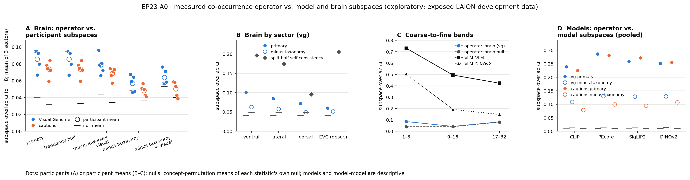

# EP23 outputs

**2026-10-13 09:50 UTC — A0 complete (exploratory). P1–P5 and A1–A3 have not
been run; A4 is inactive.**

[Figure](figures/a0_operator_alignment/20261013-attempt01/a0_operator_alignment.png) ·
[report](runs/a0_operator_alignment/20261013-attempt01/a0_report.json) ·
[result entry](experiment_log.md)

All data are LAION development data exposed in EP04 and EP22. The
prespecified primary cell is Visual Genome (VG) / `primary`. Two operators and
five statistics were evaluated.

## Findings

- **The measured operator predicts brain subspaces.**
  - The VG co-occurrence operator's leading 8-dimensional subspace overlaps
    each participant's cross-repeat brain subspace above the permutation null
    in all 5 participants. ω = 0.067–0.095 against a null of about 0.04;
    each p = 0.001; exact sign test p = 0.031.
  - This holds under a frequency-preserving null and after removing
    low-level pixel moments.
  - By sector it is strongest in ventral cortex (0.101), then lateral, then
    dorsal; EVC is weakest (descriptive).
- **The prediction is not established beyond taxonomy for VG.**
  - After projecting out the 27 THINGS categories, Δ = −0.001 to 0.018:
    3/5 participants positive, 2/5 with p < .05, sign test p = 0.50.
  - The secondary caption operator keeps a small residual: 5/5 positive,
    3/5 with p < .05.
  - So in brains, the operator's alignment at this scale is mostly shared
    category structure.
- **Brain alignment is coarse only.** It appears in modes 1–8 and is at
  chance in modes 9–16 and 17–32. Brain split-half self-consistency at
  q = 8 is only 0.10–0.20, so the fine bands and the beyond-taxonomy result
  are limited by measurement.
- **Models align beyond taxonomy (descriptive).**
  - Pooled ω is 0.24–0.29 against a null of 0.011, and stays at 0.11–0.13
    after removing taxonomy, for CLIP, PEcore, SigLIP2 and image-only
    DINOv2.
  - Model–model agreement falls from coarse to fine bands:
    - VLM–VLM: 0.69–0.75 in modes 1–8, down to 0.39–0.46 in modes 17–32;
    - VLM–DINOv2: 0.49–0.53, down to 0.14–0.16.
- **Compute.** About 2.55 CPU-hours of the 64 budgeted, and no GPU.

## Interpretation

There is a shared-statistics signal at coarse scales. In models it goes beyond
categories. In brains it reduces mostly to categories at this measurement
reliability.

The surviving alternatives are measurement reliability and experience
mismatch; neither is identified. A confirmation (A4) would need an
independent source with ≥5 participants.

## Documents

| Document | Content |
| --- | --- |
| [GOAL.md](../GOAL.md) | Question, propositions P1–P5, analyses A0–A4, competing accounts and claim boundary |
| [DATASETS.md](../DATASETS.md) | LAION development roles, A2 labels, operator sources and caveats, confirmation candidates |
| [SEARCH_POLICY.yaml](../SEARCH_POLICY.yaml) | Frozen A0 specification, budget, stop rules and terminal classes |
| [astra/v0.0.14/astra.yaml](astra/v0.0.14/astra.yaml) | Experiment program; validated 2026-10-13 |
| [design/](design/) | Literature verification and the operator novelty and source audits |
| [code/](code/) | Feasibility, A0 operator, brain-pattern, alignment and plot scripts, with sbatch files |
| [experiment_log.md](experiment_log.md) | Design record, Codex delegations, the freeze, audits, jobs and results |

Superseded but kept: `runs/a0_operator_alignment/20261013-attempt01/operators/`
is the operator build from before the caption audit. The alignment used
`operators_audited/`.
