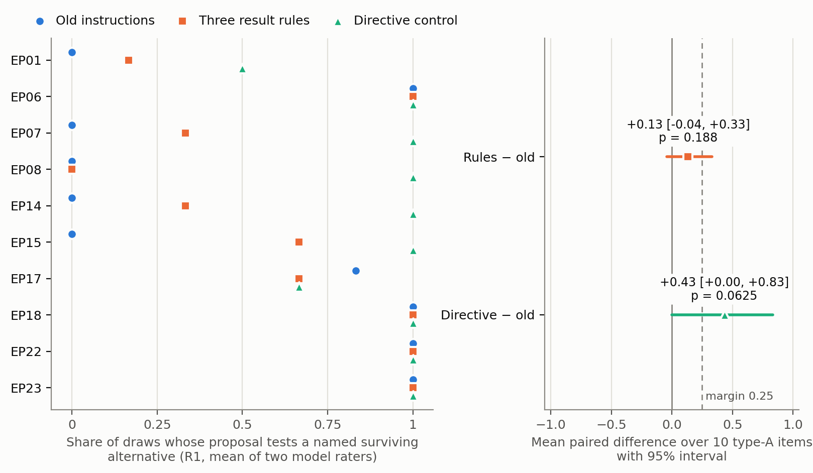

# EP24 arm comparison, attempt001 — three lines

1. Ten primary decision points were tested, with 3 draws per arm, scored by two model raters. On them, the three result rules raised the share of next-action proposals that test a named surviving alternative by +0.13 (95% interval −0.04 to +0.33; exact sign-flip p = 0.19). That is below the prespecified 0.25 margin.
2. The directive positive control reached +0.43 (interval 0.00 to +0.83; p = 0.0625) and also missed p < 0.05. Under the old instructions, proposals already tested the alternative in nearly every draw for 5 of the 10 items. With so few movable items, the exact test cannot reach significance, so the frozen rule classifies the comparison as underidentified, not as a null.
3. Secondary results, not confirmatory: rule-arm proposals more often named an outcome that would weaken a keyed explanation (R2 +0.33, p = 0.008). They also named their result in advance (R5 +0.47) and required a known-positive control before reading a null (R6 +0.91). Boundary failures did not rise (3.5 vs 5.0 rater-mean), and neither did cost (+0.03). All scores come from two model raters (R1 κ = 0.92), not human ratings.

Details: [report](../../arm_comparison/results/attempt001/report.md) ·
[analysis.json](../../arm_comparison/results/attempt001/analysis.json) ·
[per-item table](../../arm_comparison/results/attempt001/per_item.csv).
