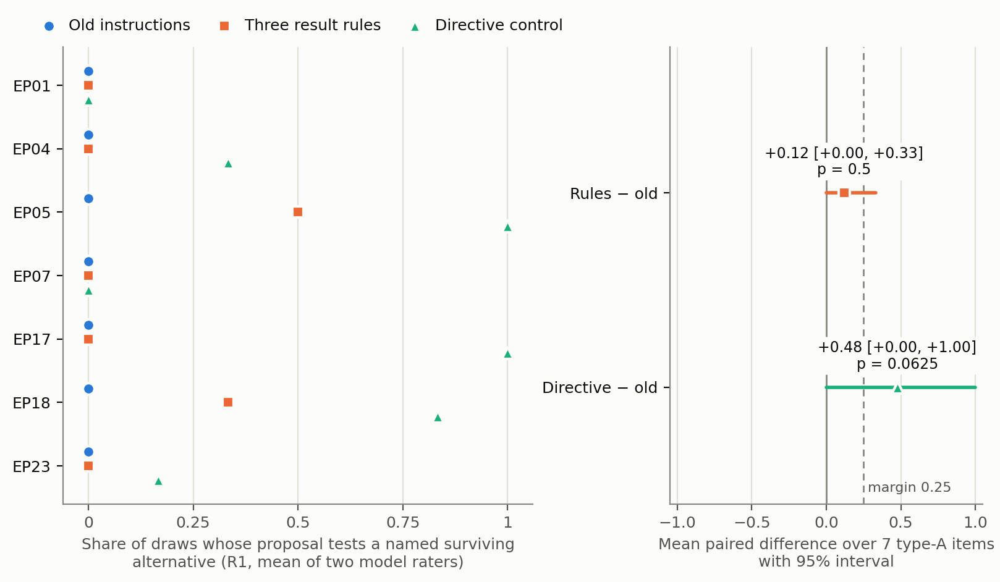

# EP24 arm comparison, attempt002 — three lines

1. Seven resume points were taken from episode logs. There, no old-instruction proposal was scored as testing the named alternative (R1 = 0 on every item). The mean paired difference for the three result rules was +0.12 (95% interval 0.00 to +0.33; exact sign-flip p = 0.5), with a positive item-mean difference on 2 of 7 items.
2. The directive positive control's difference was +0.48 (interval 0.00 to +1.00; p = 0.0625), positive on 5 of 7 items. With five informative items the exact test cannot reach p < 0.05, so under the frozen rule the comparison is underidentified. Under the directive, EP01 and EP07 still scored 0.
3. Secondary, descriptive measures follow. Rule-arm proposals more often named the result and weakening outcomes in advance (R5 +0.53, on the 5 items where both arms proposed new analysis). Rater-mean boundary failures were 4.0 under the rules vs 3.5 under the old instructions: EP18 added 2.0 and EP07 offset 1.5. All scores come from two model raters with arm labels withheld (R1 κ = 0.75), not from human ratings. The floor was lowered from 8 to 7 after screening, before any attempt002 new- or directive-arm proposal existed.

Details: [report](../../arm_comparison/results/attempt002/report.md) ·
[analysis.json](../../arm_comparison/results/attempt002/analysis.json) ·
[per-item table](../../arm_comparison/results/attempt002/per_item.csv).
