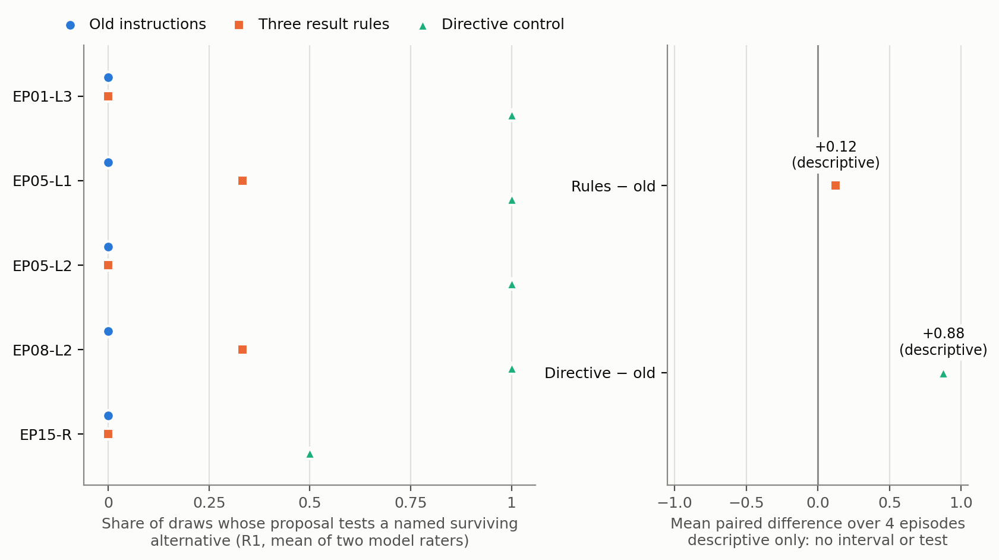

# EP24 arm comparison, attempt003 gap items — three lines (descriptive only)

1. This descriptive look covers 5 decision points in 4 episodes. They were retained on separate screening draws because old-instruction proposals had R1 ≤ 0.25 and directive proposals had R1 ≥ 0.75. The fresh draws were 3 per item per arm. In them, the mean over items of the model-rated share testing a testable named alternative was 0.00 under the old instructions, 0.13 with the three result rules added, and 0.90 with the explicit directive added.
2. Episode-weighted, the rules' difference from old was +0.125 and the directive's +0.875, a ratio of about one seventh. The rules' difference was positive on 2 of 5 items (EP05-L1, EP08-L2) and the directive's on all 5. Both model raters give exactly +0.125 for the rules.
3. On these selected items, rule-arm proposals had higher mean scores on two framing measures than on R1. Naming the result and weakening outcomes in advance (R5) rose +0.89 on the 3 items with paired scores. Requiring a positive control before reading a null (R6) rose +0.75 on 2 null items in one episode. Rater-mean boundary failures were 0.0 old, 1.0 rules and 2.0 directive, out of 15 proposals each. These are effect sizes only, with no test, interval or decision.

Details: [report](../../arm_comparison/results/attempt003/report.md) ·
[descriptive.json](../../arm_comparison/results/attempt003/descriptive.json) ·
[per-item table](../../arm_comparison/results/attempt003/per_item.csv).
